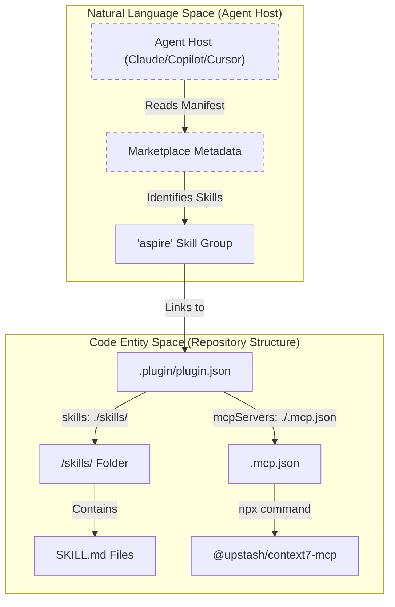
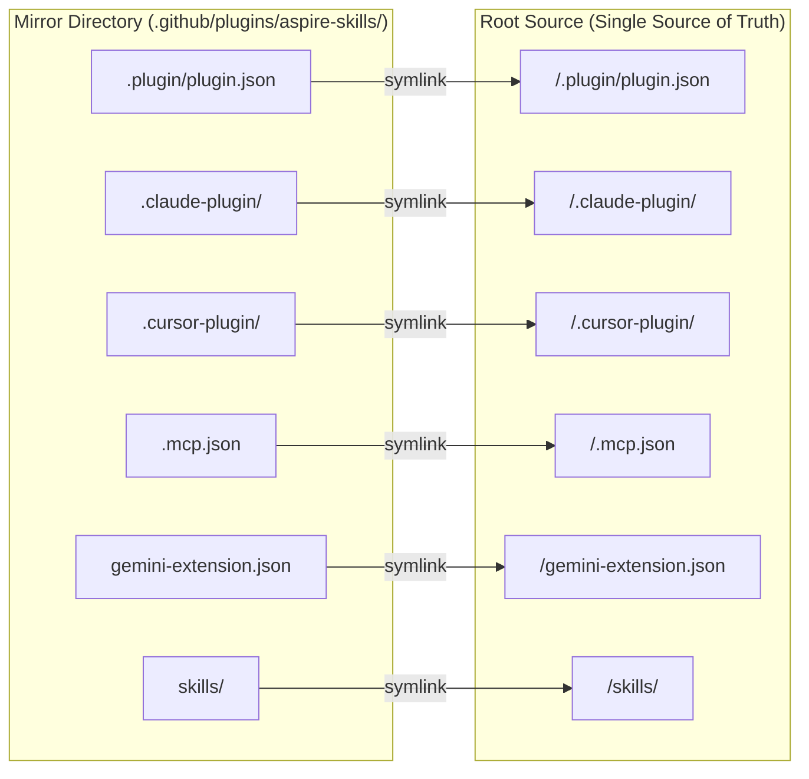

<!-- source: DeepWiki mcp.deepwiki.com · repo microsoft/aspire-skills · page 1.2 Plugin Architecture & Manifest Files · fetched 2026-10-26 -->

# Plugin Architecture & Manifest Files

Relevant source files

The following files were used as context for generating this wiki page:

- [.claude-plugin/marketplace.json](.claude-plugin/marketplace.json)
- [.claude-plugin/plugin.json](.claude-plugin/plugin.json)
- [.cursor-plugin/marketplace.json](.cursor-plugin/marketplace.json)
- [.github/plugins/aspire-skills/.claude-plugin/marketplace.json](.github/plugins/aspire-skills/.claude-plugin/marketplace.json)
- [.github/plugins/aspire-skills/.claude-plugin/plugin.json](.github/plugins/aspire-skills/.claude-plugin/plugin.json)
- [.github/plugins/aspire-skills/.cursor-plugin/marketplace.json](.github/plugins/aspire-skills/.cursor-plugin/marketplace.json)
- [.github/plugins/aspire-skills/.mcp.json](.github/plugins/aspire-skills/.mcp.json)
- [.github/plugins/aspire-skills/.plugin/plugin.json](.github/plugins/aspire-skills/.plugin/plugin.json)
- [.github/plugins/aspire-skills/README.md](.github/plugins/aspire-skills/README.md)
- [.github/plugins/aspire-skills/gemini-extension.json](.github/plugins/aspire-skills/gemini-extension.json)
- [.mcp.json](.mcp.json)
- [.plugin/plugin.json](.plugin/plugin.json)
- [README.md](README.md)
- [gemini-extension.json](gemini-extension.json)

The `aspire-skills` repository utilizes a multi-manifest architecture to support a wide variety of AI agent hosts, including GitHub Copilot, Claude Code, Gemini, and Cursor. This architecture ensures that the six core skills (aspire, aspire-init, aspireify, aspire-orchestration, aspire-deployment, and aspire-monitoring) are correctly discovered and indexed by different agent marketplaces.

## Plugin Manifest System

The system relies on a set of metadata files located in the root directory. These manifests define the plugin's identity, versioning, and the location of the skill logic.

### Manifest Types and Roles

| Manifest File | Target Host / Purpose | Key Configuration |
| :--- | :--- | :--- |
| `.plugin/plugin.json` | General agent plugin metadata | Points to `skills/` and `.mcp.json` [.plugin/plugin.json:21-22]() |
| `.claude-plugin/plugin.json` | Anthropic Claude Code | Defines author and repository links [.claude-plugin/plugin.json:5-10]() |
| `.claude-plugin/marketplace.json` | Claude Marketplace indexing | Includes category `developer-tools` and tags [.claude-plugin/marketplace.json:24-41]() |
| `.cursor-plugin/marketplace.json` | Cursor AI | Defines plugin source and tags [.cursor-plugin/marketplace.json:14-41]() |
| `gemini-extension.json` | Google Gemini CLI | Configures MCP servers for context [.gemini-extension.json:5-10]() |
| `.mcp.json` | Model Context Protocol (MCP) | Configures `stdio` based MCP servers like `context7` [.mcp.json:2-8]() |

### Data Flow: Manifest to Agent

The following diagram illustrates how the manifests bridge the "Natural Language Space" (Agent prompts) to the "Code Entity Space" (Skill files).

**Plugin Discovery and Routing Flow**

**Sources:**
- [.plugin/plugin.json:1-23]()
- [.claude-plugin/plugin.json:1-23]()
- [.mcp.json:1-9]()
- [gemini-extension.json:1-12]()

## Mirroring Strategy

To facilitate marketplace publishing while maintaining a single source of truth, the repository uses a mirroring strategy under `.github/plugins/aspire-skills/`.

### The Published Plugin Mirror
The directory `.github/plugins/aspire-skills/` acts as a staging area for distribution. All critical files in this directory are **symlinks** pointing back to the root of the repository [.github/plugins/aspire-skills/README.md:4-4](). This allows marketplace crawlers to find a clean sub-directory containing only plugin-related files without including repository-level noise like CI configurations or evaluation scripts.

**Mirror Structure Mapping**

**Sources:**
- [.github/plugins/aspire-skills/README.md:1-23]()
- [README.md:93-94]()

## Version Synchronization

The `aspire-skills` plugin enforces strict version synchronization across all manifest files to ensure consistent behavior across different agent hosts. 

### Synchronization Enforcement
The current version (e.g., `0.0.1`) is hardcoded into every manifest file:
- `.plugin/plugin.json` [.plugin/plugin.json:4-4]()
- `.claude-plugin/plugin.json` [.claude-plugin/plugin.json:4-4]()
- `.claude-plugin/marketplace.json` [.claude-plugin/marketplace.json:16-16]()
- `.cursor-plugin/marketplace.json` [.cursor-plugin/marketplace.json:16-16]()
- `gemini-extension.json` [gemini-extension.json:3-3]()

### Build and Bundle Process
The `npm run bundle` command (defined as `scripts/build-aspire-skills-bundle.mjs`) is responsible for packaging the plugin into a `.tgz` file for release [README.md:99-103](). During the PR review process, automated checks verify that the version string and Aspire version alignment (currently aligned with Aspire 13.4) are consistent across all metadata files [.plugin/plugin.json:3-3]().

**Sources:**
- [README.md:99-103]()
- [.plugin/plugin.json:1-4]()
- [.claude-plugin/marketplace.json:1-16]()

---

