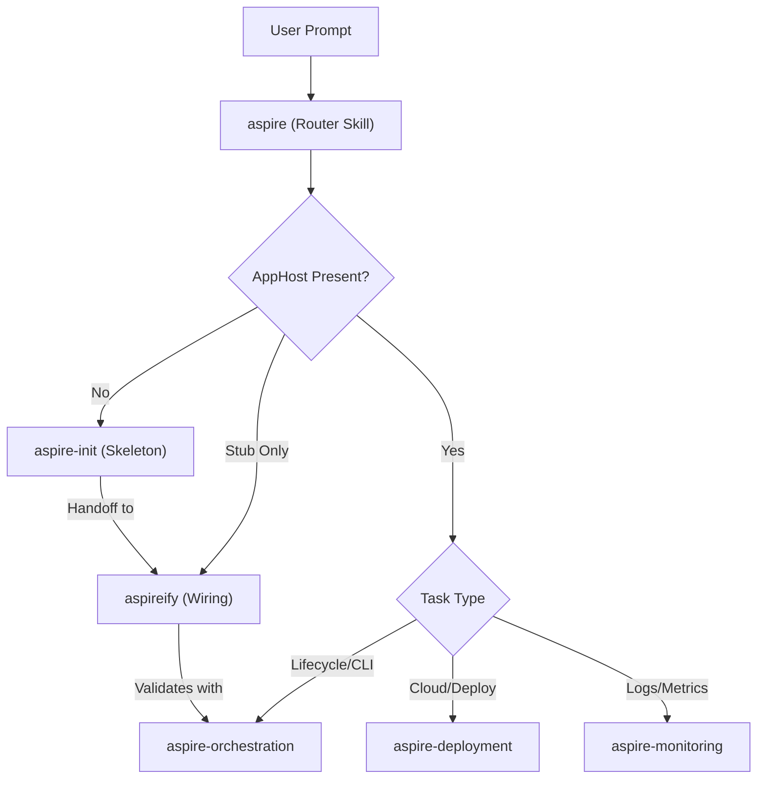
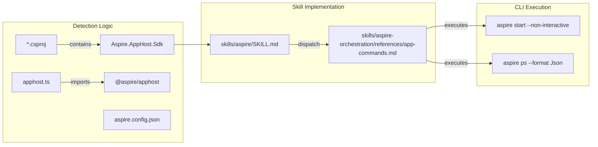

<!-- source: DeepWiki mcp.deepwiki.com · repo microsoft/aspire-skills · page 2 Skill System · fetched 2026-10-26 -->

# Skill System

Relevant source files

The following files were used as context for generating this wiki page:

- [.github/plugins/aspire-skills/skills/aspire/SKILL.md](.github/plugins/aspire-skills/skills/aspire/SKILL.md)
- [CHANGELOG.md](CHANGELOG.md)
- [skills/aspire-orchestration/references/app-commands.md](skills/aspire-orchestration/references/app-commands.md)
- [skills/aspire-orchestration/references/detection.md](skills/aspire-orchestration/references/detection.md)
- [skills/aspire/SKILL.md](skills/aspire/SKILL.md)

The `aspire-skills` plugin is built on a six-skill architecture designed to handle the full lifecycle of a .NET Aspire distributed application. A central router skill (`aspire`) manages initial detection and dispatches tasks to specialized sub-skills based on the user's intent and the current state of the repository.

### High-Level Architecture

The system transitions from "Natural Language Space" (user prompts) to "Code Entity Space" (CLI commands and file mutations) through a tiered routing model.

**Skill Dispatch Flow**

**Sources:** [skills/aspire/SKILL.md:46-51](), [skills/aspire/SKILL.md:74-84]()

### The SKILL.md Format

Each skill is defined by a `SKILL.md` file that serves as the primary contract for AI agents. This format includes:
*   **Frontmatter**: Contains the skill `name`, a `**WORKFLOW SKILL**` description, `USE FOR` / `DO NOT USE FOR` triggers, and `INVOKES` relationships [skills/aspire/SKILL.md:1-21]().
*   **Detection Rules**: A tabular mapping of file signals (e.g., `Aspire.AppHost.Sdk` in `.csproj`) to confidence levels and scope [skills/aspire/SKILL.md:29-44]().
*   **Safety Guardrails**: Strict rules (e.g., "Always use `--non-interactive`", "Never edit `.aspire/modules/` directly") to prevent agent self-harm [skills/aspire/SKILL.md:59-72]().

### Project-Local Overrides

The system supports project-local overrides to allow repository-specific logic to take precedence over the global plugin. If a repository contains `.agents/skills/<skill-name>/SKILL.md`, the router is instructed to defer to that local version [skills/aspire-orchestration/references/app-commands.md:44-47]().

---

### Core Sub-Skills

#### [aspire (Router Skill)](#2.1)
The entry point for all Aspire-related tasks. It identifies the AppHost type (C#, File-based C#, or TypeScript) and enforces the default workflow, such as ensuring `aspire start` is used instead of `dotnet run`.
*   **Key Signal**: `Aspire.AppHost.Sdk` or `apphost.ts` [skills/aspire/SKILL.md:36-38]().
*   **For details, see [aspire (Router Skill)](#2.1).**

#### [aspire-init (Skeleton Drop Skill)](#2.2)
Handles the "Day 0" experience. It uses `aspire new` for greenfield projects or `aspire init` to add Aspire to existing repositories. It generates the initial `aspire.config.json` and hands off to `aspireify` [skills/aspire/SKILL.md:88-92]().
*   **For details, see [aspire-init (Skeleton Drop Skill)](#2.2).**

#### [aspireify (AppHost Wiring Skill)](#2.3)
An agentic skill that wires the AppHost resource graph. It scans the repo for services (Node.js, Python, .NET), proposes integrations (Postgres, Redis), and edits the AppHost code using the appropriate API tiers [skills/aspire-orchestration/references/app-commands.md:48-58]().
*   **For details, see [aspireify (AppHost Wiring Skill)](#2.3).**

#### [aspire-orchestration (Lifecycle Skill)](#2.4)
Manages the local runtime environment. This skill owns commands like `aspire start`, `aspire stop`, and `aspire wait`, as well as resource-specific commands and file-lock recovery logic [skills/aspire-orchestration/references/app-commands.md:5-17]().
*   **For details, see [aspire-orchestration (Lifecycle Skill)](#2.4).**

#### [aspire-deployment (Deployment Skill)](#2.5)
Governs the transition to the cloud. It manages the 10-step deployment workflow, distinguishing between `aspire publish` (manifest generation) and `aspire deploy` (infrastructure provisioning) [CHANGELOG.md:15-22]().
*   **For details, see [aspire-deployment (Deployment Skill)](#2.5).**

#### [aspire-monitoring (Observability Skill)](#2.6)
Provides deep visibility into distributed applications. It routes between local CLI diagnostics, the Aspire Dashboard, and cloud-native providers like Azure Monitor or OpenTelemetry traces [skills/aspire/SKILL.md:108-111]().
*   **For details, see [aspire-monitoring (Observability Skill)](#2.6).**

---

### Code Entity Mapping

The following diagram maps high-level architectural concepts to the specific code entities and files that implement them.

**Entity Mapping: Detection to Execution**

**Sources:** [skills/aspire-orchestration/references/detection.md:7-56](), [skills/aspire-orchestration/references/app-commands.md:7-17](), [skills/aspire-orchestration/references/app-commands.md:85-98]()

---

