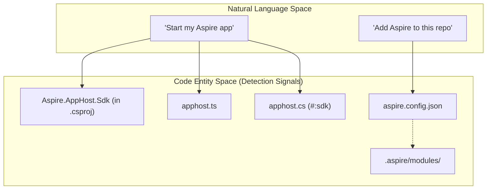
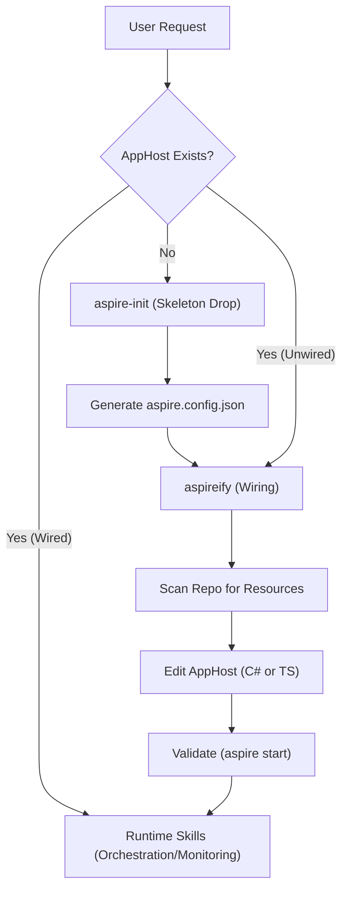

<!-- source: DeepWiki mcp.deepwiki.com · repo microsoft/aspire-skills · page 2.1 aspire (Router Skill) · fetched 2026-10-26 -->

# aspire (Router Skill)

Relevant source files

The following files were used as context for generating this wiki page:

- [.github/plugins/aspire-skills/skills/aspire/references/aspire-13-3-breaking-changes.md](.github/plugins/aspire-skills/skills/aspire/references/aspire-13-3-breaking-changes.md)
- [evals/ts-apphost/.modules/postgres.module.ts](evals/ts-apphost/.modules/postgres.module.ts)
- [skills/aspire-orchestration/references/app-commands.md](skills/aspire-orchestration/references/app-commands.md)
- [skills/aspire-orchestration/references/detection.md](skills/aspire-orchestration/references/detection.md)
- [skills/aspire-orchestration/references/safety-guardrails.md](skills/aspire-orchestration/references/safety-guardrails.md)
- [skills/aspire/SKILL.md](skills/aspire/SKILL.md)
- [skills/aspire/references/aspire-13-3-breaking-changes.md](skills/aspire/references/aspire-13-3-breaking-changes.md)

The `aspire` skill serves as the top-level entry point and workflow router for the Aspire skills plugin. It is responsible for detecting the presence of a .NET Aspire AppHost, enforcing safety guardrails, and dispatching tasks to the appropriate specialized sub-skills (`aspire-init`, `aspireify`, `aspire-orchestration`, `aspire-deployment`, or `aspire-monitoring`) [skills/aspire/SKILL.md:4-15]().

## Detection Logic

The router uses a multi-tiered detection strategy to identify Aspire projects and determine their current state (e.g., greenfield, skeleton-only, or fully wired).

### Detection Signal Table

| Signal | Indicator | Confidence | Target Scope |
| :--- | :--- | :--- | :--- |
| **C# AppHost** | `.csproj` containing `Aspire.AppHost.Sdk` | ✅ Definitive | Orchestration / Deployment / Monitoring |
| **File-based C# AppHost** | `apphost.cs` with `#:sdk Aspire.AppHost.Sdk` | ✅ Definitive | Orchestration / Deployment / Monitoring |
| **TypeScript AppHost** | `apphost.ts` file present | ✅ Definitive | Orchestration / Deployment / Monitoring |
| **Aspire Config (No Host)** | `aspire.config.json` present **without** AppHost | High | Bootstrap → `aspireify` |
| **Aspire Config (With Host)**| `aspire.config.json` present **with** AppHost | High | Orchestration / Deployment / Monitoring |
| **Generated Modules** | `.aspire/modules/` directory present | High | AppHost present (TS) |
| **Service Defaults** | `Aspire.ServiceDefaults` project reference | Medium | AppHost present elsewhere |
| **Missing AppHost** | None of the above | n/a | Bootstrap → `aspire-init` |

**Sources**: [skills/aspire/SKILL.md:34-45](), [skills/aspire-orchestration/references/detection.md:7-91]()

### Natural Language to Code Entity Space: Detection

The following diagram illustrates how natural language requests are mapped to specific file-system signals and code entities to trigger the router.

**Sources**: [skills/aspire-orchestration/references/detection.md:7-91](), [skills/aspire/SKILL.md:34-45]()

## Routing Decision Table

Once an Aspire environment is detected, the `aspire` skill routes the request based on the specific task requested by the user or required by the workflow.

| Task Category | Trigger Keywords | Target Skill |
| :--- | :--- | :--- |
| **Bootstrapping** | `new`, `init`, "add aspire" | `aspire-init` |
| **Scaffolding** | `wire`, `scaffold`, `integration search`, `add` | `aspireify` |
| **Lifecycle** | `start`, `stop`, `wait`, `restart`, `rebuild`, `ps` | `aspire-orchestration` |
| **Deployment** | `deploy`, `publish`, `destroy`, `pipeline` | `aspire-deployment` |
| **Observability** | `logs`, `otel`, `traces`, `dashboard`, `describe` | `aspire-monitoring` |

**Sources**: [skills/aspire/SKILL.md:76-84](), [skills/aspire-orchestration/references/app-commands.md:27-101]()

## Data Flow & Handoff

The router enforces a strict handoff sequence, particularly during the initial setup of a project.

### Bootstrap Workflow Flowchart

**Sources**: [skills/aspire/SKILL.md:46-57](), [skills/aspire-orchestration/references/app-commands.md:38-58]()

## Project-Local Override Mechanism

The `aspire` skill supports a project-local override mechanism. When `aspire init` is run, it may install a local version of the `aspireify` skill into the `.agents/skills/` directory of the target repository [skills/aspire-orchestration/references/app-commands.md:44-46]().

*   **Priority**: If a project-local `.agents/skills/aspireify/SKILL.md` exists, the router **must** defer to it over the built-in plugin skill [skills/aspire-orchestration/references/app-commands.md:45-46]().
*   **Purpose**: This allows repository-specific scaffolding rules and integration patterns to take precedence over generic plugin logic.

## Safety Guardrails

The router enforces critical safety rules to prevent "agent self-harm" (e.g., resource exhaustion or file-lock deadlocks).

1.  **Always `aspire start`**: Never use `dotnet run` on AppHosts. `dotnet run` bypasses the orchestration layer and fails to launch the dashboard or manage resource lifecycles [skills/aspire-orchestration/references/safety-guardrails.md:11-22]().
2.  **Always `aspire wait`**: Never use manual `curl` polling. The CLI handles internal health checks and dynamic port allocation [skills/aspire-orchestration/references/safety-guardrails.md:54-64]().
3.  **File-Lock Recovery**: If `MSB3491` or `CS2012` errors occur during build, the router mandates `aspire stop` to release locks held by the orchestrator before retrying [skills/aspire-orchestration/references/safety-guardrails.md:92-128]().
4.  **TypeScript Integrity**: Never edit `.aspire/modules/` directly. These are auto-generated from `apphost.ts` [skills/aspire/SKILL.md:72](), [evals/ts-apphost/.modules/postgres.module.ts:1-3]().

**Sources**: [skills/aspire/SKILL.md:59-72](), [skills/aspire-orchestration/references/safety-guardrails.md:1-150]()

---

