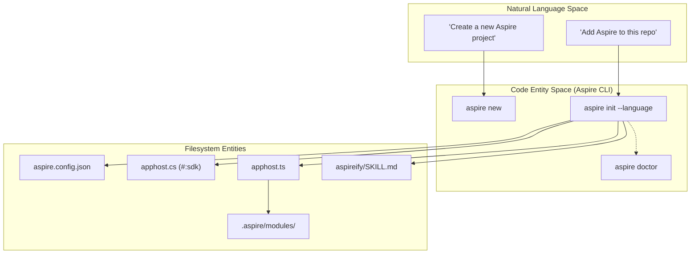
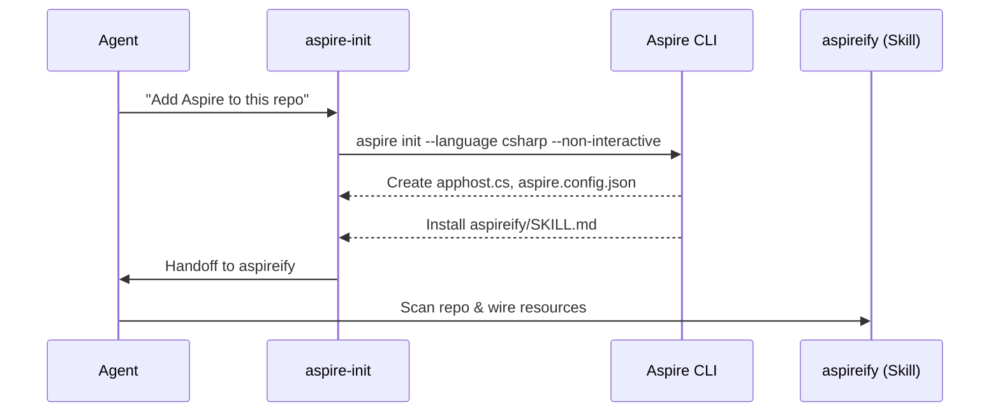

<!-- source: DeepWiki mcp.deepwiki.com · repo microsoft/aspire-skills · page 2.2 aspire-init (Skeleton Drop Skill) · fetched 2026-10-26 -->

# aspire-init (Skeleton Drop Skill)

<details>
<summary>Relevant source files</summary>

The following files were used as context for generating this wiki page:

- [.github/plugins/aspire-skills/skills/aspire-init/SKILL.md](.github/plugins/aspire-skills/skills/aspire-init/SKILL.md)
- [.github/plugins/aspire-skills/skills/aspire-init/references/init-workflow.md](.github/plugins/aspire-skills/skills/aspire-init/references/init-workflow.md)
- [.github/plugins/aspire-skills/skills/aspire-init/references/templates.md](.github/plugins/aspire-skills/skills/aspire-init/references/templates.md)
- [skills/aspire-init/SKILL.md](skills/aspire-init/SKILL.md)
- [skills/aspire-init/references/init-workflow.md](skills/aspire-init/references/init-workflow.md)
- [skills/aspire-init/references/templates.md](skills/aspire-init/references/templates.md)
- [skills/aspire-monitoring/SKILL.md](skills/aspire-monitoring/SKILL.md)

</details>


The `aspire-init` skill manages the first-run experience for adding .NET Aspire to a repository [skills/aspire-init/SKILL.md:3-6](). It handles two primary workflows: creating brand-new projects using templates (`aspire new`) and bootstrapping Aspire into existing repositories (`aspire init`) [skills/aspire-init/SKILL.md:56-64]().

## Architecture and Detection Logic

This skill is designed for **first-run only**. It is activated only when a workspace does not yet contain an Aspire AppHost [skills/aspire-init/SKILL.md:23-25]().

### Detection Signals
Before executing initialization, the skill verifies the absence of the following signals:

| Signal | Detection Method |
| :--- | :--- |
| **C# AppHost** | Absence of `.csproj` containing `Aspire.AppHost.Sdk` [skills/aspire-init/SKILL.md:46]() |
| **File-based AppHost** | Absence of `apphost.cs` with `#:sdk Aspire.AppHost.Sdk` [skills/aspire-init/SKILL.md:47]() |
| **TypeScript AppHost** | Absence of `apphost.ts` in the repository root [skills/aspire-init/SKILL.md:48]() |
| **Aspire Config** | Absence of `aspire.config.json` [skills/aspire-init/SKILL.md:49]() |

**Sources:** [skills/aspire-init/SKILL.md:39-51]()

### Natural Language to CLI Entity Mapping

This diagram bridges the user's intent to the specific Aspire CLI commands and the resulting filesystem entities.


**Sources:** [skills/aspire-init/SKILL.md:56-64](), [skills/aspire-init/references/init-workflow.md:36-56]()

## Workflow A: Greenfield (`aspire new`)

Used for brand-new projects in empty directories. It generates a full starter solution based on a template [skills/aspire-init/SKILL.md:69-71]().

### Template Selection
| Template | Language | Description |
| :--- | :--- | :--- |
| `aspire-starter` | C# | ASP.NET Core / Blazor starter [skills/aspire-init/references/templates.md:10]() |
| `aspire-ts-starter` | TypeScript | Express / React starter [skills/aspire-init/references/templates.md:13]() |
| `aspire-py-starter` | TypeScript | FastAPI / React (TS AppHost drives Python) [skills/aspire-init/references/templates.md:12]() |
| `aspire-empty` | C# | Minimal scaffold without resources [skills/aspire-init/references/templates.md:14]() |

### Execution Pattern
Agents must use the `--non-interactive` flag to suppress prompts and spinners [skills/aspire-init/references/templates.md:30]().
```bash
aspire new aspire-starter --name MyApp --output ./MyApp --non-interactive
```
**Sources:** [skills/aspire-init/SKILL.md:75-78](), [skills/aspire-init/references/templates.md:6-16]()

## Workflow B: Brownfield (`aspire init`)

Used for repositories that already contain services (e.g., Express, .NET API) and need an AppHost added alongside them [skills/aspire-init/SKILL.md:83-86]().

### The `aspire.config.json` Generation
This file is dropped at the repository root to guide subsequent tooling [skills/aspire-init/references/init-workflow.md:42]().

| Field | Description |
| :--- | :--- |
| `appHost.language` | `"csharp"` or `"typescript/nodejs"` [skills/aspire-init/references/init-workflow.md:62]() |
| `appHost.path` | Path to the AppHost file or directory [skills/aspire-init/references/init-workflow.md:63]() |

### Language-Specific Artifacts
*   **C#**: Drops `apphost.cs` using the single-file `#:sdk` directive [skills/aspire-init/references/init-workflow.md:40]().
*   **TypeScript**: Drops `apphost.ts` and generates the `.aspire/modules/` directory [skills/aspire-init/references/init-workflow.md:46-47]().

**Sources:** [skills/aspire-init/references/init-workflow.md:36-70]()

## Skill Handoff and Life Cycle

The `aspire-init` skill is a "Skeleton Drop" skill; it does not perform resource wiring itself. Instead, it prepares the environment for the `aspireify` skill [skills/aspire-init/SKILL.md:101-102]().

### Handoff Flow
1.  **Skeleton Drop**: `aspire-init` creates the AppHost and `aspire.config.json`.
2.  **Skill Installation**: `aspire init` installs the `aspireify` agent skill into the project's `.agents/skills/` (or equivalent) directory [skills/aspire-init/references/init-workflow.md:52-54]().
3.  **Handoff**: The agent transitions to the `aspireify` skill to scan the repo and wire projects/containers [skills/aspire-init/SKILL.md:111-113]().


**Sources:** [skills/aspire-init/SKILL.md:95-104](), [skills/aspire-init/references/init-workflow.md:71-91]()

## Project-Local Overrides
If a repository contains a legacy `aspire-init` skill (e.g., in `.agents/skills/aspire-init/SKILL.md`), the plugin must **defer** to the local copy and warn the user, as it may contain repo-specific instructions [skills/aspire-init/SKILL.md:120-124]().

## Error Handling and Recovery
| Symptom | Cause | Action |
| :--- | :--- | :--- |
| `AppHost already exists` | Duplicate init attempt | Route to `aspireify` or `aspire-orchestration` [skills/aspire-init/SKILL.md:134]() |
| Missing `--language` | Multiple paths available in non-interactive mode | Re-run with `--language csharp` or `typescript` [skills/aspire-init/SKILL.md:135]() |
| `aspire` command not found | CLI not installed | Install via `dotnet tool install -g Aspire.Cli` [skills/aspire-init/SKILL.md:137]() |

**Sources:** [skills/aspire-init/SKILL.md:130-137](), [skills/aspire-init/references/init-workflow.md:103-112]()

---

