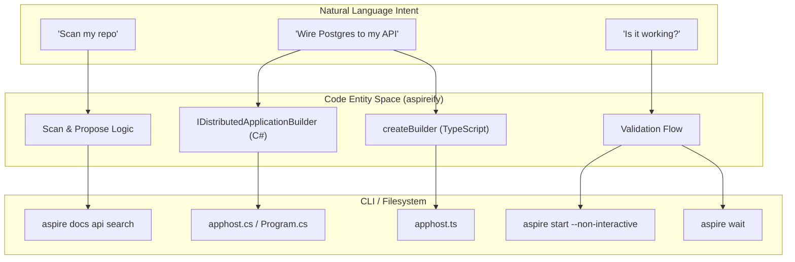
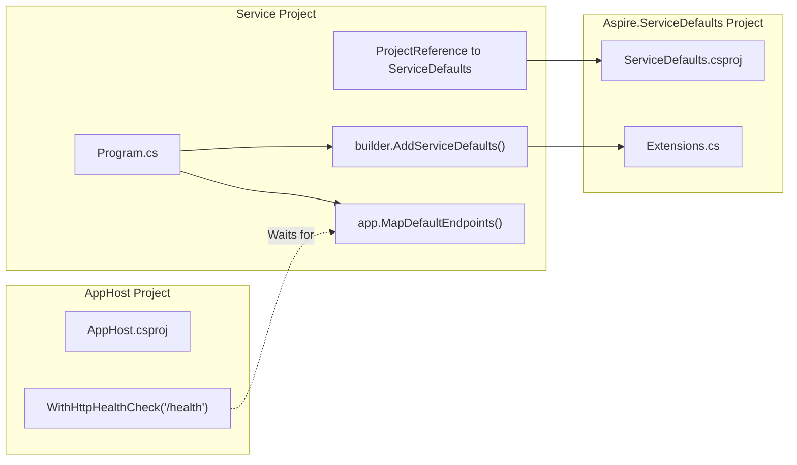

<!-- source: DeepWiki mcp.deepwiki.com · repo microsoft/aspire-skills · page 2.3 aspireify (AppHost Wiring Skill) · fetched 2026-10-26 -->

# 2.3 aspireify (AppHost Wiring Skill)

Relevant source files

The following files were used as context for generating this wiki page:

- [.gitignore](.gitignore)
- [skills/aspireify/SKILL.md](skills/aspireify/SKILL.md)
- [skills/aspireify/references/apphost-wiring.md](skills/aspireify/references/apphost-wiring.md)
- [skills/aspireify/references/full-solution-apphosts.md](skills/aspireify/references/full-solution-apphosts.md)
- [skills/aspireify/references/scan-and-propose.md](skills/aspireify/references/scan-and-propose.md)
- [skills/aspireify/references/service-defaults.md](skills/aspireify/references/service-defaults.md)
- [skills/aspireify/references/typescript-authoring.md](skills/aspireify/references/typescript-authoring.md)
- [skills/aspireify/references/validation.md](skills/aspireify/references/validation.md)

The `aspireify` skill is a one-time wiring workflow designed to transform a basic Aspire skeleton (dropped by `aspire init`) into a fully functional resource graph. It automates the process of scanning a repository, proposing a resource model, editing the AppHost code, and validating the resulting configuration.

For specific implementation patterns, see:
- [C# AppHost Authoring](#2.3.1)
- [TypeScript AppHost Authoring](#2.3.2)

## Purpose and Scope
`aspireify` handles the complexity of "wiring" after the initial skeleton is created [skills/aspireify/SKILL.md:4-7](). It is responsible for identifying .NET projects, Node.js services, and container dependencies (like Postgres or Redis) and establishing the references between them [skills/aspireify/SKILL.md:8-11]().

### 🚫 The .aspire/modules/ Guardrail
A critical constraint of this skill is the **hard refusal** to edit any files within the `.aspire/modules/` directory of a TypeScript AppHost [skills/aspireify/SKILL.md:32-37](). This directory is generated and any manual changes are clobbered during the next build or `aspire start` [skills/aspireify/references/typescript-authoring.md:9-20](). All edits must be directed to `apphost.ts` [skills/aspireify/references/typescript-authoring.md:42-48]().

## The Five-Phase Lifecycle
The skill operates through a structured five-phase workflow to ensure safety and accuracy.

### 1. Scan
The skill performs a deep inventory of the repository to find runnable projects, environment variables, and connection strings [skills/aspireify/references/scan-and-propose.md:5-17]().
- **.NET:** Scans for `.csproj` files, identifying APIs vs. Workers [skills/aspireify/references/scan-and-propose.md:23-24]().
- **JavaScript/TypeScript:** Identifies Next.js, Vite, or Node.js apps via `package.json` [skills/aspireify/references/scan-and-propose.md:25-28]().
- **Integrations:** Greps for existing connection strings (Postgres, Redis, etc.) in `.env` or `appsettings.json` [skills/aspireify/references/scan-and-propose.md:13]().

### 2. Propose
Before making edits, the skill presents a **Proposed Resource Graph** to the user [skills/aspireify/references/scan-and-propose.md:100-119](). This includes:
- Detected projects and their roles.
- Proposed references (e.g., `api` references `pg`).
- Migration strategies for existing secrets and `.env` files.

### 3. Edit
Once confirmed, the skill performs the necessary code modifications:
- **C#:** Edits `Program.cs` or `apphost.cs` using the `IDistributedApplicationBuilder` API [skills/aspireify/references/full-solution-apphosts.md:103-112]().
- **TypeScript:** Edits `apphost.ts` using the `createBuilder()` API [skills/aspireify/references/typescript-authoring.md:51-70]().
- **ServiceDefaults:** Adds the `Aspire.ServiceDefaults` project and wires `AddServiceDefaults()` and `MapDefaultEndpoints()` in service projects [skills/aspireify/references/service-defaults.md:3-41]().

### 4. Validate
The skill validates the new wiring by running the AppHost in a non-interactive mode [skills/aspireify/references/validation.md:8-23]().
- Uses `aspire start --non-interactive --format Json`.
- Uses `aspire wait <displayName>` to ensure each resource reaches a healthy state [skills/aspireify/references/validation.md:16]().
- Verifies the graph shape with `aspire describe`.

### 5. Deactivate
After successful validation, the skill self-deactivates and hands off to `aspire-orchestration` for day-to-day management [skills/aspireify/references/validation.md:66-85]().

## Integration Discovery Catalog
The skill maps detected technologies to specific Aspire hosting packages.

| Service | C# Builder Method | TypeScript Builder Method |
| :--- | :--- | :--- |
| **Postgres** | `AddPostgres("pg")` | `addPostgres('pg')` |
| **Redis** | `AddRedis("cache")` | `addRedis('cache')` |
| **RabbitMQ** | `AddRabbitMQ("mq")` | `addRabbitMQ('mq')` |
| **Next.js** | `AddNextJsApp("web")` | `addNextJsApp('web')` |

Sources: [skills/aspireify/references/scan-and-propose.md:38-74](), [skills/aspireify/references/apphost-wiring.md:17-34]().

## Architectural Mapping: Logic to Code

The following diagram bridges the natural language intent of "wiring" to the specific code entities and CLI commands used by `aspireify`.

### Wiring Workflow Entity Map

Sources: [skills/aspireify/SKILL.md:15-16](), [skills/aspireify/references/apphost-wiring.md:52-60](), [skills/aspireify/references/validation.md:10-16]().

### ServiceDefaults Integration Map

Sources: [skills/aspireify/references/service-defaults.md:7-41](), [skills/aspireify/references/service-defaults.md:54-68]().

## Project-Local Overrides
If a project contains a local `.agents/skills/aspireify/SKILL.md`, the plugin will warn the user and defer to the local version, allowing for project-specific wiring rules [skills/aspireify/SKILL.md:106-115]().

Sources:
- [skills/aspireify/SKILL.md:1-140]()
- [skills/aspireify/references/typescript-authoring.md:1-206]()
- [skills/aspireify/references/scan-and-propose.md:1-122]()
- [skills/aspireify/references/validation.md:1-98]()
- [skills/aspireify/references/service-defaults.md:1-115]()
- [skills/aspireify/references/apphost-wiring.md:1-148]()
- [skills/aspireify/references/full-solution-apphosts.md:1-150]()

---

