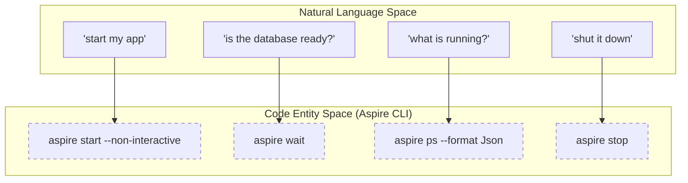
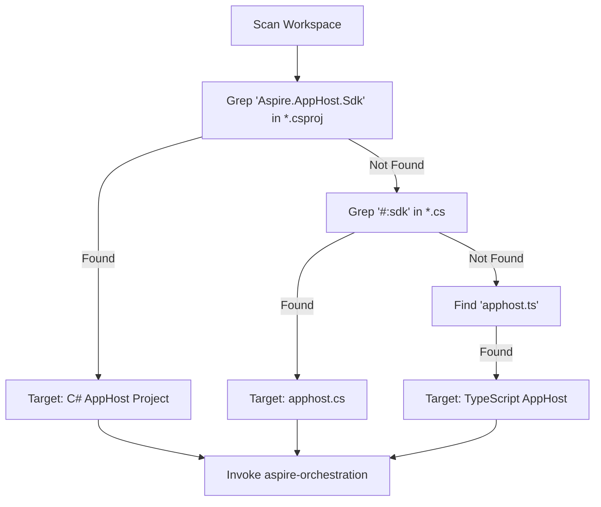

<!-- source: DeepWiki mcp.deepwiki.com · repo microsoft/aspire-skills · page 2.4 aspire-orchestration (Lifecycle Skill) · fetched 2026-10-26 -->

# aspire-orchestration (Lifecycle Skill)

Relevant source files

The following files were used as context for generating this wiki page:

- [.github/plugins/aspire-skills/skills/aspire-orchestration/references/safety-guardrails.md](.github/plugins/aspire-skills/skills/aspire-orchestration/references/safety-guardrails.md)
- [evals/ts-apphost/.modules/postgres.module.ts](evals/ts-apphost/.modules/postgres.module.ts)
- [skills/aspire-orchestration/SKILL.md](skills/aspire-orchestration/SKILL.md)
- [skills/aspire-orchestration/references/agent-workflows.md](skills/aspire-orchestration/references/agent-workflows.md)
- [skills/aspire-orchestration/references/app-commands.md](skills/aspire-orchestration/references/app-commands.md)
- [skills/aspire-orchestration/references/detection.md](skills/aspire-orchestration/references/detection.md)
- [skills/aspire-orchestration/references/resource-management.md](skills/aspire-orchestration/references/resource-management.md)
- [skills/aspire-orchestration/references/safety-guardrails.md](skills/aspire-orchestration/references/safety-guardrails.md)
- [skills/aspire/SKILL.md](skills/aspire/SKILL.md)

The `aspire-orchestration` skill is a **workflow skill** responsible for managing the lifecycle of Aspire applications. It handles starting, stopping, and inspecting the AppHost and its constituent resources, while enforcing safety guardrails to prevent common agent failures such as file locks and orphaned processes [skills/aspire-orchestration/SKILL.md:1-11]().

## Lifecycle Management Commands

The skill primarily interfaces with the Aspire CLI to manage the AppHost state.

| Task | Command | Description |
|------|---------|-------------|
| **Start (Background)** | `aspire start` | Preferred for AI agents; runs the AppHost in detached mode [skills/aspire-orchestration/references/app-commands.md:13-24](). |
| **Start (Foreground)** | `aspire run` | Interactive mode with terminal dashboard; used by humans [skills/aspire-orchestration/references/app-commands.md:19-23](). |
| **Stop** | `aspire stop` | Cleanly shuts down all resources and releases file locks/ports [skills/aspire-orchestration/references/app-commands.md:16-16](). |
| **Wait** | `aspire wait <resource>` | Blocks until a resource is ready; prevents race conditions [skills/aspire-orchestration/references/resource-management.md:5-10](). |
| **Inspect** | `aspire ps` / `aspire describe` | Lists resources and their current status [skills/aspire-orchestration/SKILL.md:85-86](). |

### Isolated Mode for Worktrees
When working in a git worktree or environments where multiple instances might overlap, agents must use `aspire start --isolated` [skills/aspire-orchestration/references/app-commands.md:9-14](). This prevents port conflicts and ensures the instance uses its own local state [skills/aspire-orchestration/references/agent-workflows.md:7-11]().

### Resource Management Flow
The following diagram illustrates the transition from natural language requests to specific Aspire CLI orchestration commands.

**Orchestration Command Mapping**

Sources: [skills/aspire-orchestration/SKILL.md:79-85](), [skills/aspire-orchestration/references/app-commands.md:5-17](), [skills/aspire-orchestration/references/safety-guardrails.md:34-42]()

## Safety Guardrails

To prevent "agent self-harm" (Issue [#15801](https://github.com/microsoft/aspire/issues/15801)), the skill enforces strict operational rules [skills/aspire-orchestration/references/safety-guardrails.md:5-7]().

### 1. File-Lock Recovery (MSB3491 / CS2012)
A common failure occurs when an agent attempts `dotnet build` while the AppHost is running. Aspire holds locks on `bin/` and `obj/` directories [skills/aspire-orchestration/references/safety-guardrails.md:94-107]().
*   **Symptom**: Errors `MSB3491` (Could not write to output file) or `CS2012` (Cannot open for writing) [skills/aspire-orchestration/SKILL.md:120-121]().
*   **Mandatory Recovery**: Run `aspire stop` immediately to release locks before retrying the build [skills/aspire-orchestration/SKILL.md:106-106](), [skills/aspire-orchestration/references/safety-guardrails.md:113-117]().

### 2. The `aspire wait` Pattern
Agents must never use `curl` or HTTP polling to check if a service is up.
*   **Why**: Aspire assigns dynamic ports and manages dependency ordering [skills/aspire-orchestration/references/safety-guardrails.md:56-63]().
*   **Requirement**: Use `aspire wait <resource-name>` [skills/aspire-orchestration/references/safety-guardrails.md:68-72](). Note: Use the `displayName` from `aspire ps --format Json` for the resource name [skills/aspire-orchestration/SKILL.md:112-112]().

### 3. Background Execution
Agents must **always** use `aspire start` rather than `aspire run` to avoid blocking the terminal execution thread [skills/aspire-orchestration/references/app-commands.md:17-17](), [skills/aspire-orchestration/references/safety-guardrails.md:42-42]().

Sources: [skills/aspire-orchestration/SKILL.md:102-121](), [skills/aspire-orchestration/references/safety-guardrails.md:1-137]()

## Detection Logic

The skill identifies Aspire projects by scanning for definitive markers.

| Signal | Marker | File Context |
|--------|--------|--------------|
| **C# AppHost** | `Aspire.AppHost.Sdk` | `.csproj` [skills/aspire-orchestration/references/detection.md:7-15]() |
| **File-based C#** | `#:sdk Aspire.AppHost.Sdk` | `apphost.cs` [skills/aspire-orchestration/references/detection.md:28-36]() |
| **TypeScript AppHost** | `apphost.ts` | Project root [skills/aspire-orchestration/references/detection.md:47-53]() |
| **Config** | `aspire.config.json` | Project root [skills/aspire-orchestration/references/detection.md:65-72]() |

**Detection and Dispatch Flow**

Sources: [skills/aspire-orchestration/references/detection.md:95-121](), [skills/aspire/SKILL.md:29-45]()

## Resource Operations

Instead of restarting the entire AppHost for minor code changes, agents are encouraged to use resource-scoped commands.

*   **Resource Commands**: `aspire resource <name> <command>` (e.g., `stop`, `start`, `rebuild`) [skills/aspire-orchestration/references/resource-management.md:19-23]().
*   **Hot Reload/Watch**: If a resource (like a Vite or Next.js frontend) supports HMR, the agent should defer to the framework's native watch behavior rather than restarting the resource via Aspire [skills/aspire-orchestration/references/agent-workflows.md:53-58]().
*   **Inspection**: `aspire describe --include-hidden` is used to see internal proxies and migration helpers that are normally filtered from the standard view [skills/aspire-orchestration/SKILL.md:86-86]().

Sources: [skills/aspire-orchestration/references/resource-management.md:1-39](), [skills/aspire-orchestration/references/agent-workflows.md:26-59]()

## Maintenance and Upgrades

The skill handles CLI and project maintenance:
*   **`aspire update --self`**: Upgrades the Aspire CLI binary (NativeAOT or script-based) [skills/aspire-orchestration/references/app-commands.md:89-89]().
*   **`aspire update`**: Updates NuGet/NPM package references within the project (requires user approval) [skills/aspire-orchestration/references/app-commands.md:90-98]().
*   **`aspire doctor`**: Diagnoses environment issues like missing SDKs or Docker daemon unavailability [skills/aspire-orchestration/SKILL.md:96-96](), [skills/aspire-orchestration/SKILL.md:115-115]().
*   **`aspire restore`**: Regenerates `.aspire/modules/` for TypeScript projects if they are missing [skills/aspire-orchestration/references/app-commands.md:91-99]().

Sources: [skills/aspire-orchestration/SKILL.md:77-101](), [skills/aspire-orchestration/references/app-commands.md:84-101]()

---

