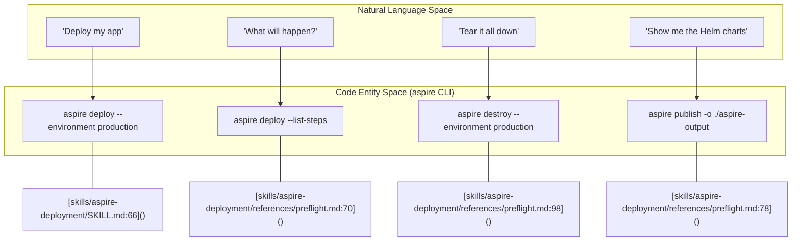
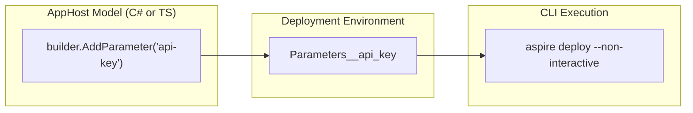

<!-- source: DeepWiki mcp.deepwiki.com · repo microsoft/aspire-skills · page 2.5 aspire-deployment (Deployment Skill) · fetched 2026-10-26 -->

# aspire-deployment (Deployment Skill)

Relevant source files

The following files were used as context for generating this wiki page:

- [.github/CODEOWNERS](.github/CODEOWNERS)
- [skills/aspire-deployment/SKILL.md](skills/aspire-deployment/SKILL.md)
- [skills/aspire-deployment/references/aws.md](skills/aspire-deployment/references/aws.md)
- [skills/aspire-deployment/references/azure.md](skills/aspire-deployment/references/azure.md)
- [skills/aspire-deployment/references/cicd.md](skills/aspire-deployment/references/cicd.md)
- [skills/aspire-deployment/references/docker-compose.md](skills/aspire-deployment/references/docker-compose.md)
- [skills/aspire-deployment/references/github-actions-azure-csharp.yml](skills/aspire-deployment/references/github-actions-azure-csharp.yml)
- [skills/aspire-deployment/references/github-actions-azure-typescript.yml](skills/aspire-deployment/references/github-actions-azure-typescript.yml)
- [skills/aspire-deployment/references/javascript.md](skills/aspire-deployment/references/javascript.md)
- [skills/aspire-deployment/references/kubernetes.md](skills/aspire-deployment/references/kubernetes.md)
- [skills/aspire-deployment/references/preflight.md](skills/aspire-deployment/references/preflight.md)

The `aspire-deployment` skill is the workflow owner for publishing, previewing, validating, deploying, and tearing down .NET Aspire applications. It transitions the application from a local development model (AppHost) to production-ready artifacts or live infrastructure across multiple targets, including Azure, Kubernetes, AWS, and Docker Compose.

## Purpose and Scope

This skill manages the transition from "Natural Language Space" (e.g., "Deploy my app to Azure") to "Code Entity Space" (e.g., `aspire deploy --apphost ./apphost.ts`). It governs the selection of deployment targets, the generation of infrastructure-as-code (IaC) artifacts, and the execution of deployment pipelines.

For target-specific implementation details, see [Deployment Targets & CI/CD Reference](#2.5.1).

## Deployment Workflow

The skill follows a standardized 10-step workflow to ensure safety and predictability before modifying cloud resources [skills/aspire-deployment/SKILL.md:110-155]().

### Workflow Steps
1.  **Orient to Workspace**: Discover AppHosts using `aspire ls` [skills/aspire-deployment/references/preflight.md:9]().
2.  **Infer Target**: Identify the intended platform (Azure, AWS, K8s, etc.).
3.  **Preflight Validation**: Check for CLI prerequisites (e.g., `az`, `kubectl`, `docker`) and authentication [skills/aspire-deployment/references/azure.md:61-71]().
4.  **Parameter Mapping**: Inventory required parameters and secrets [skills/aspire-deployment/references/preflight.md:111-130]().
5.  **AppHost Modification**: Add necessary hosting integrations (e.g., `aspire add azure-appcontainers`) [skills/aspire-deployment/references/azure.md:108-112]().
6.  **Structural Preview**: Run `aspire deploy --list-steps` to see the plan [skills/aspire-deployment/references/preflight.md:69-71]().
7.  **Publish (Optional)**: Generate static artifacts with `aspire publish` [skills/aspire-deployment/references/preflight.md:75-79]().
8.  **Confirmation**: Ask for approval before creating billable resources [skills/aspire-deployment/SKILL.md:99-104]().
9.  **Execution**: Run `aspire deploy` to provision and push [skills/aspire-deployment/SKILL.md:64-66]().
10. **Post-deployment**: Provide logs and endpoint URLs for verification.

## Natural Language to Code Mapping

The following diagrams illustrate how user intent and high-level concepts map to specific CLI commands and code entities within the `aspire-deployment` skill.

### Intent Mapping: Action to Command
This diagram maps common user requests to the underlying `aspire` CLI operations and parameters.

Sources: [skills/aspire-deployment/SKILL.md:60-70](), [skills/aspire-deployment/references/preflight.md:65-110]()

### Parameter Mapping: Configuration to Environment
This diagram shows how AppHost parameter definitions are transformed into environment variables for non-interactive deployment.

Sources: [skills/aspire-deployment/references/azure.md:90-102](), [skills/aspire-deployment/references/preflight.md:131-142]()

## Publish vs. Deploy Distinction

A critical distinction in the Aspire ecosystem is the difference between `publish` and `deploy` [skills/aspire-deployment/references/preflight.md:85-90]().

| Feature | `aspire publish` | `aspire deploy` |
| :--- | :--- | :--- |
| **Primary Output** | Static artifacts (Bicep, Helm, Compose YAML) | Live provisioned infrastructure |
| **Secrets** | Leaves placeholders in `.env` or YAML | Resolves secrets and applies them |
| **State** | Stateless generation | Manages state/cached values for an environment |
| **Usage** | Manual inspection or handoff to other tools | Direct application from AppHost to Cloud |

Sources: [skills/aspire-deployment/references/preflight.md:85-90](), [skills/aspire-deployment/references/docker-compose.md:121-126]()

## Deployment Targets

The skill provides specific guidance and reference implementations for the following platforms:

*   **Azure**: Supports Azure Container Apps (ACA), App Service, and AKS. Uses `aspire add azure-appcontainers` or similar [skills/aspire-deployment/references/azure.md:11-17]().
*   **Kubernetes**: Generates Helm charts. Supports existing clusters or AKS-managed clusters [skills/aspire-deployment/references/kubernetes.md:7-12]().
*   **AWS**: Uses AWS CDK to transform Aspire resources into CloudFormation stacks. (Note: Currently C#-only) [skills/aspire-deployment/references/aws.md:5-11]().
*   **Docker Compose**: Generates `docker-compose.yaml` and `.env` files for local or server-side container hosting [skills/aspire-deployment/references/docker-compose.md:80-90]().
*   **JavaScript**: Special handling for Vite, Next.js, and Node.js resources to ensure production serving models are correctly configured [skills/aspire-deployment/references/javascript.md:65-78]().

For details, see [Deployment Targets & CI/CD Reference](#2.5.1).

## CI/CD and Automation

The skill includes reference GitHub Actions workflows for both C# and TypeScript AppHosts. Key patterns include:
*   **OIDC Auth**: Using `azure/login` with `id-token: write` permissions [skills/aspire-deployment/references/github-actions-azure-csharp.yml:8-46]().
*   **Parameter Injection**: Mapping GitHub Secrets to `Parameters__*` environment variables [skills/aspire-deployment/references/cicd.md:110-120]().
*   **Non-Interactive Mode**: Using the `--non-interactive` flag to prevent the CLI from hanging on prompts [skills/aspire-deployment/references/github-actions-azure-typescript.yml:48]().

For details, see [Deployment Targets & CI/CD Reference](#2.5.1).

## Teardown (Aspire Destroy)

The `aspire destroy` command is used to tear down resources managed by an Aspire deployment environment [skills/aspire-deployment/references/preflight.md:95-110]().
*   It delegates to the specific target's destroy logic (e.g., deleting a Bicep deployment or a Helm release).
*   It requires the `--environment` flag to ensure the correct scope is targeted [skills/aspire-deployment/references/preflight.md:98]().
*   The `--yes` flag is used for non-interactive cleanup in CI pipelines [skills/aspire-deployment/references/preflight.md:107]().

Sources: [skills/aspire-deployment/references/preflight.md:93-110](), [skills/aspire-deployment/references/aws.md:118-124]()

---

