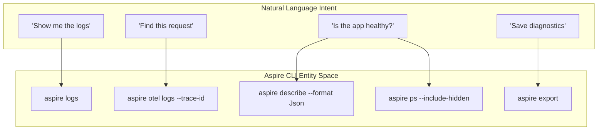
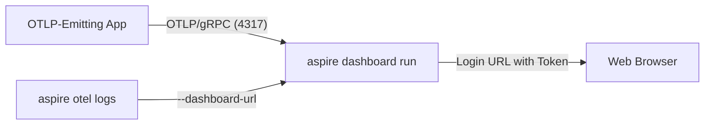

<!-- source: DeepWiki mcp.deepwiki.com · repo microsoft/aspire-skills · page 2.6 aspire-monitoring (Observability Skill) · fetched 2026-10-26 -->

# aspire-monitoring (Observability Skill)

Relevant source files

The following files were used as context for generating this wiki page:

- [.github/plugins/aspire-skills/skills/aspire-monitoring/references/diagnostics-bridge.md](.github/plugins/aspire-skills/skills/aspire-monitoring/references/diagnostics-bridge.md)
- [.github/plugins/aspire-skills/skills/aspire-monitoring/references/monitoring.md](.github/plugins/aspire-skills/skills/aspire-monitoring/references/monitoring.md)
- [.github/plugins/aspire-skills/skills/aspire-monitoring/references/playwright-handoff.md](.github/plugins/aspire-skills/skills/aspire-monitoring/references/playwright-handoff.md)
- [skills/aspire-init/SKILL.md](skills/aspire-init/SKILL.md)
- [skills/aspire-monitoring/SKILL.md](skills/aspire-monitoring/SKILL.md)
- [skills/aspire-monitoring/references/diagnostics-bridge.md](skills/aspire-monitoring/references/diagnostics-bridge.md)
- [skills/aspire-monitoring/references/monitoring.md](skills/aspire-monitoring/references/monitoring.md)
- [skills/aspire-monitoring/references/playwright-handoff.md](skills/aspire-monitoring/references/playwright-handoff.md)
- [skills/aspireify/references/csharp-authoring.md](skills/aspireify/references/csharp-authoring.md)

The `aspire-monitoring` skill provides the diagnostics bridge logic required to observe .NET Aspire applications across different environments [skills/aspire-monitoring/SKILL.md:4-6](). It serves as a router between local Aspire CLI operations, Kubernetes (AKS) workload diagnostics, and deployed Azure resource health [skills/aspire-monitoring/SKILL.md:13]().

## Diagnostics Bridge Routing

The skill implements a routing logic based on the application's current environment and the user's intent. The primary goal is to determine whether to use the local Aspire CLI backchannel or platform-specific tools like `kubectl` or `az` [skills/aspire-monitoring/references/diagnostics-bridge.md:1-4]().

### Routing Decision Logic
| Environment | Tooling | Commands |
| :--- | :--- | :--- |
| **Local Development** | Aspire CLI | `aspire logs`, `aspire otel logs`, `aspire describe` |
| **Azure Kubernetes (AKS)** | kubectl / Azure Monitor | `kubectl logs`, `kubectl describe pod` |
| **Azure (ACA/App Service)** | `azure-diagnostics` skill | `az containerapp logs`, `az monitor app-insights` |
| **Docker / Compose** | Docker CLI | `docker logs`, `docker compose ps` |

Sources: [skills/aspire-monitoring/SKILL.md:27-41](), [skills/aspire-monitoring/references/diagnostics-bridge.md:7-42]()

### Entity Mapping: Natural Language to Code CLI
The following diagram maps observability concepts to the specific Aspire CLI commands and flags used in the implementation.

Title: Observability Command Mapping

Sources: [skills/aspire-monitoring/SKILL.md:65-80](), [skills/aspire-monitoring/references/monitoring.md:9-37]()

## Local CLI Diagnostics

When running locally, the Aspire CLI communicates with the AppHost via a **backchannel socket** located at `~/.aspire/backchannels/` [skills/aspire-monitoring/references/diagnostics-bridge.md:52]().

### Core Commands and Implementation Details
*   **`aspire describe`**: Used to retrieve resource state, endpoints, and health [skills/aspire-monitoring/SKILL.md:75](). Agents are instructed to use `--format Json` for machine parsing and `--include-hidden` to see proxies or migration jobs [skills/aspire-monitoring/SKILL.md:93-97]().
*   **`aspire otel logs/traces/spans`**: Accesses structured OpenTelemetry data [skills/aspire-monitoring/SKILL.md:69-71](). Supports a `--search` flag for complex filtering (e.g., `severity:error`, `duration:>100`) [skills/aspire-monitoring/references/monitoring.md:72-84]().
*   **`aspire export`**: Generates a ZIP bundle containing `resources/`, `consolelogs/`, `structuredlogs/`, and `traces/` for offline analysis [skills/aspire-monitoring/references/monitoring.md:98-103]().

Sources: [skills/aspire-monitoring/SKILL.md:63-80](), [skills/aspire-monitoring/references/monitoring.md:49-84]()

## Standalone Dashboard

The `aspire dashboard run` command allows running the Aspire Dashboard as a standalone process [skills/aspire-monitoring/SKILL.md:80](). This is a foreground/blocking command that provides an OTLP endpoint (defaulting to port 4317 for gRPC) for any application to stream telemetry into [skills/aspire-monitoring/references/diagnostics-bridge.md:92-99]().

### Standalone Data Flow
Title: Standalone Dashboard Telemetry Flow

Sources: [skills/aspire-monitoring/references/diagnostics-bridge.md:90-115]()

## Browser Observability

The `Aspire.Hosting.Browsers` integration enables capturing frontend telemetry [skills/aspire-monitoring/references/diagnostics-bridge.md:127-129]().

*   **`WithBrowserLogs()`**: A C# extension method called in the AppHost to opt-in a frontend resource for console log, network request, and screenshot capture [skills/aspireify/references/csharp-authoring.md:146-149]().
*   **Dashboard Integration**: Captured browser data is surfaced in the Aspire Dashboard alongside server-side OTLP data [skills/aspire-monitoring/references/diagnostics-bridge.md:129]().

Sources: [skills/aspireify/references/csharp-authoring.md:32](), [skills/aspire-monitoring/references/diagnostics-bridge.md:127-135]()

## Playwright Handoff

The skill facilitates the transition from Aspire orchestration to browser testing [skills/aspire-monitoring/references/playwright-handoff.md:1-3]().

1.  **Endpoint Discovery**: The agent uses `aspire describe --format Json` to find the dynamic URL of the frontend resource [skills/aspire-monitoring/references/playwright-handoff.md:10]().
2.  **Handoff**: The discovered URL is passed to the Playwright CLI to execute tests against the live, orchestrated environment [skills/aspire-monitoring/references/playwright-handoff.md:17-21]().

Sources: [skills/aspire-monitoring/references/playwright-handoff.md:5-22]()

---

