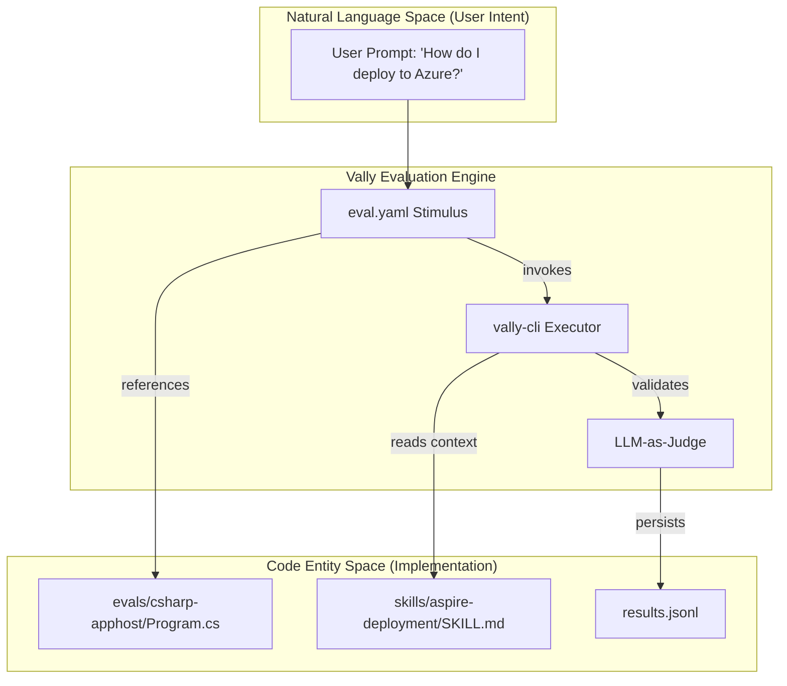
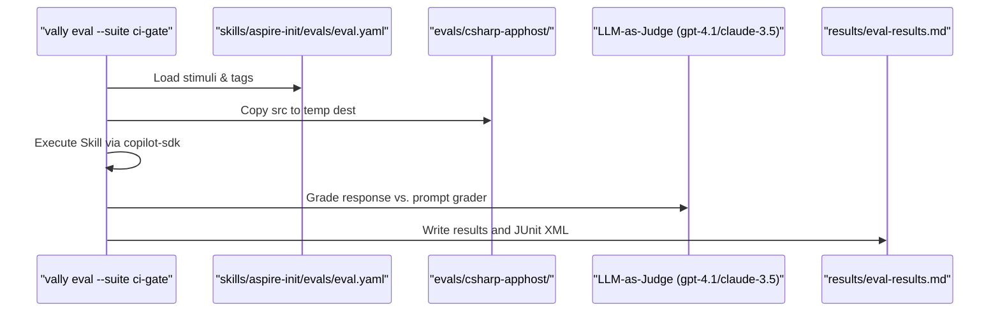

<!-- source: DeepWiki mcp.deepwiki.com · repo microsoft/aspire-skills · page 3 Evaluation Framework (Vally) · fetched 2026-10-26 -->

# Evaluation Framework (Vally)

Relevant source files

The following files were used as context for generating this wiki page:

- [.vally.yaml](.vally.yaml)
- [CHANGELOG.md](CHANGELOG.md)
- [evals/AUTHORING.md](evals/AUTHORING.md)
- [evals/README.md](evals/README.md)

The `aspire-skills` repository utilizes **Vally**, a specialized evaluation framework for AI agents, to ensure the quality, routing precision, and behavioral correctness of its skills. The system exercises the plugin against a battery of stimuli ranging from simple routing checks to complex multi-step orchestration tasks using a combination of static string graders and LLM-as-judge rubrics. [evals/README.md:1-3]()

### System Architecture

The evaluation system is structured to be decentralized, with each skill owning its own evaluation specification. This allows for skill-specific grading logic while sharing common test fixtures. [evals/README.md:17-22]()

#### Relationship between Space and Code Entities

The following diagram illustrates how natural language user prompts (Space) are mapped to the underlying code entities (Code Entity Space) through the Vally execution lifecycle.

**Natural Language to Code Mapping**

Sources: [evals/README.md:1-3](), [evals/README.md:17-31](), [evals/AUTHORING.md:7-36]()

### Core Components

The framework is built on three primary pillars:

1.  **Eval Specs (`eval.yaml`)**: Located within each skill's directory (`skills/<skill>/evals/eval.yaml`), these files define the `stimuli` (prompts), `environment` (files), and `graders` (success criteria). [evals/README.md:17-29]()
2.  **Shared Fixtures**: Located in the repo-root `evals/` directory, these are static project templates (e.g., `csharp-apphost`, `ts-apphost`) that provide the context the agent needs to "see" to answer prompts accurately. [evals/README.md:31-40]()
3.  **Vally CLI**: The `vally-cli` tool serves as the test runner, handling parallel execution, fixture mounting, and result aggregation. [evals/README.md:7-15]()

### CI Integration & Suites

Evaluations are integrated into the GitHub Actions workflow to prevent regressions. The repository defines two primary suites in `.vally.yaml`:

| Suite | Priority Filter | Purpose |
| :--- | :--- | :--- |
| `ci-gate` | `p0`, `p1` | Required PR gate; ensures core functionality and routing work. |
| `nightly` | `p0`, `p1`, `p2` | Comprehensive run including aspirational (p2) tasks. |

Sources: [.vally.yaml:10-21](), [CHANGELOG.md:44-51]()

### Execution Lifecycle

The diagram below shows the flow from a CLI command to the generation of diagnostic artifacts.

**Evaluation Execution Flow**

Sources: [evals/README.md:42-56](), [evals/README.md:58-81](), [evals/AUTHORING.md:77-83]()

### Sub-Pages

For detailed technical implementation and operational guides, refer to the following child pages:

*   **[Running & Interpreting Evals](#3.1)**: Covers CLI flags (`--suite`, `--workers`), interpreting `results.jsonl`, and using the `vally serve` dashboard.
*   **[Authoring Evals & Grader Patterns](#3.2)**: Detailed guide on writing `EvalSchema` stimuli, using the "assistant's response" anchor, and splitting positive/negative graders.
*   **[Eval Fixtures](#3.3)**: Documentation of the shared `csharp-apphost`, `ts-apphost`, and `non-aspire` fixture projects.

Sources: [evals/README.md:5-6](), [evals/README.md:128-139](), [evals/AUTHORING.md:1-6]()

---

