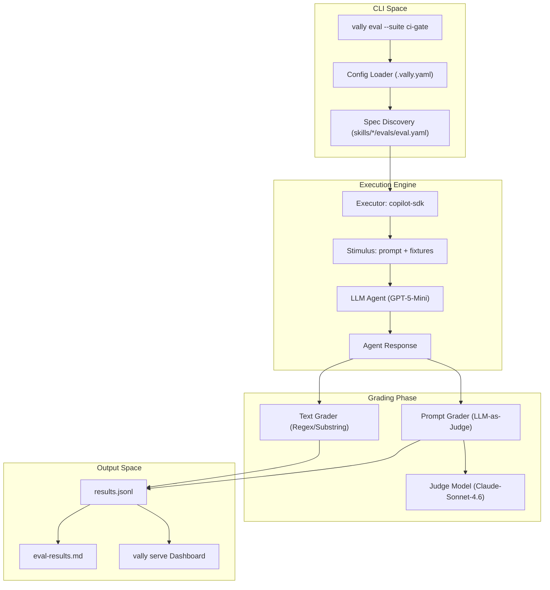
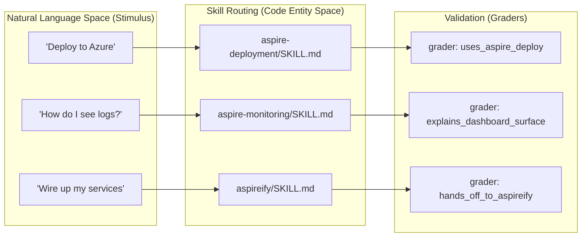

<!-- source: DeepWiki mcp.deepwiki.com · repo microsoft/aspire-skills · page 3.1 Running & Interpreting Evals · fetched 2026-10-26 -->

# Running & Interpreting Evals

<details>
<summary>Relevant source files</summary>

The following files were used as context for generating this wiki page:

- [.github/workflows/skill-eval-nightly.yml](.github/workflows/skill-eval-nightly.yml)
- [.github/workflows/skill-eval.yml](.github/workflows/skill-eval.yml)
- [.github/workflows/skill-lint.yml](.github/workflows/skill-lint.yml)
- [.vally.yaml](.vally.yaml)
- [evals/AUTHORING.md](evals/AUTHORING.md)
- [evals/README.md](evals/README.md)
- [skills/aspire-deployment/evals/eval.yaml](skills/aspire-deployment/evals/eval.yaml)
- [skills/aspire-monitoring/evals/eval.yaml](skills/aspire-monitoring/evals/eval.yaml)
- [skills/aspire-orchestration/evals/eval.yaml](skills/aspire-orchestration/evals/eval.yaml)
- [skills/aspire/evals/eval.yaml](skills/aspire/evals/eval.yaml)

</details>


This page provides technical documentation for executing and analyzing evaluations within the `aspire-skills` repository. The evaluation framework uses **Vally** to validate skill quality, routing precision, and adherence to safety guardrails across the six-skill architecture.

## Installation & Setup

The evaluation system requires Node.js 22+ and the `@microsoft/vally-cli` tool [evals/README.md:10-11]().

```bash
# Install vally globally
npm install -g @microsoft/vally-cli

# Verify installation
vally --version
```

### CI Authentication
To run model-backed evaluations (using the `copilot-sdk` executor), a `COPILOT_GITHUB_TOKEN` must be configured.
- **Local:** Set the environment variable in your shell.
- **CI:** Add the secret `COPILOT_GITHUB_TOKEN` to the GitHub repository settings [.github/workflows/skill-eval.yml:31-32](). This token is required for the `ci-gate` and `nightly` suites to invoke LLM-as-judge graders [.github/workflows/skill-eval.yml:78-79]().

**Sources:** [evals/README.md:7-15](), [.github/workflows/skill-eval.yml:28-40]()

---

## Executing Evaluations

Vally discovers evaluation specifications defined in `eval.yaml` files located within each skill's directory (e.g., `skills/aspire/evals/eval.yaml`) [evals/README.md:20-22]().

### Standard Suites
The repository defines two primary suites in `.vally.yaml` [.vally.yaml:10-21]():

| Suite | Priority Filter | Purpose |
| :--- | :--- | :--- |
| `ci-gate` | `p0`, `p1` | PR gate; ensures core functionality and critical routing work. |
| `nightly` | `p0`, `p1`, `p2` | Comprehensive weekly run; includes aspirational/forward-looking tests. |

### CLI Commands

| Goal | Command |
| :--- | :--- |
| **Run PR Gate** | `vally eval --suite ci-gate` |
| **Run Single Skill** | `vally eval --eval-spec skills/<skill>/evals/eval.yaml` |
| **Filter by Tag** | `vally eval --tag area=routing --tag priority=p0` |
| **Parallel Workers** | `vally eval --suite ci-gate --workers 4` |
| **Save Artifacts** | `vally eval --suite ci-gate --output-dir ./results` |

### Key CLI Flags
- `--suite <name>`: Runs stimuli matching filters in `.vally.yaml` [evals/README.md:65]().
- `--tag <key=values>`: Filters by tag records (e.g., `area=routing`). Multiple values are OR'd; multiple keys are AND'd [evals/README.md:66]().
- `--workers <n>`: Sets parallel stimulus workers (defaults to 1) [evals/README.md:71]().
- `--output-dir <dir>`: Persists `results.jsonl` and `eval-results.md` [evals/README.md:73]().
- `--skip-grade`: Executes the stimulus through the agent but skips the grader (useful for cost-saving during prompt engineering) [evals/README.md:76]().

**Sources:** [evals/README.md:42-81](), [.vally.yaml:1-21]()

---

## Data Flow & Architecture

The following diagram illustrates the data flow from the `vally` CLI through the `copilot-sdk` executor to the final result artifacts.

### Eval Execution Data Flow

**Sources:** [evals/README.md:24-30](), [evals/README.md:67-75](), [.vally.yaml:1-8]()

---

## Interpreting Results

When `--output-dir` is specified, Vally generates several files to help interpret the run:

### 1. `results.jsonl`
A machine-readable stream of every execution. Each line contains:
- `stimulus`: The input prompt and metadata.
- `response`: The raw text returned by the agent.
- `grading`: Array of results for each grader, including `pass/fail` status and the judge's `reasoning` [evals/README.md:79]().

### 2. `eval-results.md`
A human-readable summary of the run, grouped by skill. It highlights failing stimuli and provides the reasoning for failures.

### 3. The Dashboard (`vally serve`)
Vally includes a local web dashboard for deep-dive analysis of "trajectories" (the full interaction history).

```bash
# Launch the dashboard
vally serve ./results
```
The dashboard (defaulting to `http://127.0.0.1:3200`) allows you to browse pass/fail rates, per-grader breakdowns, and full executor traces [evals/README.md:132-139]().

**Sources:** [evals/README.md:73-79](), [evals/README.md:128-146]()

---

## Implementation Details

### Fixture Resolution
Shared fixtures are located in the root `evals/` directory and mapped into the executor's temporary workspace via `{ src, dest }` pairs in `eval.yaml` [evals/README.md:31-40]().

### Natural Language to Code Mapping
The evaluation framework bridges natural language user prompts to specific code entities within the `aspire-skills` system.


**Sources:** [skills/aspire-deployment/evals/eval.yaml:98-103](), [skills/aspire-monitoring/evals/eval.yaml:49-53](), [skills/aspire-orchestration/evals/eval.yaml:82-89]()

### CI Workflow Integration
The `skill-eval.yml` workflow manages the execution in GitHub Actions:
1. **Preflight:** Checks for `COPILOT_GITHUB_TOKEN`. If missing, it soft-skips the job to avoid blocking PRs from forks [.github/workflows/skill-eval.yml:34-54]().
2. **Execution:** Runs `vally eval --suite ci-gate` [.github/workflows/skill-eval.yml:81-83]().
3. **Artifacts:** Uploads the `./results` directory as a GitHub Action artifact for later inspection with `vally serve` [.github/workflows/skill-eval.yml:85-93]().

**Sources:** [.github/workflows/skill-eval.yml:1-93](), [.github/workflows/skill-eval-nightly.yml:1-83]()

---

