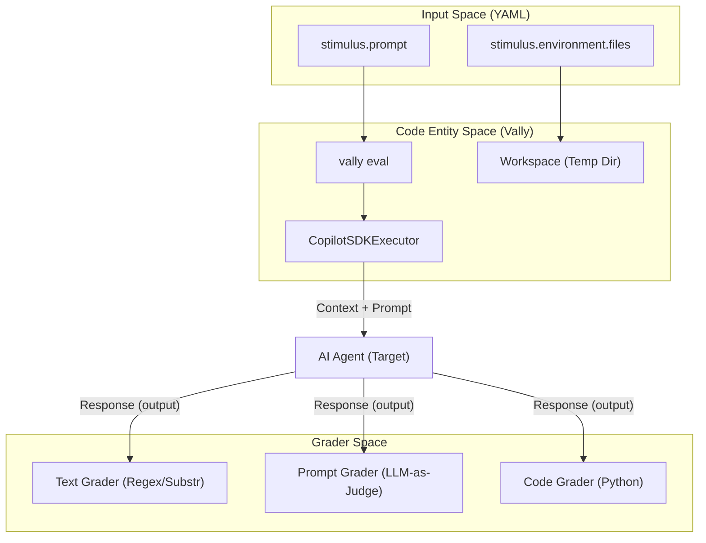
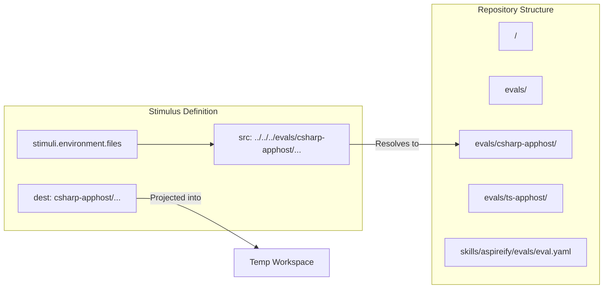

<!-- source: DeepWiki mcp.deepwiki.com · repo microsoft/aspire-skills · page 3.2 Authoring Evals & Grader Patterns · fetched 2026-10-26 -->

# Authoring Evals & Grader Patterns

Relevant source files

The following files were used as context for generating this wiki page:

- [evals/AUTHORING.md](evals/AUTHORING.md)
- [evals/README.md](evals/README.md)
- [skills/aspire-init/evals/eval.yaml](skills/aspire-init/evals/eval.yaml)
- [skills/aspireify/evals/eval.yaml](skills/aspireify/evals/eval.yaml)

This page provides technical guidance on authoring evaluation stimuli and graders for the `aspire-skills` plugin. The evaluation framework uses **Vally** to exercise skill routing, content correctness, and agent behavior against static graders and LLM-as-judge rubrics [evals/README.md:1-5]().

## EvalSchema Anatomy

Each skill maintains its own evaluation specification in `skills/<skill>/evals/eval.yaml` [evals/README.md:20-22](). This file follows the `EvalSchema` structure, which defines how the model is invoked and how its output is measured.

### Key Components of EvalSchema
| Component | Description | Code Reference |
| :--- | :--- | :--- |
| `config` | Defines the executor (`copilot-sdk`), model (`gpt-5-mini`), and timeouts. | [evals/README.md:26]() |
| `tags` | Record of metadata (e.g., `priority: p0`, `area: routing`) inherited by stimuli. | [evals/README.md:27]() |
| `stimuli` | Array of test cases containing the `prompt`, `environment.files`, and `graders`. | [evals/README.md:28]() |
| `scoring` | Weights per grader and pass-rate thresholds (defaults to 1.0). | [evals/README.md:29]() |

### Stimulus Data Flow
The following diagram illustrates how a stimulus is processed from the YAML definition through the executor to the graders.

**Stimulus Execution Lifecycle**

Sources: [evals/README.md:24-31](), [evals/README.md:60-81](), [evals/AUTHORING.md:77-83]()

## Grader Types & Patterns

Graders are the assertions of the eval system. They are categorized by their implementation method.

### 1. Text Graders
These are deterministic, cheap, and perform string-level checks using `contains` or `not_contains` [evals/AUTHORING.md:81]().
*   **Best for:** Specific command strings (e.g., `aspire destroy`) or forbidden anti-patterns.
*   **Pitfall:** Over-broad `not_contains`. Forbidding `"azd"` will fail if the agent correctly says "Do not use azd" [evals/AUTHORING.md:145-160]().

### 2. Prompt Graders (LLM-as-Judge)
These use a judge model (typically `claude-sonnet-4.6`) to evaluate intent and paraphrasing [evals/README.md:68](), [evals/AUTHORING.md:82]().
*   **The Anchor Pattern:** Every prompt grader must start with the phrase **"the assistant's response"** [evals/AUTHORING.md:91-93](). This prevents the judge from accidentally evaluating the input fixture files instead of the agent's output.
*   **Fact Injection:** If a grader relies on new features (e.g., Aspire 13.3), the fact must be stated in the grader prompt because the judge model may have a stale knowledge cutoff [evals/AUTHORING.md:173-177]().

### 3. Code Graders
These evaluate a Python expression against the `output` variable [evals/AUTHORING.md:83]().
*   **Best for:** Programmatic checks like counting lines, parsing JSON, or complex regex.

### Grader Logic Separation
Do not combine positive and negative requirements into a single prompt grader. This confuses the judge [evals/AUTHORING.md:112-114]().

**Grader Pattern Comparison**
| Requirement | ✅ Correct Pattern | ❌ Anti-Pattern |
| :--- | :--- | :--- |
| **Positive Intent** | `type: prompt` + "Does the assistant's response recommend X?" | Combining "Recommend X but not Y" in one prompt. |
| **Negative Check** | `type: text` + `not_contains: ["azd up"]` | `type: text` + `not_contains: ["azd"]` |
| **Specific Logic** | `type: code` | Using a prompt grader to count occurrences. |

Sources: [evals/AUTHORING.md:77-85](), [evals/AUTHORING.md:91-141](), [evals/AUTHORING.md:173-181]()

## Shared Fixtures & Environment
To avoid duplication, stimuli reference shared fixtures located in the repo-root `evals/` directory [evals/README.md:31]().

**Fixture Resolution Diagram**

Sources: [evals/README.md:31-41](), [skills/aspireify/evals/eval.yaml:24-29]()

## 10-Step New-Task Checklist

When authoring a new eval task (e.g., in `skills/<skill>/evals/tasks/<id>.yaml`), follow this workflow:

1.  **Assign Stable ID:** Use `<skill>-<area>-<NNN>` (e.g., `init-cli-install-001`) [evals/AUTHORING.md:67]().
2.  **Define Intent:** Write a clear `description` explaining what behavior is being validated [evals/AUTHORING.md:69]().
3.  **Tag Priority:** Always include `p0` (must pass), `p1` (should pass), or `p2` (aspirational) [evals/README.md:115]().
4.  **Reference Fixtures:** Use `src`/`dest` pairs to pull in `csharp-apphost` or `ts-apphost` rather than creating local files [evals/README.md:40]().
5.  **Draft Stimulus:** Phrase the `inputs.prompt` like a real user, not a technical specification [evals/AUTHORING.md:71]().
6.  **Apply Anchor Pattern:** Ensure all `prompt` graders start with "the assistant's response" [evals/AUTHORING.md:91]().
7.  **Split Graders:** Use separate `text` graders for `not_contains` and `prompt` graders for intent [evals/AUTHORING.md:112]().
8.  **Be Specific:** Forbid specific command tokens (e.g., `docker compose down`) instead of bare nouns (`docker`) [evals/AUTHORING.md:162]().
9.  **Validate Locally:** Run `vally lint --eval-spec <path>` to check for schema errors [evals/README.md:55]().
10. **Test Execution:** Run the specific task using `vally eval --eval-spec <path> --tag area=<area>` and inspect the output with `vally serve` [evals/README.md:49-52]().

Sources: [evals/AUTHORING.md:7-61](), [evals/AUTHORING.md:63-75](), [evals/README.md:42-57]()

---

