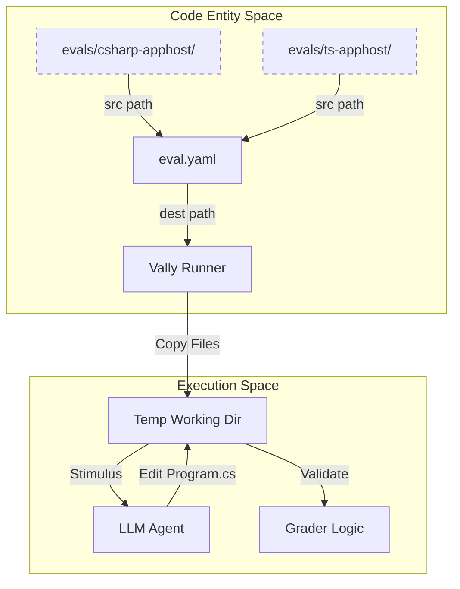

<!-- source: DeepWiki mcp.deepwiki.com · repo microsoft/aspire-skills · page 3.3 Eval Fixtures · fetched 2026-10-26 -->

# Eval Fixtures

<details>
<summary>Relevant source files</summary>

The following files were used as context for generating this wiki page:

- [evals/csharp-apphost/MyApp.ApiService/MyApp.ApiService.csproj](evals/csharp-apphost/MyApp.ApiService/MyApp.ApiService.csproj)
- [evals/csharp-apphost/MyApp.AppHost/MyApp.AppHost.csproj](evals/csharp-apphost/MyApp.AppHost/MyApp.AppHost.csproj)
- [evals/csharp-apphost/MyApp.AppHost/Program.cs](evals/csharp-apphost/MyApp.AppHost/Program.cs)
- [evals/csharp-apphost/MyApp.ServiceDefaults/MyApp.ServiceDefaults.csproj](evals/csharp-apphost/MyApp.ServiceDefaults/MyApp.ServiceDefaults.csproj)
- [evals/csharp-apphost/MyApp.sln](evals/csharp-apphost/MyApp.sln)
- [evals/csharp-apphost/aspire.config.json](evals/csharp-apphost/aspire.config.json)
- [evals/non-aspire/MyApp/MyApp.csproj](evals/non-aspire/MyApp/MyApp.csproj)
- [evals/non-aspire/MyApp/Program.cs](evals/non-aspire/MyApp/Program.cs)
- [evals/ts-apphost/.modules/base.ts](evals/ts-apphost/.modules/base.ts)
- [evals/ts-apphost/.modules/transport.ts](evals/ts-apphost/.modules/transport.ts)
- [evals/ts-apphost/apphost.ts](evals/ts-apphost/apphost.ts)
- [evals/ts-apphost/aspire.config.json](evals/ts-apphost/aspire.config.json)
- [evals/ts-apphost/package.json](evals/ts-apphost/package.json)

</details>


Eval Fixtures are shared, static project templates located under the `evals/` directory. They serve as the baseline state for evaluation tasks, providing the LLM with a realistic environment to perform modifications or analysis. These fixtures are copied into temporary working directories during evaluation execution via `src/dest` mappings defined in `eval.yaml` files.

## Fixture Types

The repository maintains three primary fixture types to cover C#, TypeScript, and negative test scenarios.

### 1. C# AppHost Fixture (`evals/csharp-apphost/`)
This fixture represents a standard .NET Aspire solution using the C# SDK. It includes a multi-project structure common in enterprise Aspire applications.

*   **MyApp.AppHost**: The orchestration project containing `Program.cs` which uses `DistributedApplication.CreateBuilder` [evals/csharp-apphost/MyApp.AppHost/Program.cs:1-1](). It defines resources like Redis, Postgres, and project references [evals/csharp-apphost/MyApp.AppHost/Program.cs:3-12]().
*   **MyApp.ApiService**: A backend service project [evals/csharp-apphost/MyApp.ApiService/MyApp.ApiService.csproj:1-1]().
*   **MyApp.ServiceDefaults**: A shared project for resilience and observability configurations [evals/csharp-apphost/MyApp.ServiceDefaults/MyApp.ServiceDefaults.csproj:1-1]().
*   **aspire.config.json**: A marker file indicating the root of an Aspire project [evals/csharp-apphost/aspire.config.json:1-3]().

**Sources:** [evals/csharp-apphost/MyApp.AppHost/Program.cs:1-15](), [evals/csharp-apphost/MyApp.AppHost/MyApp.AppHost.csproj:1-12](), [evals/csharp-apphost/aspire.config.json:1-3]()

### 2. TypeScript AppHost Fixture (`evals/ts-apphost/`)
This fixture provides the environment for testing the Node.js/TypeScript Aspire implementation. It includes the generated transport layer and the main entry point.

*   **apphost.ts**: The TypeScript entry point using the `@aspire/apphost` library to define resources [evals/ts-apphost/apphost.ts:1-14]().
*   **.modules/**: Contains the internal transport and base types required for the TypeScript SDK to communicate with the .NET-based Aspire CLI, including `transport.ts` [evals/ts-apphost/.modules/transport.ts:1-1]() and `base.ts` [evals/ts-apphost/.modules/base.ts:1-1]().
*   **ReferenceExpression**: A key class in `.modules/base.ts` that handles serialized expressions like `redis://{0}:{1}` for cross-language resource references [evals/ts-apphost/.modules/base.ts:41-156]().

**Sources:** [evals/ts-apphost/apphost.ts:1-14](), [evals/ts-apphost/.modules/base.ts:41-156](), [evals/ts-apphost/.modules/transport.ts:1-24]()

### 3. Non-Aspire Fixture (`evals/non-aspire/`)
A plain .NET console application used primarily for "negative routing" tests. These tests ensure the AI agent correctly refuses to perform Aspire-specific actions (like `aspireify`) on projects that lack Aspire metadata.

*   **MyApp.csproj**: A standard `Microsoft.NET.Sdk` project without the `Aspire.AppHost.Sdk` [evals/non-aspire/MyApp/MyApp.csproj:1-7]().
*   **Program.cs**: A simple "Hello World" implementation [evals/non-aspire/MyApp/Program.cs:1-2]().

**Sources:** [evals/non-aspire/MyApp/MyApp.csproj:1-7](), [evals/non-aspire/MyApp/Program.cs:1-2]()

---

## Data Flow: Fixture to Eval Environment

The following diagram illustrates how fixtures are transformed from static files in the repository into active test environments for the LLM.

### Fixture Instantiation Workflow

**Sources:** [evals/csharp-apphost/MyApp.AppHost/Program.cs:1-15](), [evals/ts-apphost/apphost.ts:1-14]()

---

## Technical Implementation Details

### C# Project Relationships
The C# fixture enforces a specific dependency graph to test the agent's ability to navigate project references.

| Project | Role | References |
| :--- | :--- | :--- |
| `MyApp.AppHost` | Orchestrator | `MyApp.ApiService`, `MyApp.Web` [evals/csharp-apphost/MyApp.AppHost/MyApp.AppHost.csproj:8-9]() |
| `MyApp.ApiService` | Backend API | `MyApp.ServiceDefaults` [evals/csharp-apphost/MyApp.ApiService/MyApp.ApiService.csproj:6-6]() |
| `MyApp.Web` | Frontend | `MyApp.ServiceDefaults` |

### TypeScript Transport Layer
The TypeScript fixture relies on a JSON-RPC bridge defined in `.modules/transport.ts`.

*   **MarshalledHandle**: A typed reference to a .NET object [evals/ts-apphost/.modules/transport.ts:19-24]().
*   **AspireClient**: Manages the `vscode-jsonrpc` connection to the host [evals/ts-apphost/.modules/transport.ts:3-3]().
*   **AtsErrorCodes**: Defines standard error states like `CAPABILITY_NOT_FOUND` or `TYPE_MISMATCH` [evals/ts-apphost/.modules/transport.ts:55-70]().

### Code-to-System Mapping
This diagram bridges the natural language concepts of "Resource Definition" to the specific code entities in the fixtures.

```mermaid
graph LR
    subgraph "Natural Language Space"
        R1["Redis Cache"]
        R2["Postgres DB"]
        R3["Project Reference"]
    end

    subgraph "Code Entity Space (C#)"
        R1 --- C1["builder.AddRedis('cache')"]
        R2 --- C2["builder.AddPostgres('db')"]
        R3 --- C3["builder.AddProject&lt;Projects.MyApp_ApiService&gt;"]
    end

    subgraph "Code Entity Space (TS)"
        R1 --- T1["app.addRedis('cache')"]
        R3 --- T2["app.addProject('apiservice', '../api')"]
    end

    C1 --- [evals/csharp-apphost/MyApp.AppHost/Program.cs:3-3]
    C2 --- [evals/csharp-apphost/MyApp.AppHost/Program.cs:4-4]
    T1 --- [evals/ts-apphost/apphost.ts:5-5]
```

**Sources:** [evals/csharp-apphost/MyApp.AppHost/Program.cs:1-15](), [evals/ts-apphost/apphost.ts:1-14](), [evals/ts-apphost/.modules/transport.ts:55-70]()

---

