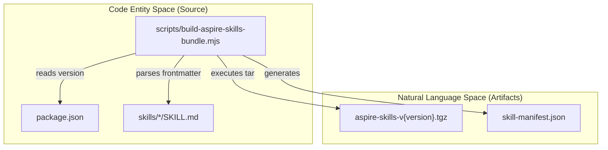
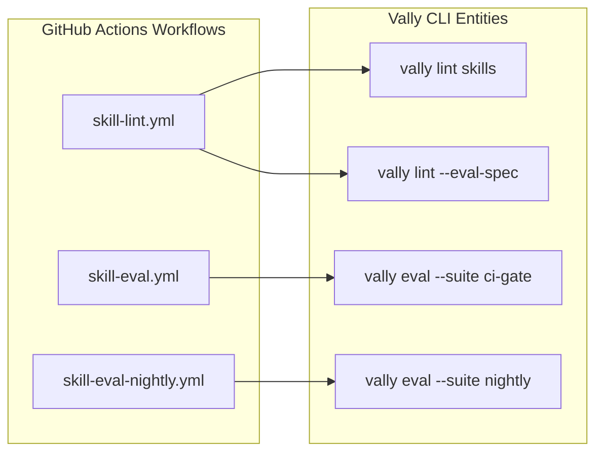

<!-- source: DeepWiki mcp.deepwiki.com · repo microsoft/aspire-skills · page 4 Repository Tooling & CI/CD · fetched 2026-10-26 -->

# Repository Tooling & CI/CD

Relevant source files

The following files were used as context for generating this wiki page:

- [.github/workflows/publish.yml](.github/workflows/publish.yml)
- [.github/workflows/skill-eval-nightly.yml](.github/workflows/skill-eval-nightly.yml)
- [.github/workflows/skill-eval.yml](.github/workflows/skill-eval.yml)
- [.github/workflows/skill-lint.yml](.github/workflows/skill-lint.yml)
- [package.json](package.json)
- [scripts/build-aspire-skills-bundle.mjs](scripts/build-aspire-skills-bundle.mjs)

This page provides a high-level overview of the automation and build systems that maintain the `aspire-skills` repository. The infrastructure is divided into two primary areas: the **Bundle & Release Pipeline**, which packages the plugin for distribution, and the **Validation Workflows**, which ensure skill schema integrity and functional correctness via model-backed evaluations.

## Build & Release Architecture

The repository uses a custom build script to aggregate individual skills into a unified, versioned distribution package. This process transforms the source directory structure into a production-ready manifest and archive.

### The Bundling Process
The core of the build system is `scripts/build-aspire-skills-bundle.mjs` [scripts/build-aspire-skills-bundle.mjs:1-7](). This script performs the following actions:
1.  **Skill Discovery**: Scans the `skills/` directory for subdirectories containing a `SKILL.md` file [scripts/build-aspire-skills-bundle.mjs:94-98]().
2.  **Frontmatter Validation**: Extracts and validates the `name` and `description` from the YAML frontmatter of each `SKILL.md` [scripts/build-aspire-skills-bundle.mjs:131-145]().
3.  **Manifest Generation**: Produces a `skill-manifest.json` that includes SemVer information, supported Aspire CLI/SDK ranges, and a list of all included skills with their file SHA256 hashes [scripts/build-aspire-skills-bundle.mjs:28-34]().
4.  **Compression**: Packages the assets into a `.tgz` archive using `tar` [scripts/build-aspire-skills-bundle.mjs:36-44]().

### Release Workflow
Releases are triggered by pushing a version tag (e.g., `v0.0.1`) to the repository [.github/workflows/publish.yml:3-7](). The `publish.yml` workflow automates the creation of a GitHub Release, performs build provenance attestation for security, and uploads the resulting bundle [.github/workflows/publish.yml:52-74]().

For details on packaging and versioning rules, see **[Bundle Build & Release Pipeline (#4.1)](#)**.

#### Build Pipeline Mapping
The following diagram maps the build script logic to the resulting distribution entities.

Title: Build Script to Bundle Mapping

Sources: [package.json:1-9](), [scripts/build-aspire-skills-bundle.mjs:1-204](), [.github/workflows/publish.yml:49-57]()

---

## Validation & Quality Gates

To maintain high quality and prevent regressions in LLM behavior, the repository employs three distinct GitHub Action workflows.

### Skill Linting
The `skill-lint.yml` workflow acts as a PR gate for all changes to `SKILL.md` or `.yaml` files [.github/workflows/skill-lint.yml:3-9](). It uses the `vally` CLI to:
*   Verify that skill definitions match the expected schema [.github/workflows/skill-lint.yml:36]().
*   Validate evaluation specifications (`eval.yaml`) to ensure stimulus structure and grader configurations are correct [.github/workflows/skill-lint.yml:38-56]().

### Model-Backed Evaluations
Functional testing is performed using `vally` to run LLM-based evaluations.
*   **PR Gate (`skill-eval.yml`)**: Runs the `ci-gate` suite on internal PRs to verify core functionality [.github/workflows/skill-eval.yml:73-83]().
*   **Nightly Suite (`skill-eval-nightly.yml`)**: A weekly comprehensive run (every Sunday) that executes the full `nightly` suite to detect drift or subtle regressions [.github/workflows/skill-eval-nightly.yml:4-6]().

Both evaluation workflows require a `COPILOT_GITHUB_TOKEN` secret to invoke the models [.github/workflows/skill-eval.yml:31-40](). If the token is missing (e.g., in a fork PR), the jobs will soft-skip to avoid blocking the PR unnecessarily [.github/workflows/skill-eval.yml:22-26]().

For details on trigger conditions and secret setup, see **[Skill Lint & Eval GitHub Actions Workflows (#4.2)](#)**.

#### CI/CD Workflow Mapping
This diagram associates GitHub Actions workflows with the `vally` CLI commands they execute.

Title: CI Workflow to Vally Command Mapping

Sources: [.github/workflows/skill-lint.yml:36-54](), [.github/workflows/skill-eval.yml:81-83](), [.github/workflows/skill-eval-nightly.yml:71-73]()

---

## Summary Table of Tooling

| Tool / Workflow | File Path | Purpose |
| :--- | :--- | :--- |
| **Bundler** | `scripts/build-aspire-skills-bundle.mjs` | Packages skills and generates `skill-manifest.json`. |
| **Publish CI** | `.github/workflows/publish.yml` | Builds and uploads releases on tag push. |
| **Lint CI** | `.github/workflows/skill-lint.yml` | Validates `SKILL.md` schema and `eval.yaml` syntax. |
| **Eval CI** | `.github/workflows/skill-eval.yml` | Runs model-backed tests on PRs using `vally`. |
| **Nightly CI** | `.github/workflows/skill-eval-nightly.yml` | Weekly comprehensive model-backed testing. |

Sources: [package.json:7](), [.github/workflows/publish.yml:1-75](), [.github/workflows/skill-lint.yml:1-57](), [.github/workflows/skill-eval.yml:1-93](), [.github/workflows/skill-eval-nightly.yml:1-83]()

---

