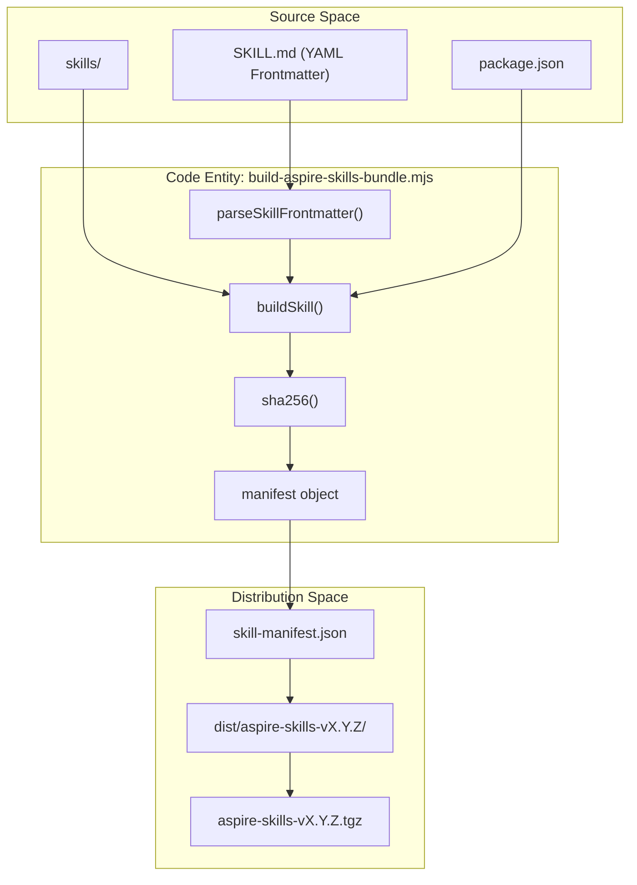
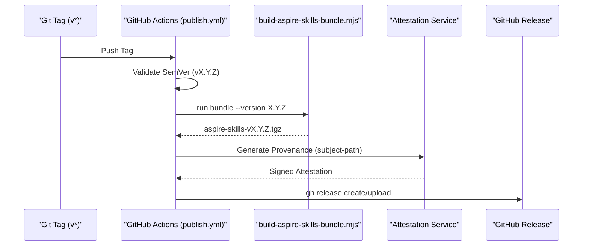

<!-- source: DeepWiki mcp.deepwiki.com · repo microsoft/aspire-skills · page 4.1 Bundle Build & Release Pipeline · fetched 2026-10-26 -->

# Bundle Build & Release Pipeline

Relevant source files

The following files were used as context for generating this wiki page:

- [.github/workflows/publish.yml](.github/workflows/publish.yml)
- [package.json](package.json)
- [scripts/build-aspire-skills-bundle.mjs](scripts/build-aspire-skills-bundle.mjs)

The `aspire-skills` repository utilizes a specialized build and release pipeline to package its collection of AI agent skills into a single, verifiable distribution. This process transforms the source-controlled skills into a versioned `.tgz` bundle containing a generated `skill-manifest.json`, which is then published via GitHub Actions with cryptographic build provenance.

### Bundle Creation Lifecycle

The bundling process is orchestrated by a custom Node.js script that aggregates individual skills from the `skills/` directory.

#### Build Execution Flow
The primary entry point for local and CI builds is `npm run bundle`, which maps to `node scripts/build-aspire-skills-bundle.mjs` [package.json:6-8]().

1.  **Argument Parsing**: The script parses `--version` and `--out` arguments. If no version is provided, it defaults to the version defined in `package.json` [scripts/build-aspire-skills-bundle.mjs:8-10]().
2.  **Environment Setup**: It clears existing build artifacts in the `dist/` folder and creates a new bundle root named `aspire-skills-v<version>` [scripts/build-aspire-skills-bundle.mjs:11-24]().
3.  **Skill Discovery**: The `listSkillDirectories` function identifies subdirectories in `skills/` that contain a `SKILL.md` file [scripts/build-aspire-skills-bundle.mjs:94-98]().
4.  **Skill Processing**: For each discovered skill, the `buildSkill` function:
    *   Parses YAML frontmatter from `SKILL.md` to extract the `name` and `description` [scripts/build-aspire-skills-bundle.mjs:48-52]().
    *   Validates that the frontmatter name matches the directory name [scripts/build-aspire-skills-bundle.mjs:54-56]().
    *   Enforces a 1024-character limit on the description [scripts/build-aspire-skills-bundle.mjs:58-60]().
    *   Copies all files (excluding `evals/` directories) to the target bundle [scripts/build-aspire-skills-bundle.mjs:62-75]().
    *   Generates a SHA-256 hash for every file included in the skill [scripts/build-aspire-skills-bundle.mjs:76-80]().
5.  **Manifest Generation**: A `skill-manifest.json` is created at the bundle root. This file includes the global version, supported Aspire CLI/SDK ranges, and a detailed list of skills with their respective file hashes [scripts/build-aspire-skills-bundle.mjs:28-34]().
6.  **Archiving**: The script uses the system `tar` command to compress the bundle into a `.tgz` file [scripts/build-aspire-skills-bundle.mjs:36-44]().

**Bundle Structure and Data Flow**

Sources: [scripts/build-aspire-skills-bundle.mjs:7-46](), [scripts/build-aspire-skills-bundle.mjs:48-92](), [scripts/build-aspire-skills-bundle.mjs:131-145]()

### GitHub Actions Release Workflow

The release pipeline is defined in `.github/workflows/publish.yml` and is triggered by pushing a semantic version tag (e.g., `v1.0.0`) or manually via `workflow_dispatch` [.github/workflows/publish.yml:3-9]().

#### Workflow Steps

| Step | Action | Description |
| :--- | :--- | :--- |
| **Checkout** | `actions/checkout` | Fetches the repository source code [.github/workflows/publish.yml:20-22](). |
| **Setup Node** | `actions/setup-node` | Installs Node.js 22 [.github/workflows/publish.yml:24-28](). |
| **Read Version** | Bash Script | Validates the git tag against a SemVer regex and extracts the version number (e.g., `1.0.0` from `v1.0.0`) [.github/workflows/publish.yml:30-47](). |
| **Build Bundle** | `npm run bundle` | Executes the build script with the extracted version number [.github/workflows/publish.yml:49-50](). |
| **Attest Build** | `actions/attest-build-provenance` | Generates a signed build provenance attestation for the `.tgz` asset using GitHub's OIDC identity [.github/workflows/publish.yml:52-56](). |
| **Publish Release** | `gh release` | Creates a GitHub Release (or updates an existing one) and uploads the `.tgz` bundle [.github/workflows/publish.yml:58-74](). |

#### Security and Provenance
The workflow requires specific permissions to generate attestations and write to releases:
*   `contents: write`: To create the GitHub Release [.github/workflows/publish.yml:11]().
*   `id-token: write`: To authenticate with the Sigstore/GitHub attestation service [.github/workflows/publish.yml:12]().
*   `attestations: write`: To publish the build provenance record [.github/workflows/publish.yml:13]().

**Release Workflow Pipeline**

Sources: [.github/workflows/publish.yml:1-75](), [scripts/build-aspire-skills-bundle.mjs:49-51]()

### Manifest Schema
The `skill-manifest.json` acts as the single source of truth for agent hosts to understand what skills are available and which files belong to them.

| Property | Type | Description |
| :--- | :--- | :--- |
| `version` | string | The SemVer version of the bundle [scripts/build-aspire-skills-bundle.mjs:29](). |
| `supports` | object | Version constraints for `aspireCli` and `aspireSdk` [scripts/build-aspire-skills-bundle.mjs:30](). |
| `skills` | array | List of skill objects [scripts/build-aspire-skills-bundle.mjs:31](). |
| `skills[].name` | string | The unique identifier for the skill [scripts/build-aspire-skills-bundle.mjs:85](). |
| `skills[].isDefault` | boolean | `true` for core skills: `aspire`, `aspireify`, `aspire-deployment` [scripts/build-aspire-skills-bundle.mjs:87](). |
| `skills[].files` | array | List of `{ relativePath, sha256 }` for verification [scripts/build-aspire-skills-bundle.mjs:90](). |

Sources: [scripts/build-aspire-skills-bundle.mjs:17-32](), [scripts/build-aspire-skills-bundle.mjs:84-91]()

---

