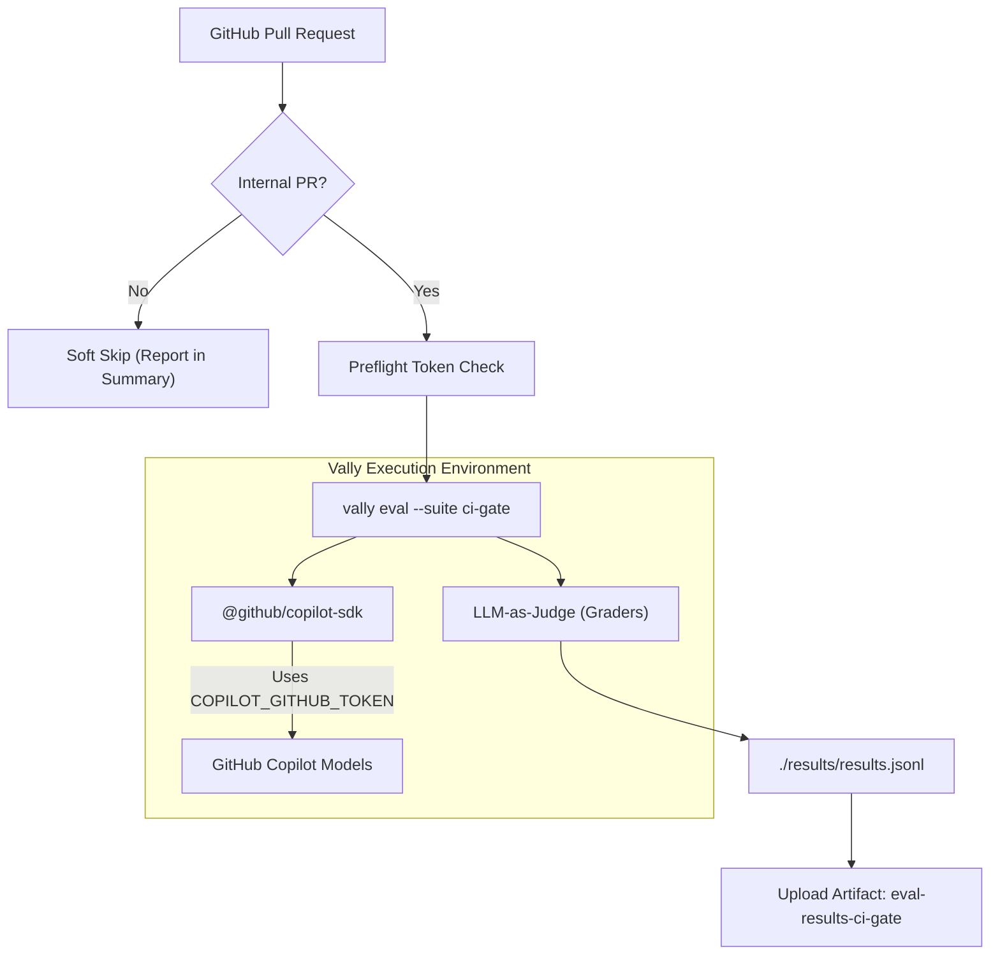
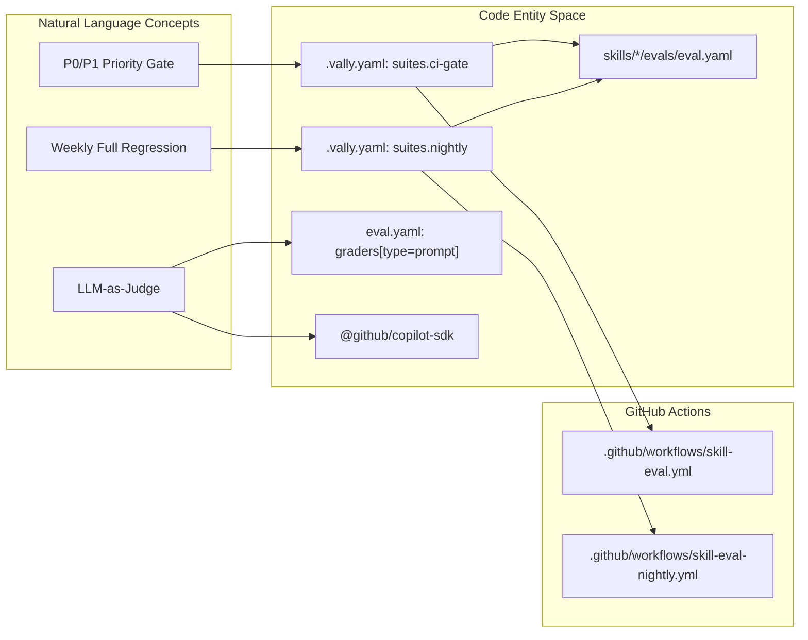

<!-- source: DeepWiki mcp.deepwiki.com · repo microsoft/aspire-skills · page 4.2 Skill Lint & Eval GitHub Actions Workflows · fetched 2026-10-26 -->

# Skill Lint & Eval GitHub Actions Workflows

Relevant source files

The following files were used as context for generating this wiki page:

- [.github/workflows/skill-eval-nightly.yml](.github/workflows/skill-eval-nightly.yml)
- [.github/workflows/skill-eval.yml](.github/workflows/skill-eval.yml)
- [.github/workflows/skill-lint.yml](.github/workflows/skill-lint.yml)
- [.vally.yaml](.vally.yaml)
- [evals/AUTHORING.md](evals/AUTHORING.md)
- [evals/README.md](evals/README.md)

The `aspire-skills` repository employs a multi-tiered Continuous Integration (CI) strategy to ensure the quality, routing precision, and safety of the AI agent skills. This is achieved through three primary GitHub Actions workflows that validate `SKILL.md` files, verify `eval.yaml` schemas, and execute model-backed evaluations using the `vally` CLI tool.

## Workflow Overview

The CI pipeline is divided into static linting and dynamic evaluation. While linting runs on every PR, dynamic evaluations require a `COPILOT_GITHUB_TOKEN` and are restricted to internal PRs for security and cost management [.github/workflows/skill-eval.yml:22-26]().

### CI Workflow Mapping

| Workflow | File | Trigger | Purpose |
| :--- | :--- | :--- | :--- |
| **Skill Lint** | `skill-lint.yml` | PR (any path change to skills/evals) | Validates Markdown frontmatter and YAML schema integrity [.github/workflows/skill-lint.yml:3-9]() |
| **Skill Eval** | `skill-eval.yml` | PR (internal only) | Runs the `ci-gate` suite (p0 + p1 stimuli) using LLM-as-judge [.github/workflows/skill-eval.yml:3-9]() |
| **Skill Eval (nightly)** | `skill-eval-nightly.yml` | Sunday 06:00 UTC / Manual | Runs the comprehensive `nightly` suite (p0, p1, p2) [.github/workflows/skill-eval-nightly.yml:3-7]() |

**Sources:** [.github/workflows/skill-lint.yml:1-9](), [.github/workflows/skill-eval.yml:1-9](), [.github/workflows/skill-eval-nightly.yml:1-8]()

---

## 1. Skill Lint Workflow (`skill-lint.yml`)

The `Skill Lint` workflow is the primary gate for structural correctness. It does not require LLM access and therefore runs on all Pull Requests, including those from forks [.github/workflows/skill-lint.yml:3-9]().

### Implementation Details
1.  **Environment**: Runs on `ubuntu-latest` with Node.js 22 [.github/workflows/skill-lint.yml:17-27]().
2.  **Skill Discovery**: Executes `vally lint skills` to validate all sub-directories in the `skills/` folder [.github/workflows/skill-lint.yml:36-36](). This checks the `SKILL.md` headers against the required schema.
3.  **Eval Spec Validation**: Iterates through all `skills/*/evals/eval.yaml` files and runs `vally lint --eval-spec` [.github/workflows/skill-lint.yml:44-56](). This ensures:
    *   Stimulus structure is valid.
    *   Grader configurations (text, prompt, code) are well-formed [.github/workflows/skill-lint.yml:40-41]().
    *   Environment file references (`src`/`dest` pairs) resolve against the repository root [.github/workflows/skill-lint.yml:41-41]().

**Sources:** [.github/workflows/skill-lint.yml:15-57]()

---

## 2. Skill Eval Workflow (`skill-eval.yml`)

The `Skill Eval` workflow executes the `ci-gate` suite defined in `.vally.yaml` [.vally.yaml:11-16](). This suite filters for stimuli tagged with `priority: p0` or `priority: p1` [evals/README.md:91-91]().

### Token Security & Fork Behavior
Because the evaluation requires the `COPILOT_GITHUB_TOKEN` to invoke the `copilot-sdk` executor, GitHub Actions restricts access to this secret [.github/workflows/skill-eval.yml:22-25]().
*   **Internal PRs**: The workflow proceeds and injects the secret into the `vally eval` step [.github/workflows/skill-eval.yml:78-79]().
*   **Fork PRs**: The job is skipped via a conditional check: `if: github.event.pull_request.head.repo.full_name == github.event.pull_request.base.repo.full_name` [.github/workflows/skill-eval.yml:26-26]().

### Data Flow: PR Evaluation
The following diagram illustrates how a PR triggers the evaluation and how the `vally` tool interacts with the Copilot SDK.

**Diagram: CI Evaluation Execution Flow**

**Sources:** [.github/workflows/skill-eval.yml:26-93](), [evals/README.md:24-29](), [.vally.yaml:11-16]()

---

## 3. Nightly Eval Workflow (`skill-eval-nightly.yml`)

The nightly workflow performs a comprehensive sweep of the entire skill catalog, including experimental or forward-looking tests tagged as `p2` [.vally.yaml:17-20]().

### Configuration
*   **Schedule**: Triggered every Sunday at 06:00 UTC [.github/workflows/skill-eval-nightly.yml:6-6]().
*   **Suite**: Executes `vally eval --suite nightly` [.github/workflows/skill-eval-nightly.yml:71-73]().
*   **Artifacts**: Results are persisted as `eval-results-nightly` [.github/workflows/skill-eval-nightly.yml:80-80](). These can be downloaded and viewed locally using `vally serve` [evals/README.md:130-139]().

**Sources:** [.github/workflows/skill-eval-nightly.yml:1-83](), [.vally.yaml:17-20]()

---

## 4. Implementation Details

### The Preflight Check
Both `skill-eval.yml` and `skill-eval-nightly.yml` include a "Preflight" step. This step ensures that the `COPILOT_GITHUB_TOKEN` is present before starting the Node.js environment or installing dependencies, saving CI minutes [.github/workflows/skill-eval.yml:34-56](). If the token is missing, it writes a warning to the `$GITHUB_STEP_SUMMARY` instead of failing the build [.github/workflows/skill-eval.yml:39-53]().

### Artifact Uploads
Evaluation results are uploaded as GitHub Action artifacts. The `./results/` directory contains:
*   `results.jsonl`: Raw execution data.
*   `eval-results.md`: A human-readable summary of the run.
*   Session logs: (If `--keep-executor-session-logs` is used) raw traces of the interaction between the agent and the model [evals/README.md:73-78]().

### Natural Language to Code Entity Mapping
This diagram bridges the conceptual "CI Gate" to the specific code entities and files that define the evaluation logic.

**Diagram: Evaluation Logic Mapping**

**Sources:** [.vally.yaml:10-21](), [evals/README.md:24-29](), [.github/workflows/skill-eval.yml:1-9](), [.github/workflows/skill-eval-nightly.yml:1-8]()

---

