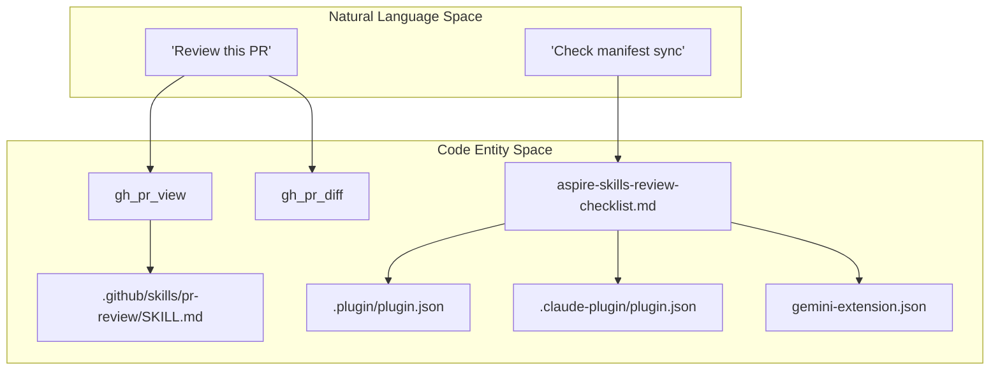
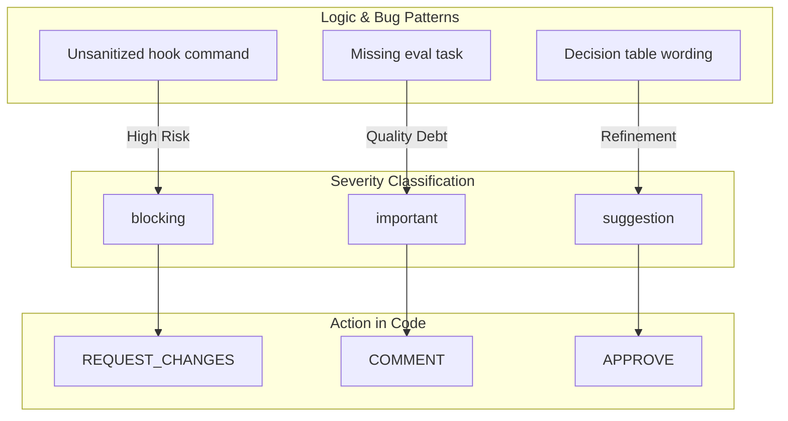

<!-- source: DeepWiki mcp.deepwiki.com · repo microsoft/aspire-skills · page 5 Repository Maintenance & PR Review · fetched 2026-10-26 -->

# Repository Maintenance & PR Review

Relevant source files

The following files were used as context for generating this wiki page:

- [.github/skills/pr-review/SKILL.md](.github/skills/pr-review/SKILL.md)
- [.github/skills/pr-review/references/aspire-skills-review-checklist.md](.github/skills/pr-review/references/aspire-skills-review-checklist.md)
- [.github/skills/pr-review/references/code-review-best-practices.md](.github/skills/pr-review/references/code-review-best-practices.md)
- [.github/skills/pr-review/references/common-bugs-checklist.md](.github/skills/pr-review/references/common-bugs-checklist.md)
- [.github/skills/pr-review/references/severity-labels.md](.github/skills/pr-review/references/severity-labels.md)

This section provides an overview of the internal tooling and processes used by authors to maintain the `microsoft/aspire-skills` repository. To ensure the quality and safety of the AI agent skills shipped to consumers, the repository employs a specialized internal skill for PR reviews, strict validation checklists, and a three-tier severity model for findings.

## Internal Author Tooling

Unlike the public-facing `aspire` skills, the repository contains internal "Author Skills" located under `.github/skills/` [.github/skills/pr-review/SKILL.md:28-30](). These tools are designed specifically for the repository's maintainers to automate the validation of changes to the plugin manifests, skill definitions, and evaluation suites.

### PR Review Workflow
The primary tool for maintenance is the `pr-review` skill. It drives a structured six-step workflow to ensure changes do not introduce regressions or violate repository conventions [.github/skills/pr-review/SKILL.md:6-9]().

| Step | Action | Code Entity / Command |
| :--- | :--- | :--- |
| **1** | **Branch Sync** | `git branch --show-current`, `gh pr checkout` |
| **2** | **Context Gathering** | `gh pr view`, `gh pr diff`, `gh api .../comments` |
| **3** | **Categorization** | Mapping paths to review focus (e.g., `skills/**` vs `.plugin/**`) |
| **4** | **Bug Scan** | Application of `common-bugs-checklist.md` |
| **5** | **Triage** | Classification via `blocking`, `important`, or `suggestion` |
| **6** | **Post Review** | `gh pr review --comment` or `gh pr review --request-changes` |

For a deep dive into the implementation and CLI commands, see **[pr-review Author Skill](#5.1)**.

**Sources:** [.github/skills/pr-review/SKILL.md:48-158]()

## Validation Rules & Checklists

Maintaining a high-quality agent plugin requires more than standard code linting. The repository uses specific checklists to enforce "Agentic Quality," such as token budget management and routing accuracy.

### Key Maintenance Obligations
*   **Token Budgets:** Each `SKILL.md` must remain under a soft limit of ~5,000 tokens to ensure the agent's context window is not overwhelmed [.github/skills/pr-review/references/aspire-skills-review-checklist.md:31-41]().
*   **Manifest Synchronization:** The plugin version must be kept in sync across four distinct manifest files: `.plugin/plugin.json`, `.claude-plugin/plugin.json`, `.claude-plugin/marketplace.json`, and `gemini-extension.json` [.github/skills/pr-review/references/aspire-skills-review-checklist.md:88-105]().
*   **Safety Guardrails:** Reviewers must ensure that agent instructions continue to enforce safety patterns, such as using `--non-interactive` flags and preventing direct edits to generated `.aspire/modules/` directories [.github/skills/pr-review/references/aspire-skills-review-checklist.md:131-151]().

For the full list of validation rules, see **[Review Checklists & Validation Rules](#5.2)**.

**Sources:** [.github/skills/pr-review/references/aspire-skills-review-checklist.md:1-152](), [.github/skills/pr-review/references/common-bugs-checklist.md:1-108]()

## Severity Classification

To keep reviews focused and actionable, the `pr-review` skill uses a strict three-tier severity model. It explicitly forbids "noise" such as style nits or social praise within the PR comments to maintain a high signal-to-noise ratio [.github/skills/pr-review/references/severity-labels.md:9-12]().

### Severity Tiers

| Label | Criteria | Action |
| :--- | :--- | :--- |
| `blocking` | Concrete harm (e.g., broken manifest sync, removed safety guardrail). | `REQUEST_CHANGES` |
| `important` | Coverage/Quality obligation unmet (e.g., missing eval tasks, stale frontmatter). | `COMMENT` |
| `suggestion` | Optional improvement (e.g., sharper decision table wording). | `COMMENT` / `APPROVE` |

**Sources:** [.github/skills/pr-review/references/severity-labels.md:1-105](), [.github/skills/pr-review/references/code-review-best-practices.md:67-76]()

## Mapping Maintenance Concepts to Code

The following diagrams illustrate how repository maintenance concepts map to specific files and internal workflow steps.

### PR Review Data Flow
"This diagram bridges the natural language intent of 'Reviewing a PR' to the specific GitHub CLI and API entities used by the `pr-review` skill."

**Sources:** [.github/skills/pr-review/SKILL.md:121-133](), [.github/skills/pr-review/references/aspire-skills-review-checklist.md:92-98]()

### Severity & Logic Mapping
"This diagram maps specific bug patterns found in the codebase to their required severity classification during a maintenance review."

**Sources:** [.github/skills/pr-review/references/severity-labels.md:13-74]()

***

### Child Pages
*   **[pr-review Author Skill](#5.1)** — Detailed technical workflow of the internal review agent.
*   **[Review Checklists & Validation Rules](#5.2)** — Comprehensive list of rules for SKILL.md, manifests, and safety guardrails.

---

