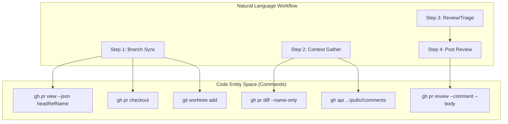
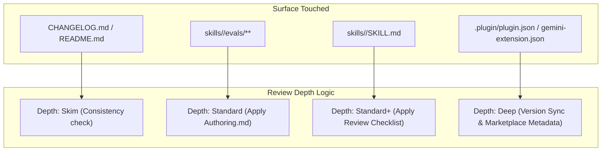

<!-- source: DeepWiki mcp.deepwiki.com · repo microsoft/aspire-skills · page 5.1 pr-review Author Skill · fetched 2026-10-26 -->

# pr-review Author Skill

Relevant source files

The following files were used as context for generating this wiki page:

- [.github/skills/pr-review/SKILL.md](.github/skills/pr-review/SKILL.md)
- [.github/skills/pr-review/references/code-review-best-practices.md](.github/skills/pr-review/references/code-review-best-practices.md)

The `pr-review` skill is an internal-only authoring tool located under `.github/skills/pr-review/` [.github/skills/pr-review/SKILL.md:4-9](). Unlike the consumer-facing `aspire` skills, it is designed specifically for repository maintainers to review pull requests submitted to the `microsoft/aspire-skills` repository [.github/skills/pr-review/SKILL.md:28-30](). Its primary objective is to identify concrete problems—such as regressions, manifest drift, or missing eval coverage—while explicitly avoiding style nits or subjective prose improvements [.github/skills/pr-review/SKILL.md:32-36]().

## Activation Triggers

The skill activates based on specific user intent or the state of the local working directory.

| Signal | Logic |
|--------|-------|
| **Direct Request** | User phrases like "review this PR", "review the current branch", or "check before merge" [.github/skills/pr-review/SKILL.md:42-42](). |
| **Tool Usage** | Detection of `gh pr view`, `gh pr diff`, or a GitHub PR URL in the conversation context [.github/skills/pr-review/SKILL.md:43-43](). |
| **Local State** | The working tree is `microsoft/aspire-skills` and there is a non-empty diff against `main` [.github/skills/pr-review/SKILL.md:44-44](). |

The skill will **refuse** to activate for consumer application code or runtime help with the `aspire` CLI, routing those instead to the standard `aspire` plugin [.github/skills/pr-review/SKILL.md:45-46]().

## Workflow Architecture

The `pr-review` skill follows a strict six-step linear workflow. Reordering these steps is prohibited as it degrades the quality of the context gathered for the review [.github/skills/pr-review/SKILL.md:48-54]().

### 1. Branch Synchronization (Blocking)
The agent must ensure the PR's head branch is available locally to allow for deep code exploration [.github/skills/pr-review/SKILL.md:72-79]().
*   **Method A (Checkout):** Stashes local changes and uses `gh pr checkout <number>` [.github/skills/pr-review/SKILL.md:91-99]().
*   **Method B (Worktree):** Creates a dedicated worktree using `git worktree add` if the current tree must remain undisturbed [.github/skills/pr-review/SKILL.md:101-108]().

### 2. Context Gathering
The agent aggregates metadata using the GitHub CLI (`gh`) and API [.github/skills/pr-review/SKILL.md:117-119]():
*   **Metadata:** Title, body, base branch, and `autoMergeRequest` status [.github/skills/pr-review/SKILL.md:121-124]().
*   **Changes:** File lists and full diffs [.github/skills/pr-review/SKILL.md:126-133]().
*   **History:** Existing review comments and CI check status to avoid duplicating feedback [.github/skills/pr-review/SKILL.md:134-142]().

### 3. Categorization
Files are grouped by area to determine the "Review Focus" [.github/skills/pr-review/SKILL.md:144-149]().

### 4. Technical Review
The agent applies specific validation rules based on the category:
*   **Manifests:** Checks for version synchronization across `.plugin/plugin.json`, `.claude-plugin/plugin.json`, and `gemini-extension.json` [.github/skills/pr-review/SKILL.md:157-157]().
*   **Evals:** Validates grader patterns, fixture reuse, and the presence of the "the assistant's response" anchor [.github/skills/pr-review/SKILL.md:153-153]().
*   **Safety:** Ensures guardrails against direct file editing in `.aspire/modules/` are maintained [.github/skills/pr-review/references/code-review-best-practices.md:118-118]().

### 5. Triage
Findings are mapped to a three-tier severity model before being presented to the user [.github/skills/pr-review/SKILL.md:162-166]().

### 6. Posting
The agent uses `gh pr review <n> --comment --body <report>` or the GitHub API to submit the final findings [.github/skills/pr-review/SKILL.md:173-178]().

### Workflow Entity Mapping
The following diagram maps the natural language workflow steps to the specific GitHub CLI and Git commands utilized by the skill.

Sources: [.github/skills/pr-review/SKILL.md:72-178]()

## Severity Model

The skill categorizes all findings into one of three tiers. If a finding does not fit these tiers (e.g., style nits), it is discarded [.github/skills/pr-review/references/code-review-best-practices.md:75-76]().

| Tier | Label | Description | Examples |
| :--- | :--- | :--- | :--- |
| **Tier 1** | `blocking` | Must fix. Critical regressions or safety issues. | Removed safety guardrails, manifest version drift, unsanitized hooks [.github/skills/pr-review/references/code-review-best-practices.md:71-71](). |
| **Tier 2** | `important` | Should fix. Degrades quality or maintainability. | Missing `trigger_tests.yaml` coverage, stale `INVOKES:` frontmatter [.github/skills/pr-review/references/code-review-best-practices.md:72-72](). |
| **Tier 3** | `suggestion` | Nice to have. Optimization or clarity. | Reordering decision tables for scan-ability, splitting reference files [.github/skills/pr-review/references/code-review-best-practices.md:73-73](). |

Sources: [.github/skills/pr-review/references/code-review-best-practices.md:67-76]()

## Implementation Details

### GitHub CLI Integration
The skill relies heavily on the `gh` CLI for data retrieval. Key functions include:
*   **PR Metadata Retrieval:** `gh pr view <n> --json number,title,body,baseRefName,headRefName,isDraft,author,autoMergeRequest` [.github/skills/pr-review/SKILL.md:124-124]().
*   **Diff Analysis:** `gh pr diff <n> --name-only` for scoping and `gh pr diff <n>` for full content [.github/skills/pr-review/SKILL.md:128-132]().
*   **Review History:** `gh api repos/microsoft/aspire-skills/pulls/<n>/comments` to prevent duplicate findings [.github/skills/pr-review/SKILL.md:136-136]().

### Review Depth Logic
The agent determines review depth based on the file surface touched, rather than line count [.github/skills/pr-review/references/code-review-best-practices.md:28-30]().

Sources: [.github/skills/pr-review/references/code-review-best-practices.md:30-35]()

---

