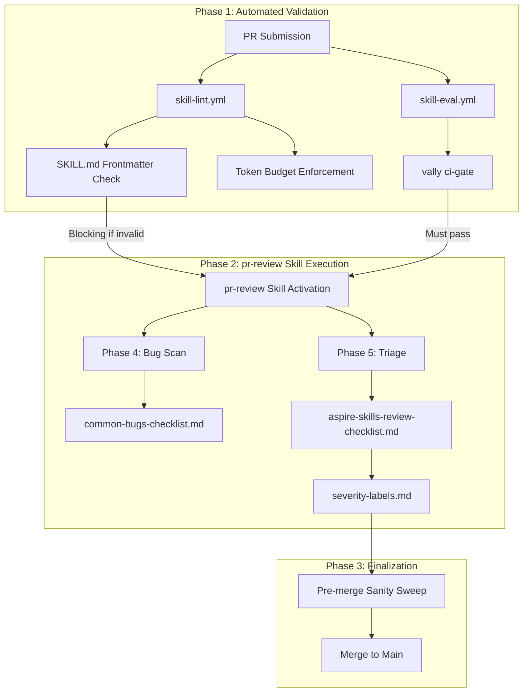
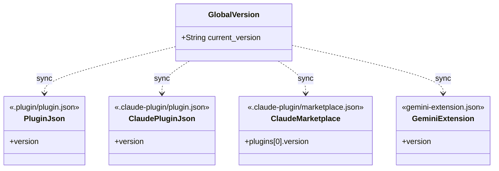

<!-- source: DeepWiki mcp.deepwiki.com · repo microsoft/aspire-skills · page 5.2 Review Checklists & Validation Rules · fetched 2026-10-26 -->

# Review Checklists & Validation Rules

Relevant source files

The following files were used as context for generating this wiki page:

- [.github/skills/pr-review/references/aspire-skills-review-checklist.md](.github/skills/pr-review/references/aspire-skills-review-checklist.md)
- [.github/skills/pr-review/references/code-review-best-practices.md](.github/skills/pr-review/references/code-review-best-practices.md)
- [.github/skills/pr-review/references/common-bugs-checklist.md](.github/skills/pr-review/references/common-bugs-checklist.md)
- [.github/skills/pr-review/references/severity-labels.md](.github/skills/pr-review/references/severity-labels.md)

This page provides the technical specifications for the validation logic and review criteria used to maintain the `microsoft/aspire-skills` repository. It details the schema requirements for skill definitions, the enforcement of token budgets, and the cross-manifest synchronization rules required for plugin distribution.

## Validation Architecture

The validation system ensures that every Pull Request maintains the structural integrity and routing accuracy of the plugin. Validation is split between automated CI gates and the `pr-review` author skill, which uses standardized checklists to categorize findings.

### Data Flow: Review to Merge

The following diagram illustrates how the validation rules are applied during the lifecycle of a Pull Request, from initial submission to the final pre-merge sanity sweep.

**PR Validation Workflow**

**Sources:** [.github/skills/pr-review/references/aspire-skills-review-checklist.md:1-11](), [.github/skills/pr-review/references/code-review-best-practices.md:103-113](), [.github/skills/pr-review/references/common-bugs-checklist.md:9-10]()

---

## SKILL.md Requirements

The `SKILL.md` files are the primary instruction sets for the AI agent. They are subject to strict schema and size constraints to ensure high routing accuracy and performance.

### Frontmatter Schema
Every `SKILL.md` must contain a YAML frontmatter block that matches the directory name and specifies its routing role.

| Field | Requirement | Severity if Missing |
|-------|-------------|---------------------|
| `name` | Must match the directory name (e.g., `aspireify`). | `important` |
| `description` | Folded scalar (`>-`) containing `USE FOR:`, `DO NOT USE FOR:`, and `INVOKES:`. | `blocking` (if keywords removed) |
| `license` | Must be `MIT`. | `important` |
| `metadata.version` | Must be present and incremented on behavior changes. | `important` |

**Sources:** [.github/skills/pr-review/references/aspire-skills-review-checklist.md:12-30](), [.github/skills/pr-review/references/common-bugs-checklist.md:83-87]()

### Token Budget Enforcement
To prevent context window overflow and "instruction fatigue" in the agent, each `SKILL.md` is limited to **5000 tokens**.
*   **Soft Limit:** ~20,000 characters.
*   **Overflow Strategy:** Content exceeding the limit must be moved to the `references/` directory within the skill folder.
*   **Critical Content:** Decision tables and primary routing keywords must remain in the `SKILL.md` as they are read on every activation.

**Sources:** [.github/skills/pr-review/references/aspire-skills-review-checklist.md:31-42]()

---

## Plugin Manifest Synchronization

The plugin is distributed across multiple ecosystems (GitHub Copilot, Claude, Gemini). Versioning must be synchronized across four distinct manifest files to prevent marketplace indexing failures.

**Manifest Version Mapping**

Failure to synchronize these four files is classified as a `blocking` issue.
**Sources:** [.github/skills/pr-review/references/aspire-skills-review-checklist.md:88-105](), [.github/skills/pr-review/references/common-bugs-checklist.md:105-122]()

---

## Safety Guardrail Validation

A core function of the review process is preventing regressions in safety guardrails. These rules are designed to prevent the agent from entering unstable states or causing file-lock errors.

| Forbidden Pattern | Required Pattern | Rationale |
|-------------------|------------------|-----------|
| `dotnet run` | `aspire start` | Ensures the orchestrator and dashboard start correctly. |
| `dotnet build` (while active) | `aspire resource <name> restart` | Avoids `MSB3491` file-lock errors. |
| Direct `.aspire/modules/` edits | `aspire add <integration>` | TypeScript modules are generated, not hand-authored. |
| Interactive CLI calls | Use `--non-interactive` | Agents cannot respond to TTY prompts. |

**Sources:** [.github/skills/pr-review/references/aspire-skills-review-checklist.md:131-151](), [.github/skills/pr-review/references/code-review-best-practices.md:114-126]()

---

## Eval & Grader Design Rules

Evals are the only automated signal for routing drift. The following rules govern how `vally` tasks and graders are authored.

### Grader Patterns
*   **Anchor Requirement:** Every `prompt` grader must include the phrase **"the assistant's response"** to ensure the LLM judge evaluates the output rather than the fixture files.
*   **Split Checks:** Positive intent and negative constraints must be split into separate graders. Do not combine "Verify X but ensure no Y" into a single prompt.
*   **Token Precision:** `not_contains` graders must use full command tokens (e.g., `"azd up"`) rather than bare nouns (`"azd"`) to avoid false positives on legitimate "do not use" guidance.

### Trigger Tests
Routing changes must be reflected in `skills/<skill>/evals/trigger_tests.yaml`. A prompt added to one skill's `should_trigger_prompts` should generally be added to the `should_not_trigger_prompts` list of its siblings to ensure clean dispatching.

**Sources:** [.github/skills/pr-review/references/aspire-skills-review-checklist.md:43-76](), [.github/skills/pr-review/references/common-bugs-checklist.md:44-77]()

---

## Severity Classification

The repository uses a three-tier severity model to prioritize review findings. Labels like `nit`, `praise`, or `learning` are explicitly forbidden to minimize review noise.

| Label | Definition | Recommendation |
|-------|------------|----------------|
| `blocking` | Concrete harm (safety regression, manifest desync, broken JSON). | `REQUEST_CHANGES` |
| `important` | Quality/Maintainability obligation unmet (missing evals, token budget overage). | `COMMENT` |
| `suggestion` | Optional improvement (sharper decision table, better fixture reuse). | `APPROVE` |

**Sources:** [.github/skills/pr-review/references/severity-labels.md:1-76](), [.github/skills/pr-review/references/code-review-best-practices.md:67-77]()

---

