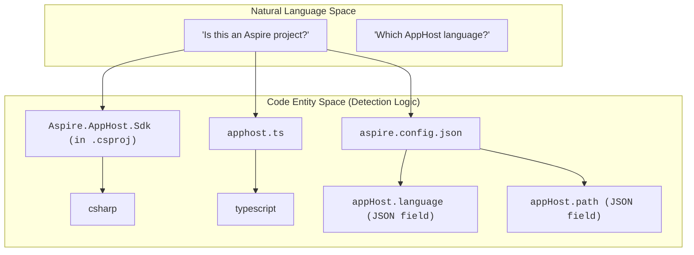
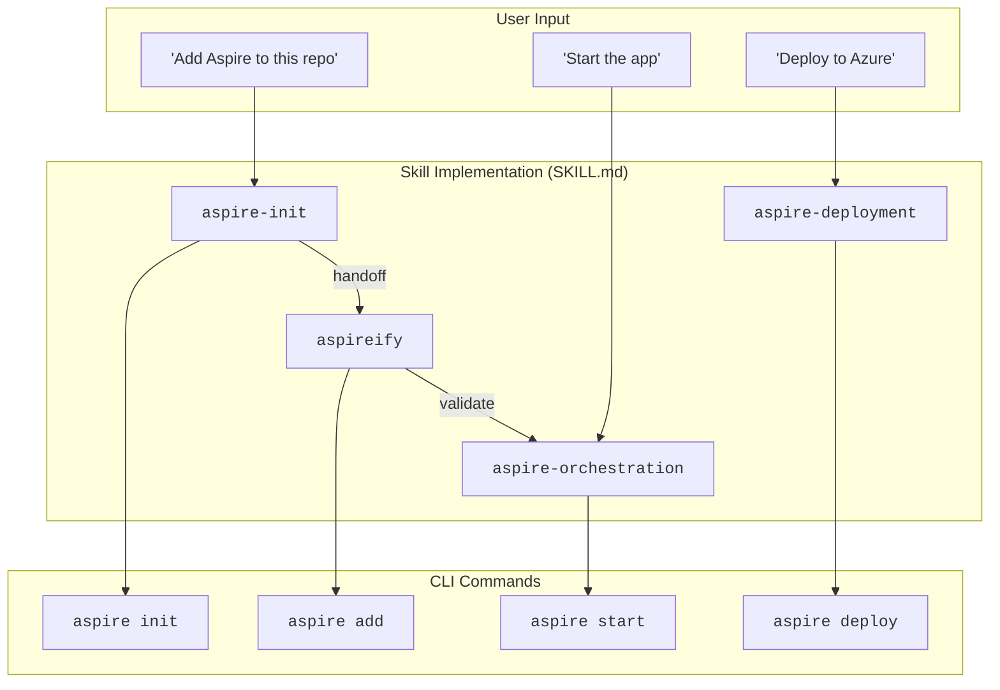

<!-- source: DeepWiki mcp.deepwiki.com · repo microsoft/aspire-skills · page 6 Glossary · fetched 2026-10-26 -->

# Glossary

Relevant source files

The following files were used as context for generating this wiki page:

- [.github/plugins/aspire-skills/README.md](.github/plugins/aspire-skills/README.md)
- [.github/skills/pr-review/references/aspire-skills-review-checklist.md](.github/skills/pr-review/references/aspire-skills-review-checklist.md)
- [.github/skills/pr-review/references/common-bugs-checklist.md](.github/skills/pr-review/references/common-bugs-checklist.md)
- [.github/skills/pr-review/references/severity-labels.md](.github/skills/pr-review/references/severity-labels.md)
- [.plugin/plugin.json](.plugin/plugin.json)
- [CHANGELOG.md](CHANGELOG.md)
- [README.md](README.md)
- [evals/AUTHORING.md](evals/AUTHORING.md)
- [evals/README.md](evals/README.md)
- [skills/aspire-deployment/SKILL.md](skills/aspire-deployment/SKILL.md)
- [skills/aspire-init/SKILL.md](skills/aspire-init/SKILL.md)
- [skills/aspire-monitoring/SKILL.md](skills/aspire-monitoring/SKILL.md)
- [skills/aspire-orchestration/SKILL.md](skills/aspire-orchestration/SKILL.md)
- [skills/aspire-orchestration/references/app-commands.md](skills/aspire-orchestration/references/app-commands.md)
- [skills/aspire-orchestration/references/detection.md](skills/aspire-orchestration/references/detection.md)
- [skills/aspire/SKILL.md](skills/aspire/SKILL.md)
- [skills/aspireify/SKILL.md](skills/aspireify/SKILL.md)

This page provides definitions for codebase-specific terms, jargon, abbreviations, and domain concepts used within the `aspire-skills` repository. It serves as a technical reference for onboarding engineers and AI agent authors to ensure consistency across skill implementations and evaluation logic.

## Core System Concepts

### AppHost
The central orchestrator of an Aspire application. It defines the resource graph (projects, containers, executables) and their relationships.
*   **C# AppHost**: Defined via a `.csproj` using `Aspire.AppHost.Sdk` [skills/aspire-orchestration/SKILL.md:40-40]() or a single `apphost.cs` file using the `#:sdk` directive [skills/aspire-orchestration/SKILL.md:41-41]().
*   **TypeScript AppHost**: Defined in an `apphost.ts` file [skills/aspire-orchestration/SKILL.md:42-42](). It relies on a generated `.aspire/modules/` directory for type-safe integration APIs [skills/aspireify/SKILL.md:32-37]().

### Skeleton Drop
The initial process of adding Aspire support to a repository. This involves creating the minimal necessary files (`apphost.cs` or `apphost.ts` and `aspire.config.json`) to allow the Aspire CLI to function, without yet defining the full resource graph [skills/aspire-init/SKILL.md:4-6]().

### Wiring
The phase following a **Skeleton Drop** where an AI agent (via the `aspireify` skill) scans the repository and populates the AppHost with resource declarations (e.g., `AddProject`, `AddPostgres`) and dependencies [skills/aspireify/SKILL.md:4-7]().

### Resource Graph
The directed graph of services and their dependencies (references) defined within the AppHost. Resources are connected using methods like `WithReference` (C#) or `withReference` (TS) [skills/aspireify/SKILL.md:52-55]().

### Diagnostics Bridge
A routing logic pattern used by the `aspire-monitoring` skill to determine whether to fetch observability data (logs, traces) from the local Aspire CLI, `kubectl` (for AKS), or Azure Monitor (for deployed Azure resources) [skills/aspire-monitoring/SKILL.md:25-42]().

## Code Entity Mapping

The following diagrams bridge natural language concepts to the specific code entities and files that implement them.

### Mapping: Workspace Detection to Code Identifiers
This diagram shows how the system identifies an Aspire project based on specific file markers.

**Sources:** [skills/aspire-orchestration/SKILL.md:34-49](), [skills/aspire-orchestration/references/app-commands.md:69-81]()

### Mapping: Skill Dispatching & Handoff
This diagram illustrates the flow from a user prompt to a specific skill and subsequent handoffs.

**Sources:** [README.md:9-16](), [skills/aspire/SKILL.md:74-84](), [skills/aspire-init/SKILL.md:109-119]()

## Domain Jargon & Abbreviations

| Term | Definition | Code Pointer |
| :--- | :--- | :--- |
| **DCP** | Distributed Application Runtime. The underlying engine managed by the Aspire CLI to run resources locally. | [skills/aspire-orchestration/SKILL.md:4-11]() |
| **Isolated Mode** | A execution mode (`--isolated`) that prevents port and resource conflicts when running multiple instances (e.g., in git worktrees). | [skills/aspire-orchestration/SKILL.md:59-59]() |
| **HMR** | Hot Module Replacement. Guidance provided to agents to prefer runtime-native updates over restarting the whole AppHost. | [skills/aspire-orchestration/SKILL.md:74-75]() |
| **OTLP** | OpenTelemetry Protocol. The standard used for exporting logs, traces, and metrics to the Aspire Dashboard. | [skills/aspire-monitoring/SKILL.md:118-124]() |
| **Vally** | The evaluation framework used to test skill quality and routing accuracy. | [evals/README.md:3-5]() |
| **Stimulus** | A single test case in an eval (prompt + environment). | [evals/README.md:28-28]() |
| **Grader** | A logic unit (text, prompt, or code-based) that determines if an agent's response passed an eval. | [evals/README.md:3-5]() |

**Sources:** [skills/aspire-orchestration/SKILL.md:59-75](), [skills/aspire-monitoring/SKILL.md:118-124](), [evals/README.md:3-28]()

## Safety & Guardrails

### File-Lock Recovery
Specific error codes (`MSB3491`, `CS2012`) indicating that the .NET build system cannot write to files because the Aspire AppHost is still running and holding handles on the `bin/` or `obj/` directories.
*   **Resolution**: Agents must execute `aspire stop` before attempting a rebuild [skills/aspire-orchestration/SKILL.md:106-106](), [skills/aspire-orchestration/SKILL.md:118-121]().

### Non-Interactive Execution
A mandatory flag (`--non-interactive`) that must be appended to all Aspire CLI commands when executed by an AI agent to prevent the process from hanging on user prompts [skills/aspire-orchestration/SKILL.md:60-60]().

### `.aspire/modules/` Protection
A "Hard Refusal" policy for TypeScript AppHosts. Agents must never edit files in this directory as they are regenerated and will clobber manual changes [skills/aspireify/SKILL.md:32-48]().

**Sources:** [skills/aspire-orchestration/SKILL.md:60-121](), [skills/aspireify/SKILL.md:32-48]()