# Page: Overview

# Overview

<details>
<summary>Relevant source files</summary>

The following files were used as context for generating this wiki page:

- [.github/plugins/aspire-skills/README.md](.github/plugins/aspire-skills/README.md)
- [.plugin/plugin.json](.plugin/plugin.json)
- [CHANGELOG.md](CHANGELOG.md)
- [CODE_OF_CONDUCT.md](CODE_OF_CONDUCT.md)
- [CONTRIBUTING.md](CONTRIBUTING.md)
- [LICENSE](LICENSE)
- [README.md](README.md)
- [SECURITY.md](SECURITY.md)

</details>


The `aspire-skills` plugin is a specialized skill pack designed for AI coding agents (such as GitHub Copilot, Claude Code, and Cursor) working within the **.NET Aspire** ecosystem [README.md:1-5](). It provides agents with the domain-specific knowledge, CLI tool definitions, and safety guardrails necessary to manage distributed applications effectively.

By installing this plugin, agents move away from generic shell commands and instead follow structured workflows for orchestration, deployment, and monitoring, aligned with the latest Aspire 13.4 patterns [CHANGELOG.md:8-11]().

## Purpose and Scope

The primary goal of `aspire-skills` is to bridge the gap between high-level natural language intent and the concrete execution of .NET Aspire commands and code modifications. It prevents agents from falling back to suboptimal `dotnet` or `docker` workarounds by providing a dedicated router and five specialized sub-skills [README.md:9-16]().

### Ecosystem Integration

The plugin fits into the .NET Aspire ecosystem through three main entry points:
1.  **First-party CLI integration**: Commands like `aspire agent init` install these skills directly into detected agent environments [README.md:24-35]().
2.  **Marketplace Plugins**: Pre-packaged manifests for popular agent hosts [README.md:37-69]().
3.  **MCP (Model Context Protocol)**: Support for MCP-compatible hosts via `.mcp.json` [README.md:93]().

### System Mapping: Natural Language to Code Entities

The following diagram illustrates how natural language requests are mapped to specific code entities and skills within the repository.

**Natural Language Mapping to Code Entities**
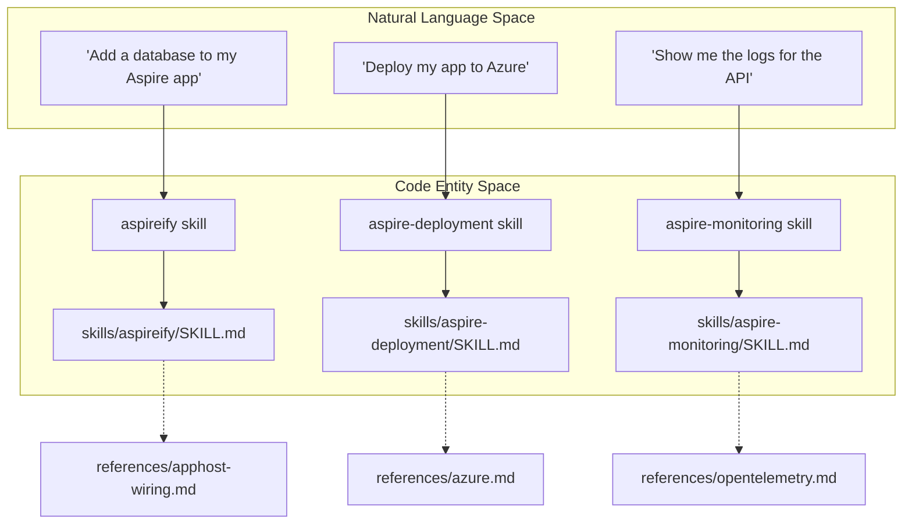
Sources: [README.md:9-16](), [CHANGELOG.md:18-22](), [CHANGELOG.md:43-46]()

## Core Skill Architecture

The plugin is structured around a central router that detects the workspace state and dispatches tasks to the appropriate specialized skill.

| Skill | Role | Key Code Entity |
|-------|------|-----------------|
| `aspire` | Top-level Router | `skills/aspire/SKILL.md` |
| `aspire-init` | Project Scaffolding | `skills/aspire-init/SKILL.md` |
| `aspireify` | AppHost Configuration | `skills/aspireify/SKILL.md` |
| `aspire-orchestration` | Resource Lifecycle | `skills/aspire-orchestration/SKILL.md` |
| `aspire-deployment` | Infrastructure Delivery | `skills/aspire-deployment/SKILL.md` |
| `aspire-monitoring` | Observability & Logs | `skills/aspire-monitoring/SKILL.md` |

**Plugin Routing Architecture**
```mermaid
graph TD
    "User Intent" --> R["aspire (Router)"]
    R -- "New Project" --> SI["aspire-init"]
    R -- "Wiring/Integrations" --> AF["aspireify"]
    R -- "Run/Stop/Status" --> AO["aspire-orchestration"]
    R -- "Publish/Deploy" --> AD["aspire-deployment"]
    R -- "Logs/Traces" --> AM["aspire-monitoring"]

    subgraph "Manifest System"
        M1[".plugin/plugin.json"]
        M2[".claude-plugin/"]
        M3[".cursor-plugin/"]
        M4["gemini-extension.json"]
    end

    R -.-> M1
```
Sources: [README.md:9-16](), [.plugin/plugin.json:1-4](), [CHANGELOG.md:70-75]()

## Child Pages

For detailed technical information on specific areas of the plugin, refer to the following pages:

### [Getting Started & Installation](#1.1)
Covers the installation process for various agent hosts, including GitHub Copilot CLI, Claude Code, and Cursor. It details the prerequisites like the .NET 10 SDK and Aspire CLI, and explains the `aspire agent init` workflow.
*For details, see [Getting Started & Installation](#1.1).*

### [Plugin Architecture & Manifest Files](#1.2)
Explains the multi-manifest system used to support different marketplaces. It details the mirroring strategy found in `.github/plugins/aspire-skills/` where symlinks are used to maintain a single source of truth for skill content.
*For details, see [Plugin Architecture & Manifest Files](#1.2).*

## Repository Organization

The repository is organized to separate runtime skill definitions from development and evaluation tooling [README.md:88-96]().

*   `skills/`: Contains the `SKILL.md` files and supporting `references/` for each skill.
*   `.plugin/`, `.claude-plugin/`, etc.: Metadata files required by different agent ecosystems.
*   `evals/`: Shared fixtures and test cases used by the **Vally** evaluation framework.
*   `.github/plugins/aspire-skills/`: A mirror of the plugin structure used for marketplace publishing [README.md:94](), [.github/plugins/aspire-skills/README.md:1-4]().

Sources: [README.md:88-96](), [.github/plugins/aspire-skills/README.md:1-23]()

---

# Page: Getting Started & Installation

# Getting Started & Installation

<details>
<summary>Relevant source files</summary>

The following files were used as context for generating this wiki page:

- [.claude-plugin/marketplace.json](.claude-plugin/marketplace.json)
- [.claude-plugin/plugin.json](.claude-plugin/plugin.json)
- [.cursor-plugin/marketplace.json](.cursor-plugin/marketplace.json)
- [.github/plugins/aspire-skills/.claude-plugin/marketplace.json](.github/plugins/aspire-skills/.claude-plugin/marketplace.json)
- [.github/plugins/aspire-skills/.claude-plugin/plugin.json](.github/plugins/aspire-skills/.claude-plugin/plugin.json)
- [.github/plugins/aspire-skills/.cursor-plugin/marketplace.json](.github/plugins/aspire-skills/.cursor-plugin/marketplace.json)
- [.github/plugins/aspire-skills/.mcp.json](.github/plugins/aspire-skills/.mcp.json)
- [.github/plugins/aspire-skills/.plugin/plugin.json](.github/plugins/aspire-skills/.plugin/plugin.json)
- [.github/plugins/aspire-skills/README.md](.github/plugins/aspire-skills/README.md)
- [.mcp.json](.mcp.json)
- [.plugin/plugin.json](.plugin/plugin.json)
- [README.md](README.md)
- [gemini-extension.json](gemini-extension.json)

</details>


This page provides technical details for installing and configuring the `aspire-skills` plugin across various AI agent hosts. The plugin enables AI agents to interact with .NET Aspire distributed applications by providing a specialized set of skills for orchestration, deployment, and monitoring.

## Prerequisites

Before installing the plugin, ensure the following environment requirements are met:
*   **.NET 10 SDK**: Required for running and building Aspire projects.
*   **Node.js 22+**: Required for the `npx skills` installer and the `aspire-skills` bundle scripts.
*   **Aspire CLI**: The primary tool used by the skills to manage the AppHost lifecycle.

## Entry Points & Installation Methods

The plugin can be installed through three primary mechanisms: the Aspire CLI, native agent marketplace commands, or the generic `npx skills` utility.

### 1. Aspire CLI Integration
The Aspire CLI provides the most integrated experience, automatically detecting agent environments during project initialization.

*   `aspire new`: Creates a new project and prompts for agent guidance [README.md:28-28]().
*   `aspire init`: Scans an existing repo for Aspire-compatible projects and offers to install skills [README.md:31-31]().
*   `aspire agent init`: Explicitly configures or updates Aspire guidance in an existing workspace [README.md:34-34]().

### 2. Agent Host Specific Installation
Each supported agent host has a specific installation path to register the plugin manifest and its associated MCP (Model Context Protocol) servers.

| Agent Host | Command / Method |
| :--- | :--- |
| **GitHub Copilot** | `copilot plugin install aspire@aspire-skills` [README.md:42-42]() |
| **Claude Code** | `/plugin install aspire@aspire-skills` [README.md:47-47]() |
| **Gemini CLI** | `gemini extensions install https://github.com/microsoft/aspire-skills` [README.md:54-54]() |
| **Cursor** | Clone to `~/.cursor/skills/aspire-skills` [README.md:57-58]() |

### 3. NPX Skills Installer
For hosts supporting the `skills.sh` standard, the `npx skills` command can be used to target specific agents globally or locally.

```bash
npx skills add microsoft/aspire-skills
```
[README.md:76-76]()

To target a specific agent (e.g., GitHub Copilot) globally:
```bash
npx skills add https://github.com/microsoft/aspire-skills/tree/main/skills -a github-copilot -g -y
```
[README.md:82-84]()

**Sources:** [README.md:18-87]().

## Data Flow: Installation to Agent Runtime

The following diagram illustrates how natural language installation commands translate into code-level manifest registrations within the agent's environment.

**Installation Logic Flow**
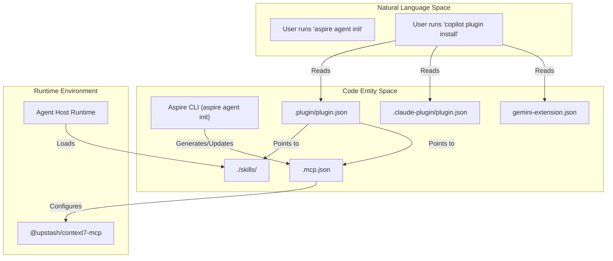
**Sources:** [.plugin/plugin.json:21-22](), [.mcp.json:1-9](), [gemini-extension.json:5-10](), [.claude-plugin/plugin.json:21-22]().

## Plugin Manifests & Mirroring

The repository maintains multiple manifest files to ensure compatibility across different marketplaces while keeping a single source of truth for the skill logic.

### Manifest Synchronization
*   `.plugin/plugin.json`: The primary manifest used by the standard plugin system [plugin.json:1-23]().
*   `.claude-plugin/plugin.json`: Metadata specific to Anthropic's Claude Code environment [plugin.json:1-23]().
*   `gemini-extension.json`: Extension metadata for Google's Gemini CLI [gemini-extension.json:1-12]().
*   `.mcp.json`: Configures the Model Context Protocol servers, specifically the `context7` server via `npx -y @upstash/context7-mcp@latest` [.mcp.json:3-8]().

### Published Plugin Mirror
To support marketplace structures that require a specific folder hierarchy, the directory `.github/plugins/aspire-skills/` contains a mirrored structure using symlinks back to the root manifests and the `skills/` directory [.github/plugins/aspire-skills/README.md:1-23]().

**Mirror Structure Mapping**
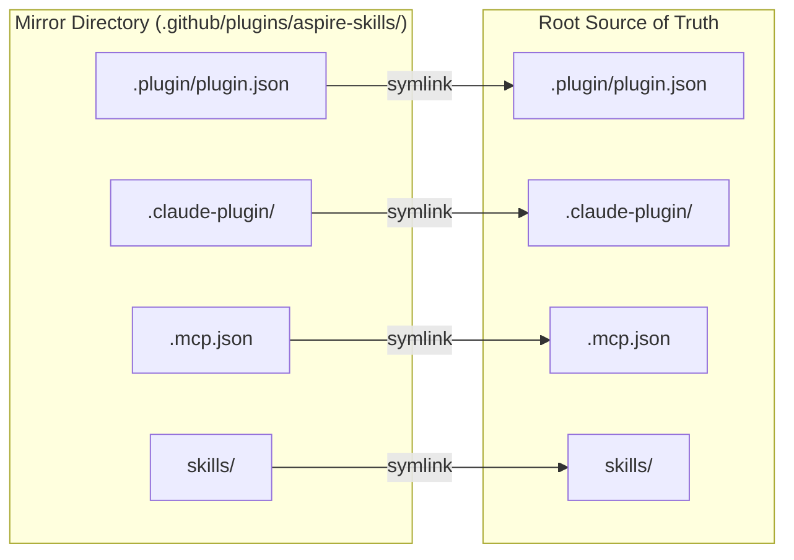
**Sources:** [.github/plugins/aspire-skills/README.md:9-20]().

## Summary Table of Components

| Component | Code Reference | Description |
| :--- | :--- | :--- |
| **Router Skill** | `skills/aspire` | Top-level entry point for all Aspire requests. |
| **Init Skill** | `skills/aspire-init` | Handles `aspire new` and skeleton generation. |
| **Aspireify** | `skills/aspireify` | Logic for wiring existing projects into the AppHost. |
| **Orchestration** | `skills/aspire-orchestration` | Manages `aspire start/stop` and resource lifecycle. |
| **Deployment** | `skills/aspire-deployment` | Handles publishing and cloud deployment targets. |
| **Monitoring** | `skills/aspire-monitoring` | Bridges logs, traces, and the Aspire dashboard. |
| **MCP Config** | `.mcp.json` | Defines external tools available to the agent. |

**Sources:** [README.md:9-16](), [.plugin/plugin.json:3-3]().

---

# Page: Plugin Architecture & Manifest Files

# Plugin Architecture & Manifest Files

<details>
<summary>Relevant source files</summary>

The following files were used as context for generating this wiki page:

- [.claude-plugin/marketplace.json](.claude-plugin/marketplace.json)
- [.claude-plugin/plugin.json](.claude-plugin/plugin.json)
- [.cursor-plugin/marketplace.json](.cursor-plugin/marketplace.json)
- [.github/plugins/aspire-skills/.claude-plugin/marketplace.json](.github/plugins/aspire-skills/.claude-plugin/marketplace.json)
- [.github/plugins/aspire-skills/.claude-plugin/plugin.json](.github/plugins/aspire-skills/.claude-plugin/plugin.json)
- [.github/plugins/aspire-skills/.cursor-plugin/marketplace.json](.github/plugins/aspire-skills/.cursor-plugin/marketplace.json)
- [.github/plugins/aspire-skills/.mcp.json](.github/plugins/aspire-skills/.mcp.json)
- [.github/plugins/aspire-skills/.plugin/plugin.json](.github/plugins/aspire-skills/.plugin/plugin.json)
- [.github/plugins/aspire-skills/README.md](.github/plugins/aspire-skills/README.md)
- [.github/plugins/aspire-skills/gemini-extension.json](.github/plugins/aspire-skills/gemini-extension.json)
- [.mcp.json](.mcp.json)
- [.plugin/plugin.json](.plugin/plugin.json)
- [README.md](README.md)
- [gemini-extension.json](gemini-extension.json)

</details>


The `aspire-skills` repository utilizes a multi-manifest architecture to support a wide variety of AI agent hosts, including GitHub Copilot, Claude Code, Gemini, and Cursor. This architecture ensures that the six core skills (aspire, aspire-init, aspireify, aspire-orchestration, aspire-deployment, and aspire-monitoring) are correctly discovered and indexed by different agent marketplaces.

## Plugin Manifest System

The system relies on a set of metadata files located in the root directory. These manifests define the plugin's identity, versioning, and the location of the skill logic.

### Manifest Types and Roles

| Manifest File | Target Host / Purpose | Key Configuration |
| :--- | :--- | :--- |
| `.plugin/plugin.json` | General agent plugin metadata | Points to `skills/` and `.mcp.json` [.plugin/plugin.json:21-22]() |
| `.claude-plugin/plugin.json` | Anthropic Claude Code | Defines author and repository links [.claude-plugin/plugin.json:5-10]() |
| `.claude-plugin/marketplace.json` | Claude Marketplace indexing | Includes category `developer-tools` and tags [.claude-plugin/marketplace.json:24-41]() |
| `.cursor-plugin/marketplace.json` | Cursor AI | Defines plugin source and tags [.cursor-plugin/marketplace.json:14-41]() |
| `gemini-extension.json` | Google Gemini CLI | Configures MCP servers for context [.gemini-extension.json:5-10]() |
| `.mcp.json` | Model Context Protocol (MCP) | Configures `stdio` based MCP servers like `context7` [.mcp.json:2-8]() |

### Data Flow: Manifest to Agent

The following diagram illustrates how the manifests bridge the "Natural Language Space" (Agent prompts) to the "Code Entity Space" (Skill files).

**Plugin Discovery and Routing Flow**
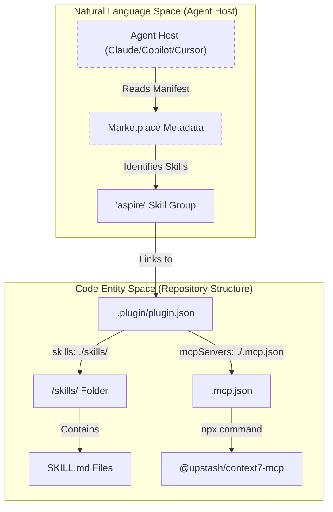

**Sources:**
- [.plugin/plugin.json:1-23]()
- [.claude-plugin/plugin.json:1-23]()
- [.mcp.json:1-9]()
- [gemini-extension.json:1-12]()

## Mirroring Strategy

To facilitate marketplace publishing while maintaining a single source of truth, the repository uses a mirroring strategy under `.github/plugins/aspire-skills/`.

### The Published Plugin Mirror
The directory `.github/plugins/aspire-skills/` acts as a staging area for distribution. All critical files in this directory are **symlinks** pointing back to the root of the repository [.github/plugins/aspire-skills/README.md:4-4](). This allows marketplace crawlers to find a clean sub-directory containing only plugin-related files without including repository-level noise like CI configurations or evaluation scripts.

**Mirror Structure Mapping**
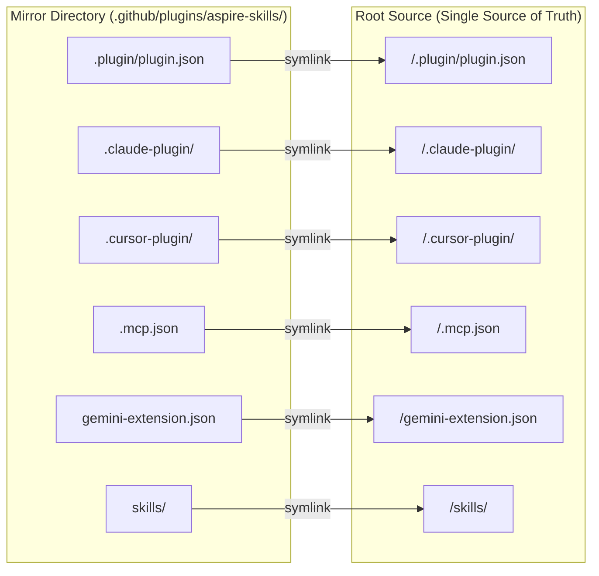

**Sources:**
- [.github/plugins/aspire-skills/README.md:1-23]()
- [README.md:93-94]()

## Version Synchronization

The `aspire-skills` plugin enforces strict version synchronization across all manifest files to ensure consistent behavior across different agent hosts. 

### Synchronization Enforcement
The current version (e.g., `0.0.1`) is hardcoded into every manifest file:
- `.plugin/plugin.json` [.plugin/plugin.json:4-4]()
- `.claude-plugin/plugin.json` [.claude-plugin/plugin.json:4-4]()
- `.claude-plugin/marketplace.json` [.claude-plugin/marketplace.json:16-16]()
- `.cursor-plugin/marketplace.json` [.cursor-plugin/marketplace.json:16-16]()
- `gemini-extension.json` [gemini-extension.json:3-3]()

### Build and Bundle Process
The `npm run bundle` command (defined as `scripts/build-aspire-skills-bundle.mjs`) is responsible for packaging the plugin into a `.tgz` file for release [README.md:99-103](). During the PR review process, automated checks verify that the version string and Aspire version alignment (currently aligned with Aspire 13.4) are consistent across all metadata files [.plugin/plugin.json:3-3]().

**Sources:**
- [README.md:99-103]()
- [.plugin/plugin.json:1-4]()
- [.claude-plugin/marketplace.json:1-16]()

---

# Page: Skill System

# Skill System

<details>
<summary>Relevant source files</summary>

The following files were used as context for generating this wiki page:

- [.github/plugins/aspire-skills/skills/aspire/SKILL.md](.github/plugins/aspire-skills/skills/aspire/SKILL.md)
- [CHANGELOG.md](CHANGELOG.md)
- [skills/aspire-orchestration/references/app-commands.md](skills/aspire-orchestration/references/app-commands.md)
- [skills/aspire-orchestration/references/detection.md](skills/aspire-orchestration/references/detection.md)
- [skills/aspire/SKILL.md](skills/aspire/SKILL.md)

</details>


The `aspire-skills` plugin is built on a six-skill architecture designed to handle the full lifecycle of a .NET Aspire distributed application. A central router skill (`aspire`) manages initial detection and dispatches tasks to specialized sub-skills based on the user's intent and the current state of the repository.

### High-Level Architecture

The system transitions from "Natural Language Space" (user prompts) to "Code Entity Space" (CLI commands and file mutations) through a tiered routing model.

**Skill Dispatch Flow**
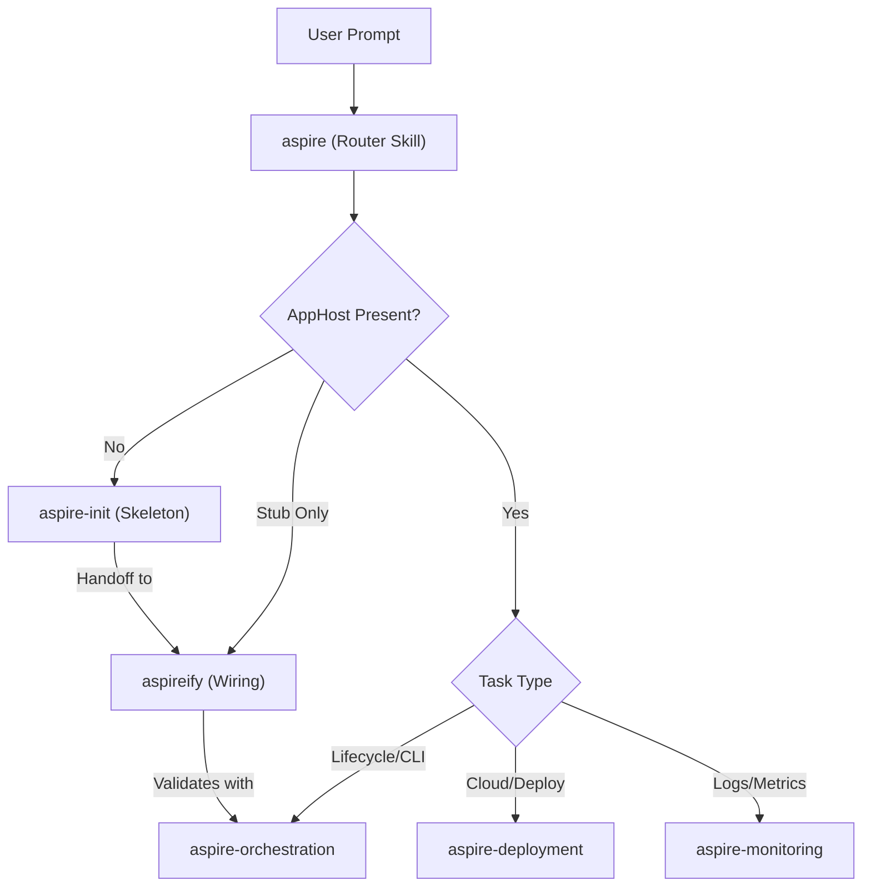
**Sources:** [skills/aspire/SKILL.md:46-51](), [skills/aspire/SKILL.md:74-84]()

### The SKILL.md Format

Each skill is defined by a `SKILL.md` file that serves as the primary contract for AI agents. This format includes:
*   **Frontmatter**: Contains the skill `name`, a `**WORKFLOW SKILL**` description, `USE FOR` / `DO NOT USE FOR` triggers, and `INVOKES` relationships [skills/aspire/SKILL.md:1-21]().
*   **Detection Rules**: A tabular mapping of file signals (e.g., `Aspire.AppHost.Sdk` in `.csproj`) to confidence levels and scope [skills/aspire/SKILL.md:29-44]().
*   **Safety Guardrails**: Strict rules (e.g., "Always use `--non-interactive`", "Never edit `.aspire/modules/` directly") to prevent agent self-harm [skills/aspire/SKILL.md:59-72]().

### Project-Local Overrides

The system supports project-local overrides to allow repository-specific logic to take precedence over the global plugin. If a repository contains `.agents/skills/<skill-name>/SKILL.md`, the router is instructed to defer to that local version [skills/aspire-orchestration/references/app-commands.md:44-47]().

---

### Core Sub-Skills

#### [aspire (Router Skill)](#2.1)
The entry point for all Aspire-related tasks. It identifies the AppHost type (C#, File-based C#, or TypeScript) and enforces the default workflow, such as ensuring `aspire start` is used instead of `dotnet run`.
*   **Key Signal**: `Aspire.AppHost.Sdk` or `apphost.ts` [skills/aspire/SKILL.md:36-38]().
*   **For details, see [aspire (Router Skill)](#2.1).**

#### [aspire-init (Skeleton Drop Skill)](#2.2)
Handles the "Day 0" experience. It uses `aspire new` for greenfield projects or `aspire init` to add Aspire to existing repositories. It generates the initial `aspire.config.json` and hands off to `aspireify` [skills/aspire/SKILL.md:88-92]().
*   **For details, see [aspire-init (Skeleton Drop Skill)](#2.2).**

#### [aspireify (AppHost Wiring Skill)](#2.3)
An agentic skill that wires the AppHost resource graph. It scans the repo for services (Node.js, Python, .NET), proposes integrations (Postgres, Redis), and edits the AppHost code using the appropriate API tiers [skills/aspire-orchestration/references/app-commands.md:48-58]().
*   **For details, see [aspireify (AppHost Wiring Skill)](#2.3).**

#### [aspire-orchestration (Lifecycle Skill)](#2.4)
Manages the local runtime environment. This skill owns commands like `aspire start`, `aspire stop`, and `aspire wait`, as well as resource-specific commands and file-lock recovery logic [skills/aspire-orchestration/references/app-commands.md:5-17]().
*   **For details, see [aspire-orchestration (Lifecycle Skill)](#2.4).**

#### [aspire-deployment (Deployment Skill)](#2.5)
Governs the transition to the cloud. It manages the 10-step deployment workflow, distinguishing between `aspire publish` (manifest generation) and `aspire deploy` (infrastructure provisioning) [CHANGELOG.md:15-22]().
*   **For details, see [aspire-deployment (Deployment Skill)](#2.5).**

#### [aspire-monitoring (Observability Skill)](#2.6)
Provides deep visibility into distributed applications. It routes between local CLI diagnostics, the Aspire Dashboard, and cloud-native providers like Azure Monitor or OpenTelemetry traces [skills/aspire/SKILL.md:108-111]().
*   **For details, see [aspire-monitoring (Observability Skill)](#2.6).**

---

### Code Entity Mapping

The following diagram maps high-level architectural concepts to the specific code entities and files that implement them.

**Entity Mapping: Detection to Execution**
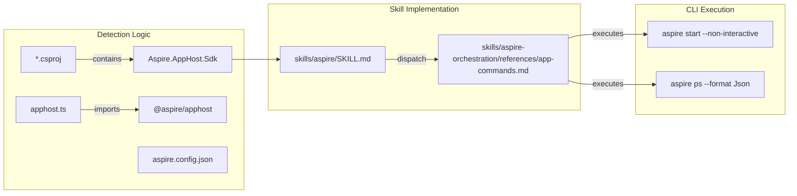
**Sources:** [skills/aspire-orchestration/references/detection.md:7-56](), [skills/aspire-orchestration/references/app-commands.md:7-17](), [skills/aspire-orchestration/references/app-commands.md:85-98]()

---

# Page: aspire (Router Skill)

# aspire (Router Skill)

<details>
<summary>Relevant source files</summary>

The following files were used as context for generating this wiki page:

- [.github/plugins/aspire-skills/skills/aspire/references/aspire-13-3-breaking-changes.md](.github/plugins/aspire-skills/skills/aspire/references/aspire-13-3-breaking-changes.md)
- [evals/ts-apphost/.modules/postgres.module.ts](evals/ts-apphost/.modules/postgres.module.ts)
- [skills/aspire-orchestration/references/app-commands.md](skills/aspire-orchestration/references/app-commands.md)
- [skills/aspire-orchestration/references/detection.md](skills/aspire-orchestration/references/detection.md)
- [skills/aspire-orchestration/references/safety-guardrails.md](skills/aspire-orchestration/references/safety-guardrails.md)
- [skills/aspire/SKILL.md](skills/aspire/SKILL.md)
- [skills/aspire/references/aspire-13-3-breaking-changes.md](skills/aspire/references/aspire-13-3-breaking-changes.md)

</details>


The `aspire` skill serves as the top-level entry point and workflow router for the Aspire skills plugin. It is responsible for detecting the presence of a .NET Aspire AppHost, enforcing safety guardrails, and dispatching tasks to the appropriate specialized sub-skills (`aspire-init`, `aspireify`, `aspire-orchestration`, `aspire-deployment`, or `aspire-monitoring`) [skills/aspire/SKILL.md:4-15]().

## Detection Logic

The router uses a multi-tiered detection strategy to identify Aspire projects and determine their current state (e.g., greenfield, skeleton-only, or fully wired).

### Detection Signal Table

| Signal | Indicator | Confidence | Target Scope |
| :--- | :--- | :--- | :--- |
| **C# AppHost** | `.csproj` containing `Aspire.AppHost.Sdk` | ✅ Definitive | Orchestration / Deployment / Monitoring |
| **File-based C# AppHost** | `apphost.cs` with `#:sdk Aspire.AppHost.Sdk` | ✅ Definitive | Orchestration / Deployment / Monitoring |
| **TypeScript AppHost** | `apphost.ts` file present | ✅ Definitive | Orchestration / Deployment / Monitoring |
| **Aspire Config (No Host)** | `aspire.config.json` present **without** AppHost | High | Bootstrap → `aspireify` |
| **Aspire Config (With Host)**| `aspire.config.json` present **with** AppHost | High | Orchestration / Deployment / Monitoring |
| **Generated Modules** | `.aspire/modules/` directory present | High | AppHost present (TS) |
| **Service Defaults** | `Aspire.ServiceDefaults` project reference | Medium | AppHost present elsewhere |
| **Missing AppHost** | None of the above | n/a | Bootstrap → `aspire-init` |

**Sources**: [skills/aspire/SKILL.md:34-45](), [skills/aspire-orchestration/references/detection.md:7-91]()

### Natural Language to Code Entity Space: Detection

The following diagram illustrates how natural language requests are mapped to specific file-system signals and code entities to trigger the router.

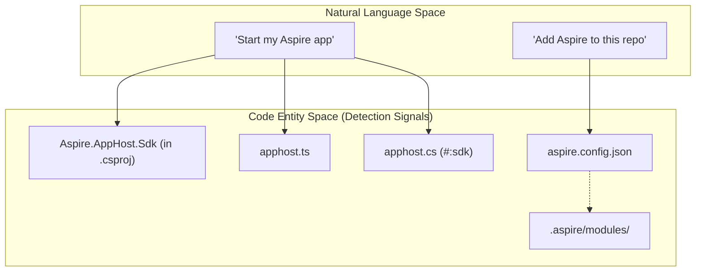
**Sources**: [skills/aspire-orchestration/references/detection.md:7-91](), [skills/aspire/SKILL.md:34-45]()

## Routing Decision Table

Once an Aspire environment is detected, the `aspire` skill routes the request based on the specific task requested by the user or required by the workflow.

| Task Category | Trigger Keywords | Target Skill |
| :--- | :--- | :--- |
| **Bootstrapping** | `new`, `init`, "add aspire" | `aspire-init` |
| **Scaffolding** | `wire`, `scaffold`, `integration search`, `add` | `aspireify` |
| **Lifecycle** | `start`, `stop`, `wait`, `restart`, `rebuild`, `ps` | `aspire-orchestration` |
| **Deployment** | `deploy`, `publish`, `destroy`, `pipeline` | `aspire-deployment` |
| **Observability** | `logs`, `otel`, `traces`, `dashboard`, `describe` | `aspire-monitoring` |

**Sources**: [skills/aspire/SKILL.md:76-84](), [skills/aspire-orchestration/references/app-commands.md:27-101]()

## Data Flow & Handoff

The router enforces a strict handoff sequence, particularly during the initial setup of a project.

### Bootstrap Workflow Flowchart

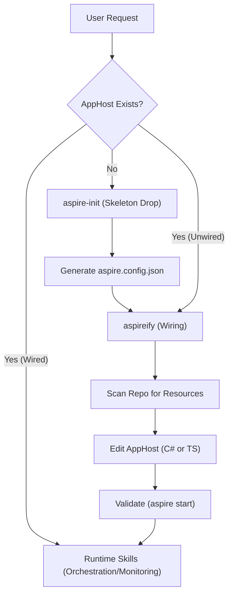
**Sources**: [skills/aspire/SKILL.md:46-57](), [skills/aspire-orchestration/references/app-commands.md:38-58]()

## Project-Local Override Mechanism

The `aspire` skill supports a project-local override mechanism. When `aspire init` is run, it may install a local version of the `aspireify` skill into the `.agents/skills/` directory of the target repository [skills/aspire-orchestration/references/app-commands.md:44-46]().

*   **Priority**: If a project-local `.agents/skills/aspireify/SKILL.md` exists, the router **must** defer to it over the built-in plugin skill [skills/aspire-orchestration/references/app-commands.md:45-46]().
*   **Purpose**: This allows repository-specific scaffolding rules and integration patterns to take precedence over generic plugin logic.

## Safety Guardrails

The router enforces critical safety rules to prevent "agent self-harm" (e.g., resource exhaustion or file-lock deadlocks).

1.  **Always `aspire start`**: Never use `dotnet run` on AppHosts. `dotnet run` bypasses the orchestration layer and fails to launch the dashboard or manage resource lifecycles [skills/aspire-orchestration/references/safety-guardrails.md:11-22]().
2.  **Always `aspire wait`**: Never use manual `curl` polling. The CLI handles internal health checks and dynamic port allocation [skills/aspire-orchestration/references/safety-guardrails.md:54-64]().
3.  **File-Lock Recovery**: If `MSB3491` or `CS2012` errors occur during build, the router mandates `aspire stop` to release locks held by the orchestrator before retrying [skills/aspire-orchestration/references/safety-guardrails.md:92-128]().
4.  **TypeScript Integrity**: Never edit `.aspire/modules/` directly. These are auto-generated from `apphost.ts` [skills/aspire/SKILL.md:72](), [evals/ts-apphost/.modules/postgres.module.ts:1-3]().

**Sources**: [skills/aspire/SKILL.md:59-72](), [skills/aspire-orchestration/references/safety-guardrails.md:1-150]()

---

# Page: aspire-init (Skeleton Drop Skill)

# aspire-init (Skeleton Drop Skill)

<details>
<summary>Relevant source files</summary>

The following files were used as context for generating this wiki page:

- [.github/plugins/aspire-skills/skills/aspire-init/SKILL.md](.github/plugins/aspire-skills/skills/aspire-init/SKILL.md)
- [.github/plugins/aspire-skills/skills/aspire-init/references/init-workflow.md](.github/plugins/aspire-skills/skills/aspire-init/references/init-workflow.md)
- [.github/plugins/aspire-skills/skills/aspire-init/references/templates.md](.github/plugins/aspire-skills/skills/aspire-init/references/templates.md)
- [skills/aspire-init/SKILL.md](skills/aspire-init/SKILL.md)
- [skills/aspire-init/references/init-workflow.md](skills/aspire-init/references/init-workflow.md)
- [skills/aspire-init/references/templates.md](skills/aspire-init/references/templates.md)
- [skills/aspire-monitoring/SKILL.md](skills/aspire-monitoring/SKILL.md)

</details>


The `aspire-init` skill manages the first-run experience for adding .NET Aspire to a repository [skills/aspire-init/SKILL.md:3-6](). It handles two primary workflows: creating brand-new projects using templates (`aspire new`) and bootstrapping Aspire into existing repositories (`aspire init`) [skills/aspire-init/SKILL.md:56-64]().

## Architecture and Detection Logic

This skill is designed for **first-run only**. It is activated only when a workspace does not yet contain an Aspire AppHost [skills/aspire-init/SKILL.md:23-25]().

### Detection Signals
Before executing initialization, the skill verifies the absence of the following signals:

| Signal | Detection Method |
| :--- | :--- |
| **C# AppHost** | Absence of `.csproj` containing `Aspire.AppHost.Sdk` [skills/aspire-init/SKILL.md:46]() |
| **File-based AppHost** | Absence of `apphost.cs` with `#:sdk Aspire.AppHost.Sdk` [skills/aspire-init/SKILL.md:47]() |
| **TypeScript AppHost** | Absence of `apphost.ts` in the repository root [skills/aspire-init/SKILL.md:48]() |
| **Aspire Config** | Absence of `aspire.config.json` [skills/aspire-init/SKILL.md:49]() |

**Sources:** [skills/aspire-init/SKILL.md:39-51]()

### Natural Language to CLI Entity Mapping

This diagram bridges the user's intent to the specific Aspire CLI commands and the resulting filesystem entities.

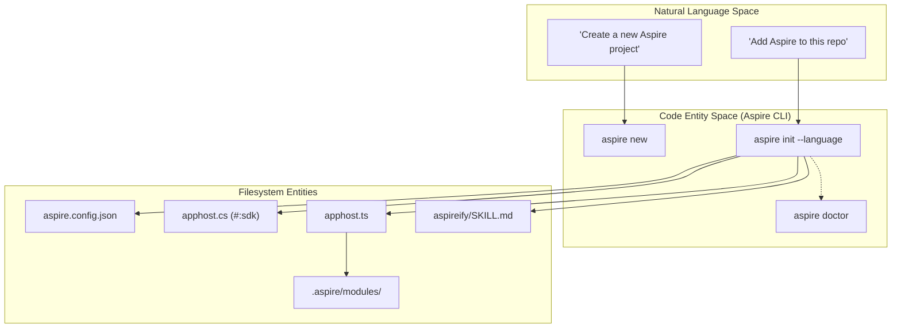
**Sources:** [skills/aspire-init/SKILL.md:56-64](), [skills/aspire-init/references/init-workflow.md:36-56]()

## Workflow A: Greenfield (`aspire new`)

Used for brand-new projects in empty directories. It generates a full starter solution based on a template [skills/aspire-init/SKILL.md:69-71]().

### Template Selection
| Template | Language | Description |
| :--- | :--- | :--- |
| `aspire-starter` | C# | ASP.NET Core / Blazor starter [skills/aspire-init/references/templates.md:10]() |
| `aspire-ts-starter` | TypeScript | Express / React starter [skills/aspire-init/references/templates.md:13]() |
| `aspire-py-starter` | TypeScript | FastAPI / React (TS AppHost drives Python) [skills/aspire-init/references/templates.md:12]() |
| `aspire-empty` | C# | Minimal scaffold without resources [skills/aspire-init/references/templates.md:14]() |

### Execution Pattern
Agents must use the `--non-interactive` flag to suppress prompts and spinners [skills/aspire-init/references/templates.md:30]().
```bash
aspire new aspire-starter --name MyApp --output ./MyApp --non-interactive
```
**Sources:** [skills/aspire-init/SKILL.md:75-78](), [skills/aspire-init/references/templates.md:6-16]()

## Workflow B: Brownfield (`aspire init`)

Used for repositories that already contain services (e.g., Express, .NET API) and need an AppHost added alongside them [skills/aspire-init/SKILL.md:83-86]().

### The `aspire.config.json` Generation
This file is dropped at the repository root to guide subsequent tooling [skills/aspire-init/references/init-workflow.md:42]().

| Field | Description |
| :--- | :--- |
| `appHost.language` | `"csharp"` or `"typescript/nodejs"` [skills/aspire-init/references/init-workflow.md:62]() |
| `appHost.path` | Path to the AppHost file or directory [skills/aspire-init/references/init-workflow.md:63]() |

### Language-Specific Artifacts
*   **C#**: Drops `apphost.cs` using the single-file `#:sdk` directive [skills/aspire-init/references/init-workflow.md:40]().
*   **TypeScript**: Drops `apphost.ts` and generates the `.aspire/modules/` directory [skills/aspire-init/references/init-workflow.md:46-47]().

**Sources:** [skills/aspire-init/references/init-workflow.md:36-70]()

## Skill Handoff and Life Cycle

The `aspire-init` skill is a "Skeleton Drop" skill; it does not perform resource wiring itself. Instead, it prepares the environment for the `aspireify` skill [skills/aspire-init/SKILL.md:101-102]().

### Handoff Flow
1.  **Skeleton Drop**: `aspire-init` creates the AppHost and `aspire.config.json`.
2.  **Skill Installation**: `aspire init` installs the `aspireify` agent skill into the project's `.agents/skills/` (or equivalent) directory [skills/aspire-init/references/init-workflow.md:52-54]().
3.  **Handoff**: The agent transitions to the `aspireify` skill to scan the repo and wire projects/containers [skills/aspire-init/SKILL.md:111-113]().

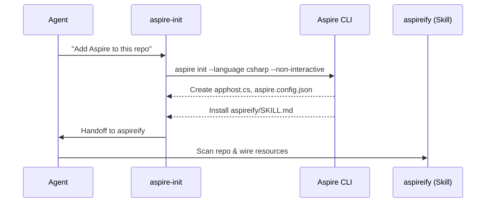
**Sources:** [skills/aspire-init/SKILL.md:95-104](), [skills/aspire-init/references/init-workflow.md:71-91]()

## Project-Local Overrides
If a repository contains a legacy `aspire-init` skill (e.g., in `.agents/skills/aspire-init/SKILL.md`), the plugin must **defer** to the local copy and warn the user, as it may contain repo-specific instructions [skills/aspire-init/SKILL.md:120-124]().

## Error Handling and Recovery
| Symptom | Cause | Action |
| :--- | :--- | :--- |
| `AppHost already exists` | Duplicate init attempt | Route to `aspireify` or `aspire-orchestration` [skills/aspire-init/SKILL.md:134]() |
| Missing `--language` | Multiple paths available in non-interactive mode | Re-run with `--language csharp` or `typescript` [skills/aspire-init/SKILL.md:135]() |
| `aspire` command not found | CLI not installed | Install via `dotnet tool install -g Aspire.Cli` [skills/aspire-init/SKILL.md:137]() |

**Sources:** [skills/aspire-init/SKILL.md:130-137](), [skills/aspire-init/references/init-workflow.md:103-112]()

---

# Page: aspireify (AppHost Wiring Skill)

# 2.3 aspireify (AppHost Wiring Skill)

<details>
<summary>Relevant source files</summary>

The following files were used as context for generating this wiki page:

- [.gitignore](.gitignore)
- [skills/aspireify/SKILL.md](skills/aspireify/SKILL.md)
- [skills/aspireify/references/apphost-wiring.md](skills/aspireify/references/apphost-wiring.md)
- [skills/aspireify/references/full-solution-apphosts.md](skills/aspireify/references/full-solution-apphosts.md)
- [skills/aspireify/references/scan-and-propose.md](skills/aspireify/references/scan-and-propose.md)
- [skills/aspireify/references/service-defaults.md](skills/aspireify/references/service-defaults.md)
- [skills/aspireify/references/typescript-authoring.md](skills/aspireify/references/typescript-authoring.md)
- [skills/aspireify/references/validation.md](skills/aspireify/references/validation.md)

</details>


The `aspireify` skill is a one-time wiring workflow designed to transform a basic Aspire skeleton (dropped by `aspire init`) into a fully functional resource graph. It automates the process of scanning a repository, proposing a resource model, editing the AppHost code, and validating the resulting configuration.

For specific implementation patterns, see:
- [C# AppHost Authoring](#2.3.1)
- [TypeScript AppHost Authoring](#2.3.2)

## Purpose and Scope
`aspireify` handles the complexity of "wiring" after the initial skeleton is created [skills/aspireify/SKILL.md:4-7](). It is responsible for identifying .NET projects, Node.js services, and container dependencies (like Postgres or Redis) and establishing the references between them [skills/aspireify/SKILL.md:8-11]().

### 🚫 The .aspire/modules/ Guardrail
A critical constraint of this skill is the **hard refusal** to edit any files within the `.aspire/modules/` directory of a TypeScript AppHost [skills/aspireify/SKILL.md:32-37](). This directory is generated and any manual changes are clobbered during the next build or `aspire start` [skills/aspireify/references/typescript-authoring.md:9-20](). All edits must be directed to `apphost.ts` [skills/aspireify/references/typescript-authoring.md:42-48]().

## The Five-Phase Lifecycle
The skill operates through a structured five-phase workflow to ensure safety and accuracy.

### 1. Scan
The skill performs a deep inventory of the repository to find runnable projects, environment variables, and connection strings [skills/aspireify/references/scan-and-propose.md:5-17]().
- **.NET:** Scans for `.csproj` files, identifying APIs vs. Workers [skills/aspireify/references/scan-and-propose.md:23-24]().
- **JavaScript/TypeScript:** Identifies Next.js, Vite, or Node.js apps via `package.json` [skills/aspireify/references/scan-and-propose.md:25-28]().
- **Integrations:** Greps for existing connection strings (Postgres, Redis, etc.) in `.env` or `appsettings.json` [skills/aspireify/references/scan-and-propose.md:13]().

### 2. Propose
Before making edits, the skill presents a **Proposed Resource Graph** to the user [skills/aspireify/references/scan-and-propose.md:100-119](). This includes:
- Detected projects and their roles.
- Proposed references (e.g., `api` references `pg`).
- Migration strategies for existing secrets and `.env` files.

### 3. Edit
Once confirmed, the skill performs the necessary code modifications:
- **C#:** Edits `Program.cs` or `apphost.cs` using the `IDistributedApplicationBuilder` API [skills/aspireify/references/full-solution-apphosts.md:103-112]().
- **TypeScript:** Edits `apphost.ts` using the `createBuilder()` API [skills/aspireify/references/typescript-authoring.md:51-70]().
- **ServiceDefaults:** Adds the `Aspire.ServiceDefaults` project and wires `AddServiceDefaults()` and `MapDefaultEndpoints()` in service projects [skills/aspireify/references/service-defaults.md:3-41]().

### 4. Validate
The skill validates the new wiring by running the AppHost in a non-interactive mode [skills/aspireify/references/validation.md:8-23]().
- Uses `aspire start --non-interactive --format Json`.
- Uses `aspire wait <displayName>` to ensure each resource reaches a healthy state [skills/aspireify/references/validation.md:16]().
- Verifies the graph shape with `aspire describe`.

### 5. Deactivate
After successful validation, the skill self-deactivates and hands off to `aspire-orchestration` for day-to-day management [skills/aspireify/references/validation.md:66-85]().

## Integration Discovery Catalog
The skill maps detected technologies to specific Aspire hosting packages.

| Service | C# Builder Method | TypeScript Builder Method |
| :--- | :--- | :--- |
| **Postgres** | `AddPostgres("pg")` | `addPostgres('pg')` |
| **Redis** | `AddRedis("cache")` | `addRedis('cache')` |
| **RabbitMQ** | `AddRabbitMQ("mq")` | `addRabbitMQ('mq')` |
| **Next.js** | `AddNextJsApp("web")` | `addNextJsApp('web')` |

Sources: [skills/aspireify/references/scan-and-propose.md:38-74](), [skills/aspireify/references/apphost-wiring.md:17-34]().

## Architectural Mapping: Logic to Code

The following diagram bridges the natural language intent of "wiring" to the specific code entities and CLI commands used by `aspireify`.

### Wiring Workflow Entity Map
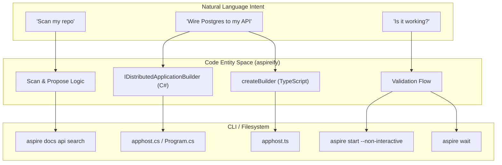
Sources: [skills/aspireify/SKILL.md:15-16](), [skills/aspireify/references/apphost-wiring.md:52-60](), [skills/aspireify/references/validation.md:10-16]().

### ServiceDefaults Integration Map
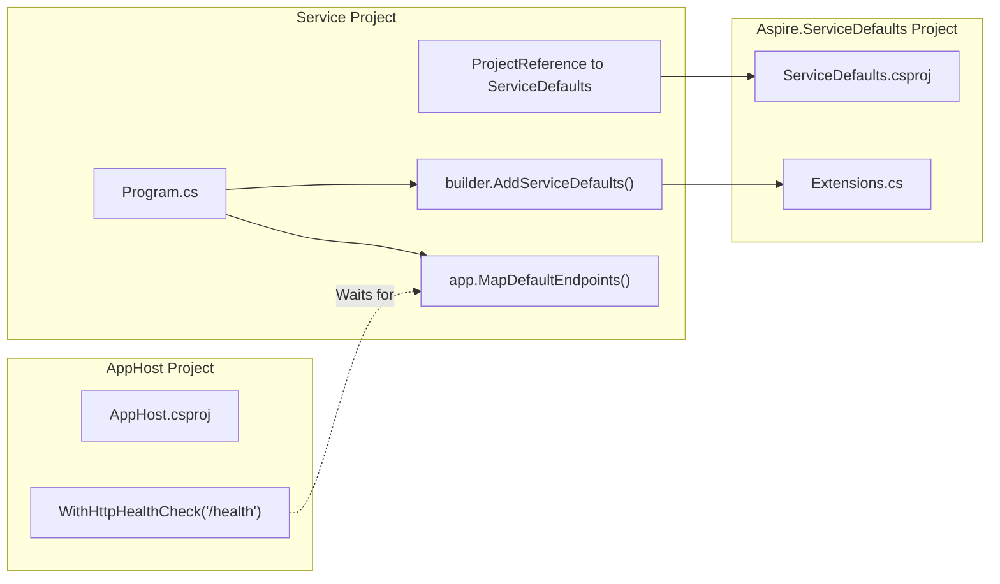
Sources: [skills/aspireify/references/service-defaults.md:7-41](), [skills/aspireify/references/service-defaults.md:54-68]().

## Project-Local Overrides
If a project contains a local `.agents/skills/aspireify/SKILL.md`, the plugin will warn the user and defer to the local version, allowing for project-specific wiring rules [skills/aspireify/SKILL.md:106-115]().

Sources:
- [skills/aspireify/SKILL.md:1-140]()
- [skills/aspireify/references/typescript-authoring.md:1-206]()
- [skills/aspireify/references/scan-and-propose.md:1-122]()
- [skills/aspireify/references/validation.md:1-98]()
- [skills/aspireify/references/service-defaults.md:1-115]()
- [skills/aspireify/references/apphost-wiring.md:1-148]()
- [skills/aspireify/references/full-solution-apphosts.md:1-150]()

---

# Page: C# AppHost Authoring

# C# AppHost Authoring

<details>
<summary>Relevant source files</summary>

The following files were used as context for generating this wiki page:

- [.github/plugins/aspire-skills/skills/aspireify/references/csharp-authoring.md](.github/plugins/aspire-skills/skills/aspireify/references/csharp-authoring.md)
- [skills/aspire-monitoring/references/diagnostics-bridge.md](skills/aspire-monitoring/references/diagnostics-bridge.md)
- [skills/aspire-monitoring/references/monitoring.md](skills/aspire-monitoring/references/monitoring.md)
- [skills/aspireify/references/csharp-authoring.md](skills/aspireify/references/csharp-authoring.md)
- [skills/aspireify/references/service-defaults.md](skills/aspireify/references/service-defaults.md)

</details>


This page details the patterns and implementation details for authoring .NET Aspire AppHosts using C#. It covers the two primary authoring modes (SDK-style vs. File-based), the core builder API, resource orchestration, and the integration of ServiceDefaults for observability and resilience.

## Overview and Purpose

C# AppHost authoring provides a strongly-typed environment for defining distributed applications. The `aspireify` skill uses these patterns to wire up projects, containers, and cloud resources. The system relies on the `IDistributedApplicationBuilder` to manage the lifecycle, configuration, and relationship between services [skills/aspireify/references/csharp-authoring.md:1-4]().

## Authoring Modes

### 1. SDK-style (.csproj + Program.cs)
This is the standard mode for .NET projects. It utilizes a `.csproj` file that imports the `Aspire.AppHost.Sdk`. This enables strongly-typed project references via the `Projects` namespace, which is automatically generated by the SDK based on `<ProjectReference>` entries [skills/aspireify/references/csharp-authoring.md:9-38]().

### 2. File-based AppHost (apphost.cs)
A lightweight alternative that does not require a `.csproj` file. It uses `#:sdk` and `#:package` directives at the top of a `.cs` file. In this mode, strongly-typed `Projects.X` references are unavailable, and the path-based overload of `AddProject` must be used [skills/aspireify/references/csharp-authoring.md:47-75]().

### Mapping Natural Language to Code Entities: Authoring Styles
| Concept | Code Entity | Source |
| :--- | :--- | :--- |
| **Project Reference** | `builder.AddProject<Projects.MyApi>("api")` | [skills/aspireify/references/csharp-authoring.md:19-19]() |
| **Direct Path** | `builder.AddProject("api", "../Api/Api.csproj")` | [skills/aspireify/references/csharp-authoring.md:43-43]() |
| **SDK Directive** | `#:sdk Aspire.AppHost.Sdk` | [skills/aspireify/references/csharp-authoring.md:52-52]() |
| **Package Directive** | `#:package Aspire.Hosting.PostgreSQL@13.*` | [skills/aspireify/references/csharp-authoring.md:53-53]() |

**Sources:** [skills/aspireify/references/csharp-authoring.md:9-75]()

---

## Core Builder API

The `DistributedApplication.CreateBuilder(args)` method initializes the orchestration engine. Developers use extension methods on the builder to define the application graph [skills/aspireify/references/csharp-authoring.md:14-34]().

### Common Resource Methods
| Method | Purpose |
| :--- | :--- |
| `AddPostgres(name)` | Adds a PostgreSQL container resource [skills/aspireify/references/csharp-authoring.md:87-87]() |
| `AddRedis(name)` | Adds a Redis container resource [skills/aspireify/references/csharp-authoring.md:87-87]() |
| `AddContainer(name, image)` | Adds an arbitrary container [skills/aspireify/references/csharp-authoring.md:82-82]() |
| `AddNodeApp(name, path)` | Integrates a Node.js application [skills/aspireify/references/csharp-authoring.md:84-84]() |

### Orchestration and Relationships
| Method | Data Flow / Behavior |
| :--- | :--- |
| `WithReference(other)` | Injects connection strings or endpoint URLs from the target into the consumer's environment [skills/aspireify/references/csharp-authoring.md:89-89]() |
| `WaitFor(other)` | Blocks the resource start until the target passes its health check [skills/aspireify/references/csharp-authoring.md:90-90]() |
| `WithEnvironment(k, v)` | Manually injects environment variables, supporting dynamic expressions [skills/aspireify/references/csharp-authoring.md:91-91]() |
| `WithHttpHealthCheck(path)` | Defines the endpoint used by `WaitFor` to determine readiness [skills/aspireify/references/csharp-authoring.md:94-94]() |

### Resource Relationship Data Flow
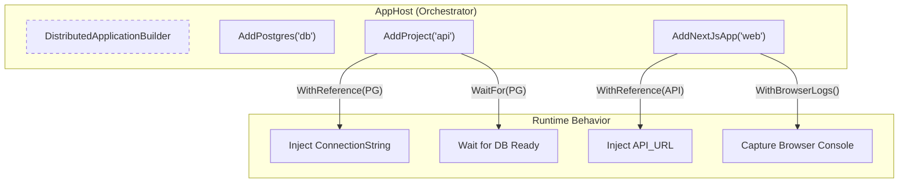
**Sources:** [skills/aspireify/references/csharp-authoring.md:14-34](), [skills/aspireify/references/csharp-authoring.md:77-94](), [skills/aspireify/references/service-defaults.md:54-68]()

---

## Endpoint Configuration

Endpoints are managed via `WithEndpoint` and `WithExternalHttpEndpoints`. `WithEndpoint` is idempotent; calling it multiple times with the same name updates the existing configuration rather than creating duplicates [skills/aspireify/references/csharp-authoring.md:96-107]().

```csharp
var api = builder.AddProject<Projects.Api>("api")
    .WithEndpoint("admin", e => e.Port = 9000)
    .WithEndpoint("admin", e => e.ExcludeReferenceEndpoint = true); 
```
*Note: `ExcludeReferenceEndpoint = true` prevents the endpoint from being automatically injected into other resources via `WithReference` [skills/aspireify/references/csharp-authoring.md:104-106]().*

**Sources:** [skills/aspireify/references/csharp-authoring.md:96-107]()

---

## ServiceDefaults Injection

`Aspire.ServiceDefaults` is a shared project that configures cross-cutting concerns for every service in the solution. It is essential for ensuring that `WaitFor` logic functions correctly by providing standard health endpoints [skills/aspireify/references/service-defaults.md:1-6]().

### Wiring Workflow
1.  **Project Reference**: Each service project must reference the `ServiceDefaults` project [skills/aspireify/references/service-defaults.md:16-20]().
2.  **Registration**: Call `builder.AddServiceDefaults()` in the service's `Program.cs` to configure OpenTelemetry, Service Discovery, and Resilience [skills/aspireify/references/service-defaults.md:24-30]().
3.  **Mapping**: Call `app.MapDefaultEndpoints()` to expose `/health` and `/alive` routes [skills/aspireify/references/service-defaults.md:34-36]().

### ServiceDefaults Capabilities
| Feature | Implementation | Source |
| :--- | :--- | :--- |
| **Observability** | OTLP Export for Traces, Metrics, and Logs | [skills/aspireify/references/service-defaults.md:47-49]() |
| **Health Checks** | Readiness (`/health`) and Liveness (`/alive`) | [skills/aspireify/references/service-defaults.md:50-50]() |
| **Discovery** | `Microsoft.Extensions.ServiceDiscovery` for HttpClient | [skills/aspireify/references/service-defaults.md:51-51]() |
| **Resilience** | Standard resilience handlers for outbound calls | [skills/aspireify/references/service-defaults.md:52-52]() |

### Service Interaction Logic
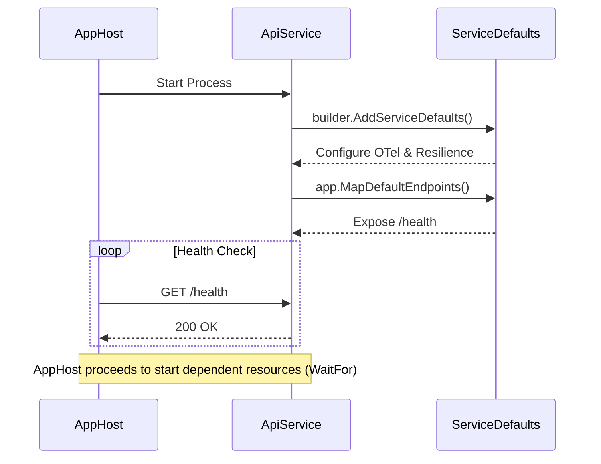
**Sources:** [skills/aspireify/references/service-defaults.md:22-41](), [skills/aspireify/references/service-defaults.md:54-68]()

---

## JavaScript Integration in C# AppHosts

C# AppHosts support first-class integration for Node.js, Next.js, and Vite applications.

*   **Browser Logs**: The `WithBrowserLogs()` method (from `Aspire.Hosting.Browsers`) captures browser console output, network requests, and screenshots, sending them to the Aspire Dashboard [skills/aspireify/references/csharp-authoring.md:144-149]().
*   **Publishing**:
    *   `PublishAsStaticWebsite`: Used for Vite SPAs, often paired with a YARP reverse proxy for API calls [skills/aspireify/references/csharp-authoring.md:129-137]().
    *   `PublishAsNodeServer`: For pre-bundled servers like SvelteKit [skills/aspireify/references/csharp-authoring.md:130-130]().
    *   `PublishAsPackageScript`: For SSR frameworks like Remix or Astro [skills/aspireify/references/csharp-authoring.md:131-131]().

**Sources:** [skills/aspireify/references/csharp-authoring.md:125-149]()

---

# Page: TypeScript AppHost Authoring

# TypeScript AppHost Authoring

<details>
<summary>Relevant source files</summary>

The following files were used as context for generating this wiki page:

- [.github/plugins/aspire-skills/skills/aspireify/references/javascript-apps.md](.github/plugins/aspire-skills/skills/aspireify/references/javascript-apps.md)
- [.github/plugins/aspire-skills/skills/aspireify/references/typescript-authoring.md](.github/plugins/aspire-skills/skills/aspireify/references/typescript-authoring.md)
- [.gitignore](.gitignore)
- [evals/ts-apphost/.modules/aspire.ts](evals/ts-apphost/.modules/aspire.ts)
- [skills/aspireify/references/javascript-apps.md](skills/aspireify/references/javascript-apps.md)
- [skills/aspireify/references/typescript-authoring.md](skills/aspireify/references/typescript-authoring.md)

</details>


This page details the patterns and implementation details for authoring a TypeScript-based AppHost in .NET Aspire. It covers the core `IDistributedApplicationBuilder` equivalent in TypeScript, resource orchestration, and the critical lifecycle of generated modules.

## Overview and Implementation Flow

TypeScript AppHost authoring centers around `apphost.ts`. Unlike the C# AppHost, which uses NuGet packages directly, the TypeScript AppHost relies on a generation step that produces type-safe bindings for Aspire integrations.

### Data Flow and Lifecycle
The following diagram illustrates the relationship between `apphost.ts`, the Aspire CLI, and the generated artifacts.

**TypeScript AppHost Lifecycle**
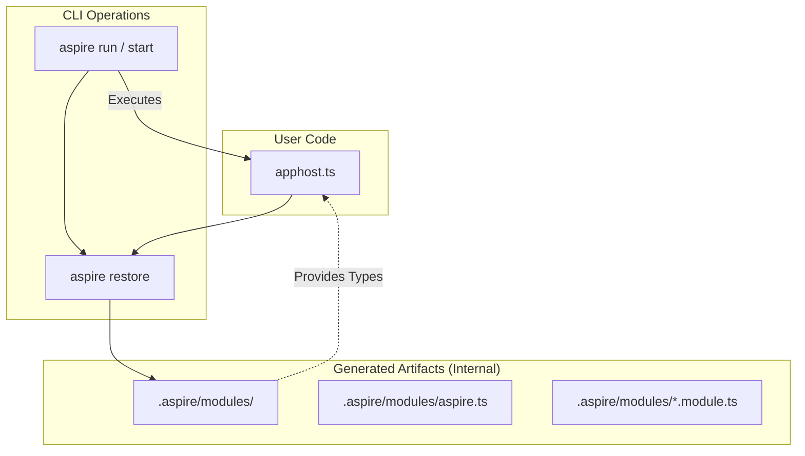

**Sources:** [skills/aspireify/references/typescript-authoring.md:9-19](), [skills/aspireify/references/javascript-apps.md:120-122]()

## Core API Patterns

### The Builder Pattern
The entry point for any TypeScript AppHost is `createBuilder()`. This function initializes the orchestration context.

```typescript
import { createBuilder } from '@aspire/hosting';

const builder = await createBuilder();

// Define resources...
const pg = builder.addPostgres('pg').addDatabase('appdb');
const api = await builder.addProject('api', '../Api/Api.csproj')
    .withReference(pg);

await builder.build().run();
```

**Sources:** [skills/aspireify/references/typescript-authoring.md:52-71]()

### Unified `withEnvironment` API
TypeScript authoring uses a unified `withEnvironment(name, value)` method. This single API replaces several specialized C# methods by accepting various types of `IExpressionValue`.

| Supported Value Types | Description |
|-----------------------|-------------|
| `string` | Literal environment variable values. |
| `ReferenceExpression` | Complex expressions involving other resources. |
| `EndpointReference` | Automatic URL/Host/Port resolution. |
| `ParameterResource` | Values from `builder.addParameter`. |
| `IResource` | Connection strings from database or cache resources. |

**Note:** Per-kind helpers like `withEnvironmentEndpoint` or `withEnvironmentConnectionString` are deprecated in favor of this unified API [skills/aspireify/references/typescript-authoring.md:91-96]().

**Sources:** [skills/aspireify/references/typescript-authoring.md:73-89]()

### Endpoint Expressions
Resources expose endpoints that can be queried for specific properties using `getEndpoint(name)`. These properties (`url`, `host`, `port`) are themselves expressions that resolve at runtime.

```typescript
const api = await builder.addProject('api', '../Api/Api.csproj');
const httpEndpoint = api.getEndpoint('http');

await builder.addNodeApp('worker', 'worker.js')
    .withEnvironment('API_BASE', httpEndpoint.url);
```

**Sources:** [skills/aspireify/references/typescript-authoring.md:98-110]()

## JavaScript and Frontend Resource Types

The TypeScript AppHost provides specialized helpers for different JavaScript workloads.

| Helper | Use Case |
|--------|----------|
| `addNextJsApp` | Next.js applications; supports auto-standalone publish. |
| `addViteApp` | Vite-based SPAs (React, Vue, Svelte). |
| `addNodeApp` | General Node.js services or APIs. |

### Publish Hooks
To ensure parity with C# `PublishAs*` methods, TypeScript provides hooks for deployment behavior:
*   `publishAsStaticWebsite`: Deploys a Vite/SPA as a static site, optionally configuring an API proxy [skills/aspireify/references/typescript-authoring.md:137-139]().
*   `publishAsNodeServer`: For pre-bundled servers like SvelteKit [skills/aspireify/references/typescript-authoring.md:141-143]().
*   `publishAsPackageScript`: Delegates deployment execution to a `package.json` script [skills/aspireify/references/typescript-authoring.md:145-147]().

**Sources:** [skills/aspireify/references/typescript-authoring.md:124-148](), [skills/aspireify/references/javascript-apps.md:7-13]()

## Compute Environments

TypeScript AppHosts support targeting specific compute environments like Azure Container Apps (ACA) or Azure Kubernetes Service (AKS).

```typescript
const aca = builder.addAzureContainerAppEnvironment('aca');

await builder.addProject('api', '../Api/Api.csproj')
    .withComputeEnvironment(aca, e => {
        e.customDomains = [{ name: 'api.example.com', certificate: cert }];
    });
```

**Sources:** [skills/aspireify/references/typescript-authoring.md:182-198]()

## The `.aspire/modules/` Directory

A critical distinction in TypeScript AppHost authoring is the `.aspire/modules/` directory. This directory contains the generated TypeScript bindings for Aspire resources and integrations.

### ⛔ Hard Refusal: Editing Generated Modules
Users and AI agents must **never** edit files inside `.aspire/modules/`. This directory is an internal artifact managed by the Aspire CLI.

*   **Regeneration:** Files are clobbered on every `aspire restore`, `aspire add`, and `aspire start` [skills/aspireify/references/typescript-authoring.md:15-18]().
*   **Source of Truth:** All configuration must happen in `apphost.ts`. If an integration is missing, it must be added via `aspire add <package>` [skills/aspireify/references/typescript-authoring.md:34-35]().

**Entity Mapping: AppHost to Transport**
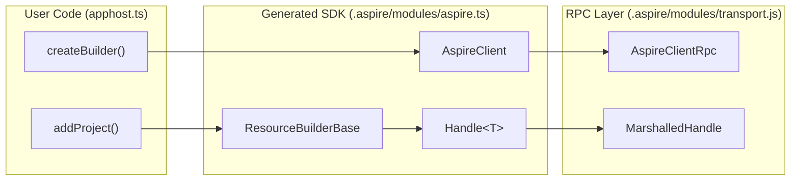

**Sources:** [skills/aspireify/references/typescript-authoring.md:9-40](), [evals/ts-apphost/.modules/aspire.ts:1-26](), [evals/ts-apphost/.modules/aspire.ts:61-101]()

## Project Configuration

### package.json
The root `package.json` should delegate to the Aspire CLI rather than running `node` directly on the AppHost file.

```json
{
  "type": "module",
  "scripts": {
    "dev": "aspire run",
    "build": "tsc"
  }
}
```

### tsconfig.json
The TypeScript configuration must include the generated modules to provide IntelliSense and type checking for the AppHost.

```json
{
  "compilerOptions": {
    "target": "ES2022",
    "module": "nodenext",
    "moduleResolution": "nodenext"
  },
  "include": ["apphost.ts", ".aspire/modules/**/*.ts"]
}
```

**Sources:** [skills/aspireify/references/javascript-apps.md:86-117](), [skills/aspireify/references/javascript-apps.md:123-146]()

---

# Page: aspire-orchestration (Lifecycle Skill)

# aspire-orchestration (Lifecycle Skill)

<details>
<summary>Relevant source files</summary>

The following files were used as context for generating this wiki page:

- [.github/plugins/aspire-skills/skills/aspire-orchestration/references/safety-guardrails.md](.github/plugins/aspire-skills/skills/aspire-orchestration/references/safety-guardrails.md)
- [evals/ts-apphost/.modules/postgres.module.ts](evals/ts-apphost/.modules/postgres.module.ts)
- [skills/aspire-orchestration/SKILL.md](skills/aspire-orchestration/SKILL.md)
- [skills/aspire-orchestration/references/agent-workflows.md](skills/aspire-orchestration/references/agent-workflows.md)
- [skills/aspire-orchestration/references/app-commands.md](skills/aspire-orchestration/references/app-commands.md)
- [skills/aspire-orchestration/references/detection.md](skills/aspire-orchestration/references/detection.md)
- [skills/aspire-orchestration/references/resource-management.md](skills/aspire-orchestration/references/resource-management.md)
- [skills/aspire-orchestration/references/safety-guardrails.md](skills/aspire-orchestration/references/safety-guardrails.md)
- [skills/aspire/SKILL.md](skills/aspire/SKILL.md)

</details>


The `aspire-orchestration` skill is a **workflow skill** responsible for managing the lifecycle of Aspire applications. It handles starting, stopping, and inspecting the AppHost and its constituent resources, while enforcing safety guardrails to prevent common agent failures such as file locks and orphaned processes [skills/aspire-orchestration/SKILL.md:1-11]().

## Lifecycle Management Commands

The skill primarily interfaces with the Aspire CLI to manage the AppHost state.

| Task | Command | Description |
|------|---------|-------------|
| **Start (Background)** | `aspire start` | Preferred for AI agents; runs the AppHost in detached mode [skills/aspire-orchestration/references/app-commands.md:13-24](). |
| **Start (Foreground)** | `aspire run` | Interactive mode with terminal dashboard; used by humans [skills/aspire-orchestration/references/app-commands.md:19-23](). |
| **Stop** | `aspire stop` | Cleanly shuts down all resources and releases file locks/ports [skills/aspire-orchestration/references/app-commands.md:16-16](). |
| **Wait** | `aspire wait <resource>` | Blocks until a resource is ready; prevents race conditions [skills/aspire-orchestration/references/resource-management.md:5-10](). |
| **Inspect** | `aspire ps` / `aspire describe` | Lists resources and their current status [skills/aspire-orchestration/SKILL.md:85-86](). |

### Isolated Mode for Worktrees
When working in a git worktree or environments where multiple instances might overlap, agents must use `aspire start --isolated` [skills/aspire-orchestration/references/app-commands.md:9-14](). This prevents port conflicts and ensures the instance uses its own local state [skills/aspire-orchestration/references/agent-workflows.md:7-11]().

### Resource Management Flow
The following diagram illustrates the transition from natural language requests to specific Aspire CLI orchestration commands.

**Orchestration Command Mapping**
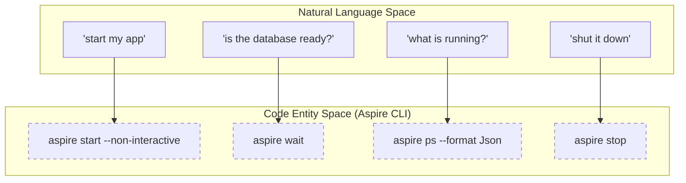
Sources: [skills/aspire-orchestration/SKILL.md:79-85](), [skills/aspire-orchestration/references/app-commands.md:5-17](), [skills/aspire-orchestration/references/safety-guardrails.md:34-42]()

## Safety Guardrails

To prevent "agent self-harm" (Issue [#15801](https://github.com/microsoft/aspire/issues/15801)), the skill enforces strict operational rules [skills/aspire-orchestration/references/safety-guardrails.md:5-7]().

### 1. File-Lock Recovery (MSB3491 / CS2012)
A common failure occurs when an agent attempts `dotnet build` while the AppHost is running. Aspire holds locks on `bin/` and `obj/` directories [skills/aspire-orchestration/references/safety-guardrails.md:94-107]().
*   **Symptom**: Errors `MSB3491` (Could not write to output file) or `CS2012` (Cannot open for writing) [skills/aspire-orchestration/SKILL.md:120-121]().
*   **Mandatory Recovery**: Run `aspire stop` immediately to release locks before retrying the build [skills/aspire-orchestration/SKILL.md:106-106](), [skills/aspire-orchestration/references/safety-guardrails.md:113-117]().

### 2. The `aspire wait` Pattern
Agents must never use `curl` or HTTP polling to check if a service is up.
*   **Why**: Aspire assigns dynamic ports and manages dependency ordering [skills/aspire-orchestration/references/safety-guardrails.md:56-63]().
*   **Requirement**: Use `aspire wait <resource-name>` [skills/aspire-orchestration/references/safety-guardrails.md:68-72](). Note: Use the `displayName` from `aspire ps --format Json` for the resource name [skills/aspire-orchestration/SKILL.md:112-112]().

### 3. Background Execution
Agents must **always** use `aspire start` rather than `aspire run` to avoid blocking the terminal execution thread [skills/aspire-orchestration/references/app-commands.md:17-17](), [skills/aspire-orchestration/references/safety-guardrails.md:42-42]().

Sources: [skills/aspire-orchestration/SKILL.md:102-121](), [skills/aspire-orchestration/references/safety-guardrails.md:1-137]()

## Detection Logic

The skill identifies Aspire projects by scanning for definitive markers.

| Signal | Marker | File Context |
|--------|--------|--------------|
| **C# AppHost** | `Aspire.AppHost.Sdk` | `.csproj` [skills/aspire-orchestration/references/detection.md:7-15]() |
| **File-based C#** | `#:sdk Aspire.AppHost.Sdk` | `apphost.cs` [skills/aspire-orchestration/references/detection.md:28-36]() |
| **TypeScript AppHost** | `apphost.ts` | Project root [skills/aspire-orchestration/references/detection.md:47-53]() |
| **Config** | `aspire.config.json` | Project root [skills/aspire-orchestration/references/detection.md:65-72]() |

**Detection and Dispatch Flow**
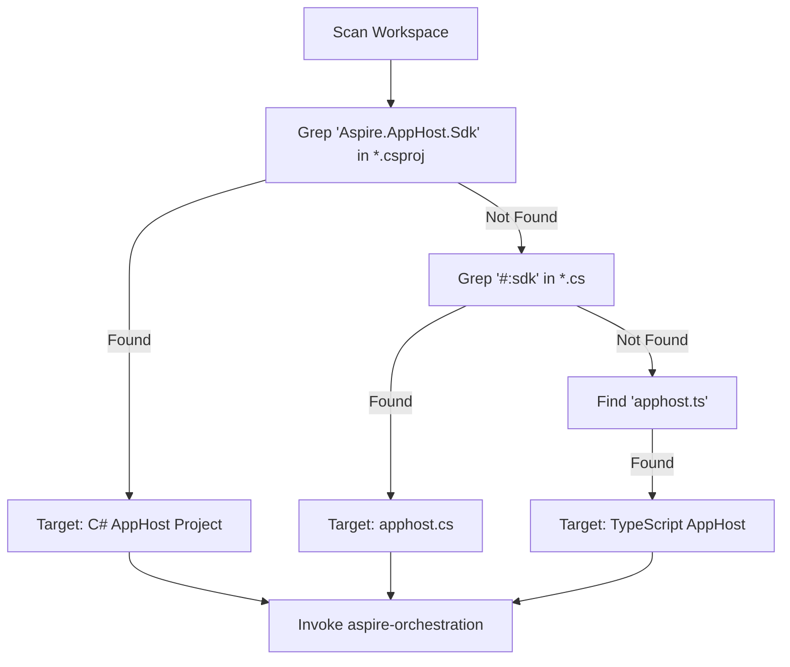
Sources: [skills/aspire-orchestration/references/detection.md:95-121](), [skills/aspire/SKILL.md:29-45]()

## Resource Operations

Instead of restarting the entire AppHost for minor code changes, agents are encouraged to use resource-scoped commands.

*   **Resource Commands**: `aspire resource <name> <command>` (e.g., `stop`, `start`, `rebuild`) [skills/aspire-orchestration/references/resource-management.md:19-23]().
*   **Hot Reload/Watch**: If a resource (like a Vite or Next.js frontend) supports HMR, the agent should defer to the framework's native watch behavior rather than restarting the resource via Aspire [skills/aspire-orchestration/references/agent-workflows.md:53-58]().
*   **Inspection**: `aspire describe --include-hidden` is used to see internal proxies and migration helpers that are normally filtered from the standard view [skills/aspire-orchestration/SKILL.md:86-86]().

Sources: [skills/aspire-orchestration/references/resource-management.md:1-39](), [skills/aspire-orchestration/references/agent-workflows.md:26-59]()

## Maintenance and Upgrades

The skill handles CLI and project maintenance:
*   **`aspire update --self`**: Upgrades the Aspire CLI binary (NativeAOT or script-based) [skills/aspire-orchestration/references/app-commands.md:89-89]().
*   **`aspire update`**: Updates NuGet/NPM package references within the project (requires user approval) [skills/aspire-orchestration/references/app-commands.md:90-98]().
*   **`aspire doctor`**: Diagnoses environment issues like missing SDKs or Docker daemon unavailability [skills/aspire-orchestration/SKILL.md:96-96](), [skills/aspire-orchestration/SKILL.md:115-115]().
*   **`aspire restore`**: Regenerates `.aspire/modules/` for TypeScript projects if they are missing [skills/aspire-orchestration/references/app-commands.md:91-99]().

Sources: [skills/aspire-orchestration/SKILL.md:77-101](), [skills/aspire-orchestration/references/app-commands.md:84-101]()

---

# Page: aspire-deployment (Deployment Skill)

# aspire-deployment (Deployment Skill)

<details>
<summary>Relevant source files</summary>

The following files were used as context for generating this wiki page:

- [.github/CODEOWNERS](.github/CODEOWNERS)
- [skills/aspire-deployment/SKILL.md](skills/aspire-deployment/SKILL.md)
- [skills/aspire-deployment/references/aws.md](skills/aspire-deployment/references/aws.md)
- [skills/aspire-deployment/references/azure.md](skills/aspire-deployment/references/azure.md)
- [skills/aspire-deployment/references/cicd.md](skills/aspire-deployment/references/cicd.md)
- [skills/aspire-deployment/references/docker-compose.md](skills/aspire-deployment/references/docker-compose.md)
- [skills/aspire-deployment/references/github-actions-azure-csharp.yml](skills/aspire-deployment/references/github-actions-azure-csharp.yml)
- [skills/aspire-deployment/references/github-actions-azure-typescript.yml](skills/aspire-deployment/references/github-actions-azure-typescript.yml)
- [skills/aspire-deployment/references/javascript.md](skills/aspire-deployment/references/javascript.md)
- [skills/aspire-deployment/references/kubernetes.md](skills/aspire-deployment/references/kubernetes.md)
- [skills/aspire-deployment/references/preflight.md](skills/aspire-deployment/references/preflight.md)

</details>


The `aspire-deployment` skill is the workflow owner for publishing, previewing, validating, deploying, and tearing down .NET Aspire applications. It transitions the application from a local development model (AppHost) to production-ready artifacts or live infrastructure across multiple targets, including Azure, Kubernetes, AWS, and Docker Compose.

## Purpose and Scope

This skill manages the transition from "Natural Language Space" (e.g., "Deploy my app to Azure") to "Code Entity Space" (e.g., `aspire deploy --apphost ./apphost.ts`). It governs the selection of deployment targets, the generation of infrastructure-as-code (IaC) artifacts, and the execution of deployment pipelines.

For target-specific implementation details, see [Deployment Targets & CI/CD Reference](#2.5.1).

## Deployment Workflow

The skill follows a standardized 10-step workflow to ensure safety and predictability before modifying cloud resources [skills/aspire-deployment/SKILL.md:110-155]().

### Workflow Steps
1.  **Orient to Workspace**: Discover AppHosts using `aspire ls` [skills/aspire-deployment/references/preflight.md:9]().
2.  **Infer Target**: Identify the intended platform (Azure, AWS, K8s, etc.).
3.  **Preflight Validation**: Check for CLI prerequisites (e.g., `az`, `kubectl`, `docker`) and authentication [skills/aspire-deployment/references/azure.md:61-71]().
4.  **Parameter Mapping**: Inventory required parameters and secrets [skills/aspire-deployment/references/preflight.md:111-130]().
5.  **AppHost Modification**: Add necessary hosting integrations (e.g., `aspire add azure-appcontainers`) [skills/aspire-deployment/references/azure.md:108-112]().
6.  **Structural Preview**: Run `aspire deploy --list-steps` to see the plan [skills/aspire-deployment/references/preflight.md:69-71]().
7.  **Publish (Optional)**: Generate static artifacts with `aspire publish` [skills/aspire-deployment/references/preflight.md:75-79]().
8.  **Confirmation**: Ask for approval before creating billable resources [skills/aspire-deployment/SKILL.md:99-104]().
9.  **Execution**: Run `aspire deploy` to provision and push [skills/aspire-deployment/SKILL.md:64-66]().
10. **Post-deployment**: Provide logs and endpoint URLs for verification.

## Natural Language to Code Mapping

The following diagrams illustrate how user intent and high-level concepts map to specific CLI commands and code entities within the `aspire-deployment` skill.

### Intent Mapping: Action to Command
This diagram maps common user requests to the underlying `aspire` CLI operations and parameters.

```mermaid
graph TD
    subgraph "Natural Language Space"
        A["'Deploy my app'"]
        B["'What will happen?'"]
        C["'Tear it all down'"]
        D["'Show me the Helm charts'"]
    end

    subgraph "Code Entity Space (aspire CLI)"
        A --> CMD1["aspire deploy --environment production"]
        B --> CMD2["aspire deploy --list-steps"]
        C --> CMD3["aspire destroy --environment production"]
        D --> CMD4["aspire publish -o ./aspire-output"]
    end

    CMD1 --- F1["[skills/aspire-deployment/SKILL.md:66]()"]
    CMD2 --- F2["[skills/aspire-deployment/references/preflight.md:70]()"]
    CMD3 --- F3["[skills/aspire-deployment/references/preflight.md:98]()"]
    CMD4 --- F4["[skills/aspire-deployment/references/preflight.md:78]()"]
```
Sources: [skills/aspire-deployment/SKILL.md:60-70](), [skills/aspire-deployment/references/preflight.md:65-110]()

### Parameter Mapping: Configuration to Environment
This diagram shows how AppHost parameter definitions are transformed into environment variables for non-interactive deployment.

```mermaid
graph LR
    subgraph "AppHost Model (C# or TS)"
        P1["builder.AddParameter('api-key')"]
    end

    subgraph "Deployment Environment"
        V1["Parameters__api_key"]
    end

    subgraph "CLI Execution"
        E1["aspire deploy --non-interactive"]
    end

    P1 --> V1
    V1 --> E1
```
Sources: [skills/aspire-deployment/references/azure.md:90-102](), [skills/aspire-deployment/references/preflight.md:131-142]()

## Publish vs. Deploy Distinction

A critical distinction in the Aspire ecosystem is the difference between `publish` and `deploy` [skills/aspire-deployment/references/preflight.md:85-90]().

| Feature | `aspire publish` | `aspire deploy` |
| :--- | :--- | :--- |
| **Primary Output** | Static artifacts (Bicep, Helm, Compose YAML) | Live provisioned infrastructure |
| **Secrets** | Leaves placeholders in `.env` or YAML | Resolves secrets and applies them |
| **State** | Stateless generation | Manages state/cached values for an environment |
| **Usage** | Manual inspection or handoff to other tools | Direct application from AppHost to Cloud |

Sources: [skills/aspire-deployment/references/preflight.md:85-90](), [skills/aspire-deployment/references/docker-compose.md:121-126]()

## Deployment Targets

The skill provides specific guidance and reference implementations for the following platforms:

*   **Azure**: Supports Azure Container Apps (ACA), App Service, and AKS. Uses `aspire add azure-appcontainers` or similar [skills/aspire-deployment/references/azure.md:11-17]().
*   **Kubernetes**: Generates Helm charts. Supports existing clusters or AKS-managed clusters [skills/aspire-deployment/references/kubernetes.md:7-12]().
*   **AWS**: Uses AWS CDK to transform Aspire resources into CloudFormation stacks. (Note: Currently C#-only) [skills/aspire-deployment/references/aws.md:5-11]().
*   **Docker Compose**: Generates `docker-compose.yaml` and `.env` files for local or server-side container hosting [skills/aspire-deployment/references/docker-compose.md:80-90]().
*   **JavaScript**: Special handling for Vite, Next.js, and Node.js resources to ensure production serving models are correctly configured [skills/aspire-deployment/references/javascript.md:65-78]().

For details, see [Deployment Targets & CI/CD Reference](#2.5.1).

## CI/CD and Automation

The skill includes reference GitHub Actions workflows for both C# and TypeScript AppHosts. Key patterns include:
*   **OIDC Auth**: Using `azure/login` with `id-token: write` permissions [skills/aspire-deployment/references/github-actions-azure-csharp.yml:8-46]().
*   **Parameter Injection**: Mapping GitHub Secrets to `Parameters__*` environment variables [skills/aspire-deployment/references/cicd.md:110-120]().
*   **Non-Interactive Mode**: Using the `--non-interactive` flag to prevent the CLI from hanging on prompts [skills/aspire-deployment/references/github-actions-azure-typescript.yml:48]().

For details, see [Deployment Targets & CI/CD Reference](#2.5.1).

## Teardown (Aspire Destroy)

The `aspire destroy` command is used to tear down resources managed by an Aspire deployment environment [skills/aspire-deployment/references/preflight.md:95-110]().
*   It delegates to the specific target's destroy logic (e.g., deleting a Bicep deployment or a Helm release).
*   It requires the `--environment` flag to ensure the correct scope is targeted [skills/aspire-deployment/references/preflight.md:98]().
*   The `--yes` flag is used for non-interactive cleanup in CI pipelines [skills/aspire-deployment/references/preflight.md:107]().

Sources: [skills/aspire-deployment/references/preflight.md:93-110](), [skills/aspire-deployment/references/aws.md:118-124]()

---

# Page: Deployment Targets & CI/CD Reference

# Deployment Targets & CI/CD Reference

<details>
<summary>Relevant source files</summary>

The following files were used as context for generating this wiki page:

- [.github/CODEOWNERS](.github/CODEOWNERS)
- [.github/plugins/aspire-skills/skills/aspire-deployment/references/aws.md](.github/plugins/aspire-skills/skills/aspire-deployment/references/aws.md)
- [.github/plugins/aspire-skills/skills/aspire-deployment/references/azure.md](.github/plugins/aspire-skills/skills/aspire-deployment/references/azure.md)
- [.github/plugins/aspire-skills/skills/aspire-deployment/references/cicd.md](.github/plugins/aspire-skills/skills/aspire-deployment/references/cicd.md)
- [.github/plugins/aspire-skills/skills/aspire-deployment/references/docker-compose.md](.github/plugins/aspire-skills/skills/aspire-deployment/references/docker-compose.md)
- [.github/plugins/aspire-skills/skills/aspire-deployment/references/github-actions-azure-csharp.yml](.github/plugins/aspire-skills/skills/aspire-deployment/references/github-actions-azure-csharp.yml)
- [.github/plugins/aspire-skills/skills/aspire-deployment/references/github-actions-azure-typescript.yml](.github/plugins/aspire-skills/skills/aspire-deployment/references/github-actions-azure-typescript.yml)
- [skills/aspire-deployment/references/aws.md](skills/aspire-deployment/references/aws.md)
- [skills/aspire-deployment/references/azure.md](skills/aspire-deployment/references/azure.md)
- [skills/aspire-deployment/references/cicd.md](skills/aspire-deployment/references/cicd.md)
- [skills/aspire-deployment/references/docker-compose.md](skills/aspire-deployment/references/docker-compose.md)
- [skills/aspire-deployment/references/github-actions-azure-csharp.yml](skills/aspire-deployment/references/github-actions-azure-csharp.yml)
- [skills/aspire-deployment/references/github-actions-azure-typescript.yml](skills/aspire-deployment/references/github-actions-azure-typescript.yml)
- [skills/aspire-deployment/references/javascript.md](skills/aspire-deployment/references/javascript.md)
- [skills/aspire-deployment/references/kubernetes.md](skills/aspire-deployment/references/kubernetes.md)

</details>


This page provides target-specific deployment guidance for .NET Aspire applications across various cloud providers and container runtimes. It details the implementation of CI/CD pipelines using GitHub Actions, focusing on both C# and TypeScript AppHost patterns, OIDC authentication, and secret management.

## Azure Deployment Targets

Aspire supports three primary Azure targets, each requiring specific hosting integrations and environment resource definitions within the AppHost [skills/aspire-deployment/references/azure.md:11-18]().

| Target | Aspire Command | Best Fit | Integration |
| :--- | :--- | :--- | :--- |
| **Azure Container Apps (ACA)** | `aspire add azure-appcontainers` | Distributed/containerized services with ingress | Azure Container Apps hosting |
| **Azure App Service** | `aspire add azure-appservice` | Public web apps/APIs (App Service model) | Azure App Service hosting |
| **Azure Kubernetes Service (AKS)** | `aspire add azure-kubernetes` | Provisioned Azure-managed Kubernetes | Azure Kubernetes hosting |

### Azure Preflight & Secret Mapping
Deployment to Azure requires authentication via the Azure CLI (`az login`) or a configured `Azure:CredentialSource` [skills/aspire-deployment/references/azure.md:65-66](). For non-interactive environments like CI/CD, settings are mapped via environment variables [skills/aspire-deployment/references/azure.md:90-98]():

*   `Azure__SubscriptionId`: Target subscription [skills/aspire-deployment/references/azure.md:77]().
*   `Azure__Location`: Target region (e.g., `eastus`) [skills/aspire-deployment/references/azure.md:78]().
*   `Azure__ResourceGroup`: Target resource group [skills/aspire-deployment/references/azure.md:79]().
*   `Parameters__<Name>`: Maps to AppHost parameters. Note that dashes in parameter names must be replaced with underscores (e.g., `registry-endpoint` becomes `Parameters__registry_endpoint`) [skills/aspire-deployment/references/azure.md:102]().

**Sources:** [skills/aspire-deployment/references/azure.md:11-102]()

---

## Kubernetes & AKS Reference

Aspire differentiates between existing clusters and those provisioned by the AppHost [skills/aspire-deployment/references/kubernetes.md:7-12]().

### Data Flow: AppHost to Kubernetes
The following diagram illustrates how AppHost definitions translate to Kubernetes resources.

**Diagram: AppHost to Kubernetes Resource Mapping**
```mermaid
graph TD
    subgraph "Code Entity Space (AppHost)"
        A["builder.AddKubernetesEnvironment(\"k8s\")"] -- "Defines" --> B["KubernetesEnvironment"]
        C["resource.WithHelm(\"chart\")"] -- "Configures" --> D["Helm Release"]
        E["resource.WithExternalHttpEndpoints()"] -- "Triggers" --> F["Ingress/Gateway"]
    end

    subgraph "Infrastructure Space (Cluster)"
        B --> G["Namespace/Context"]
        D --> H["Helm Chart Deployment"]
        F --> I["LoadBalancer / Ingress Controller"]
    end
```

### Implementation Details
1.  **Registry Requirement:** Vanilla Kubernetes deployments require a container registry as there is no local-registry fallback [skills/aspire-deployment/references/kubernetes.md:56]().
2.  **External Endpoints:** Routed endpoints (via `AddIngress` or `AddGateway`) **must** be marked external in the AppHost. Failure to do so results in an `InvalidOperationException` during `aspire publish` [skills/aspire-deployment/references/kubernetes.md:88]().
3.  **AKS Specifics:** `aspire add azure-kubernetes` allows Aspire to provision the ACR and Managed Identity alongside the cluster [skills/aspire-deployment/references/kubernetes.md:100-103]().

**Sources:** [skills/aspire-deployment/references/kubernetes.md:7-103]()

---

## AWS Deployment (Preview)

AWS deployment is a preview path driven by the `Aspire.Hosting.AWS` integration [skills/aspire-deployment/references/aws.md:5]().

*   **C# Only:** Currently, there is no TypeScript AppHost support for AWS [skills/aspire-deployment/references/aws.md:52]().
*   **CDK Integration:** Aspire transforms resources into AWS CDK constructs. The AppHost must disable the `ASPIREAWSPUBLISHERS001` warning and initialize the environment using `builder.AddAWSCDKEnvironment` [skills/aspire-deployment/references/aws.md:39-46]().
*   **Bootstrap:** The target account/region must be bootstrapped via `cdk bootstrap` before the first `aspire deploy` [skills/aspire-deployment/references/aws.md:64-68]().

**Sources:** [skills/aspire-deployment/references/aws.md:5-68]()

---

## Docker Compose Reference

Docker Compose is the primary target for local container artifacts and non-cloud deployments [skills/aspire-deployment/references/docker-compose.md:3]().

### Prepare vs. Publish
*   `aspire publish`: Generates a `docker-compose.yaml` and a `.env` file containing **placeholders** [skills/aspire-deployment/references/docker-compose.md:83-125]().
*   `aspire deploy` / `aspire do prepare-docker-compose`: Writes an `.env.<environment>` file with **resolved** parameter values, secrets, and image tags [skills/aspire-deployment/references/docker-compose.md:95-125]().

**Sources:** [skills/aspire-deployment/references/docker-compose.md:3-125]()

---

## CI/CD Reference Workflows

Reference GitHub Actions workflows are provided for both C# and TypeScript AppHosts. These workflows utilize OpenID Connect (OIDC) for Azure authentication, eliminating the need for long-lived service principal secrets.

### GitHub Actions Workflow Structure
The workflow logic follows a standard sequence:
1.  **Setup Toolchain:** Install .NET 10 or Node.js 22 [skills/aspire-deployment/references/cicd.md:74-106]().
2.  **Install Aspire CLI:** `curl -sSL https://aspire.dev/install.sh | bash` [skills/aspire-deployment/references/cicd.md:62]().
3.  **Auth:** Azure Login using `id-token: write` permissions [skills/aspire-deployment/references/github-actions-azure-csharp.yml:9-45]().
4.  **Deploy:** Execute `aspire deploy` with the `--non-interactive` flag [skills/aspire-deployment/references/github-actions-azure-typescript.yml:48]().

**Diagram: CI/CD Execution Flow**
```mermaid
sequenceDiagram
    participant G as GitHub Runner
    participant A as Aspire CLI
    participant P as AppHost (C# or TS)
    participant C as Cloud Target (Azure/AWS)

    G->>G: "actions/checkout"
    G->>G: "azure/login" (OIDC)
    G->>A: "aspire deploy --non-interactive"
    A->>P: "Build & Execute AppHost"
    P->>A: "Manifest / Resource Graph"
    A->>C: "Provision Infrastructure & Push Images"
```

### Reference: TypeScript AppHost Workflow
[skills/aspire-deployment/references/github-actions-azure-typescript.yml:1-54]()
*   **Permissions:** Requires `id-token: write` for OIDC [skills/aspire-deployment/references/github-actions-azure-typescript.yml:9]().
*   **Build:** Runs `npm ci` and `npm run build` before deployment [skills/aspire-deployment/references/github-actions-azure-typescript.yml:31-32]().
*   **Command:** `aspire deploy --apphost ./apphost.ts --environment Production --non-interactive` [skills/aspire-deployment/references/github-actions-azure-typescript.yml:48]().

### Reference: C# AppHost Workflow
[skills/aspire-deployment/references/github-actions-azure-csharp.yml:1-54]()
*   **Setup:** Uses `actions/setup-dotnet` with `10.0.x` [skills/aspire-deployment/references/github-actions-azure-csharp.yml:29-32]().
*   **Command:** `aspire deploy --apphost ./src/AppHost/AppHost.csproj --environment Production` [skills/aspire-deployment/references/github-actions-azure-csharp.yml:48]().

**Sources:** [skills/aspire-deployment/references/cicd.md:62-106](), [skills/aspire-deployment/references/github-actions-azure-typescript.yml:1-54](), [skills/aspire-deployment/references/github-actions-azure-csharp.yml:1-54]()

---

# Page: aspire-monitoring (Observability Skill)

# aspire-monitoring (Observability Skill)

<details>
<summary>Relevant source files</summary>

The following files were used as context for generating this wiki page:

- [.github/plugins/aspire-skills/skills/aspire-monitoring/references/diagnostics-bridge.md](.github/plugins/aspire-skills/skills/aspire-monitoring/references/diagnostics-bridge.md)
- [.github/plugins/aspire-skills/skills/aspire-monitoring/references/monitoring.md](.github/plugins/aspire-skills/skills/aspire-monitoring/references/monitoring.md)
- [.github/plugins/aspire-skills/skills/aspire-monitoring/references/playwright-handoff.md](.github/plugins/aspire-skills/skills/aspire-monitoring/references/playwright-handoff.md)
- [skills/aspire-init/SKILL.md](skills/aspire-init/SKILL.md)
- [skills/aspire-monitoring/SKILL.md](skills/aspire-monitoring/SKILL.md)
- [skills/aspire-monitoring/references/diagnostics-bridge.md](skills/aspire-monitoring/references/diagnostics-bridge.md)
- [skills/aspire-monitoring/references/monitoring.md](skills/aspire-monitoring/references/monitoring.md)
- [skills/aspire-monitoring/references/playwright-handoff.md](skills/aspire-monitoring/references/playwright-handoff.md)
- [skills/aspireify/references/csharp-authoring.md](skills/aspireify/references/csharp-authoring.md)

</details>


The `aspire-monitoring` skill provides the diagnostics bridge logic required to observe .NET Aspire applications across different environments [skills/aspire-monitoring/SKILL.md:4-6](). It serves as a router between local Aspire CLI operations, Kubernetes (AKS) workload diagnostics, and deployed Azure resource health [skills/aspire-monitoring/SKILL.md:13]().

## Diagnostics Bridge Routing

The skill implements a routing logic based on the application's current environment and the user's intent. The primary goal is to determine whether to use the local Aspire CLI backchannel or platform-specific tools like `kubectl` or `az` [skills/aspire-monitoring/references/diagnostics-bridge.md:1-4]().

### Routing Decision Logic
| Environment | Tooling | Commands |
| :--- | :--- | :--- |
| **Local Development** | Aspire CLI | `aspire logs`, `aspire otel logs`, `aspire describe` |
| **Azure Kubernetes (AKS)** | kubectl / Azure Monitor | `kubectl logs`, `kubectl describe pod` |
| **Azure (ACA/App Service)** | `azure-diagnostics` skill | `az containerapp logs`, `az monitor app-insights` |
| **Docker / Compose** | Docker CLI | `docker logs`, `docker compose ps` |

Sources: [skills/aspire-monitoring/SKILL.md:27-41](), [skills/aspire-monitoring/references/diagnostics-bridge.md:7-42]()

### Entity Mapping: Natural Language to Code CLI
The following diagram maps observability concepts to the specific Aspire CLI commands and flags used in the implementation.

Title: Observability Command Mapping
```mermaid
graph TD
    subgraph "Natural Language Intent"
        NL_Logs["'Show me the logs'"]
        NL_Trace["'Find this request'"]
        NL_State["'Is the app healthy?'"]
        NL_Export["'Save diagnostics'"]
    end

    subgraph "Aspire CLI Entity Space"
        CLI_Logs["aspire logs <resource>"]
        CLI_OTEL_Logs["aspire otel logs --trace-id <id>"]
        CLI_Describe["aspire describe --format Json"]
        CLI_Export["aspire export"]
        CLI_PS["aspire ps --include-hidden"]
    end

    NL_Logs --> CLI_Logs
    NL_Trace --> CLI_OTEL_Logs
    NL_State --> CLI_Describe
    NL_State --> CLI_PS
    NL_Export --> CLI_Export
```
Sources: [skills/aspire-monitoring/SKILL.md:65-80](), [skills/aspire-monitoring/references/monitoring.md:9-37]()

## Local CLI Diagnostics

When running locally, the Aspire CLI communicates with the AppHost via a **backchannel socket** located at `~/.aspire/backchannels/` [skills/aspire-monitoring/references/diagnostics-bridge.md:52]().

### Core Commands and Implementation Details
*   **`aspire describe`**: Used to retrieve resource state, endpoints, and health [skills/aspire-monitoring/SKILL.md:75](). Agents are instructed to use `--format Json` for machine parsing and `--include-hidden` to see proxies or migration jobs [skills/aspire-monitoring/SKILL.md:93-97]().
*   **`aspire otel logs/traces/spans`**: Accesses structured OpenTelemetry data [skills/aspire-monitoring/SKILL.md:69-71](). Supports a `--search` flag for complex filtering (e.g., `severity:error`, `duration:>100`) [skills/aspire-monitoring/references/monitoring.md:72-84]().
*   **`aspire export`**: Generates a ZIP bundle containing `resources/`, `consolelogs/`, `structuredlogs/`, and `traces/` for offline analysis [skills/aspire-monitoring/references/monitoring.md:98-103]().

Sources: [skills/aspire-monitoring/SKILL.md:63-80](), [skills/aspire-monitoring/references/monitoring.md:49-84]()

## Standalone Dashboard

The `aspire dashboard run` command allows running the Aspire Dashboard as a standalone process [skills/aspire-monitoring/SKILL.md:80](). This is a foreground/blocking command that provides an OTLP endpoint (defaulting to port 4317 for gRPC) for any application to stream telemetry into [skills/aspire-monitoring/references/diagnostics-bridge.md:92-99]().

### Standalone Data Flow
Title: Standalone Dashboard Telemetry Flow
```mermaid
flowchart LR
    App["OTLP-Emitting App"] -- "OTLP/gRPC (4317)" --> Dash["aspire dashboard run"]
    Dash -- "Login URL with Token" --> Browser["Web Browser"]
    CLI["aspire otel logs"] -- "--dashboard-url" --> Dash
```
Sources: [skills/aspire-monitoring/references/diagnostics-bridge.md:90-115]()

## Browser Observability

The `Aspire.Hosting.Browsers` integration enables capturing frontend telemetry [skills/aspire-monitoring/references/diagnostics-bridge.md:127-129]().

*   **`WithBrowserLogs()`**: A C# extension method called in the AppHost to opt-in a frontend resource for console log, network request, and screenshot capture [skills/aspireify/references/csharp-authoring.md:146-149]().
*   **Dashboard Integration**: Captured browser data is surfaced in the Aspire Dashboard alongside server-side OTLP data [skills/aspire-monitoring/references/diagnostics-bridge.md:129]().

Sources: [skills/aspireify/references/csharp-authoring.md:32](), [skills/aspire-monitoring/references/diagnostics-bridge.md:127-135]()

## Playwright Handoff

The skill facilitates the transition from Aspire orchestration to browser testing [skills/aspire-monitoring/references/playwright-handoff.md:1-3]().

1.  **Endpoint Discovery**: The agent uses `aspire describe --format Json` to find the dynamic URL of the frontend resource [skills/aspire-monitoring/references/playwright-handoff.md:10]().
2.  **Handoff**: The discovered URL is passed to the Playwright CLI to execute tests against the live, orchestrated environment [skills/aspire-monitoring/references/playwright-handoff.md:17-21]().

Sources: [skills/aspire-monitoring/references/playwright-handoff.md:5-22]()

---

# Page: Evaluation Framework (Vally)

# Evaluation Framework (Vally)

<details>
<summary>Relevant source files</summary>

The following files were used as context for generating this wiki page:

- [.vally.yaml](.vally.yaml)
- [CHANGELOG.md](CHANGELOG.md)
- [evals/AUTHORING.md](evals/AUTHORING.md)
- [evals/README.md](evals/README.md)

</details>


The `aspire-skills` repository utilizes **Vally**, a specialized evaluation framework for AI agents, to ensure the quality, routing precision, and behavioral correctness of its skills. The system exercises the plugin against a battery of stimuli ranging from simple routing checks to complex multi-step orchestration tasks using a combination of static string graders and LLM-as-judge rubrics. [evals/README.md:1-3]()

### System Architecture

The evaluation system is structured to be decentralized, with each skill owning its own evaluation specification. This allows for skill-specific grading logic while sharing common test fixtures. [evals/README.md:17-22]()

#### Relationship between Space and Code Entities

The following diagram illustrates how natural language user prompts (Space) are mapped to the underlying code entities (Code Entity Space) through the Vally execution lifecycle.

**Natural Language to Code Mapping**
```mermaid
graph TD
    subgraph "Natural Language Space (User Intent)"
        A["User Prompt: 'How do I deploy to Azure?'"]
    end

    subgraph "Vally Evaluation Engine"
        B["eval.yaml Stimulus"]
        C["vally-cli Executor"]
        D["LLM-as-Judge"]
    end

    subgraph "Code Entity Space (Implementation)"
        E["skills/aspire-deployment/SKILL.md"]
        F["evals/csharp-apphost/Program.cs"]
        G["results.jsonl"]
    end

    A --> B
    B -- "references" --> F
    B -- "invokes" --> C
    C -- "reads context" --> E
    C -- "validates" --> D
    D -- "persists" --> G
```
Sources: [evals/README.md:1-3](), [evals/README.md:17-31](), [evals/AUTHORING.md:7-36]()

### Core Components

The framework is built on three primary pillars:

1.  **Eval Specs (`eval.yaml`)**: Located within each skill's directory (`skills/<skill>/evals/eval.yaml`), these files define the `stimuli` (prompts), `environment` (files), and `graders` (success criteria). [evals/README.md:17-29]()
2.  **Shared Fixtures**: Located in the repo-root `evals/` directory, these are static project templates (e.g., `csharp-apphost`, `ts-apphost`) that provide the context the agent needs to "see" to answer prompts accurately. [evals/README.md:31-40]()
3.  **Vally CLI**: The `vally-cli` tool serves as the test runner, handling parallel execution, fixture mounting, and result aggregation. [evals/README.md:7-15]()

### CI Integration & Suites

Evaluations are integrated into the GitHub Actions workflow to prevent regressions. The repository defines two primary suites in `.vally.yaml`:

| Suite | Priority Filter | Purpose |
| :--- | :--- | :--- |
| `ci-gate` | `p0`, `p1` | Required PR gate; ensures core functionality and routing work. |
| `nightly` | `p0`, `p1`, `p2` | Comprehensive run including aspirational (p2) tasks. |

Sources: [.vally.yaml:10-21](), [CHANGELOG.md:44-51]()

### Execution Lifecycle

The diagram below shows the flow from a CLI command to the generation of diagnostic artifacts.

**Evaluation Execution Flow**
```mermaid
sequenceDiagram
    participant CLI as "vally eval --suite ci-gate"
    participant Spec as "skills/aspire-init/evals/eval.yaml"
    participant Fix as "evals/csharp-apphost/"
    participant Judge as "LLM-as-Judge (gpt-4.1/claude-3.5)"
    participant Out as "results/eval-results.md"

    CLI->>Spec: Load stimuli & tags
    CLI->>Fix: Copy src to temp dest
    CLI->>CLI: Execute Skill via copilot-sdk
    CLI->>Judge: Grade response vs. prompt grader
    CLI->>Out: Write results and JUnit XML
```
Sources: [evals/README.md:42-56](), [evals/README.md:58-81](), [evals/AUTHORING.md:77-83]()

### Sub-Pages

For detailed technical implementation and operational guides, refer to the following child pages:

*   **[Running & Interpreting Evals](#3.1)**: Covers CLI flags (`--suite`, `--workers`), interpreting `results.jsonl`, and using the `vally serve` dashboard.
*   **[Authoring Evals & Grader Patterns](#3.2)**: Detailed guide on writing `EvalSchema` stimuli, using the "assistant's response" anchor, and splitting positive/negative graders.
*   **[Eval Fixtures](#3.3)**: Documentation of the shared `csharp-apphost`, `ts-apphost`, and `non-aspire` fixture projects.

Sources: [evals/README.md:5-6](), [evals/README.md:128-139](), [evals/AUTHORING.md:1-6]()

---

# Page: Running & Interpreting Evals

# Running & Interpreting Evals

<details>
<summary>Relevant source files</summary>

The following files were used as context for generating this wiki page:

- [.github/workflows/skill-eval-nightly.yml](.github/workflows/skill-eval-nightly.yml)
- [.github/workflows/skill-eval.yml](.github/workflows/skill-eval.yml)
- [.github/workflows/skill-lint.yml](.github/workflows/skill-lint.yml)
- [.vally.yaml](.vally.yaml)
- [evals/AUTHORING.md](evals/AUTHORING.md)
- [evals/README.md](evals/README.md)
- [skills/aspire-deployment/evals/eval.yaml](skills/aspire-deployment/evals/eval.yaml)
- [skills/aspire-monitoring/evals/eval.yaml](skills/aspire-monitoring/evals/eval.yaml)
- [skills/aspire-orchestration/evals/eval.yaml](skills/aspire-orchestration/evals/eval.yaml)
- [skills/aspire/evals/eval.yaml](skills/aspire/evals/eval.yaml)

</details>


This page provides technical documentation for executing and analyzing evaluations within the `aspire-skills` repository. The evaluation framework uses **Vally** to validate skill quality, routing precision, and adherence to safety guardrails across the six-skill architecture.

## Installation & Setup

The evaluation system requires Node.js 22+ and the `@microsoft/vally-cli` tool [evals/README.md:10-11]().

```bash
# Install vally globally
npm install -g @microsoft/vally-cli

# Verify installation
vally --version
```

### CI Authentication
To run model-backed evaluations (using the `copilot-sdk` executor), a `COPILOT_GITHUB_TOKEN` must be configured.
- **Local:** Set the environment variable in your shell.
- **CI:** Add the secret `COPILOT_GITHUB_TOKEN` to the GitHub repository settings [.github/workflows/skill-eval.yml:31-32](). This token is required for the `ci-gate` and `nightly` suites to invoke LLM-as-judge graders [.github/workflows/skill-eval.yml:78-79]().

**Sources:** [evals/README.md:7-15](), [.github/workflows/skill-eval.yml:28-40]()

---

## Executing Evaluations

Vally discovers evaluation specifications defined in `eval.yaml` files located within each skill's directory (e.g., `skills/aspire/evals/eval.yaml`) [evals/README.md:20-22]().

### Standard Suites
The repository defines two primary suites in `.vally.yaml` [.vally.yaml:10-21]():

| Suite | Priority Filter | Purpose |
| :--- | :--- | :--- |
| `ci-gate` | `p0`, `p1` | PR gate; ensures core functionality and critical routing work. |
| `nightly` | `p0`, `p1`, `p2` | Comprehensive weekly run; includes aspirational/forward-looking tests. |

### CLI Commands

| Goal | Command |
| :--- | :--- |
| **Run PR Gate** | `vally eval --suite ci-gate` |
| **Run Single Skill** | `vally eval --eval-spec skills/<skill>/evals/eval.yaml` |
| **Filter by Tag** | `vally eval --tag area=routing --tag priority=p0` |
| **Parallel Workers** | `vally eval --suite ci-gate --workers 4` |
| **Save Artifacts** | `vally eval --suite ci-gate --output-dir ./results` |

### Key CLI Flags
- `--suite <name>`: Runs stimuli matching filters in `.vally.yaml` [evals/README.md:65]().
- `--tag <key=values>`: Filters by tag records (e.g., `area=routing`). Multiple values are OR'd; multiple keys are AND'd [evals/README.md:66]().
- `--workers <n>`: Sets parallel stimulus workers (defaults to 1) [evals/README.md:71]().
- `--output-dir <dir>`: Persists `results.jsonl` and `eval-results.md` [evals/README.md:73]().
- `--skip-grade`: Executes the stimulus through the agent but skips the grader (useful for cost-saving during prompt engineering) [evals/README.md:76]().

**Sources:** [evals/README.md:42-81](), [.vally.yaml:1-21]()

---

## Data Flow & Architecture

The following diagram illustrates the data flow from the `vally` CLI through the `copilot-sdk` executor to the final result artifacts.

### Eval Execution Data Flow
```mermaid
graph TD
    subgraph "CLI Space"
        A["vally eval --suite ci-gate"] --> B["Config Loader (.vally.yaml)"]
        B --> C["Spec Discovery (skills/*/evals/eval.yaml)"]
    end

    subgraph "Execution Engine"
        C --> D["Executor: copilot-sdk"]
        D --> E["Stimulus: prompt + fixtures"]
        E --> F["LLM Agent (GPT-5-Mini)"]
        F --> G["Agent Response"]
    end

    subgraph "Grading Phase"
        G --> H["Text Grader (Regex/Substring)"]
        G --> I["Prompt Grader (LLM-as-Judge)"]
        I --> J["Judge Model (Claude-Sonnet-4.6)"]
    end

    subgraph "Output Space"
        H --> K["results.jsonl"]
        I --> K
        K --> L["eval-results.md"]
        K --> M["vally serve Dashboard"]
    end
```
**Sources:** [evals/README.md:24-30](), [evals/README.md:67-75](), [.vally.yaml:1-8]()

---

## Interpreting Results

When `--output-dir` is specified, Vally generates several files to help interpret the run:

### 1. `results.jsonl`
A machine-readable stream of every execution. Each line contains:
- `stimulus`: The input prompt and metadata.
- `response`: The raw text returned by the agent.
- `grading`: Array of results for each grader, including `pass/fail` status and the judge's `reasoning` [evals/README.md:79]().

### 2. `eval-results.md`
A human-readable summary of the run, grouped by skill. It highlights failing stimuli and provides the reasoning for failures.

### 3. The Dashboard (`vally serve`)
Vally includes a local web dashboard for deep-dive analysis of "trajectories" (the full interaction history).

```bash
# Launch the dashboard
vally serve ./results
```
The dashboard (defaulting to `http://127.0.0.1:3200`) allows you to browse pass/fail rates, per-grader breakdowns, and full executor traces [evals/README.md:132-139]().

**Sources:** [evals/README.md:73-79](), [evals/README.md:128-146]()

---

## Implementation Details

### Fixture Resolution
Shared fixtures are located in the root `evals/` directory and mapped into the executor's temporary workspace via `{ src, dest }` pairs in `eval.yaml` [evals/README.md:31-40]().

### Natural Language to Code Mapping
The evaluation framework bridges natural language user prompts to specific code entities within the `aspire-skills` system.

```mermaid
graph LR
    subgraph "Natural Language Space (Stimulus)"
        P1["'Deploy to Azure'"]
        P2["'How do I see logs?'"]
        P3["'Wire up my services'"]
    end

    subgraph "Skill Routing (Code Entity Space)"
        P1 --> S1["aspire-deployment/SKILL.md"]
        P2 --> S2["aspire-monitoring/SKILL.md"]
        P3 --> S3["aspireify/SKILL.md"]
    end

    subgraph "Validation (Graders)"
        S1 --> G1["grader: uses_aspire_deploy"]
        S2 --> G2["grader: explains_dashboard_surface"]
        S3 --> G3["grader: hands_off_to_aspireify"]
    end
```
**Sources:** [skills/aspire-deployment/evals/eval.yaml:98-103](), [skills/aspire-monitoring/evals/eval.yaml:49-53](), [skills/aspire-orchestration/evals/eval.yaml:82-89]()

### CI Workflow Integration
The `skill-eval.yml` workflow manages the execution in GitHub Actions:
1. **Preflight:** Checks for `COPILOT_GITHUB_TOKEN`. If missing, it soft-skips the job to avoid blocking PRs from forks [.github/workflows/skill-eval.yml:34-54]().
2. **Execution:** Runs `vally eval --suite ci-gate` [.github/workflows/skill-eval.yml:81-83]().
3. **Artifacts:** Uploads the `./results` directory as a GitHub Action artifact for later inspection with `vally serve` [.github/workflows/skill-eval.yml:85-93]().

**Sources:** [.github/workflows/skill-eval.yml:1-93](), [.github/workflows/skill-eval-nightly.yml:1-83]()

---

# Page: Authoring Evals & Grader Patterns

# Authoring Evals & Grader Patterns

<details>
<summary>Relevant source files</summary>

The following files were used as context for generating this wiki page:

- [evals/AUTHORING.md](evals/AUTHORING.md)
- [evals/README.md](evals/README.md)
- [skills/aspire-init/evals/eval.yaml](skills/aspire-init/evals/eval.yaml)
- [skills/aspireify/evals/eval.yaml](skills/aspireify/evals/eval.yaml)

</details>


This page provides technical guidance on authoring evaluation stimuli and graders for the `aspire-skills` plugin. The evaluation framework uses **Vally** to exercise skill routing, content correctness, and agent behavior against static graders and LLM-as-judge rubrics [evals/README.md:1-5]().

## EvalSchema Anatomy

Each skill maintains its own evaluation specification in `skills/<skill>/evals/eval.yaml` [evals/README.md:20-22](). This file follows the `EvalSchema` structure, which defines how the model is invoked and how its output is measured.

### Key Components of EvalSchema
| Component | Description | Code Reference |
| :--- | :--- | :--- |
| `config` | Defines the executor (`copilot-sdk`), model (`gpt-5-mini`), and timeouts. | [evals/README.md:26]() |
| `tags` | Record of metadata (e.g., `priority: p0`, `area: routing`) inherited by stimuli. | [evals/README.md:27]() |
| `stimuli` | Array of test cases containing the `prompt`, `environment.files`, and `graders`. | [evals/README.md:28]() |
| `scoring` | Weights per grader and pass-rate thresholds (defaults to 1.0). | [evals/README.md:29]() |

### Stimulus Data Flow
The following diagram illustrates how a stimulus is processed from the YAML definition through the executor to the graders.

**Stimulus Execution Lifecycle**
```mermaid
graph TD
    subgraph "Input Space (YAML)"
        A["stimulus.prompt"]
        B["stimulus.environment.files"]
    end

    subgraph "Code Entity Space (Vally)"
        C["vally eval"]
        D["CopilotSDKExecutor"]
        E["Workspace (Temp Dir)"]
    end

    subgraph "Grader Space"
        F["Text Grader (Regex/Substr)"]
        G["Prompt Grader (LLM-as-Judge)"]
        H["Code Grader (Python)"]
    end

    A --> C
    B --> E
    C --> D
    D -- "Context + Prompt" --> Agent["AI Agent (Target)"]
    Agent -- "Response (output)" --> F
    Agent -- "Response (output)" --> G
    Agent -- "Response (output)" --> H
```
Sources: [evals/README.md:24-31](), [evals/README.md:60-81](), [evals/AUTHORING.md:77-83]()

## Grader Types & Patterns

Graders are the assertions of the eval system. They are categorized by their implementation method.

### 1. Text Graders
These are deterministic, cheap, and perform string-level checks using `contains` or `not_contains` [evals/AUTHORING.md:81]().
*   **Best for:** Specific command strings (e.g., `aspire destroy`) or forbidden anti-patterns.
*   **Pitfall:** Over-broad `not_contains`. Forbidding `"azd"` will fail if the agent correctly says "Do not use azd" [evals/AUTHORING.md:145-160]().

### 2. Prompt Graders (LLM-as-Judge)
These use a judge model (typically `claude-sonnet-4.6`) to evaluate intent and paraphrasing [evals/README.md:68](), [evals/AUTHORING.md:82]().
*   **The Anchor Pattern:** Every prompt grader must start with the phrase **"the assistant's response"** [evals/AUTHORING.md:91-93](). This prevents the judge from accidentally evaluating the input fixture files instead of the agent's output.
*   **Fact Injection:** If a grader relies on new features (e.g., Aspire 13.3), the fact must be stated in the grader prompt because the judge model may have a stale knowledge cutoff [evals/AUTHORING.md:173-177]().

### 3. Code Graders
These evaluate a Python expression against the `output` variable [evals/AUTHORING.md:83]().
*   **Best for:** Programmatic checks like counting lines, parsing JSON, or complex regex.

### Grader Logic Separation
Do not combine positive and negative requirements into a single prompt grader. This confuses the judge [evals/AUTHORING.md:112-114]().

**Grader Pattern Comparison**
| Requirement | ✅ Correct Pattern | ❌ Anti-Pattern |
| :--- | :--- | :--- |
| **Positive Intent** | `type: prompt` + "Does the assistant's response recommend X?" | Combining "Recommend X but not Y" in one prompt. |
| **Negative Check** | `type: text` + `not_contains: ["azd up"]` | `type: text` + `not_contains: ["azd"]` |
| **Specific Logic** | `type: code` | Using a prompt grader to count occurrences. |

Sources: [evals/AUTHORING.md:77-85](), [evals/AUTHORING.md:91-141](), [evals/AUTHORING.md:173-181]()

## Shared Fixtures & Environment
To avoid duplication, stimuli reference shared fixtures located in the repo-root `evals/` directory [evals/README.md:31]().

**Fixture Resolution Diagram**
```mermaid
graph LR
    subgraph "Repository Structure"
        Root["/"]
        E["evals/"]
        CS["evals/csharp-apphost/"]
        TS["evals/ts-apphost/"]
        S["skills/aspireify/evals/eval.yaml"]
    end

    subgraph "Stimulus Definition"
        Spec["stimuli.environment.files"]
        Src["src: ../../../evals/csharp-apphost/..."]
        Dest["dest: csharp-apphost/..."]
    end

    Spec --> Src
    Src -- "Resolves to" --> CS
    Dest -- "Projected into" --> Workspace["Temp Workspace"]
```
Sources: [evals/README.md:31-41](), [skills/aspireify/evals/eval.yaml:24-29]()

## 10-Step New-Task Checklist

When authoring a new eval task (e.g., in `skills/<skill>/evals/tasks/<id>.yaml`), follow this workflow:

1.  **Assign Stable ID:** Use `<skill>-<area>-<NNN>` (e.g., `init-cli-install-001`) [evals/AUTHORING.md:67]().
2.  **Define Intent:** Write a clear `description` explaining what behavior is being validated [evals/AUTHORING.md:69]().
3.  **Tag Priority:** Always include `p0` (must pass), `p1` (should pass), or `p2` (aspirational) [evals/README.md:115]().
4.  **Reference Fixtures:** Use `src`/`dest` pairs to pull in `csharp-apphost` or `ts-apphost` rather than creating local files [evals/README.md:40]().
5.  **Draft Stimulus:** Phrase the `inputs.prompt` like a real user, not a technical specification [evals/AUTHORING.md:71]().
6.  **Apply Anchor Pattern:** Ensure all `prompt` graders start with "the assistant's response" [evals/AUTHORING.md:91]().
7.  **Split Graders:** Use separate `text` graders for `not_contains` and `prompt` graders for intent [evals/AUTHORING.md:112]().
8.  **Be Specific:** Forbid specific command tokens (e.g., `docker compose down`) instead of bare nouns (`docker`) [evals/AUTHORING.md:162]().
9.  **Validate Locally:** Run `vally lint --eval-spec <path>` to check for schema errors [evals/README.md:55]().
10. **Test Execution:** Run the specific task using `vally eval --eval-spec <path> --tag area=<area>` and inspect the output with `vally serve` [evals/README.md:49-52]().

Sources: [evals/AUTHORING.md:7-61](), [evals/AUTHORING.md:63-75](), [evals/README.md:42-57]()

---

# Page: Eval Fixtures

# Eval Fixtures

<details>
<summary>Relevant source files</summary>

The following files were used as context for generating this wiki page:

- [evals/csharp-apphost/MyApp.ApiService/MyApp.ApiService.csproj](evals/csharp-apphost/MyApp.ApiService/MyApp.ApiService.csproj)
- [evals/csharp-apphost/MyApp.AppHost/MyApp.AppHost.csproj](evals/csharp-apphost/MyApp.AppHost/MyApp.AppHost.csproj)
- [evals/csharp-apphost/MyApp.AppHost/Program.cs](evals/csharp-apphost/MyApp.AppHost/Program.cs)
- [evals/csharp-apphost/MyApp.ServiceDefaults/MyApp.ServiceDefaults.csproj](evals/csharp-apphost/MyApp.ServiceDefaults/MyApp.ServiceDefaults.csproj)
- [evals/csharp-apphost/MyApp.sln](evals/csharp-apphost/MyApp.sln)
- [evals/csharp-apphost/aspire.config.json](evals/csharp-apphost/aspire.config.json)
- [evals/non-aspire/MyApp/MyApp.csproj](evals/non-aspire/MyApp/MyApp.csproj)
- [evals/non-aspire/MyApp/Program.cs](evals/non-aspire/MyApp/Program.cs)
- [evals/ts-apphost/.modules/base.ts](evals/ts-apphost/.modules/base.ts)
- [evals/ts-apphost/.modules/transport.ts](evals/ts-apphost/.modules/transport.ts)
- [evals/ts-apphost/apphost.ts](evals/ts-apphost/apphost.ts)
- [evals/ts-apphost/aspire.config.json](evals/ts-apphost/aspire.config.json)
- [evals/ts-apphost/package.json](evals/ts-apphost/package.json)

</details>


Eval Fixtures are shared, static project templates located under the `evals/` directory. They serve as the baseline state for evaluation tasks, providing the LLM with a realistic environment to perform modifications or analysis. These fixtures are copied into temporary working directories during evaluation execution via `src/dest` mappings defined in `eval.yaml` files.

## Fixture Types

The repository maintains three primary fixture types to cover C#, TypeScript, and negative test scenarios.

### 1. C# AppHost Fixture (`evals/csharp-apphost/`)
This fixture represents a standard .NET Aspire solution using the C# SDK. It includes a multi-project structure common in enterprise Aspire applications.

*   **MyApp.AppHost**: The orchestration project containing `Program.cs` which uses `DistributedApplication.CreateBuilder` [evals/csharp-apphost/MyApp.AppHost/Program.cs:1-1](). It defines resources like Redis, Postgres, and project references [evals/csharp-apphost/MyApp.AppHost/Program.cs:3-12]().
*   **MyApp.ApiService**: A backend service project [evals/csharp-apphost/MyApp.ApiService/MyApp.ApiService.csproj:1-1]().
*   **MyApp.ServiceDefaults**: A shared project for resilience and observability configurations [evals/csharp-apphost/MyApp.ServiceDefaults/MyApp.ServiceDefaults.csproj:1-1]().
*   **aspire.config.json**: A marker file indicating the root of an Aspire project [evals/csharp-apphost/aspire.config.json:1-3]().

**Sources:** [evals/csharp-apphost/MyApp.AppHost/Program.cs:1-15](), [evals/csharp-apphost/MyApp.AppHost/MyApp.AppHost.csproj:1-12](), [evals/csharp-apphost/aspire.config.json:1-3]()

### 2. TypeScript AppHost Fixture (`evals/ts-apphost/`)
This fixture provides the environment for testing the Node.js/TypeScript Aspire implementation. It includes the generated transport layer and the main entry point.

*   **apphost.ts**: The TypeScript entry point using the `@aspire/apphost` library to define resources [evals/ts-apphost/apphost.ts:1-14]().
*   **.modules/**: Contains the internal transport and base types required for the TypeScript SDK to communicate with the .NET-based Aspire CLI, including `transport.ts` [evals/ts-apphost/.modules/transport.ts:1-1]() and `base.ts` [evals/ts-apphost/.modules/base.ts:1-1]().
*   **ReferenceExpression**: A key class in `.modules/base.ts` that handles serialized expressions like `redis://{0}:{1}` for cross-language resource references [evals/ts-apphost/.modules/base.ts:41-156]().

**Sources:** [evals/ts-apphost/apphost.ts:1-14](), [evals/ts-apphost/.modules/base.ts:41-156](), [evals/ts-apphost/.modules/transport.ts:1-24]()

### 3. Non-Aspire Fixture (`evals/non-aspire/`)
A plain .NET console application used primarily for "negative routing" tests. These tests ensure the AI agent correctly refuses to perform Aspire-specific actions (like `aspireify`) on projects that lack Aspire metadata.

*   **MyApp.csproj**: A standard `Microsoft.NET.Sdk` project without the `Aspire.AppHost.Sdk` [evals/non-aspire/MyApp/MyApp.csproj:1-7]().
*   **Program.cs**: A simple "Hello World" implementation [evals/non-aspire/MyApp/Program.cs:1-2]().

**Sources:** [evals/non-aspire/MyApp/MyApp.csproj:1-7](), [evals/non-aspire/MyApp/Program.cs:1-2]()

---

## Data Flow: Fixture to Eval Environment

The following diagram illustrates how fixtures are transformed from static files in the repository into active test environments for the LLM.

### Fixture Instantiation Workflow
```mermaid
graph TD
    subgraph "Code Entity Space"
        A["evals/csharp-apphost/"] -->|src path| B["eval.yaml"]
        C["evals/ts-apphost/"] -->|src path| B
        B -->|dest path| D["Vally Runner"]
    end

    subgraph "Execution Space"
        D -->|Copy Files| E["Temp Working Dir"]
        E -->|Stimulus| F["LLM Agent"]
        F -->|Edit Program.cs| E
        E -->|Validate| G["Grader Logic"]
    end

    style A stroke-dasharray: 5 5
    style C stroke-dasharray: 5 5
```
**Sources:** [evals/csharp-apphost/MyApp.AppHost/Program.cs:1-15](), [evals/ts-apphost/apphost.ts:1-14]()

---

## Technical Implementation Details

### C# Project Relationships
The C# fixture enforces a specific dependency graph to test the agent's ability to navigate project references.

| Project | Role | References |
| :--- | :--- | :--- |
| `MyApp.AppHost` | Orchestrator | `MyApp.ApiService`, `MyApp.Web` [evals/csharp-apphost/MyApp.AppHost/MyApp.AppHost.csproj:8-9]() |
| `MyApp.ApiService` | Backend API | `MyApp.ServiceDefaults` [evals/csharp-apphost/MyApp.ApiService/MyApp.ApiService.csproj:6-6]() |
| `MyApp.Web` | Frontend | `MyApp.ServiceDefaults` |

### TypeScript Transport Layer
The TypeScript fixture relies on a JSON-RPC bridge defined in `.modules/transport.ts`.

*   **MarshalledHandle**: A typed reference to a .NET object [evals/ts-apphost/.modules/transport.ts:19-24]().
*   **AspireClient**: Manages the `vscode-jsonrpc` connection to the host [evals/ts-apphost/.modules/transport.ts:3-3]().
*   **AtsErrorCodes**: Defines standard error states like `CAPABILITY_NOT_FOUND` or `TYPE_MISMATCH` [evals/ts-apphost/.modules/transport.ts:55-70]().

### Code-to-System Mapping
This diagram bridges the natural language concepts of "Resource Definition" to the specific code entities in the fixtures.

```mermaid
graph LR
    subgraph "Natural Language Space"
        R1["Redis Cache"]
        R2["Postgres DB"]
        R3["Project Reference"]
    end

    subgraph "Code Entity Space (C#)"
        R1 --- C1["builder.AddRedis('cache')"]
        R2 --- C2["builder.AddPostgres('db')"]
        R3 --- C3["builder.AddProject&lt;Projects.MyApp_ApiService&gt;"]
    end

    subgraph "Code Entity Space (TS)"
        R1 --- T1["app.addRedis('cache')"]
        R3 --- T2["app.addProject('apiservice', '../api')"]
    end

    C1 --- [evals/csharp-apphost/MyApp.AppHost/Program.cs:3-3]
    C2 --- [evals/csharp-apphost/MyApp.AppHost/Program.cs:4-4]
    T1 --- [evals/ts-apphost/apphost.ts:5-5]
```

**Sources:** [evals/csharp-apphost/MyApp.AppHost/Program.cs:1-15](), [evals/ts-apphost/apphost.ts:1-14](), [evals/ts-apphost/.modules/transport.ts:55-70]()

---

# Page: Repository Tooling & CI/CD

# Repository Tooling & CI/CD

<details>
<summary>Relevant source files</summary>

The following files were used as context for generating this wiki page:

- [.github/workflows/publish.yml](.github/workflows/publish.yml)
- [.github/workflows/skill-eval-nightly.yml](.github/workflows/skill-eval-nightly.yml)
- [.github/workflows/skill-eval.yml](.github/workflows/skill-eval.yml)
- [.github/workflows/skill-lint.yml](.github/workflows/skill-lint.yml)
- [package.json](package.json)
- [scripts/build-aspire-skills-bundle.mjs](scripts/build-aspire-skills-bundle.mjs)

</details>


This page provides a high-level overview of the automation and build systems that maintain the `aspire-skills` repository. The infrastructure is divided into two primary areas: the **Bundle & Release Pipeline**, which packages the plugin for distribution, and the **Validation Workflows**, which ensure skill schema integrity and functional correctness via model-backed evaluations.

## Build & Release Architecture

The repository uses a custom build script to aggregate individual skills into a unified, versioned distribution package. This process transforms the source directory structure into a production-ready manifest and archive.

### The Bundling Process
The core of the build system is `scripts/build-aspire-skills-bundle.mjs` [scripts/build-aspire-skills-bundle.mjs:1-7](). This script performs the following actions:
1.  **Skill Discovery**: Scans the `skills/` directory for subdirectories containing a `SKILL.md` file [scripts/build-aspire-skills-bundle.mjs:94-98]().
2.  **Frontmatter Validation**: Extracts and validates the `name` and `description` from the YAML frontmatter of each `SKILL.md` [scripts/build-aspire-skills-bundle.mjs:131-145]().
3.  **Manifest Generation**: Produces a `skill-manifest.json` that includes SemVer information, supported Aspire CLI/SDK ranges, and a list of all included skills with their file SHA256 hashes [scripts/build-aspire-skills-bundle.mjs:28-34]().
4.  **Compression**: Packages the assets into a `.tgz` archive using `tar` [scripts/build-aspire-skills-bundle.mjs:36-44]().

### Release Workflow
Releases are triggered by pushing a version tag (e.g., `v0.0.1`) to the repository [.github/workflows/publish.yml:3-7](). The `publish.yml` workflow automates the creation of a GitHub Release, performs build provenance attestation for security, and uploads the resulting bundle [.github/workflows/publish.yml:52-74]().

For details on packaging and versioning rules, see **[Bundle Build & Release Pipeline (#4.1)](#)**.

#### Build Pipeline Mapping
The following diagram maps the build script logic to the resulting distribution entities.

Title: Build Script to Bundle Mapping
```mermaid
graph TD
    subgraph "Code Entity Space (Source)"
        A["package.json"]
        B["skills/*/SKILL.md"]
        C["scripts/build-aspire-skills-bundle.mjs"]
    end

    subgraph "Natural Language Space (Artifacts)"
        D["aspire-skills-v{version}.tgz"]
        E["skill-manifest.json"]
    end

    C -- "reads version" --> A
    C -- "parses frontmatter" --> B
    C -- "executes tar" --> D
    C -- "generates" --> E
```
Sources: [package.json:1-9](), [scripts/build-aspire-skills-bundle.mjs:1-204](), [.github/workflows/publish.yml:49-57]()

---

## Validation & Quality Gates

To maintain high quality and prevent regressions in LLM behavior, the repository employs three distinct GitHub Action workflows.

### Skill Linting
The `skill-lint.yml` workflow acts as a PR gate for all changes to `SKILL.md` or `.yaml` files [.github/workflows/skill-lint.yml:3-9](). It uses the `vally` CLI to:
*   Verify that skill definitions match the expected schema [.github/workflows/skill-lint.yml:36]().
*   Validate evaluation specifications (`eval.yaml`) to ensure stimulus structure and grader configurations are correct [.github/workflows/skill-lint.yml:38-56]().

### Model-Backed Evaluations
Functional testing is performed using `vally` to run LLM-based evaluations.
*   **PR Gate (`skill-eval.yml`)**: Runs the `ci-gate` suite on internal PRs to verify core functionality [.github/workflows/skill-eval.yml:73-83]().
*   **Nightly Suite (`skill-eval-nightly.yml`)**: A weekly comprehensive run (every Sunday) that executes the full `nightly` suite to detect drift or subtle regressions [.github/workflows/skill-eval-nightly.yml:4-6]().

Both evaluation workflows require a `COPILOT_GITHUB_TOKEN` secret to invoke the models [.github/workflows/skill-eval.yml:31-40](). If the token is missing (e.g., in a fork PR), the jobs will soft-skip to avoid blocking the PR unnecessarily [.github/workflows/skill-eval.yml:22-26]().

For details on trigger conditions and secret setup, see **[Skill Lint & Eval GitHub Actions Workflows (#4.2)](#)**.

#### CI/CD Workflow Mapping
This diagram associates GitHub Actions workflows with the `vally` CLI commands they execute.

Title: CI Workflow to Vally Command Mapping
```mermaid
graph LR
    subgraph "GitHub Actions Workflows"
        W1["skill-lint.yml"]
        W2["skill-eval.yml"]
        W3["skill-eval-nightly.yml"]
    end

    subgraph "Vally CLI Entities"
        V1["vally lint skills"]
        V2["vally lint --eval-spec"]
        V3["vally eval --suite ci-gate"]
        V4["vally eval --suite nightly"]
    end

    W1 --> V1
    W1 --> V2
    W2 --> V3
    W3 --> V4
```
Sources: [.github/workflows/skill-lint.yml:36-54](), [.github/workflows/skill-eval.yml:81-83](), [.github/workflows/skill-eval-nightly.yml:71-73]()

---

## Summary Table of Tooling

| Tool / Workflow | File Path | Purpose |
| :--- | :--- | :--- |
| **Bundler** | `scripts/build-aspire-skills-bundle.mjs` | Packages skills and generates `skill-manifest.json`. |
| **Publish CI** | `.github/workflows/publish.yml` | Builds and uploads releases on tag push. |
| **Lint CI** | `.github/workflows/skill-lint.yml` | Validates `SKILL.md` schema and `eval.yaml` syntax. |
| **Eval CI** | `.github/workflows/skill-eval.yml` | Runs model-backed tests on PRs using `vally`. |
| **Nightly CI** | `.github/workflows/skill-eval-nightly.yml` | Weekly comprehensive model-backed testing. |

Sources: [package.json:7](), [.github/workflows/publish.yml:1-75](), [.github/workflows/skill-lint.yml:1-57](), [.github/workflows/skill-eval.yml:1-93](), [.github/workflows/skill-eval-nightly.yml:1-83]()

---

# Page: Bundle Build & Release Pipeline

# Bundle Build & Release Pipeline

<details>
<summary>Relevant source files</summary>

The following files were used as context for generating this wiki page:

- [.github/workflows/publish.yml](.github/workflows/publish.yml)
- [package.json](package.json)
- [scripts/build-aspire-skills-bundle.mjs](scripts/build-aspire-skills-bundle.mjs)

</details>


The `aspire-skills` repository utilizes a specialized build and release pipeline to package its collection of AI agent skills into a single, verifiable distribution. This process transforms the source-controlled skills into a versioned `.tgz` bundle containing a generated `skill-manifest.json`, which is then published via GitHub Actions with cryptographic build provenance.

### Bundle Creation Lifecycle

The bundling process is orchestrated by a custom Node.js script that aggregates individual skills from the `skills/` directory.

#### Build Execution Flow
The primary entry point for local and CI builds is `npm run bundle`, which maps to `node scripts/build-aspire-skills-bundle.mjs` [package.json:6-8]().

1.  **Argument Parsing**: The script parses `--version` and `--out` arguments. If no version is provided, it defaults to the version defined in `package.json` [scripts/build-aspire-skills-bundle.mjs:8-10]().
2.  **Environment Setup**: It clears existing build artifacts in the `dist/` folder and creates a new bundle root named `aspire-skills-v<version>` [scripts/build-aspire-skills-bundle.mjs:11-24]().
3.  **Skill Discovery**: The `listSkillDirectories` function identifies subdirectories in `skills/` that contain a `SKILL.md` file [scripts/build-aspire-skills-bundle.mjs:94-98]().
4.  **Skill Processing**: For each discovered skill, the `buildSkill` function:
    *   Parses YAML frontmatter from `SKILL.md` to extract the `name` and `description` [scripts/build-aspire-skills-bundle.mjs:48-52]().
    *   Validates that the frontmatter name matches the directory name [scripts/build-aspire-skills-bundle.mjs:54-56]().
    *   Enforces a 1024-character limit on the description [scripts/build-aspire-skills-bundle.mjs:58-60]().
    *   Copies all files (excluding `evals/` directories) to the target bundle [scripts/build-aspire-skills-bundle.mjs:62-75]().
    *   Generates a SHA-256 hash for every file included in the skill [scripts/build-aspire-skills-bundle.mjs:76-80]().
5.  **Manifest Generation**: A `skill-manifest.json` is created at the bundle root. This file includes the global version, supported Aspire CLI/SDK ranges, and a detailed list of skills with their respective file hashes [scripts/build-aspire-skills-bundle.mjs:28-34]().
6.  **Archiving**: The script uses the system `tar` command to compress the bundle into a `.tgz` file [scripts/build-aspire-skills-bundle.mjs:36-44]().

**Bundle Structure and Data Flow**
```mermaid
graph TD
    subgraph "Source Space"
        SKILLS_DIR["skills/"]
        SKILL_MD["SKILL.md (YAML Frontmatter)"]
        PKG_JSON["package.json"]
    end

    subgraph "Code Entity: build-aspire-skills-bundle.mjs"
        PARSE_FM["parseSkillFrontmatter()"]
        BUILD_SKILL["buildSkill()"]
        SHA256["sha256()"]
        GEN_MANIFEST["manifest object"]
    end

    subgraph "Distribution Space"
        DIST_DIR["dist/aspire-skills-vX.Y.Z/"]
        MANIFEST_JSON["skill-manifest.json"]
        TGZ_FILE["aspire-skills-vX.Y.Z.tgz"]
    end

    SKILLS_DIR --> BUILD_SKILL
    SKILL_MD --> PARSE_FM
    PARSE_FM --> BUILD_SKILL
    PKG_JSON --> BUILD_SKILL
    BUILD_SKILL --> SHA256
    SHA256 --> GEN_MANIFEST
    GEN_MANIFEST --> MANIFEST_JSON
    MANIFEST_JSON --> DIST_DIR
    DIST_DIR --> TGZ_FILE
```
Sources: [scripts/build-aspire-skills-bundle.mjs:7-46](), [scripts/build-aspire-skills-bundle.mjs:48-92](), [scripts/build-aspire-skills-bundle.mjs:131-145]()

### GitHub Actions Release Workflow

The release pipeline is defined in `.github/workflows/publish.yml` and is triggered by pushing a semantic version tag (e.g., `v1.0.0`) or manually via `workflow_dispatch` [.github/workflows/publish.yml:3-9]().

#### Workflow Steps

| Step | Action | Description |
| :--- | :--- | :--- |
| **Checkout** | `actions/checkout` | Fetches the repository source code [.github/workflows/publish.yml:20-22](). |
| **Setup Node** | `actions/setup-node` | Installs Node.js 22 [.github/workflows/publish.yml:24-28](). |
| **Read Version** | Bash Script | Validates the git tag against a SemVer regex and extracts the version number (e.g., `1.0.0` from `v1.0.0`) [.github/workflows/publish.yml:30-47](). |
| **Build Bundle** | `npm run bundle` | Executes the build script with the extracted version number [.github/workflows/publish.yml:49-50](). |
| **Attest Build** | `actions/attest-build-provenance` | Generates a signed build provenance attestation for the `.tgz` asset using GitHub's OIDC identity [.github/workflows/publish.yml:52-56](). |
| **Publish Release** | `gh release` | Creates a GitHub Release (or updates an existing one) and uploads the `.tgz` bundle [.github/workflows/publish.yml:58-74](). |

#### Security and Provenance
The workflow requires specific permissions to generate attestations and write to releases:
*   `contents: write`: To create the GitHub Release [.github/workflows/publish.yml:11]().
*   `id-token: write`: To authenticate with the Sigstore/GitHub attestation service [.github/workflows/publish.yml:12]().
*   `attestations: write`: To publish the build provenance record [.github/workflows/publish.yml:13]().

**Release Workflow Pipeline**
```mermaid
sequenceDiagram
    participant Git as "Git Tag (v*)"
    participant GHA as "GitHub Actions (publish.yml)"
    participant Script as "build-aspire-skills-bundle.mjs"
    participant Attest as "Attestation Service"
    participant GH_Rel as "GitHub Release"

    Git->>GHA: Push Tag
    GHA->>GHA: Validate SemVer (vX.Y.Z)
    GHA->>Script: run bundle --version X.Y.Z
    Script-->>GHA: aspire-skills-vX.Y.Z.tgz
    GHA->>Attest: Generate Provenance (subject-path)
    Attest-->>GHA: Signed Attestation
    GHA->>GH_Rel: gh release create/upload
```
Sources: [.github/workflows/publish.yml:1-75](), [scripts/build-aspire-skills-bundle.mjs:49-51]()

### Manifest Schema
The `skill-manifest.json` acts as the single source of truth for agent hosts to understand what skills are available and which files belong to them.

| Property | Type | Description |
| :--- | :--- | :--- |
| `version` | string | The SemVer version of the bundle [scripts/build-aspire-skills-bundle.mjs:29](). |
| `supports` | object | Version constraints for `aspireCli` and `aspireSdk` [scripts/build-aspire-skills-bundle.mjs:30](). |
| `skills` | array | List of skill objects [scripts/build-aspire-skills-bundle.mjs:31](). |
| `skills[].name` | string | The unique identifier for the skill [scripts/build-aspire-skills-bundle.mjs:85](). |
| `skills[].isDefault` | boolean | `true` for core skills: `aspire`, `aspireify`, `aspire-deployment` [scripts/build-aspire-skills-bundle.mjs:87](). |
| `skills[].files` | array | List of `{ relativePath, sha256 }` for verification [scripts/build-aspire-skills-bundle.mjs:90](). |

Sources: [scripts/build-aspire-skills-bundle.mjs:17-32](), [scripts/build-aspire-skills-bundle.mjs:84-91]()

---

# Page: Skill Lint & Eval GitHub Actions Workflows

# Skill Lint & Eval GitHub Actions Workflows

<details>
<summary>Relevant source files</summary>

The following files were used as context for generating this wiki page:

- [.github/workflows/skill-eval-nightly.yml](.github/workflows/skill-eval-nightly.yml)
- [.github/workflows/skill-eval.yml](.github/workflows/skill-eval.yml)
- [.github/workflows/skill-lint.yml](.github/workflows/skill-lint.yml)
- [.vally.yaml](.vally.yaml)
- [evals/AUTHORING.md](evals/AUTHORING.md)
- [evals/README.md](evals/README.md)

</details>


The `aspire-skills` repository employs a multi-tiered Continuous Integration (CI) strategy to ensure the quality, routing precision, and safety of the AI agent skills. This is achieved through three primary GitHub Actions workflows that validate `SKILL.md` files, verify `eval.yaml` schemas, and execute model-backed evaluations using the `vally` CLI tool.

## Workflow Overview

The CI pipeline is divided into static linting and dynamic evaluation. While linting runs on every PR, dynamic evaluations require a `COPILOT_GITHUB_TOKEN` and are restricted to internal PRs for security and cost management [.github/workflows/skill-eval.yml:22-26]().

### CI Workflow Mapping

| Workflow | File | Trigger | Purpose |
| :--- | :--- | :--- | :--- |
| **Skill Lint** | `skill-lint.yml` | PR (any path change to skills/evals) | Validates Markdown frontmatter and YAML schema integrity [.github/workflows/skill-lint.yml:3-9]() |
| **Skill Eval** | `skill-eval.yml` | PR (internal only) | Runs the `ci-gate` suite (p0 + p1 stimuli) using LLM-as-judge [.github/workflows/skill-eval.yml:3-9]() |
| **Skill Eval (nightly)** | `skill-eval-nightly.yml` | Sunday 06:00 UTC / Manual | Runs the comprehensive `nightly` suite (p0, p1, p2) [.github/workflows/skill-eval-nightly.yml:3-7]() |

**Sources:** [.github/workflows/skill-lint.yml:1-9](), [.github/workflows/skill-eval.yml:1-9](), [.github/workflows/skill-eval-nightly.yml:1-8]()

---

## 1. Skill Lint Workflow (`skill-lint.yml`)

The `Skill Lint` workflow is the primary gate for structural correctness. It does not require LLM access and therefore runs on all Pull Requests, including those from forks [.github/workflows/skill-lint.yml:3-9]().

### Implementation Details
1.  **Environment**: Runs on `ubuntu-latest` with Node.js 22 [.github/workflows/skill-lint.yml:17-27]().
2.  **Skill Discovery**: Executes `vally lint skills` to validate all sub-directories in the `skills/` folder [.github/workflows/skill-lint.yml:36-36](). This checks the `SKILL.md` headers against the required schema.
3.  **Eval Spec Validation**: Iterates through all `skills/*/evals/eval.yaml` files and runs `vally lint --eval-spec` [.github/workflows/skill-lint.yml:44-56](). This ensures:
    *   Stimulus structure is valid.
    *   Grader configurations (text, prompt, code) are well-formed [.github/workflows/skill-lint.yml:40-41]().
    *   Environment file references (`src`/`dest` pairs) resolve against the repository root [.github/workflows/skill-lint.yml:41-41]().

**Sources:** [.github/workflows/skill-lint.yml:15-57]()

---

## 2. Skill Eval Workflow (`skill-eval.yml`)

The `Skill Eval` workflow executes the `ci-gate` suite defined in `.vally.yaml` [.vally.yaml:11-16](). This suite filters for stimuli tagged with `priority: p0` or `priority: p1` [evals/README.md:91-91]().

### Token Security & Fork Behavior
Because the evaluation requires the `COPILOT_GITHUB_TOKEN` to invoke the `copilot-sdk` executor, GitHub Actions restricts access to this secret [.github/workflows/skill-eval.yml:22-25]().
*   **Internal PRs**: The workflow proceeds and injects the secret into the `vally eval` step [.github/workflows/skill-eval.yml:78-79]().
*   **Fork PRs**: The job is skipped via a conditional check: `if: github.event.pull_request.head.repo.full_name == github.event.pull_request.base.repo.full_name` [.github/workflows/skill-eval.yml:26-26]().

### Data Flow: PR Evaluation
The following diagram illustrates how a PR triggers the evaluation and how the `vally` tool interacts with the Copilot SDK.

**Diagram: CI Evaluation Execution Flow**
```mermaid
graph TD
    PR["GitHub Pull Request"] --> Gate{"Internal PR?"}
    Gate -- "No" --> Skip["Soft Skip (Report in Summary)"]
    Gate -- "Yes" --> Preflight["Preflight Token Check"]
    Preflight --> VallyExec["vally eval --suite ci-gate"]
    
    subgraph "Vally Execution Environment"
        VallyExec --> SDK["@github/copilot-sdk"]
        SDK -- "Uses COPILOT_GITHUB_TOKEN" --> LLM["GitHub Copilot Models"]
        VallyExec --> Graders["LLM-as-Judge (Graders)"]
    end
    
    Graders --> Results["./results/results.jsonl"]
    Results --> Artifact["Upload Artifact: eval-results-ci-gate"]
```
**Sources:** [.github/workflows/skill-eval.yml:26-93](), [evals/README.md:24-29](), [.vally.yaml:11-16]()

---

## 3. Nightly Eval Workflow (`skill-eval-nightly.yml`)

The nightly workflow performs a comprehensive sweep of the entire skill catalog, including experimental or forward-looking tests tagged as `p2` [.vally.yaml:17-20]().

### Configuration
*   **Schedule**: Triggered every Sunday at 06:00 UTC [.github/workflows/skill-eval-nightly.yml:6-6]().
*   **Suite**: Executes `vally eval --suite nightly` [.github/workflows/skill-eval-nightly.yml:71-73]().
*   **Artifacts**: Results are persisted as `eval-results-nightly` [.github/workflows/skill-eval-nightly.yml:80-80](). These can be downloaded and viewed locally using `vally serve` [evals/README.md:130-139]().

**Sources:** [.github/workflows/skill-eval-nightly.yml:1-83](), [.vally.yaml:17-20]()

---

## 4. Implementation Details

### The Preflight Check
Both `skill-eval.yml` and `skill-eval-nightly.yml` include a "Preflight" step. This step ensures that the `COPILOT_GITHUB_TOKEN` is present before starting the Node.js environment or installing dependencies, saving CI minutes [.github/workflows/skill-eval.yml:34-56](). If the token is missing, it writes a warning to the `$GITHUB_STEP_SUMMARY` instead of failing the build [.github/workflows/skill-eval.yml:39-53]().

### Artifact Uploads
Evaluation results are uploaded as GitHub Action artifacts. The `./results/` directory contains:
*   `results.jsonl`: Raw execution data.
*   `eval-results.md`: A human-readable summary of the run.
*   Session logs: (If `--keep-executor-session-logs` is used) raw traces of the interaction between the agent and the model [evals/README.md:73-78]().

### Natural Language to Code Entity Mapping
This diagram bridges the conceptual "CI Gate" to the specific code entities and files that define the evaluation logic.

**Diagram: Evaluation Logic Mapping**
```mermaid
graph LR
    subgraph "Natural Language Concepts"
        P0["P0/P1 Priority Gate"]
        Nightly["Weekly Full Regression"]
        Judge["LLM-as-Judge"]
    end

    subgraph "Code Entity Space"
        P0 --> SuiteCI[".vally.yaml: suites.ci-gate"]
        Nightly --> SuiteNightly[".vally.yaml: suites.nightly"]
        
        SuiteCI --> EvalSpec["skills/*/evals/eval.yaml"]
        SuiteNightly --> EvalSpec
        
        Judge --> GraderPrompt["eval.yaml: graders[type=prompt]"]
        Judge --> CopilotSDK["@github/copilot-sdk"]
    end
    
    subgraph "GitHub Actions"
        SuiteCI --> WorkflowPR[".github/workflows/skill-eval.yml"]
        SuiteNightly --> WorkflowNightly[".github/workflows/skill-eval-nightly.yml"]
    end
```
**Sources:** [.vally.yaml:10-21](), [evals/README.md:24-29](), [.github/workflows/skill-eval.yml:1-9](), [.github/workflows/skill-eval-nightly.yml:1-8]()

---

# Page: Repository Maintenance & PR Review

# Repository Maintenance & PR Review

<details>
<summary>Relevant source files</summary>

The following files were used as context for generating this wiki page:

- [.github/skills/pr-review/SKILL.md](.github/skills/pr-review/SKILL.md)
- [.github/skills/pr-review/references/aspire-skills-review-checklist.md](.github/skills/pr-review/references/aspire-skills-review-checklist.md)
- [.github/skills/pr-review/references/code-review-best-practices.md](.github/skills/pr-review/references/code-review-best-practices.md)
- [.github/skills/pr-review/references/common-bugs-checklist.md](.github/skills/pr-review/references/common-bugs-checklist.md)
- [.github/skills/pr-review/references/severity-labels.md](.github/skills/pr-review/references/severity-labels.md)

</details>


This section provides an overview of the internal tooling and processes used by authors to maintain the `microsoft/aspire-skills` repository. To ensure the quality and safety of the AI agent skills shipped to consumers, the repository employs a specialized internal skill for PR reviews, strict validation checklists, and a three-tier severity model for findings.

## Internal Author Tooling

Unlike the public-facing `aspire` skills, the repository contains internal "Author Skills" located under `.github/skills/` [.github/skills/pr-review/SKILL.md:28-30](). These tools are designed specifically for the repository's maintainers to automate the validation of changes to the plugin manifests, skill definitions, and evaluation suites.

### PR Review Workflow
The primary tool for maintenance is the `pr-review` skill. It drives a structured six-step workflow to ensure changes do not introduce regressions or violate repository conventions [.github/skills/pr-review/SKILL.md:6-9]().

| Step | Action | Code Entity / Command |
| :--- | :--- | :--- |
| **1** | **Branch Sync** | `git branch --show-current`, `gh pr checkout` |
| **2** | **Context Gathering** | `gh pr view`, `gh pr diff`, `gh api .../comments` |
| **3** | **Categorization** | Mapping paths to review focus (e.g., `skills/**` vs `.plugin/**`) |
| **4** | **Bug Scan** | Application of `common-bugs-checklist.md` |
| **5** | **Triage** | Classification via `blocking`, `important`, or `suggestion` |
| **6** | **Post Review** | `gh pr review --comment` or `gh pr review --request-changes` |

For a deep dive into the implementation and CLI commands, see **[pr-review Author Skill](#5.1)**.

**Sources:** [.github/skills/pr-review/SKILL.md:48-158]()

## Validation Rules & Checklists

Maintaining a high-quality agent plugin requires more than standard code linting. The repository uses specific checklists to enforce "Agentic Quality," such as token budget management and routing accuracy.

### Key Maintenance Obligations
*   **Token Budgets:** Each `SKILL.md` must remain under a soft limit of ~5,000 tokens to ensure the agent's context window is not overwhelmed [.github/skills/pr-review/references/aspire-skills-review-checklist.md:31-41]().
*   **Manifest Synchronization:** The plugin version must be kept in sync across four distinct manifest files: `.plugin/plugin.json`, `.claude-plugin/plugin.json`, `.claude-plugin/marketplace.json`, and `gemini-extension.json` [.github/skills/pr-review/references/aspire-skills-review-checklist.md:88-105]().
*   **Safety Guardrails:** Reviewers must ensure that agent instructions continue to enforce safety patterns, such as using `--non-interactive` flags and preventing direct edits to generated `.aspire/modules/` directories [.github/skills/pr-review/references/aspire-skills-review-checklist.md:131-151]().

For the full list of validation rules, see **[Review Checklists & Validation Rules](#5.2)**.

**Sources:** [.github/skills/pr-review/references/aspire-skills-review-checklist.md:1-152](), [.github/skills/pr-review/references/common-bugs-checklist.md:1-108]()

## Severity Classification

To keep reviews focused and actionable, the `pr-review` skill uses a strict three-tier severity model. It explicitly forbids "noise" such as style nits or social praise within the PR comments to maintain a high signal-to-noise ratio [.github/skills/pr-review/references/severity-labels.md:9-12]().

### Severity Tiers

| Label | Criteria | Action |
| :--- | :--- | :--- |
| `blocking` | Concrete harm (e.g., broken manifest sync, removed safety guardrail). | `REQUEST_CHANGES` |
| `important` | Coverage/Quality obligation unmet (e.g., missing eval tasks, stale frontmatter). | `COMMENT` |
| `suggestion` | Optional improvement (e.g., sharper decision table wording). | `COMMENT` / `APPROVE` |

**Sources:** [.github/skills/pr-review/references/severity-labels.md:1-105](), [.github/skills/pr-review/references/code-review-best-practices.md:67-76]()

## Mapping Maintenance Concepts to Code

The following diagrams illustrate how repository maintenance concepts map to specific files and internal workflow steps.

### PR Review Data Flow
"This diagram bridges the natural language intent of 'Reviewing a PR' to the specific GitHub CLI and API entities used by the `pr-review` skill."

```mermaid
graph TD
    subgraph "Natural Language Space"
        A["'Review this PR'"]
        B["'Check manifest sync'"]
    end

    subgraph "Code Entity Space"
        A --> C["gh_pr_view"]
        A --> D["gh_pr_diff"]
        C --> E[".github/skills/pr-review/SKILL.md"]
        B --> F["aspire-skills-review-checklist.md"]
        F --> G[".plugin/plugin.json"]
        F --> H[".claude-plugin/plugin.json"]
        F --> I["gemini-extension.json"]
    end
```
**Sources:** [.github/skills/pr-review/SKILL.md:121-133](), [.github/skills/pr-review/references/aspire-skills-review-checklist.md:92-98]()

### Severity & Logic Mapping
"This diagram maps specific bug patterns found in the codebase to their required severity classification during a maintenance review."

```mermaid
graph TD
    subgraph "Logic & Bug Patterns"
        L1["Unsanitized hook command"]
        L2["Missing eval task"]
        L3["Decision table wording"]
    end

    subgraph "Severity Classification"
        L1 -- "High Risk" --> S1["blocking"]
        L2 -- "Quality Debt" --> S2["important"]
        L3 -- "Refinement" --> S3["suggestion"]
    end

    subgraph "Action in Code"
        S1 --> R1["REQUEST_CHANGES"]
        S2 --> R2["COMMENT"]
        S3 --> R3["APPROVE"]
    end
```
**Sources:** [.github/skills/pr-review/references/severity-labels.md:13-74]()

***

### Child Pages
*   **[pr-review Author Skill](#5.1)** — Detailed technical workflow of the internal review agent.
*   **[Review Checklists & Validation Rules](#5.2)** — Comprehensive list of rules for SKILL.md, manifests, and safety guardrails.

---

# Page: pr-review Author Skill

# pr-review Author Skill

<details>
<summary>Relevant source files</summary>

The following files were used as context for generating this wiki page:

- [.github/skills/pr-review/SKILL.md](.github/skills/pr-review/SKILL.md)
- [.github/skills/pr-review/references/code-review-best-practices.md](.github/skills/pr-review/references/code-review-best-practices.md)

</details>


The `pr-review` skill is an internal-only authoring tool located under `.github/skills/pr-review/` [.github/skills/pr-review/SKILL.md:4-9](). Unlike the consumer-facing `aspire` skills, it is designed specifically for repository maintainers to review pull requests submitted to the `microsoft/aspire-skills` repository [.github/skills/pr-review/SKILL.md:28-30](). Its primary objective is to identify concrete problems—such as regressions, manifest drift, or missing eval coverage—while explicitly avoiding style nits or subjective prose improvements [.github/skills/pr-review/SKILL.md:32-36]().

## Activation Triggers

The skill activates based on specific user intent or the state of the local working directory.

| Signal | Logic |
|--------|-------|
| **Direct Request** | User phrases like "review this PR", "review the current branch", or "check before merge" [.github/skills/pr-review/SKILL.md:42-42](). |
| **Tool Usage** | Detection of `gh pr view`, `gh pr diff`, or a GitHub PR URL in the conversation context [.github/skills/pr-review/SKILL.md:43-43](). |
| **Local State** | The working tree is `microsoft/aspire-skills` and there is a non-empty diff against `main` [.github/skills/pr-review/SKILL.md:44-44](). |

The skill will **refuse** to activate for consumer application code or runtime help with the `aspire` CLI, routing those instead to the standard `aspire` plugin [.github/skills/pr-review/SKILL.md:45-46]().

## Workflow Architecture

The `pr-review` skill follows a strict six-step linear workflow. Reordering these steps is prohibited as it degrades the quality of the context gathered for the review [.github/skills/pr-review/SKILL.md:48-54]().

### 1. Branch Synchronization (Blocking)
The agent must ensure the PR's head branch is available locally to allow for deep code exploration [.github/skills/pr-review/SKILL.md:72-79]().
*   **Method A (Checkout):** Stashes local changes and uses `gh pr checkout <number>` [.github/skills/pr-review/SKILL.md:91-99]().
*   **Method B (Worktree):** Creates a dedicated worktree using `git worktree add` if the current tree must remain undisturbed [.github/skills/pr-review/SKILL.md:101-108]().

### 2. Context Gathering
The agent aggregates metadata using the GitHub CLI (`gh`) and API [.github/skills/pr-review/SKILL.md:117-119]():
*   **Metadata:** Title, body, base branch, and `autoMergeRequest` status [.github/skills/pr-review/SKILL.md:121-124]().
*   **Changes:** File lists and full diffs [.github/skills/pr-review/SKILL.md:126-133]().
*   **History:** Existing review comments and CI check status to avoid duplicating feedback [.github/skills/pr-review/SKILL.md:134-142]().

### 3. Categorization
Files are grouped by area to determine the "Review Focus" [.github/skills/pr-review/SKILL.md:144-149]().

### 4. Technical Review
The agent applies specific validation rules based on the category:
*   **Manifests:** Checks for version synchronization across `.plugin/plugin.json`, `.claude-plugin/plugin.json`, and `gemini-extension.json` [.github/skills/pr-review/SKILL.md:157-157]().
*   **Evals:** Validates grader patterns, fixture reuse, and the presence of the "the assistant's response" anchor [.github/skills/pr-review/SKILL.md:153-153]().
*   **Safety:** Ensures guardrails against direct file editing in `.aspire/modules/` are maintained [.github/skills/pr-review/references/code-review-best-practices.md:118-118]().

### 5. Triage
Findings are mapped to a three-tier severity model before being presented to the user [.github/skills/pr-review/SKILL.md:162-166]().

### 6. Posting
The agent uses `gh pr review <n> --comment --body <report>` or the GitHub API to submit the final findings [.github/skills/pr-review/SKILL.md:173-178]().

### Workflow Entity Mapping
The following diagram maps the natural language workflow steps to the specific GitHub CLI and Git commands utilized by the skill.

```mermaid
graph TD
    subgraph "Natural Language Workflow"
        Step1["Step 1: Branch Sync"]
        Step2["Step 2: Context Gather"]
        Step3["Step 3: Review/Triage"]
        Step4["Step 4: Post Review"]
    end

    subgraph "Code Entity Space (Commands)"
        GH_VIEW["gh pr view --json headRefName"]
        GIT_CHECKOUT["gh pr checkout <n>"]
        GIT_WORKTREE["git worktree add"]
        GH_DIFF["gh pr diff --name-only"]
        GH_API_COMMENTS["gh api .../pulls/<n>/comments"]
        GH_REVIEW["gh pr review --comment --body"]
    end

    Step1 --> GH_VIEW
    Step1 --> GIT_CHECKOUT
    Step1 --> GIT_WORKTREE
    Step2 --> GH_DIFF
    Step2 --> GH_API_COMMENTS
    Step3 --> Step4
    Step4 --> GH_REVIEW
```
Sources: [.github/skills/pr-review/SKILL.md:72-178]()

## Severity Model

The skill categorizes all findings into one of three tiers. If a finding does not fit these tiers (e.g., style nits), it is discarded [.github/skills/pr-review/references/code-review-best-practices.md:75-76]().

| Tier | Label | Description | Examples |
| :--- | :--- | :--- | :--- |
| **Tier 1** | `blocking` | Must fix. Critical regressions or safety issues. | Removed safety guardrails, manifest version drift, unsanitized hooks [.github/skills/pr-review/references/code-review-best-practices.md:71-71](). |
| **Tier 2** | `important` | Should fix. Degrades quality or maintainability. | Missing `trigger_tests.yaml` coverage, stale `INVOKES:` frontmatter [.github/skills/pr-review/references/code-review-best-practices.md:72-72](). |
| **Tier 3** | `suggestion` | Nice to have. Optimization or clarity. | Reordering decision tables for scan-ability, splitting reference files [.github/skills/pr-review/references/code-review-best-practices.md:73-73](). |

Sources: [.github/skills/pr-review/references/code-review-best-practices.md:67-76]()

## Implementation Details

### GitHub CLI Integration
The skill relies heavily on the `gh` CLI for data retrieval. Key functions include:
*   **PR Metadata Retrieval:** `gh pr view <n> --json number,title,body,baseRefName,headRefName,isDraft,author,autoMergeRequest` [.github/skills/pr-review/SKILL.md:124-124]().
*   **Diff Analysis:** `gh pr diff <n> --name-only` for scoping and `gh pr diff <n>` for full content [.github/skills/pr-review/SKILL.md:128-132]().
*   **Review History:** `gh api repos/microsoft/aspire-skills/pulls/<n>/comments` to prevent duplicate findings [.github/skills/pr-review/SKILL.md:136-136]().

### Review Depth Logic
The agent determines review depth based on the file surface touched, rather than line count [.github/skills/pr-review/references/code-review-best-practices.md:28-30]().

```mermaid
graph TD
    subgraph "Surface Touched"
        Docs["CHANGELOG.md / README.md"]
        Evals["skills/<skill>/evals/**"]
        SkillMD["skills/<skill>/SKILL.md"]
        Manifests[".plugin/plugin.json / gemini-extension.json"]
    end

    subgraph "Review Depth Logic"
        Skim["Depth: Skim (Consistency check)"]
        Standard["Depth: Standard (Apply Authoring.md)"]
        StandardPlus["Depth: Standard+ (Apply Review Checklist)"]
        Deep["Depth: Deep (Version Sync & Marketplace Metadata)"]
    end

    Docs --> Skim
    Evals --> Standard
    SkillMD --> StandardPlus
    Manifests --> Deep
```
Sources: [.github/skills/pr-review/references/code-review-best-practices.md:30-35]()

---

# Page: Review Checklists & Validation Rules

# Review Checklists & Validation Rules

<details>
<summary>Relevant source files</summary>

The following files were used as context for generating this wiki page:

- [.github/skills/pr-review/references/aspire-skills-review-checklist.md](.github/skills/pr-review/references/aspire-skills-review-checklist.md)
- [.github/skills/pr-review/references/code-review-best-practices.md](.github/skills/pr-review/references/code-review-best-practices.md)
- [.github/skills/pr-review/references/common-bugs-checklist.md](.github/skills/pr-review/references/common-bugs-checklist.md)
- [.github/skills/pr-review/references/severity-labels.md](.github/skills/pr-review/references/severity-labels.md)

</details>


This page provides the technical specifications for the validation logic and review criteria used to maintain the `microsoft/aspire-skills` repository. It details the schema requirements for skill definitions, the enforcement of token budgets, and the cross-manifest synchronization rules required for plugin distribution.

## Validation Architecture

The validation system ensures that every Pull Request maintains the structural integrity and routing accuracy of the plugin. Validation is split between automated CI gates and the `pr-review` author skill, which uses standardized checklists to categorize findings.

### Data Flow: Review to Merge

The following diagram illustrates how the validation rules are applied during the lifecycle of a Pull Request, from initial submission to the final pre-merge sanity sweep.

**PR Validation Workflow**
```mermaid
graph TD
    subgraph "Phase 1: Automated Validation"
        A["PR Submission"] --> B["skill-lint.yml"]
        B --> C["SKILL.md Frontmatter Check"]
        B --> D["Token Budget Enforcement"]
        A --> E["skill-eval.yml"]
        E --> F["vally ci-gate"]
    end

    subgraph "Phase 2: pr-review Skill Execution"
        G["pr-review Skill Activation"] --> H["Phase 4: Bug Scan"]
        H --> I["common-bugs-checklist.md"]
        G --> J["Phase 5: Triage"]
        J --> K["aspire-skills-review-checklist.md"]
        K --> L["severity-labels.md"]
    end

    subgraph "Phase 3: Finalization"
        L --> M["Pre-merge Sanity Sweep"]
        M --> N["Merge to Main"]
    end

    C -- "Blocking if invalid" --> G
    F -- "Must pass" --> G
```
**Sources:** [.github/skills/pr-review/references/aspire-skills-review-checklist.md:1-11](), [.github/skills/pr-review/references/code-review-best-practices.md:103-113](), [.github/skills/pr-review/references/common-bugs-checklist.md:9-10]()

---

## SKILL.md Requirements

The `SKILL.md` files are the primary instruction sets for the AI agent. They are subject to strict schema and size constraints to ensure high routing accuracy and performance.

### Frontmatter Schema
Every `SKILL.md` must contain a YAML frontmatter block that matches the directory name and specifies its routing role.

| Field | Requirement | Severity if Missing |
|-------|-------------|---------------------|
| `name` | Must match the directory name (e.g., `aspireify`). | `important` |
| `description` | Folded scalar (`>-`) containing `USE FOR:`, `DO NOT USE FOR:`, and `INVOKES:`. | `blocking` (if keywords removed) |
| `license` | Must be `MIT`. | `important` |
| `metadata.version` | Must be present and incremented on behavior changes. | `important` |

**Sources:** [.github/skills/pr-review/references/aspire-skills-review-checklist.md:12-30](), [.github/skills/pr-review/references/common-bugs-checklist.md:83-87]()

### Token Budget Enforcement
To prevent context window overflow and "instruction fatigue" in the agent, each `SKILL.md` is limited to **5000 tokens**.
*   **Soft Limit:** ~20,000 characters.
*   **Overflow Strategy:** Content exceeding the limit must be moved to the `references/` directory within the skill folder.
*   **Critical Content:** Decision tables and primary routing keywords must remain in the `SKILL.md` as they are read on every activation.

**Sources:** [.github/skills/pr-review/references/aspire-skills-review-checklist.md:31-42]()

---

## Plugin Manifest Synchronization

The plugin is distributed across multiple ecosystems (GitHub Copilot, Claude, Gemini). Versioning must be synchronized across four distinct manifest files to prevent marketplace indexing failures.

**Manifest Version Mapping**
```mermaid
classDiagram
    class GlobalVersion {
        +String current_version
    }
    class PluginJson {
        <<.plugin/plugin.json>>
        +version
    }
    class ClaudePluginJson {
        <<.claude-plugin/plugin.json>>
        +version
    }
    class ClaudeMarketplace {
        <<.claude-plugin/marketplace.json>>
        +plugins[0].version
    }
    class GeminiExtension {
        <<gemini-extension.json>>
        +version
    }

    GlobalVersion ..> PluginJson : sync
    GlobalVersion ..> ClaudePluginJson : sync
    GlobalVersion ..> ClaudeMarketplace : sync
    GlobalVersion ..> GeminiExtension : sync
```

Failure to synchronize these four files is classified as a `blocking` issue.
**Sources:** [.github/skills/pr-review/references/aspire-skills-review-checklist.md:88-105](), [.github/skills/pr-review/references/common-bugs-checklist.md:105-122]()

---

## Safety Guardrail Validation

A core function of the review process is preventing regressions in safety guardrails. These rules are designed to prevent the agent from entering unstable states or causing file-lock errors.

| Forbidden Pattern | Required Pattern | Rationale |
|-------------------|------------------|-----------|
| `dotnet run` | `aspire start` | Ensures the orchestrator and dashboard start correctly. |
| `dotnet build` (while active) | `aspire resource <name> restart` | Avoids `MSB3491` file-lock errors. |
| Direct `.aspire/modules/` edits | `aspire add <integration>` | TypeScript modules are generated, not hand-authored. |
| Interactive CLI calls | Use `--non-interactive` | Agents cannot respond to TTY prompts. |

**Sources:** [.github/skills/pr-review/references/aspire-skills-review-checklist.md:131-151](), [.github/skills/pr-review/references/code-review-best-practices.md:114-126]()

---

## Eval & Grader Design Rules

Evals are the only automated signal for routing drift. The following rules govern how `vally` tasks and graders are authored.

### Grader Patterns
*   **Anchor Requirement:** Every `prompt` grader must include the phrase **"the assistant's response"** to ensure the LLM judge evaluates the output rather than the fixture files.
*   **Split Checks:** Positive intent and negative constraints must be split into separate graders. Do not combine "Verify X but ensure no Y" into a single prompt.
*   **Token Precision:** `not_contains` graders must use full command tokens (e.g., `"azd up"`) rather than bare nouns (`"azd"`) to avoid false positives on legitimate "do not use" guidance.

### Trigger Tests
Routing changes must be reflected in `skills/<skill>/evals/trigger_tests.yaml`. A prompt added to one skill's `should_trigger_prompts` should generally be added to the `should_not_trigger_prompts` list of its siblings to ensure clean dispatching.

**Sources:** [.github/skills/pr-review/references/aspire-skills-review-checklist.md:43-76](), [.github/skills/pr-review/references/common-bugs-checklist.md:44-77]()

---

## Severity Classification

The repository uses a three-tier severity model to prioritize review findings. Labels like `nit`, `praise`, or `learning` are explicitly forbidden to minimize review noise.

| Label | Definition | Recommendation |
|-------|------------|----------------|
| `blocking` | Concrete harm (safety regression, manifest desync, broken JSON). | `REQUEST_CHANGES` |
| `important` | Quality/Maintainability obligation unmet (missing evals, token budget overage). | `COMMENT` |
| `suggestion` | Optional improvement (sharper decision table, better fixture reuse). | `APPROVE` |

**Sources:** [.github/skills/pr-review/references/severity-labels.md:1-76](), [.github/skills/pr-review/references/code-review-best-practices.md:67-77]()

---

# Page: Glossary

# Glossary

<details>
<summary>Relevant source files</summary>

The following files were used as context for generating this wiki page:

- [.github/plugins/aspire-skills/README.md](.github/plugins/aspire-skills/README.md)
- [.github/skills/pr-review/references/aspire-skills-review-checklist.md](.github/skills/pr-review/references/aspire-skills-review-checklist.md)
- [.github/skills/pr-review/references/common-bugs-checklist.md](.github/skills/pr-review/references/common-bugs-checklist.md)
- [.github/skills/pr-review/references/severity-labels.md](.github/skills/pr-review/references/severity-labels.md)
- [.plugin/plugin.json](.plugin/plugin.json)
- [CHANGELOG.md](CHANGELOG.md)
- [README.md](README.md)
- [evals/AUTHORING.md](evals/AUTHORING.md)
- [evals/README.md](evals/README.md)
- [skills/aspire-deployment/SKILL.md](skills/aspire-deployment/SKILL.md)
- [skills/aspire-init/SKILL.md](skills/aspire-init/SKILL.md)
- [skills/aspire-monitoring/SKILL.md](skills/aspire-monitoring/SKILL.md)
- [skills/aspire-orchestration/SKILL.md](skills/aspire-orchestration/SKILL.md)
- [skills/aspire-orchestration/references/app-commands.md](skills/aspire-orchestration/references/app-commands.md)
- [skills/aspire-orchestration/references/detection.md](skills/aspire-orchestration/references/detection.md)
- [skills/aspire/SKILL.md](skills/aspire/SKILL.md)
- [skills/aspireify/SKILL.md](skills/aspireify/SKILL.md)

</details>


This page provides definitions for codebase-specific terms, jargon, abbreviations, and domain concepts used within the `aspire-skills` repository. It serves as a technical reference for onboarding engineers and AI agent authors to ensure consistency across skill implementations and evaluation logic.

## Core System Concepts

### AppHost
The central orchestrator of an Aspire application. It defines the resource graph (projects, containers, executables) and their relationships.
*   **C# AppHost**: Defined via a `.csproj` using `Aspire.AppHost.Sdk` [skills/aspire-orchestration/SKILL.md:40-40]() or a single `apphost.cs` file using the `#:sdk` directive [skills/aspire-orchestration/SKILL.md:41-41]().
*   **TypeScript AppHost**: Defined in an `apphost.ts` file [skills/aspire-orchestration/SKILL.md:42-42](). It relies on a generated `.aspire/modules/` directory for type-safe integration APIs [skills/aspireify/SKILL.md:32-37]().

### Skeleton Drop
The initial process of adding Aspire support to a repository. This involves creating the minimal necessary files (`apphost.cs` or `apphost.ts` and `aspire.config.json`) to allow the Aspire CLI to function, without yet defining the full resource graph [skills/aspire-init/SKILL.md:4-6]().

### Wiring
The phase following a **Skeleton Drop** where an AI agent (via the `aspireify` skill) scans the repository and populates the AppHost with resource declarations (e.g., `AddProject`, `AddPostgres`) and dependencies [skills/aspireify/SKILL.md:4-7]().

### Resource Graph
The directed graph of services and their dependencies (references) defined within the AppHost. Resources are connected using methods like `WithReference` (C#) or `withReference` (TS) [skills/aspireify/SKILL.md:52-55]().

### Diagnostics Bridge
A routing logic pattern used by the `aspire-monitoring` skill to determine whether to fetch observability data (logs, traces) from the local Aspire CLI, `kubectl` (for AKS), or Azure Monitor (for deployed Azure resources) [skills/aspire-monitoring/SKILL.md:25-42]().

## Code Entity Mapping

The following diagrams bridge natural language concepts to the specific code entities and files that implement them.

### Mapping: Workspace Detection to Code Identifiers
This diagram shows how the system identifies an Aspire project based on specific file markers.

```mermaid
graph TD
  subgraph "Natural Language Space"
    A["'Is this an Aspire project?'"]
    B["'Which AppHost language?'"]
  end

  subgraph "Code Entity Space (Detection Logic)"
    A --> C["Aspire.AppHost.Sdk (in .csproj)"]
    A --> D["apphost.ts"]
    A --> E["aspire.config.json"]
    
    C --> F["csharp"]
    D --> G["typescript"]
    
    E --> H["appHost.language (JSON field)"]
    E --> I["appHost.path (JSON field)"]
  end

  style C font-family:monospace
  style D font-family:monospace
  style E font-family:monospace
  style H font-family:monospace
  style I font-family:monospace
```
**Sources:** [skills/aspire-orchestration/SKILL.md:34-49](), [skills/aspire-orchestration/references/app-commands.md:69-81]()

### Mapping: Skill Dispatching & Handoff
This diagram illustrates the flow from a user prompt to a specific skill and subsequent handoffs.

```mermaid
graph TD
  subgraph "User Input"
    P1["'Add Aspire to this repo'"]
    P2["'Start the app'"]
    P3["'Deploy to Azure'"]
  end

  subgraph "Skill Implementation (SKILL.md)"
    P1 --> S1["aspire-init"]
    P2 --> S2["aspire-orchestration"]
    P3 --> S3["aspire-deployment"]
    
    S1 -- "handoff" --> S4["aspireify"]
    S4 -- "validate" --> S2
  end

  subgraph "CLI Commands"
    S1 --> C1["aspire init"]
    S2 --> C2["aspire start"]
    S3 --> C3["aspire deploy"]
    S4 --> C4["aspire add"]
  end

  style S1 font-family:monospace
  style S2 font-family:monospace
  style S3 font-family:monospace
  style S4 font-family:monospace
  style C1 font-family:monospace
  style C2 font-family:monospace
  style C3 font-family:monospace
  style C4 font-family:monospace
```
**Sources:** [README.md:9-16](), [skills/aspire/SKILL.md:74-84](), [skills/aspire-init/SKILL.md:109-119]()

## Domain Jargon & Abbreviations

| Term | Definition | Code Pointer |
| :--- | :--- | :--- |
| **DCP** | Distributed Application Runtime. The underlying engine managed by the Aspire CLI to run resources locally. | [skills/aspire-orchestration/SKILL.md:4-11]() |
| **Isolated Mode** | A execution mode (`--isolated`) that prevents port and resource conflicts when running multiple instances (e.g., in git worktrees). | [skills/aspire-orchestration/SKILL.md:59-59]() |
| **HMR** | Hot Module Replacement. Guidance provided to agents to prefer runtime-native updates over restarting the whole AppHost. | [skills/aspire-orchestration/SKILL.md:74-75]() |
| **OTLP** | OpenTelemetry Protocol. The standard used for exporting logs, traces, and metrics to the Aspire Dashboard. | [skills/aspire-monitoring/SKILL.md:118-124]() |
| **Vally** | The evaluation framework used to test skill quality and routing accuracy. | [evals/README.md:3-5]() |
| **Stimulus** | A single test case in an eval (prompt + environment). | [evals/README.md:28-28]() |
| **Grader** | A logic unit (text, prompt, or code-based) that determines if an agent's response passed an eval. | [evals/README.md:3-5]() |

**Sources:** [skills/aspire-orchestration/SKILL.md:59-75](), [skills/aspire-monitoring/SKILL.md:118-124](), [evals/README.md:3-28]()

## Safety & Guardrails

### File-Lock Recovery
Specific error codes (`MSB3491`, `CS2012`) indicating that the .NET build system cannot write to files because the Aspire AppHost is still running and holding handles on the `bin/` or `obj/` directories.
*   **Resolution**: Agents must execute `aspire stop` before attempting a rebuild [skills/aspire-orchestration/SKILL.md:106-106](), [skills/aspire-orchestration/SKILL.md:118-121]().

### Non-Interactive Execution
A mandatory flag (`--non-interactive`) that must be appended to all Aspire CLI commands when executed by an AI agent to prevent the process from hanging on user prompts [skills/aspire-orchestration/SKILL.md:60-60]().

### `.aspire/modules/` Protection
A "Hard Refusal" policy for TypeScript AppHosts. Agents must never edit files in this directory as they are regenerated and will clobber manual changes [skills/aspireify/SKILL.md:32-48]().

**Sources:** [skills/aspire-orchestration/SKILL.md:60-121](), [skills/aspireify/SKILL.md:32-48]()