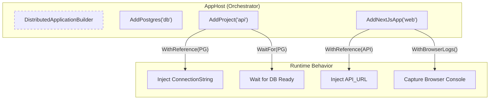
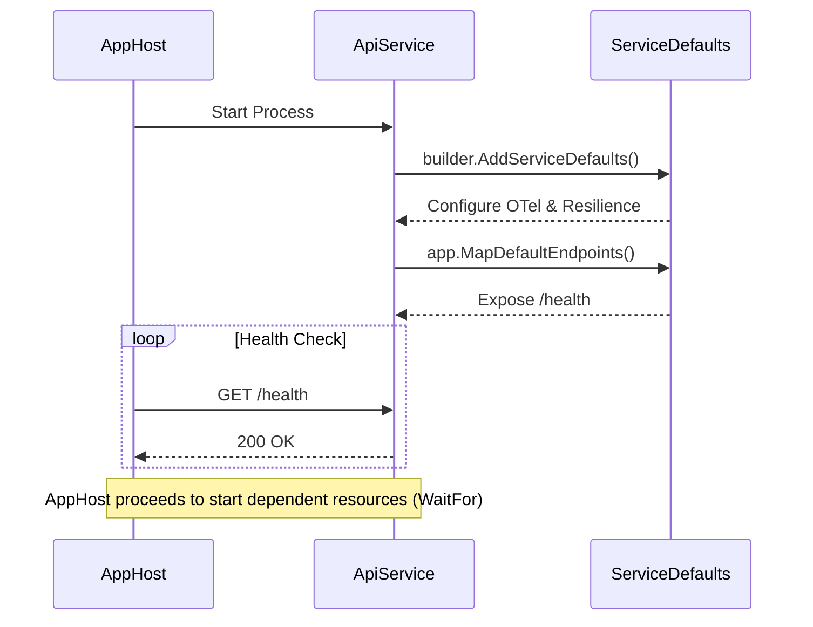

<!-- source: DeepWiki mcp.deepwiki.com · repo microsoft/aspire-skills · extra page C# AppHost Authoring · fetched 2026-10-26 -->

# C# AppHost Authoring

<details>
<summary>Relevant source files</summary>

The following files were used as context for generating this wiki page:

- [.github/plugins/aspire-skills/skills/aspireify/references/csharp-authoring.md](.github/plugins/aspire-skills/skills/aspireify/references/csharp-authoring.md)
- [skills/aspire-monitoring/references/diagnostics-bridge.md](skills/aspire-monitoring/references/diagnostics-bridge.md)
- [skills/aspire-monitoring/references/monitoring.md](skills/aspire-monitoring/references/monitoring.md)
- [skills/aspireify/references/csharp-authoring.md](skills/aspireify/references/csharp-authoring.md)
- [skills/aspireify/references/service-defaults.md](skills/aspireify/references/service-defaults.md)

</details>


This page details the patterns and implementation details for authoring .NET Aspire AppHosts using C#. It covers the two primary authoring modes (SDK-style vs. File-based), the core builder API, resource orchestration, and the integration of ServiceDefaults for observability and resilience.

## Overview and Purpose

C# AppHost authoring provides a strongly-typed environment for defining distributed applications. The `aspireify` skill uses these patterns to wire up projects, containers, and cloud resources. The system relies on the `IDistributedApplicationBuilder` to manage the lifecycle, configuration, and relationship between services [skills/aspireify/references/csharp-authoring.md:1-4]().

## Authoring Modes

### 1. SDK-style (.csproj + Program.cs)
This is the standard mode for .NET projects. It utilizes a `.csproj` file that imports the `Aspire.AppHost.Sdk`. This enables strongly-typed project references via the `Projects` namespace, which is automatically generated by the SDK based on `<ProjectReference>` entries [skills/aspireify/references/csharp-authoring.md:9-38]().

### 2. File-based AppHost (apphost.cs)
A lightweight alternative that does not require a `.csproj` file. It uses `#:sdk` and `#:package` directives at the top of a `.cs` file. In this mode, strongly-typed `Projects.X` references are unavailable, and the path-based overload of `AddProject` must be used [skills/aspireify/references/csharp-authoring.md:47-75]().

### Mapping Natural Language to Code Entities: Authoring Styles
| Concept | Code Entity | Source |
| :--- | :--- | :--- |
| **Project Reference** | `builder.AddProject<Projects.MyApi>("api")` | [skills/aspireify/references/csharp-authoring.md:19-19]() |
| **Direct Path** | `builder.AddProject("api", "../Api/Api.csproj")` | [skills/aspireify/references/csharp-authoring.md:43-43]() |
| **SDK Directive** | `#:sdk Aspire.AppHost.Sdk` | [skills/aspireify/references/csharp-authoring.md:52-52]() |
| **Package Directive** | `#:package Aspire.Hosting.PostgreSQL@13.*` | [skills/aspireify/references/csharp-authoring.md:53-53]() |

**Sources:** [skills/aspireify/references/csharp-authoring.md:9-75]()

---

## Core Builder API

The `DistributedApplication.CreateBuilder(args)` method initializes the orchestration engine. Developers use extension methods on the builder to define the application graph [skills/aspireify/references/csharp-authoring.md:14-34]().

### Common Resource Methods
| Method | Purpose |
| :--- | :--- |
| `AddPostgres(name)` | Adds a PostgreSQL container resource [skills/aspireify/references/csharp-authoring.md:87-87]() |
| `AddRedis(name)` | Adds a Redis container resource [skills/aspireify/references/csharp-authoring.md:87-87]() |
| `AddContainer(name, image)` | Adds an arbitrary container [skills/aspireify/references/csharp-authoring.md:82-82]() |
| `AddNodeApp(name, path)` | Integrates a Node.js application [skills/aspireify/references/csharp-authoring.md:84-84]() |

### Orchestration and Relationships
| Method | Data Flow / Behavior |
| :--- | :--- |
| `WithReference(other)` | Injects connection strings or endpoint URLs from the target into the consumer's environment [skills/aspireify/references/csharp-authoring.md:89-89]() |
| `WaitFor(other)` | Blocks the resource start until the target passes its health check [skills/aspireify/references/csharp-authoring.md:90-90]() |
| `WithEnvironment(k, v)` | Manually injects environment variables, supporting dynamic expressions [skills/aspireify/references/csharp-authoring.md:91-91]() |
| `WithHttpHealthCheck(path)` | Defines the endpoint used by `WaitFor` to determine readiness [skills/aspireify/references/csharp-authoring.md:94-94]() |

### Resource Relationship Data Flow

**Sources:** [skills/aspireify/references/csharp-authoring.md:14-34](), [skills/aspireify/references/csharp-authoring.md:77-94](), [skills/aspireify/references/service-defaults.md:54-68]()

---

## Endpoint Configuration

Endpoints are managed via `WithEndpoint` and `WithExternalHttpEndpoints`. `WithEndpoint` is idempotent; calling it multiple times with the same name updates the existing configuration rather than creating duplicates [skills/aspireify/references/csharp-authoring.md:96-107]().

```csharp
var api = builder.AddProject<Projects.Api>("api")
    .WithEndpoint("admin", e => e.Port = 9000)
    .WithEndpoint("admin", e => e.ExcludeReferenceEndpoint = true); 
```
*Note: `ExcludeReferenceEndpoint = true` prevents the endpoint from being automatically injected into other resources via `WithReference` [skills/aspireify/references/csharp-authoring.md:104-106]().*

**Sources:** [skills/aspireify/references/csharp-authoring.md:96-107]()

---

## ServiceDefaults Injection

`Aspire.ServiceDefaults` is a shared project that configures cross-cutting concerns for every service in the solution. It is essential for ensuring that `WaitFor` logic functions correctly by providing standard health endpoints [skills/aspireify/references/service-defaults.md:1-6]().

### Wiring Workflow
1.  **Project Reference**: Each service project must reference the `ServiceDefaults` project [skills/aspireify/references/service-defaults.md:16-20]().
2.  **Registration**: Call `builder.AddServiceDefaults()` in the service's `Program.cs` to configure OpenTelemetry, Service Discovery, and Resilience [skills/aspireify/references/service-defaults.md:24-30]().
3.  **Mapping**: Call `app.MapDefaultEndpoints()` to expose `/health` and `/alive` routes [skills/aspireify/references/service-defaults.md:34-36]().

### ServiceDefaults Capabilities
| Feature | Implementation | Source |
| :--- | :--- | :--- |
| **Observability** | OTLP Export for Traces, Metrics, and Logs | [skills/aspireify/references/service-defaults.md:47-49]() |
| **Health Checks** | Readiness (`/health`) and Liveness (`/alive`) | [skills/aspireify/references/service-defaults.md:50-50]() |
| **Discovery** | `Microsoft.Extensions.ServiceDiscovery` for HttpClient | [skills/aspireify/references/service-defaults.md:51-51]() |
| **Resilience** | Standard resilience handlers for outbound calls | [skills/aspireify/references/service-defaults.md:52-52]() |

### Service Interaction Logic

**Sources:** [skills/aspireify/references/service-defaults.md:22-41](), [skills/aspireify/references/service-defaults.md:54-68]()

---

## JavaScript Integration in C# AppHosts

C# AppHosts support first-class integration for Node.js, Next.js, and Vite applications.

*   **Browser Logs**: The `WithBrowserLogs()` method (from `Aspire.Hosting.Browsers`) captures browser console output, network requests, and screenshots, sending them to the Aspire Dashboard [skills/aspireify/references/csharp-authoring.md:144-149]().
*   **Publishing**:
    *   `PublishAsStaticWebsite`: Used for Vite SPAs, often paired with a YARP reverse proxy for API calls [skills/aspireify/references/csharp-authoring.md:129-137]().
    *   `PublishAsNodeServer`: For pre-bundled servers like SvelteKit [skills/aspireify/references/csharp-authoring.md:130-130]().
    *   `PublishAsPackageScript`: For SSR frameworks like Remix or Astro [skills/aspireify/references/csharp-authoring.md:131-131]().

**Sources:** [skills/aspireify/references/csharp-authoring.md:125-149]()

---

