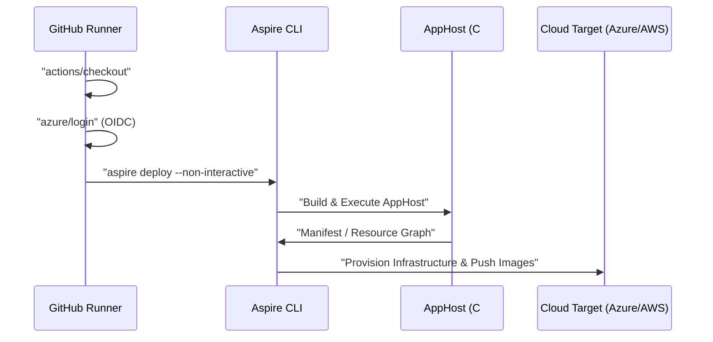

<!-- source: DeepWiki mcp.deepwiki.com · repo microsoft/aspire-skills · extra page Deployment Targets & CI/CD Reference · fetched 2026-10-26 -->

# Deployment Targets & CI/CD Reference

<details>
<summary>Relevant source files</summary>

The following files were used as context for generating this wiki page:

- [.github/CODEOWNERS](.github/CODEOWNERS)
- [.github/plugins/aspire-skills/skills/aspire-deployment/references/aws.md](.github/plugins/aspire-skills/skills/aspire-deployment/references/aws.md)
- [.github/plugins/aspire-skills/skills/aspire-deployment/references/azure.md](.github/plugins/aspire-skills/skills/aspire-deployment/references/azure.md)
- [.github/plugins/aspire-skills/skills/aspire-deployment/references/cicd.md](.github/plugins/aspire-skills/skills/aspire-deployment/references/cicd.md)
- [.github/plugins/aspire-skills/skills/aspire-deployment/references/docker-compose.md](.github/plugins/aspire-skills/skills/aspire-deployment/references/docker-compose.md)
- [.github/plugins/aspire-skills/skills/aspire-deployment/references/github-actions-azure-csharp.yml](.github/plugins/aspire-skills/skills/aspire-deployment/references/github-actions-azure-csharp.yml)
- [.github/plugins/aspire-skills/skills/aspire-deployment/references/github-actions-azure-typescript.yml](.github/plugins/aspire-skills/skills/aspire-deployment/references/github-actions-azure-typescript.yml)
- [skills/aspire-deployment/references/aws.md](skills/aspire-deployment/references/aws.md)
- [skills/aspire-deployment/references/azure.md](skills/aspire-deployment/references/azure.md)
- [skills/aspire-deployment/references/cicd.md](skills/aspire-deployment/references/cicd.md)
- [skills/aspire-deployment/references/docker-compose.md](skills/aspire-deployment/references/docker-compose.md)
- [skills/aspire-deployment/references/github-actions-azure-csharp.yml](skills/aspire-deployment/references/github-actions-azure-csharp.yml)
- [skills/aspire-deployment/references/github-actions-azure-typescript.yml](skills/aspire-deployment/references/github-actions-azure-typescript.yml)
- [skills/aspire-deployment/references/javascript.md](skills/aspire-deployment/references/javascript.md)
- [skills/aspire-deployment/references/kubernetes.md](skills/aspire-deployment/references/kubernetes.md)

</details>


This page provides target-specific deployment guidance for .NET Aspire applications across various cloud providers and container runtimes. It details the implementation of CI/CD pipelines using GitHub Actions, focusing on both C# and TypeScript AppHost patterns, OIDC authentication, and secret management.

## Azure Deployment Targets

Aspire supports three primary Azure targets, each requiring specific hosting integrations and environment resource definitions within the AppHost [skills/aspire-deployment/references/azure.md:11-18]().

| Target | Aspire Command | Best Fit | Integration |
| :--- | :--- | :--- | :--- |
| **Azure Container Apps (ACA)** | `aspire add azure-appcontainers` | Distributed/containerized services with ingress | Azure Container Apps hosting |
| **Azure App Service** | `aspire add azure-appservice` | Public web apps/APIs (App Service model) | Azure App Service hosting |
| **Azure Kubernetes Service (AKS)** | `aspire add azure-kubernetes` | Provisioned Azure-managed Kubernetes | Azure Kubernetes hosting |

### Azure Preflight & Secret Mapping
Deployment to Azure requires authentication via the Azure CLI (`az login`) or a configured `Azure:CredentialSource` [skills/aspire-deployment/references/azure.md:65-66](). For non-interactive environments like CI/CD, settings are mapped via environment variables [skills/aspire-deployment/references/azure.md:90-98]():

*   `Azure__SubscriptionId`: Target subscription [skills/aspire-deployment/references/azure.md:77]().
*   `Azure__Location`: Target region (e.g., `eastus`) [skills/aspire-deployment/references/azure.md:78]().
*   `Azure__ResourceGroup`: Target resource group [skills/aspire-deployment/references/azure.md:79]().
*   `Parameters__<Name>`: Maps to AppHost parameters. Note that dashes in parameter names must be replaced with underscores (e.g., `registry-endpoint` becomes `Parameters__registry_endpoint`) [skills/aspire-deployment/references/azure.md:102]().

**Sources:** [skills/aspire-deployment/references/azure.md:11-102]()

---

## Kubernetes & AKS Reference

Aspire differentiates between existing clusters and those provisioned by the AppHost [skills/aspire-deployment/references/kubernetes.md:7-12]().

### Data Flow: AppHost to Kubernetes
The following diagram illustrates how AppHost definitions translate to Kubernetes resources.

**Diagram: AppHost to Kubernetes Resource Mapping**
```mermaid
graph TD
    subgraph "Code Entity Space (AppHost)"
        A["builder.AddKubernetesEnvironment(\"k8s\")"] -- "Defines" --> B["KubernetesEnvironment"]
        C["resource.WithHelm(\"chart\")"] -- "Configures" --> D["Helm Release"]
        E["resource.WithExternalHttpEndpoints()"] -- "Triggers" --> F["Ingress/Gateway"]
    end

    subgraph "Infrastructure Space (Cluster)"
        B --> G["Namespace/Context"]
        D --> H["Helm Chart Deployment"]
        F --> I["LoadBalancer / Ingress Controller"]
    end
```

### Implementation Details
1.  **Registry Requirement:** Vanilla Kubernetes deployments require a container registry as there is no local-registry fallback [skills/aspire-deployment/references/kubernetes.md:56]().
2.  **External Endpoints:** Routed endpoints (via `AddIngress` or `AddGateway`) **must** be marked external in the AppHost. Failure to do so results in an `InvalidOperationException` during `aspire publish` [skills/aspire-deployment/references/kubernetes.md:88]().
3.  **AKS Specifics:** `aspire add azure-kubernetes` allows Aspire to provision the ACR and Managed Identity alongside the cluster [skills/aspire-deployment/references/kubernetes.md:100-103]().

**Sources:** [skills/aspire-deployment/references/kubernetes.md:7-103]()

---

## AWS Deployment (Preview)

AWS deployment is a preview path driven by the `Aspire.Hosting.AWS` integration [skills/aspire-deployment/references/aws.md:5]().

*   **C# Only:** Currently, there is no TypeScript AppHost support for AWS [skills/aspire-deployment/references/aws.md:52]().
*   **CDK Integration:** Aspire transforms resources into AWS CDK constructs. The AppHost must disable the `ASPIREAWSPUBLISHERS001` warning and initialize the environment using `builder.AddAWSCDKEnvironment` [skills/aspire-deployment/references/aws.md:39-46]().
*   **Bootstrap:** The target account/region must be bootstrapped via `cdk bootstrap` before the first `aspire deploy` [skills/aspire-deployment/references/aws.md:64-68]().

**Sources:** [skills/aspire-deployment/references/aws.md:5-68]()

---

## Docker Compose Reference

Docker Compose is the primary target for local container artifacts and non-cloud deployments [skills/aspire-deployment/references/docker-compose.md:3]().

### Prepare vs. Publish
*   `aspire publish`: Generates a `docker-compose.yaml` and a `.env` file containing **placeholders** [skills/aspire-deployment/references/docker-compose.md:83-125]().
*   `aspire deploy` / `aspire do prepare-docker-compose`: Writes an `.env.<environment>` file with **resolved** parameter values, secrets, and image tags [skills/aspire-deployment/references/docker-compose.md:95-125]().

**Sources:** [skills/aspire-deployment/references/docker-compose.md:3-125]()

---

## CI/CD Reference Workflows

Reference GitHub Actions workflows are provided for both C# and TypeScript AppHosts. These workflows utilize OpenID Connect (OIDC) for Azure authentication, eliminating the need for long-lived service principal secrets.

### GitHub Actions Workflow Structure
The workflow logic follows a standard sequence:
1.  **Setup Toolchain:** Install .NET 10 or Node.js 22 [skills/aspire-deployment/references/cicd.md:74-106]().
2.  **Install Aspire CLI:** `curl -sSL https://aspire.dev/install.sh | bash` [skills/aspire-deployment/references/cicd.md:62]().
3.  **Auth:** Azure Login using `id-token: write` permissions [skills/aspire-deployment/references/github-actions-azure-csharp.yml:9-45]().
4.  **Deploy:** Execute `aspire deploy` with the `--non-interactive` flag [skills/aspire-deployment/references/github-actions-azure-typescript.yml:48]().

**Diagram: CI/CD Execution Flow**


### Reference: TypeScript AppHost Workflow
[skills/aspire-deployment/references/github-actions-azure-typescript.yml:1-54]()
*   **Permissions:** Requires `id-token: write` for OIDC [skills/aspire-deployment/references/github-actions-azure-typescript.yml:9]().
*   **Build:** Runs `npm ci` and `npm run build` before deployment [skills/aspire-deployment/references/github-actions-azure-typescript.yml:31-32]().
*   **Command:** `aspire deploy --apphost ./apphost.ts --environment Production --non-interactive` [skills/aspire-deployment/references/github-actions-azure-typescript.yml:48]().

### Reference: C# AppHost Workflow
[skills/aspire-deployment/references/github-actions-azure-csharp.yml:1-54]()
*   **Setup:** Uses `actions/setup-dotnet` with `10.0.x` [skills/aspire-deployment/references/github-actions-azure-csharp.yml:29-32]().
*   **Command:** `aspire deploy --apphost ./src/AppHost/AppHost.csproj --environment Production` [skills/aspire-deployment/references/github-actions-azure-csharp.yml:48]().

**Sources:** [skills/aspire-deployment/references/cicd.md:62-106](), [skills/aspire-deployment/references/github-actions-azure-typescript.yml:1-54](), [skills/aspire-deployment/references/github-actions-azure-csharp.yml:1-54]()

---

