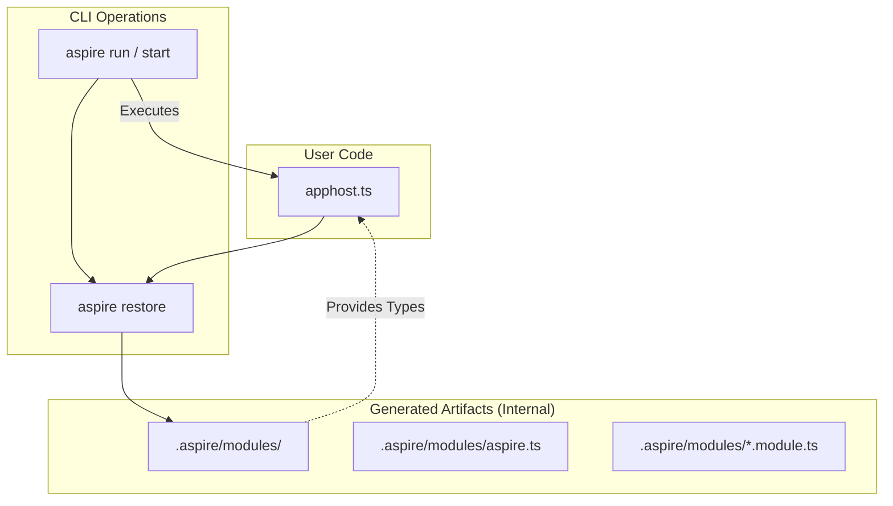
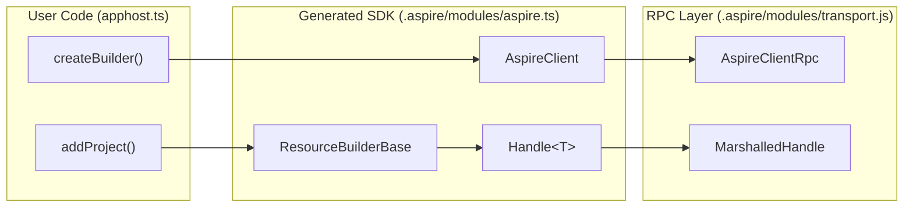

<!-- source: DeepWiki mcp.deepwiki.com · repo microsoft/aspire-skills · extra page TypeScript AppHost Authoring · fetched 2026-10-26 -->

# TypeScript AppHost Authoring

<details>
<summary>Relevant source files</summary>

The following files were used as context for generating this wiki page:

- [.github/plugins/aspire-skills/skills/aspireify/references/javascript-apps.md](.github/plugins/aspire-skills/skills/aspireify/references/javascript-apps.md)
- [.github/plugins/aspire-skills/skills/aspireify/references/typescript-authoring.md](.github/plugins/aspire-skills/skills/aspireify/references/typescript-authoring.md)
- [.gitignore](.gitignore)
- [evals/ts-apphost/.modules/aspire.ts](evals/ts-apphost/.modules/aspire.ts)
- [skills/aspireify/references/javascript-apps.md](skills/aspireify/references/javascript-apps.md)
- [skills/aspireify/references/typescript-authoring.md](skills/aspireify/references/typescript-authoring.md)

</details>


This page details the patterns and implementation details for authoring a TypeScript-based AppHost in .NET Aspire. It covers the core `IDistributedApplicationBuilder` equivalent in TypeScript, resource orchestration, and the critical lifecycle of generated modules.

## Overview and Implementation Flow

TypeScript AppHost authoring centers around `apphost.ts`. Unlike the C# AppHost, which uses NuGet packages directly, the TypeScript AppHost relies on a generation step that produces type-safe bindings for Aspire integrations.

### Data Flow and Lifecycle
The following diagram illustrates the relationship between `apphost.ts`, the Aspire CLI, and the generated artifacts.

**TypeScript AppHost Lifecycle**


**Sources:** [skills/aspireify/references/typescript-authoring.md:9-19](), [skills/aspireify/references/javascript-apps.md:120-122]()

## Core API Patterns

### The Builder Pattern
The entry point for any TypeScript AppHost is `createBuilder()`. This function initializes the orchestration context.

```typescript
import { createBuilder } from '@aspire/hosting';

const builder = await createBuilder();

// Define resources...
const pg = builder.addPostgres('pg').addDatabase('appdb');
const api = await builder.addProject('api', '../Api/Api.csproj')
    .withReference(pg);

await builder.build().run();
```

**Sources:** [skills/aspireify/references/typescript-authoring.md:52-71]()

### Unified `withEnvironment` API
TypeScript authoring uses a unified `withEnvironment(name, value)` method. This single API replaces several specialized C# methods by accepting various types of `IExpressionValue`.

| Supported Value Types | Description |
|-----------------------|-------------|
| `string` | Literal environment variable values. |
| `ReferenceExpression` | Complex expressions involving other resources. |
| `EndpointReference` | Automatic URL/Host/Port resolution. |
| `ParameterResource` | Values from `builder.addParameter`. |
| `IResource` | Connection strings from database or cache resources. |

**Note:** Per-kind helpers like `withEnvironmentEndpoint` or `withEnvironmentConnectionString` are deprecated in favor of this unified API [skills/aspireify/references/typescript-authoring.md:91-96]().

**Sources:** [skills/aspireify/references/typescript-authoring.md:73-89]()

### Endpoint Expressions
Resources expose endpoints that can be queried for specific properties using `getEndpoint(name)`. These properties (`url`, `host`, `port`) are themselves expressions that resolve at runtime.

```typescript
const api = await builder.addProject('api', '../Api/Api.csproj');
const httpEndpoint = api.getEndpoint('http');

await builder.addNodeApp('worker', 'worker.js')
    .withEnvironment('API_BASE', httpEndpoint.url);
```

**Sources:** [skills/aspireify/references/typescript-authoring.md:98-110]()

## JavaScript and Frontend Resource Types

The TypeScript AppHost provides specialized helpers for different JavaScript workloads.

| Helper | Use Case |
|--------|----------|
| `addNextJsApp` | Next.js applications; supports auto-standalone publish. |
| `addViteApp` | Vite-based SPAs (React, Vue, Svelte). |
| `addNodeApp` | General Node.js services or APIs. |

### Publish Hooks
To ensure parity with C# `PublishAs*` methods, TypeScript provides hooks for deployment behavior:
*   `publishAsStaticWebsite`: Deploys a Vite/SPA as a static site, optionally configuring an API proxy [skills/aspireify/references/typescript-authoring.md:137-139]().
*   `publishAsNodeServer`: For pre-bundled servers like SvelteKit [skills/aspireify/references/typescript-authoring.md:141-143]().
*   `publishAsPackageScript`: Delegates deployment execution to a `package.json` script [skills/aspireify/references/typescript-authoring.md:145-147]().

**Sources:** [skills/aspireify/references/typescript-authoring.md:124-148](), [skills/aspireify/references/javascript-apps.md:7-13]()

## Compute Environments

TypeScript AppHosts support targeting specific compute environments like Azure Container Apps (ACA) or Azure Kubernetes Service (AKS).

```typescript
const aca = builder.addAzureContainerAppEnvironment('aca');

await builder.addProject('api', '../Api/Api.csproj')
    .withComputeEnvironment(aca, e => {
        e.customDomains = [{ name: 'api.example.com', certificate: cert }];
    });
```

**Sources:** [skills/aspireify/references/typescript-authoring.md:182-198]()

## The `.aspire/modules/` Directory

A critical distinction in TypeScript AppHost authoring is the `.aspire/modules/` directory. This directory contains the generated TypeScript bindings for Aspire resources and integrations.

### ⛔ Hard Refusal: Editing Generated Modules
Users and AI agents must **never** edit files inside `.aspire/modules/`. This directory is an internal artifact managed by the Aspire CLI.

*   **Regeneration:** Files are clobbered on every `aspire restore`, `aspire add`, and `aspire start` [skills/aspireify/references/typescript-authoring.md:15-18]().
*   **Source of Truth:** All configuration must happen in `apphost.ts`. If an integration is missing, it must be added via `aspire add <package>` [skills/aspireify/references/typescript-authoring.md:34-35]().

**Entity Mapping: AppHost to Transport**


**Sources:** [skills/aspireify/references/typescript-authoring.md:9-40](), [evals/ts-apphost/.modules/aspire.ts:1-26](), [evals/ts-apphost/.modules/aspire.ts:61-101]()

## Project Configuration

### package.json
The root `package.json` should delegate to the Aspire CLI rather than running `node` directly on the AppHost file.

```json
{
  "type": "module",
  "scripts": {
    "dev": "aspire run",
    "build": "tsc"
  }
}
```

### tsconfig.json
The TypeScript configuration must include the generated modules to provide IntelliSense and type checking for the AppHost.

```json
{
  "compilerOptions": {
    "target": "ES2022",
    "module": "nodenext",
    "moduleResolution": "nodenext"
  },
  "include": ["apphost.ts", ".aspire/modules/**/*.ts"]
}
```

**Sources:** [skills/aspireify/references/javascript-apps.md:86-117](), [skills/aspireify/references/javascript-apps.md:123-146]()

---

