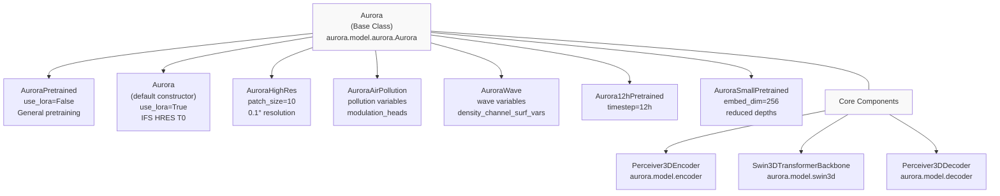
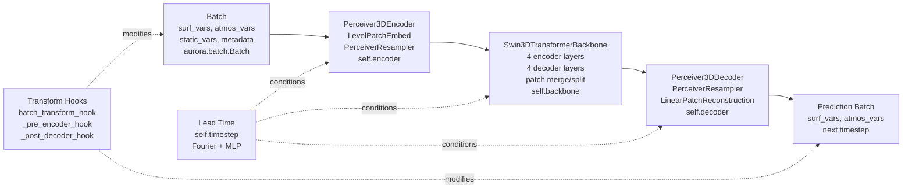
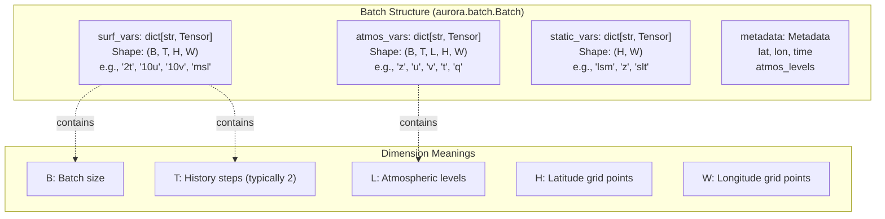
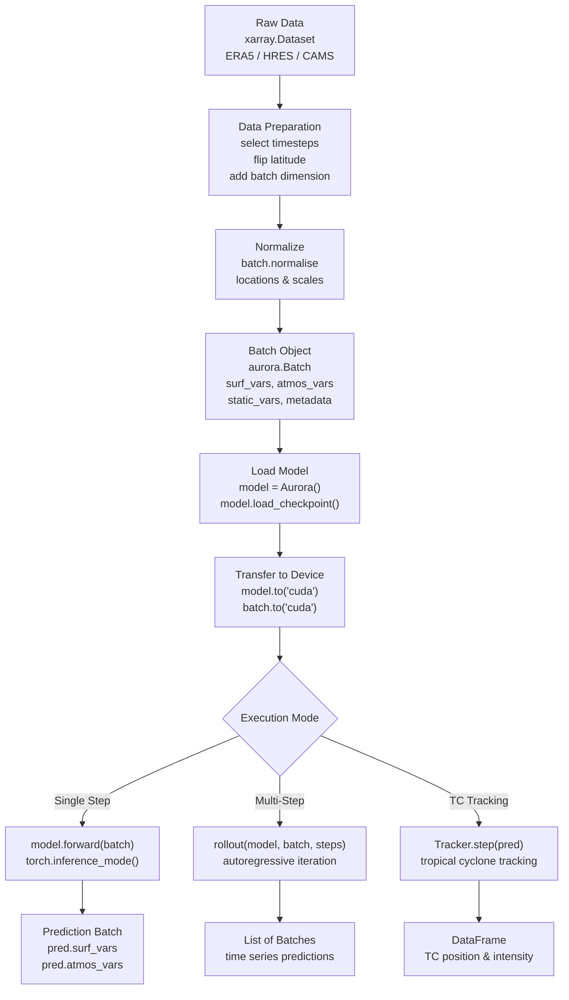

<!-- source: DeepWiki mcp.deepwiki.com · repo microsoft/aurora · page 1 Overview · fetched 2026-10-26 -->

# Overview

<details>
<summary>Relevant source files</summary>

The following files were used as context for generating this wiki page:

- [README.md](README.md)
- [aurora/__init__.py](aurora/__init__.py)
- [aurora/model/aurora.py](aurora/model/aurora.py)
- [docs/_toc.yml](docs/_toc.yml)
- [docs/ai_models_plugin.md](docs/ai_models_plugin.md)
- [docs/gifs/tc_tracks.gif](docs/gifs/tc_tracks.gif)
- [docs/intro.md](docs/intro.md)
- [docs/tracking.md](docs/tracking.md)
- [docs/usage.md](docs/usage.md)

</details>


This document introduces Aurora, a foundation model for atmospheric and environmental forecasting. Aurora is a deep learning system capable of predicting surface-level and atmospheric variables including temperature, wind, precipitation, air pollution concentrations, and ocean wave conditions. The model implements a hierarchical transformer architecture with multi-scale processing capabilities and supports various specialized prediction tasks through fine-tuned variants.

For detailed architecture documentation, see [Model Architecture](#2). For data preparation and batch construction, see [Data Handling](#3). For practical usage examples, see [Usage Guide](#4). For model training and adaptation, see [Fine-tuning](#5).

## Model Family

Aurora consists of a pretrained base model and multiple specialized variants optimized for different resolutions, temporal scales, and atmospheric domains. All variants share the same core architecture defined in [aurora/model/aurora.py:40-548]() but differ in configuration parameters, input/output variables, and checkpoint weights.

| Model Class | Resolution | Timestep | Primary Use Case | Checkpoint |
|------------|-----------|----------|------------------|------------|
| `AuroraPretrained` | 0.25° | 6h | General atmospheric forecasting (ERA5, CMIP6, GFS, HRES) | `aurora-0.25-pretrained.ckpt` |
| `Aurora` | 0.25° | 6h | Operational weather forecasting (IFS HRES T0) | `aurora-0.25-finetuned.ckpt` |
| `AuroraHighRes` | 0.1° | 6h | High-resolution weather analysis | `aurora-0.1-finetuned.ckpt` |
| `AuroraAirPollution` | 0.4° | 12h | Air quality forecasting (CAMS) | `aurora-0.4-air-pollution.ckpt` |
| `AuroraWave` | 0.25° | 6h | Ocean wave prediction (HRES-WAM) | `aurora-0.25-wave.ckpt` |
| `Aurora12hPretrained` | 0.25° | 12h | 12-hour timestep predictions | `aurora-0.25-12h-pretrained.ckpt` |
| `AuroraSmallPretrained` | 0.25° | 6h | Debugging and testing (reduced parameters) | `aurora-0.25-small-pretrained.ckpt` |

Sources: [aurora/model/aurora.py:28-37](), [aurora/model/aurora.py:550-851](), [README.md:52-59]()

## Model Class Hierarchy



**Model Variant Specializations**: Each model variant inherits from the base `Aurora` class and customizes specific parameters:

- **AuroraHighRes** modifies `patch_size=10` and encoder/decoder depths for 0.1° resolution [aurora/model/aurora.py:624-643]()
- **AuroraAirPollution** extends `surf_vars` and `atmos_vars` with pollution species, uses `level_condition`, `dynamic_vars`, `separate_perceiver`, and `modulation_heads` for predicting concentration differences [aurora/model/aurora.py:646-801]()
- **AuroraWave** supplements wave variables with density channels and sine/cosine encoding for directional variables [aurora/model/aurora.py:804-851]()
- **AuroraSmall** reduces `embed_dim` and layer depths for faster testing [aurora/model/aurora.py:568-601]()

Sources: [aurora/model/aurora.py:40-851]()

## Core Architecture Components

Aurora implements a three-stage encoder-backbone-decoder architecture. The model processes heterogeneous multi-scale atmospheric data through variable-specific embeddings, hierarchical 3D attention, and specialized output heads.



**Forward Pass Flow**: The model's forward method [aurora/model/aurora.py:265-392]() implements the following sequence:

1. **Batch Transformation** (`batch_transform_hook`): Domain-specific preprocessing (e.g., wave component splitting)
2. **Normalization** (`batch.normalise`): Apply variable-specific location/scale normalization with optional adjustments via `surf_stats`
3. **Spatial Cropping** (`batch.crop`): Adjust dimensions to be divisible by `patch_size`
4. **Static Variable Broadcasting**: Expand static variables to batch and history dimensions
5. **Positive Variable Clamping**: Apply lower bounds to concentration/magnitude variables if configured
6. **Pre-encoder Hook** (`_pre_encoder_hook`): Apply domain-specific transformations (e.g., log transforms for pollution)
7. **Encoding**: Process through `Perceiver3DEncoder` with lead time conditioning
8. **Backbone Processing**: Apply hierarchical `Swin3DTransformerBackbone` with optional autocast to bfloat16
9. **Decoding**: Reconstruct outputs via `Perceiver3DDecoder`
10. **Post-decoder Hook** (`_post_decoder_hook`): Apply output transformations (e.g., add back differences for pollution)
11. **Output Clamping**: Reapply positive constraints for autoregressive stability
12. **Unnormalization**: Restore original variable scales

Sources: [aurora/model/aurora.py:265-392](), [aurora/model/aurora.py:394-407]()

## Input and Output Specification

Aurora operates on structured atmospheric data encapsulated in the `Batch` dataclass, which contains three categories of variables and associated metadata.



**Variable Categories**:

- **Surface Variables** (`surf_vars`): 2D fields at Earth's surface (temperature, wind components, pressure, concentrations)
- **Atmospheric Variables** (`atmos_vars`): 3D fields at pressure levels (geopotential, wind, temperature, humidity)
- **Static Variables** (`static_vars`): Time-invariant geographical properties (land-sea mask, orography, soil type)
- **Metadata** (`metadata`): Coordinate information including latitude/longitude grids, timestamps, and pressure level specifications

The model requires 2 historical timesteps (T=2) as input context and produces predictions for the next timestep. During autoregressive rollout via the `rollout` function [aurora/rollout.py](), predictions are concatenated with the most recent historical step to form new input batches.

Sources: [aurora/batch.py](), [aurora/model/aurora.py:55-104](), [docs/usage.md:42-66]()

## Execution Workflow



**Core Execution Functions**:

- **Model Construction**: Instantiate a model class (`Aurora`, `AuroraHighRes`, etc.) [aurora/model/aurora.py:40-95]()
- **Checkpoint Loading**: `model.load_checkpoint(repo, name, revision)` downloads from HuggingFace and loads weights [aurora/model/aurora.py:409-456]()
- **Single Prediction**: `model.forward(batch)` produces one timestep ahead [aurora/model/aurora.py:265-392]()
- **Autoregressive Rollout**: `rollout(model, batch, steps)` iteratively applies the model [aurora/rollout.py]()
- **Cyclone Tracking**: `Tracker(init_lat, init_lon, init_time)` with `tracker.step(pred)` [aurora/tracker.py]()

Sources: [aurora/model/aurora.py:409-456](), [aurora/rollout.py](), [aurora/tracker.py](), [docs/usage.md:33-142]()

## Deployment and Integration Options

Aurora supports three primary deployment modes serving different user communities and operational requirements.

| Mode | Entry Point | Use Case | Requirements |
|------|------------|----------|--------------|
| **Local Execution** | Direct Python import | Research, development, testing | PyTorch, GPU (40GB for 0.25° model) |
| **ECMWF ai-models** | `ai-models-aurora` plugin | Operational forecasting integration | ECMWF data access, ai-models framework |
| **Azure AI Foundry** | Foundry API client | Scalable cloud inference | Azure account, blob storage |

**Local Execution**: Install via pip (`pip install microsoft-aurora`) or conda (`mamba install microsoft-aurora -c conda-forge`), then import and use directly:

```python
from aurora import Aurora, Batch
model = Aurora()
model.load_checkpoint()
prediction = model.forward(batch)
```

**ECMWF Integration**: The `ai-models-aurora` plugin enables Aurora to participate in ECMWF operational workflows alongside other AI weather models. The plugin implements the ai-models interface and handles data format conversions.

**Cloud Deployment**: Azure AI Foundry provides REST API access for asynchronous job submission with results delivered via blob storage. This mode supports enterprise-scale inference with managed infrastructure.

Sources: [README.md:63-74](), [docs/usage.md:3-30](), [docs/ai_models_plugin.md](), [aurora/__init__.py:1-30]()

## Key Configuration Parameters

The `Aurora` constructor [aurora/model/aurora.py:55-95]() accepts numerous parameters controlling model architecture, training behavior, and domain-specific features:

**Architecture Parameters**:
- `encoder_depths`, `encoder_num_heads`: Control Swin3D encoder layers
- `decoder_depths`, `decoder_num_heads`: Control Swin3D decoder layers  
- `latent_levels`: Number of latent pressure levels in Perceiver aggregation
- `patch_size`: Spatial patch size for tokenization (4 for 0.25°, 10 for 0.1°)
- `embed_dim`: Base embedding dimensionality

**Variable Configuration**:
- `surf_vars`: Tuple of surface variable names (e.g., `("2t", "10u", "10v", "msl")`)
- `atmos_vars`: Tuple of atmospheric variable names (e.g., `("z", "u", "v", "t", "q")`)
- `static_vars`: Tuple of static variable names (e.g., `("lsm", "z", "slt")`)

**Operational Parameters**:
- `max_history_size`: Number of historical timesteps (default 2)
- `timestep`: Temporal resolution as `timedelta` (default 6 hours)
- `use_lora`: Enable Low-Rank Adaptation for efficient fine-tuning
- `lora_steps`, `lora_mode`: Control LoRA application strategy

**Domain-Specific Features**:
- `level_condition`: Enable pressure-level-dependent embeddings
- `dynamic_vars`: Generate time-dependent static variables (e.g., solar angle)
- `modulation_heads`: Variables requiring difference prediction heads
- `positive_surf_vars`, `positive_atmos_vars`: Variables constrained to non-negative values
- `separate_perceiver`: Use dedicated Perceiver blocks for specific variables

Sources: [aurora/model/aurora.py:55-178]()

## Checkpoint Management

Model weights are distributed via HuggingFace Hub under the `microsoft/aurora` repository. Each model variant specifies default checkpoint details as class attributes:

```python
class Aurora(torch.nn.Module):
    default_checkpoint_repo = "microsoft/aurora"
    default_checkpoint_name = "aurora-0.25-finetuned.ckpt"
    default_checkpoint_revision = "0be7e57c685dac86b78c4a19a3ab149d13c6a3dd"
```

The `load_checkpoint()` method [aurora/model/aurora.py:409-430]() uses `hf_hub_download` to retrieve checkpoints and applies compatibility adaptations via `_adapt_checkpoint()` [aurora/model/aurora.py:458-467](). Checkpoint adaptation handles:

- Version-specific parameter name changes
- History size mismatches via `adapt_checkpoint_max_history_size()` [aurora/model/aurora.py:469-504]()
- Domain-specific extensions for pollution and wave variants

Static geographical variables (land-sea mask, orography, soil type) are also stored in the HuggingFace repository as `.pickle` files, loaded separately and passed to the `Batch` constructor.

Sources: [aurora/model/aurora.py:46-53](), [aurora/model/aurora.py:409-504](), [aurora/model/compat.py]()

## Technical Requirements and Performance

**Hardware Requirements**:
- GPU memory: ~40 GB for Aurora 0.25° (full resolution global predictions)
- GPU memory: ~20 GB for AuroraSmall (testing/debugging)
- CPU execution supported but significantly slower

**Software Dependencies**:
- Python ≥ 3.10
- PyTorch with CUDA support
- Additional packages: `numpy`, `xarray`, `huggingface_hub`, `torch.distributed` for fine-tuning

**Throughput Characteristics**:
- Single forward pass: ~1 second on A100 GPU
- Autoregressive rollout (10 steps): ~10 seconds
- Fine-tuning: Requires activation checkpointing (`configure_activation_checkpointing()`) and automatic mixed precision to fit in memory

Sources: [aurora/model/aurora.py:506-547](), [docs/usage.md:123-124](), [setup.py or requirements files would provide dependency details]

---

