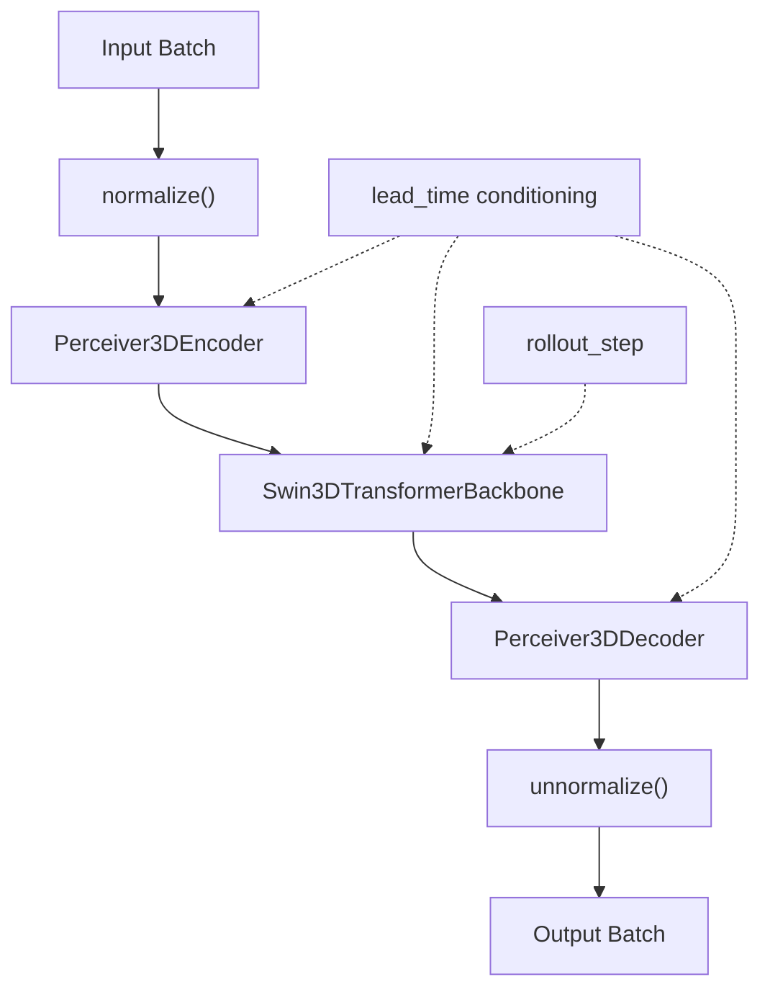
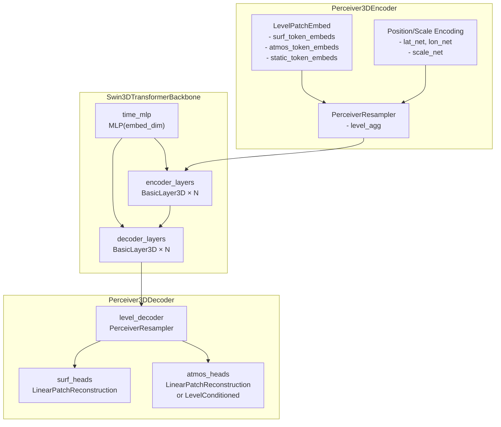
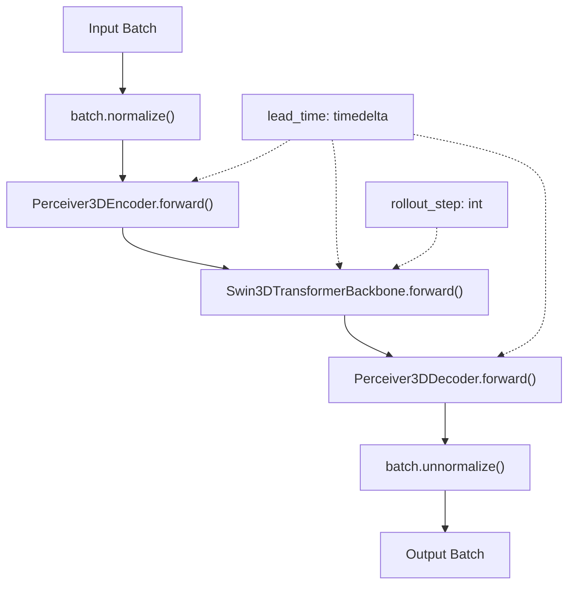
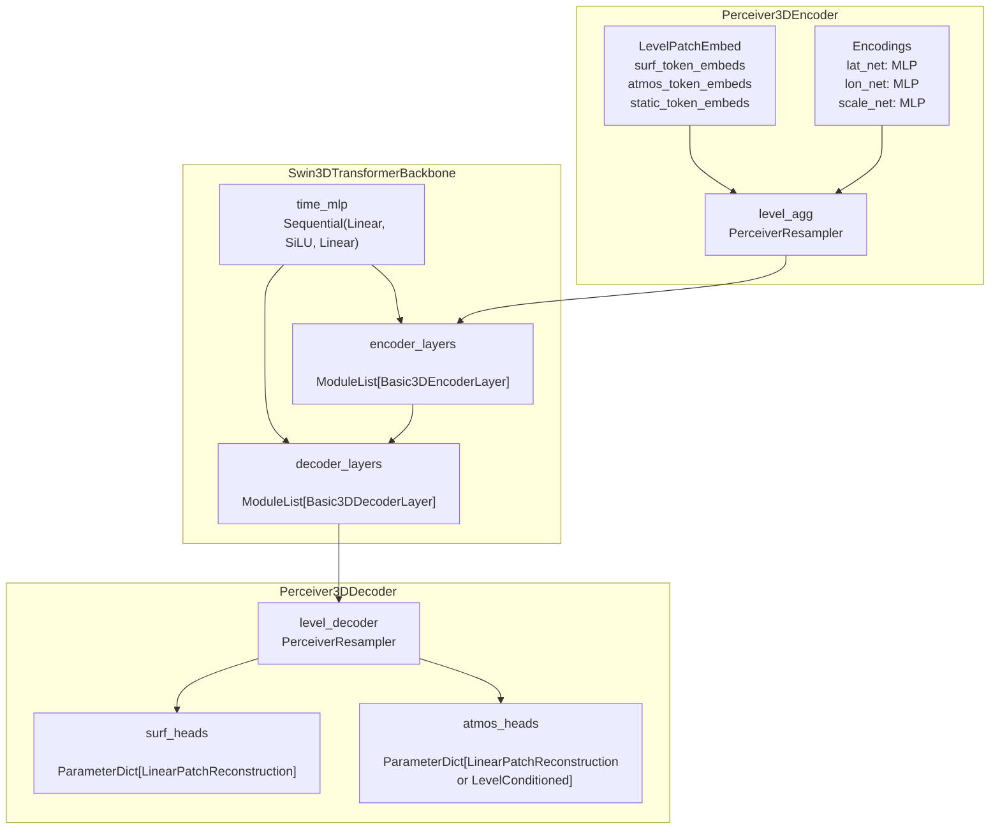
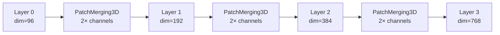
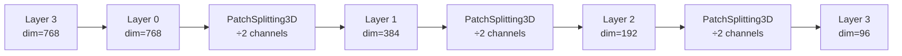
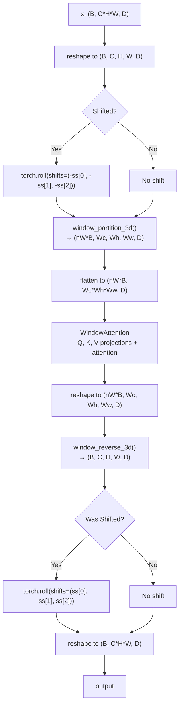
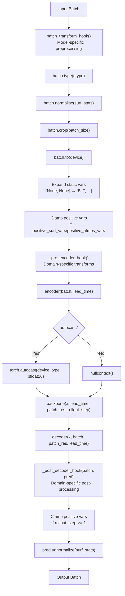
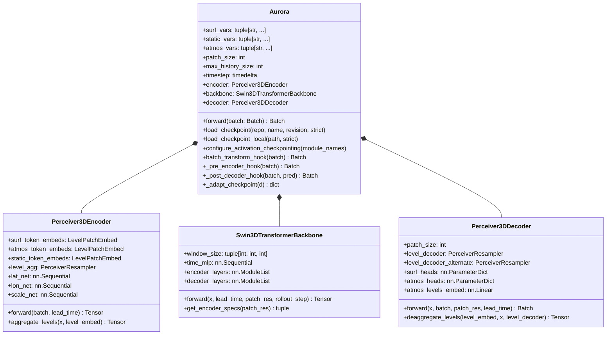

<!-- source: DeepWiki mcp.deepwiki.com · repo microsoft/aurora · page 2 Model Architecture · fetched 2026-10-26 -->

# Model Architecture

<details>
<summary>Relevant source files</summary>

The following files were used as context for generating this wiki page:

- [aurora/model/aurora.py](aurora/model/aurora.py)
- [aurora/model/decoder.py](aurora/model/decoder.py)
- [aurora/model/swin3d.py](aurora/model/swin3d.py)

</details>


Aurora implements a three-stage neural network architecture consisting of an encoder, backbone, and decoder. This page documents the architectural design, component interactions, and implementation details. For the main model class interface, see page 2.1. For backbone details, see page 2.2. For decoder specifics, see page 2.3. For model variants, see page 2.4.

## Architecture Overview

Aurora processes multi-variable atmospheric data through a three-stage pipeline: (1) the `Perceiver3DEncoder` aggregates heterogeneous inputs into a unified latent representation, (2) the `Swin3DTransformerBackbone` processes this representation through hierarchical 3D attention layers, and (3) the `Perceiver3DDecoder` reconstructs multi-scale predictions.

### High-Level Data Flow



Sources: [aurora/model/aurora.py:265-392]()

### Architecture Components with Code Entities



Sources: [aurora/model/aurora.py:199-252](), [aurora/model/swin3d.py:753-869](), [aurora/model/decoder.py:27-138]()
</old_str>
<new_str>
# Model Architecture

Aurora implements a three-stage neural network architecture consisting of an encoder, backbone, and decoder. This page documents the architectural design, component interactions, and implementation details. For the main `Aurora` model class interface, see page 2.1. For backbone details, see page 2.2. For decoder specifics, see page 2.3. For model variants, see page 2.4.

## Architecture Overview

Aurora processes multi-variable atmospheric data through a three-stage pipeline: (1) the `Perceiver3DEncoder` aggregates heterogeneous inputs into a unified latent representation, (2) the `Swin3DTransformerBackbone` processes this representation through hierarchical 3D attention layers, and (3) the `Perceiver3DDecoder` reconstructs multi-scale predictions.

### High-Level Data Flow



Sources: [aurora/model/aurora.py:265-392]()

### Architecture Components with Code Entities



Sources: [aurora/model/aurora.py:199-252](), [aurora/model/swin3d.py:753-869](), [aurora/model/decoder.py:27-138]()

## Three-Stage Architecture

Aurora's architecture follows an encoder-backbone-decoder pattern, with each stage handling a specific aspect of the processing pipeline.

### Stage 1: Perceiver3D Encoder

The `Perceiver3DEncoder` converts heterogeneous multi-variable inputs into a unified latent representation suitable for transformer processing. The encoder handles three types of variables with different characteristics:

| Variable Type | Embedding Module | Dimensions | Aggregation |
|---------------|-----------------|------------|-------------|
| Surface variables | `surf_token_embeds` | `(B, T, H, W)` | → `latent_levels` |
| Atmospheric variables | `atmos_token_embeds` | `(B, T, C_atmos, H, W)` | → `latent_levels` |
| Static variables | `static_token_embeds` | `(H, W)` | → `latent_levels` |

**Key Operations:**

1. **Patch Embedding**: Each variable is embedded through `LevelPatchEmbed`, which applies 3D convolutions per variable to create patch tokens
2. **Position Encoding**: Fourier expansions of latitude, longitude, and scale are added via learned MLPs (`lat_net`, `lon_net`, `scale_net`)
3. **Level Aggregation**: The `PerceiverResampler` (in `level_agg`) compresses physical pressure levels into `latent_levels` (default: 4) latent levels through cross-attention

The encoder outputs a tensor of shape `(B, latent_levels * H_patch * W_patch, embed_dim)`.

Sources: [aurora/model/encoder.py:28-261](), [aurora/model/aurora.py:199-218]()

### Stage 2: Swin3D Transformer Backbone

The `Swin3DTransformerBackbone` implements a hierarchical U-Net-style architecture using 3D Swin Transformer blocks with shifted window attention. The backbone operates in two phases:

**Encoder Phase:**


**Decoder Phase:**


Each layer consists of multiple `Swin3DTransformerBlock` instances with alternating regular and shifted window attention. The backbone:

- Progressively halves spatial dimensions (H, W) while doubling channels in the encoder
- Reverses this in the decoder via `PatchSplitting3D`
- Uses U-Net-style skip connections: concatenation at the final layer, addition at intermediate layers
- Conditions all layers on lead time through `AdaptiveLayerNorm` with embeddings from `time_mlp`

Sources: [aurora/model/swin3d.py:753-939](), [aurora/model/aurora.py:220-234]()

### Stage 3: Perceiver3D Decoder

The `Perceiver3DDecoder` transforms the latent representation back into per-variable predictions at the original spatial resolution:

**Architecture:**

1. **Level De-aggregation**: The `level_decoder` (`PerceiverResampler`) expands the `latent_levels` back to physical pressure levels through cross-attention
2. **Variable-Specific Heads**: Separate prediction heads in `surf_heads` and `atmos_heads` produce per-variable outputs
   - Surface variables use `LinearPatchReconstruction` directly
   - Atmospheric variables optionally use `LevelConditioned` wrappers for level-specific parameters
3. **Unpatchification**: Patch predictions are assembled back into full spatial fields

For atmospheric variables, some model variants use `separate_perceiver` to run specific variables (e.g., pollution species) through an alternate decoder (`level_decoder_alternate`).

Sources: [aurora/model/decoder.py:27-276](), [aurora/model/aurora.py:236-252]()

## Hierarchical Multi-Scale Processing

The backbone's hierarchical structure enables efficient processing of atmospheric data at multiple scales:

### Resolution Stages

| Stage | Encoder Layer | Channel Dim | Spatial Dim | Decoder Layer |
|-------|---------------|-------------|-------------|---------------|
| 0 | `encoder_layers[0]` | `96` | `(C, H, W)` | `decoder_layers[3]` |
| 1 | `encoder_layers[1]` | `192` | `(C, H/2, W/2)` | `decoder_layers[2]` |
| 2 | `encoder_layers[2]` | `384` | `(C, H/4, W/4)` | `decoder_layers[1]` |
| 3 | `encoder_layers[3]` | `768` | `(C, H/8, W/8)` | `decoder_layers[0]` |

Where `(C, H, W)` is the patch resolution. The vertical dimension `C` (corresponding to `latent_levels`) remains constant throughout.

**Patch Merging/Splitting:**
- `PatchMerging3D`: Reduces spatial dimensions by 2× in H and W, concatenates 2×2 neighborhoods, then projects to 2× channels
- `PatchSplitting3D`: Reverses the operation, splitting channels to expand spatial dimensions

Sources: [aurora/model/swin3d.py:514-615](), [aurora/model/swin3d.py:871-885]()

### 3D Window Attention

Each `Swin3DTransformerBlock` applies window-based self-attention with the following mechanism:



The window size `(Wc, Wh, Ww)` defaults to `(2, 6, 12)`. Consecutive blocks alternate between regular windows and shifted windows (shifted by half the window size) to enable cross-window communication.

Sources: [aurora/model/swin3d.py:365-512](), [aurora/model/swin3d.py:198-248]()

## Conditioning and Adaptation

### Lead Time Conditioning

All stages of the model are conditioned on the prediction lead time (forecast horizon):

1. **Time Embedding**: Lead time is converted to hours, then expanded to `embed_dim` dimensions via Fourier features: `lead_time_expansion(lead_hours, embed_dim)`
2. **Time MLP**: The expansion is passed through `time_mlp`, a 2-layer MLP with SiLU activation
3. **Adaptive Layer Normalization**: Each `Swin3DTransformerBlock` uses `AdaptiveLayerNorm` that modulates normalization based on the time embedding

This conditioning allows the model to adjust its predictions based on forecast horizon.

Sources: [aurora/model/swin3d.py:808-812](), [aurora/model/swin3d.py:915-917](), [aurora/model/film.py:1-87]()

### LoRA Adaptation

When `use_lora=True`, the backbone enables Low-Rank Adaptation for efficient fine-tuning:

- **LoRA Modules**: `WindowAttention` uses `LoRARollout` wrappers for `qkv` and `proj` layers
- **Rollout-Specific Adaptation**: The `lora_mode` parameter controls adaptation behavior:
  - `"single"`: Same LoRA parameters for all rollout steps
  - `"from_second"`: Separate LoRA for first step, shared for subsequent steps
  - `"all"`: Different LoRA for each rollout step up to `lora_steps`
- **Low-Rank Structure**: LoRA uses rank-`lora_r` (default: 8) matrices with scaling factor `lora_alpha`

Sources: [aurora/model/swin3d.py:125-134](), [aurora/model/lora.py:1-161]()

## Forward Pass Pipeline

The complete forward pass in `Aurora.forward()` follows this sequence:



**Hooks** provide extension points for model variants:
- `batch_transform_hook()`: Pre-normalization transformations (e.g., `AuroraWave` splits wind direction)
- `_pre_encoder_hook()`: Post-normalization, pre-encoding (e.g., `AuroraAirPollution` applies log transforms)
- `_post_decoder_hook()`: Post-decoding (e.g., `AuroraAirPollution` adds difference predictions, `AuroraWave` reconstructs angles)

Sources: [aurora/model/aurora.py:265-392](), [aurora/model/aurora.py:394-407]()

## Implementation Details

### Variable Processing

Aurora handles three categories of variables, each with specific processing:

| Category | Default Variables | Shape | Processing Module |
|----------|------------------|-------|-------------------|
| Surface | `2t`, `10u`, `10v`, `msl` | `(B, T, H, W)` | `surf_token_embeds`, `surf_heads` |
| Static | `lsm`, `z`, `slt` | `(H, W)` | `static_token_embeds`, expanded to `(B, T, H, W)` |
| Atmospheric | `z`, `u`, `v`, `t`, `q` | `(B, T, C, H, W)` | `atmos_token_embeds`, `atmos_heads` |

Where `T = max_history_size` (default: 2), and `C = len(atmos_levels)` (default: 13 pressure levels).

Sources: [aurora/model/aurora.py:55-104](), [aurora/model/aurora.py:291-295]()

### Patch Embedding

The `LevelPatchEmbed` class creates patch embeddings via 3D convolutions:

- Each variable has its own convolutional embedding weights in `surf_token_embeds.weights` and `atmos_token_embeds.weights`
- Convolution: kernel size `(max_history_size, patch_size, patch_size)`, stride `(1, patch_size, patch_size)`
- Output: `(B, embed_dim, 1, H_patch, W_patch)` where `H_patch = H // patch_size`, `W_patch = W // patch_size`

Sources: [aurora/model/encoder.py:33-119]()

### Memory Optimization

**Activation Checkpointing:**

The `configure_activation_checkpointing()` method enables gradient checkpointing to reduce memory usage during training:

```python
model.configure_activation_checkpointing(
    module_names=(
        "Basic3DDecoderLayer",
        "Basic3DEncoderLayer", 
        "LinearPatchReconstruction",
        "Perceiver3DDecoder",
        "Perceiver3DEncoder",
        "Swin3DTransformerBackbone",
        "Swin3DTransformerBlock",
    )
)
```

This trades computation for memory by recomputing activations during the backward pass.

**Mixed Precision:**

Setting `autocast=True` wraps the backbone in `torch.autocast(device_type, dtype=torch.bfloat16)`, casting operations to bfloat16 for reduced memory usage. The encoder and decoder remain in full precision for numerical stability.

Sources: [aurora/model/aurora.py:506-547](), [aurora/model/aurora.py:327-336]()

## Configuration Parameters

The `Aurora` class initialization accepts numerous architectural parameters:

### Core Architecture Parameters

| Parameter | Type | Default | Description |
|-----------|------|---------|-------------|
| `window_size` | `tuple[int, int, int]` | `(2, 6, 12)` | Window size for 3D attention (depth, height, width) |
| `encoder_depths` | `tuple[int, ...]` | `(6, 10, 8)` | Number of blocks per encoder layer |
| `encoder_num_heads` | `tuple[int, ...]` | `(8, 16, 32)` | Attention heads per encoder layer |
| `decoder_depths` | `tuple[int, ...]` | `(8, 10, 6)` | Number of blocks per decoder layer |
| `decoder_num_heads` | `tuple[int, ...]` | `(32, 16, 8)` | Attention heads per decoder layer |
| `patch_size` | `int` | `4` | Spatial patch size |
| `embed_dim` | `int` | `512` | Embedding dimension (base dimension for stage 0) |
| `latent_levels` | `int` | `4` | Number of latent pressure levels |
| `num_heads` | `int` | `16` | Attention heads in Perceiver blocks |

### Perceiver Parameters

| Parameter | Type | Default | Description |
|-----------|------|---------|-------------|
| `enc_depth` | `int` | `1` | Perceiver blocks in encoder |
| `dec_depth` | `int` | `1` | Perceiver blocks in decoder |
| `dec_mlp_ratio` | `float` | `2.0` | MLP ratio in decoder Perceiver |
| `perceiver_ln_eps` | `float` | `1e-5` | Layer norm epsilon in Perceiver |

### Training and Adaptation

| Parameter | Type | Default | Description |
|-----------|------|---------|-------------|
| `use_lora` | `bool` | `True` | Enable LoRA adaptation |
| `lora_steps` | `int` | `40` | Max rollout steps with distinct LoRA |
| `lora_mode` | `LoRAMode` | `"single"` | LoRA application mode |
| `autocast` | `bool` | `False` | Use bfloat16 autocast for backbone |
| `max_history_size` | `int` | `2` | Maximum history timesteps |
| `timestep` | `timedelta` | `timedelta(hours=6)` | Prediction timestep |

Sources: [aurora/model/aurora.py:55-95]()

## Class Hierarchy

The core model classes and their relationships:



Sources: [aurora/model/aurora.py:40-407](), [aurora/model/encoder.py:28-261](), [aurora/model/swin3d.py:753-939](), [aurora/model/decoder.py:27-276]()

## Summary

The Core Aurora Model represents a sophisticated encoder-backbone-decoder architecture specifically designed for Earth system forecasting. Its unique combination of 3D Perceiver components and Swin Transformer technology enables it to effectively process complex meteorological data with different spatial and temporal characteristics.

The model handles both surface-level and atmospheric variables, with careful attention to proper normalization, spatial relationships, and pressure level aggregation. The architecture is designed to be flexible, with variants available for different computational requirements and resolution needs.

---

