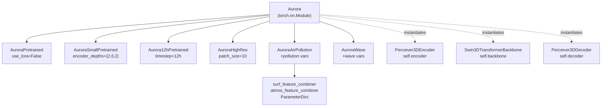
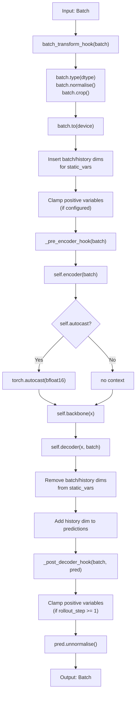
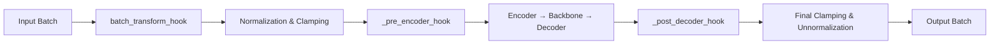

<!-- source: DeepWiki mcp.deepwiki.com · repo microsoft/aurora · page 2.1 Aurora Model Class · fetched 2026-10-26 -->

# Aurora Model Class

<details>
<summary>Relevant source files</summary>

The following files were used as context for generating this wiki page:

- [aurora/model/aurora.py](aurora/model/aurora.py)

</details>


## Purpose and Scope

This page documents the `Aurora` class ([aurora/model/aurora.py:40-548]()), which is the main entry point for all Aurora model variants. It covers the class initialization parameters, the forward pass pipeline, the extensible hooks system, and checkpoint management functionality.

For detailed documentation of specific model variants (`AuroraPretrained`, `AuroraHighRes`, `AuroraAirPollution`, etc.), see [Model Variants](#2.4). For the internal architecture components (encoder, backbone, decoder), see [Swin3D Transformer Backbone](#2.2) and [Perceiver3D Decoder](#2.3).

## Class Overview

The `Aurora` class is a `torch.nn.Module` that orchestrates the complete prediction pipeline. It instantiates and manages three core architectural components:

| Component | Class | Purpose |
|-----------|-------|---------|
| Encoder | `Perceiver3DEncoder` | Multi-scale input processing and level aggregation |
| Backbone | `Swin3DTransformerBackbone` | Hierarchical 3D attention processing |
| Decoder | `Perceiver3DDecoder` | Level de-aggregation and output reconstruction |

The class provides a flexible initialization interface with 30+ configuration parameters, an extensible hooks system for variant-specific transformations, and utilities for checkpoint management.



**Class Hierarchy**: All Aurora variants inherit from the base `Aurora` class, customizing initialization parameters and overriding hook methods to implement variant-specific behavior.

Sources: [aurora/model/aurora.py:40-852]()

## Initialization Parameters

The `Aurora.__init__` method ([aurora/model/aurora.py:55-264]()) accepts parameters organized into several functional groups:

### Variable Configuration

These parameters define what variables the model processes:

| Parameter | Type | Default | Description |
|-----------|------|---------|-------------|
| `surf_vars` | `tuple[str, ...]` | `("2t", "10u", "10v", "msl")` | Surface-level variables |
| `static_vars` | `tuple[str, ...]` | `("lsm", "z", "slt")` | Static variables (terrain, land-sea mask) |
| `atmos_vars` | `tuple[str, ...]` | `("z", "u", "v", "t", "q")` | Atmospheric variables at pressure levels |

### Architecture Configuration

Core architectural parameters:

| Parameter | Type | Default | Description |
|-----------|------|---------|-------------|
| `window_size` | `tuple[int, int, int]` | `(2, 6, 12)` | Vertical, height, width of Swin3D windows |
| `encoder_depths` | `tuple[int, ...]` | `(6, 10, 8)` | Number of blocks per encoder layer |
| `encoder_num_heads` | `tuple[int, ...]` | `(8, 16, 32)` | Attention heads per encoder layer |
| `decoder_depths` | `tuple[int, ...]` | `(8, 10, 6)` | Number of blocks per decoder layer |
| `decoder_num_heads` | `tuple[int, ...]` | `(32, 16, 8)` | Attention heads per decoder layer |
| `latent_levels` | `int` | `4` | Number of latent pressure levels |
| `patch_size` | `int` | `4` | Patch size for spatial discretization |
| `embed_dim` | `int` | `512` | Patch embedding dimension |

### Perceiver Configuration

Parameters for the Perceiver encoder/decoder blocks:

| Parameter | Type | Default | Description |
|-----------|------|---------|-------------|
| `num_heads` | `int` | `16` | Attention heads in aggregation/deaggregation |
| `enc_depth` | `int` | `1` | Number of Perceiver blocks in encoder |
| `dec_depth` | `int` | `1` | Number of Perceiver blocks in decoder |
| `perceiver_ln_eps` | `float` | `1e-5` | Layer norm epsilon for numerical stability |

### Fine-tuning and Adaptation

Parameters for model adaptation:

| Parameter | Type | Default | Description |
|-----------|------|---------|-------------|
| `use_lora` | `bool` | `True` | Enable LoRA adaptation |
| `lora_steps` | `int` | `40` | Use different LoRA for first N steps |
| `lora_mode` | `LoRAMode` | `"single"` | LoRA mode: `"single"`, `"from_second"`, or `"all"` |
| `max_history_size` | `int` | `2` | Maximum number of history timesteps |
| `timestep` | `timedelta` | `timedelta(hours=6)` | Model timestep duration |

### Variant-Specific Features

Parameters enabling specialized behavior:

| Parameter | Type | Default | Description |
|-----------|------|---------|-------------|
| `level_condition` | `tuple[int\|float, ...]` | `None` | Pressure levels for level-conditioned embeddings |
| `dynamic_vars` | `bool` | `False` | Use dynamic static variables (time of day) |
| `atmos_static_vars` | `bool` | `False` | Concatenate static vars to atmospheric vars |
| `separate_perceiver` | `tuple[str, ...]` | `()` | Variables using separate decoder Perceiver |
| `modulation_heads` | `tuple[str, ...]` | `()` | Variables with additional modulation heads |
| `positive_surf_vars` | `tuple[str, ...]` | `()` | Surface variables to clamp positive |
| `positive_atmos_vars` | `tuple[str, ...]` | `()` | Atmospheric variables to clamp positive |

Sources: [aurora/model/aurora.py:55-178]()

## Forward Pass Pipeline

The `forward` method ([aurora/model/aurora.py:265-392]()) implements a multi-stage processing pipeline:



### Key Processing Steps

1. **Pre-processing** ([aurora/model/aurora.py:274-295]()):
   - Apply `batch_transform_hook` for variant-specific input transformations
   - Type conversion, normalization, spatial cropping, device placement
   - Insert batch and history dimensions for static variables

2. **Positive Variable Clamping** ([aurora/model/aurora.py:301-317]()):
   - Clamp variables in `positive_surf_vars` and `positive_atmos_vars` to be non-negative
   - Applied before encoder to prevent negative inputs

3. **Encoder Processing** ([aurora/model/aurora.py:319-325]()):
   - Apply `_pre_encoder_hook` for additional transformations
   - Pass through `Perceiver3DEncoder` with lead time conditioning

4. **Backbone Processing** ([aurora/model/aurora.py:327-343]()):
   - Optionally wrap in `torch.autocast` for BF16 memory optimization
   - Pass through `Swin3DTransformerBackbone` with rollout step tracking

5. **Decoder Processing** ([aurora/model/aurora.py:345-365]()):
   - Pass through `Perceiver3DDecoder` to reconstruct outputs
   - Remove batch/history dimensions from static variables
   - Add history dimension to predictions

6. **Post-processing** ([aurora/model/aurora.py:365-391]()):
   - Apply `_post_decoder_hook` for variant-specific output transformations
   - Clamp positive variables for autoregressive rollout (after first step)
   - Unnormalize predictions to original scale

Sources: [aurora/model/aurora.py:265-392]()

## Hooks System

The `Aurora` class provides three extensible hooks that subclasses can override to implement variant-specific behavior:

### batch_transform_hook

```python
def batch_transform_hook(self, batch: Batch) -> Batch:
```

**Location**: [aurora/model/aurora.py:394-399]()

**Called**: First step in `forward()`, before normalization

**Purpose**: Transform the raw input batch. This hook should be **idempotent** since it may be called multiple times during autoregressive rollout.

**Example Use Case**: `AuroraWave` uses this to split wind direction into u/v components and mark absent waves with NaNs ([aurora/model/aurora.py:854-890]()).

### _pre_encoder_hook

```python
def _pre_encoder_hook(self, batch: Batch) -> Batch:
```

**Location**: [aurora/model/aurora.py:401-403]()

**Called**: After normalization and clamping, immediately before encoder

**Purpose**: Apply transformations to normalized data before encoding. Unlike `batch_transform_hook`, this operates on normalized values.

**Example Use Cases**:
- `AuroraAirPollution`: Apply log-space transformations to pollution variables ([aurora/model/aurora.py:726-758]())
- `AuroraWave`: Create density channels for sparse data and sine/cosine for angles ([aurora/model/aurora.py:892-908]())

### _post_decoder_hook

```python
def _post_decoder_hook(self, batch: Batch, pred: Batch) -> Batch:
```

**Location**: [aurora/model/aurora.py:405-407]()

**Called**: After decoder, before final clamping and unnormalization

**Purpose**: Transform predictions, such as computing differences or applying domain-specific constraints.

**Example Use Cases**:
- `AuroraAirPollution`: Convert difference predictions to absolute values and clip SO2 ([aurora/model/aurora.py:760-796]())
- `AuroraWave`: Reconstruct angles from sine/cosine and apply density thresholds ([aurora/model/aurora.py:910-932]())

### Hook Execution Order



Sources: [aurora/model/aurora.py:394-407](), [aurora/model/aurora.py:726-932]()

## Checkpoint Management

### Loading from HuggingFace

```python
def load_checkpoint(
    self,
    repo: Optional[str] = None,
    name: Optional[str] = None,
    revision: Optional[str] = None,
    strict: bool = True,
) -> None:
```

**Location**: [aurora/model/aurora.py:409-430]()

Downloads and loads a checkpoint from HuggingFace Hub. Each model variant specifies default values:

| Attribute | Purpose |
|-----------|---------|
| `default_checkpoint_repo` | Repository name (e.g., `"microsoft/aurora"`) |
| `default_checkpoint_name` | Checkpoint filename (e.g., `"aurora-0.25-finetuned.ckpt"`) |
| `default_checkpoint_revision` | Git commit hash for version pinning |

**Usage**:
```python
model = Aurora()
model.load_checkpoint()  # Uses defaults
model.load_checkpoint(repo="custom/repo", name="custom.ckpt")  # Override
```

### Loading from Local File

```python
def load_checkpoint_local(self, path: str, strict: bool = True) -> None:
```

**Location**: [aurora/model/aurora.py:432-456]()

Loads a checkpoint directly from disk. Handles:
1. Device placement (CPU or GPU)
2. Checkpoint adaptation via `_adapt_checkpoint()`
3. History size compatibility checking
4. State dictionary loading

### Checkpoint Adaptation

```python
def _adapt_checkpoint(self, d: dict[str, torch.Tensor]) -> dict[str, torch.Tensor]:
```

**Location**: [aurora/model/aurora.py:458-467]()

Transforms checkpoint state dictionaries to ensure compatibility with the current model version. Each variant may override this:

- **Aurora (base)**: Applies `_adapt_checkpoint_pretrained()` for backward compatibility
- **AuroraAirPollution**: Additionally applies `_adapt_checkpoint_air_pollution()`
- **AuroraWave**: Additionally applies `_adapt_checkpoint_wave()`

These adaptation functions are defined in [aurora/model/compat.py]().

### History Size Adaptation

```python
def adapt_checkpoint_max_history_size(self, checkpoint: dict[str, torch.Tensor]) -> None:
```

**Location**: [aurora/model/aurora.py:469-504]()

Adapts checkpoints trained with smaller `max_history_size` to models with larger `max_history_size`. This is necessary because the patch embeddings have a history dimension.

**Mechanism**:
- Identifies patch embedding weights: `encoder.surf_token_embeds.weights.*` and `encoder.atmos_token_embeds.weights.*`
- Creates new weight tensors with the larger history dimension
- Copies existing weights and zero-pads the additional history slots
- **Cannot** load checkpoints with larger history size than the model (raises `AssertionError`)

**Shape Transformation**:
```
Original: (C, 1, H_old, h, w)
New:      (C, 1, H_new, h, w)  where H_new > H_old
```

Sources: [aurora/model/aurora.py:409-504](), [aurora/model/compat.py]()

## Activation Checkpointing

```python
def configure_activation_checkpointing(
    self,
    module_names: tuple[str, ...] = (
        "Basic3DDecoderLayer",
        "Basic3DEncoderLayer",
        "LinearPatchReconstruction",
        "Perceiver3DDecoder",
        "Perceiver3DEncoder",
        "Swin3DTransformerBackbone",
        "Swin3DTransformerBlock",
    ),
) -> None:
```

**Location**: [aurora/model/aurora.py:506-547]()

Enables gradient checkpointing to reduce memory usage during training/fine-tuning. This is **critical** for fine-tuning Aurora models without running out of memory.

**How It Works**:
- Uses PyTorch's `apply_activation_checkpointing` from the distributed package
- Applies checkpointing to specific module classes by name
- Trades compute for memory by recomputing activations during backward pass

**Default Checkpointed Modules**:
- All encoder and decoder layers
- Swin3D transformer blocks
- Perceiver components
- Patch reconstruction heads

**Error Handling**: Raises `RuntimeError` if any specified module name is not found in the model.

**Usage**:
```python
model = Aurora()
model.configure_activation_checkpointing()  # Use defaults
model.configure_activation_checkpointing(module_names=("Swin3DTransformerBlock",))  # Custom
```

Sources: [aurora/model/aurora.py:506-547]()

## Model Variants Summary

The `aurora/model/aurora.py` file defines seven model variants, each inheriting from `Aurora`:

| Class | Checkpoint | Key Differences |
|-------|-----------|-----------------|
| `Aurora` | `aurora-0.25-finetuned.ckpt` | Base 1.3B parameter model, `use_lora=True` |
| `AuroraPretrained` | `aurora-0.25-pretrained.ckpt` | Pretrained base, `use_lora=False` |
| `AuroraSmallPretrained` | `aurora-0.25-small-pretrained.ckpt` | Smaller architecture for debugging |
| `Aurora12hPretrained` | `aurora-0.25-12h-pretrained.ckpt` | 12-hour timestep variant |
| `AuroraHighRes` | `aurora-0.1-finetuned.ckpt` | 0.1° resolution, `patch_size=10` |
| `AuroraAirPollution` | `aurora-0.4-air-pollution.ckpt` | Pollution variables, log transforms, modulation heads |
| `AuroraWave` | `aurora-0.25-wave.ckpt` | Ocean wave variables, density channels, angle encoding |

Each variant:
1. Overrides default checkpoint attributes
2. Customizes `__init__` parameters
3. May override hooks for variant-specific transformations
4. May add additional learnable parameters (e.g., `AuroraAirPollution.surf_feature_combiner`)

For detailed documentation of each variant's behavior, variables, and use cases, see [Model Variants](#2.4).

Sources: [aurora/model/aurora.py:550-852]()

---

