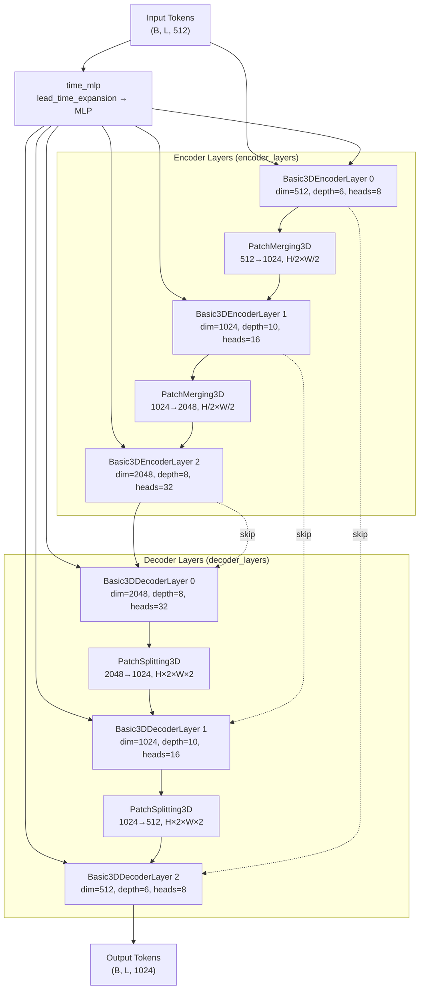
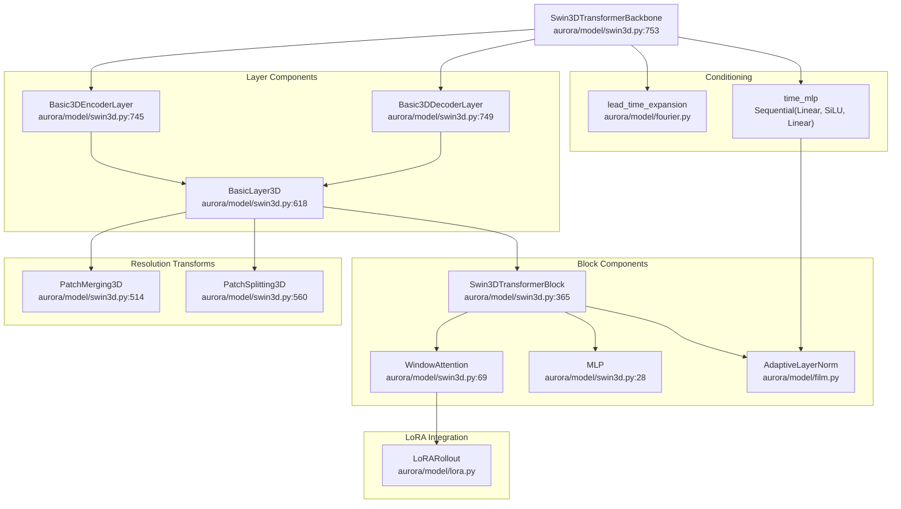
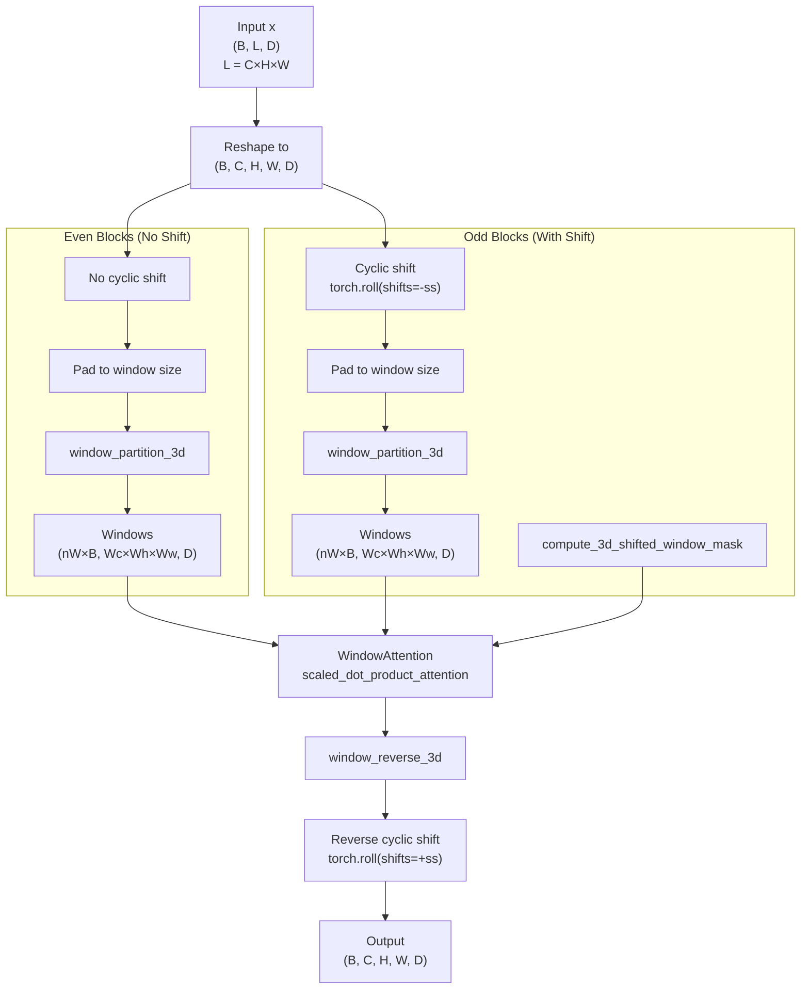
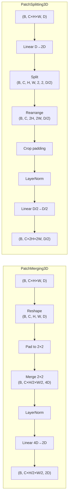
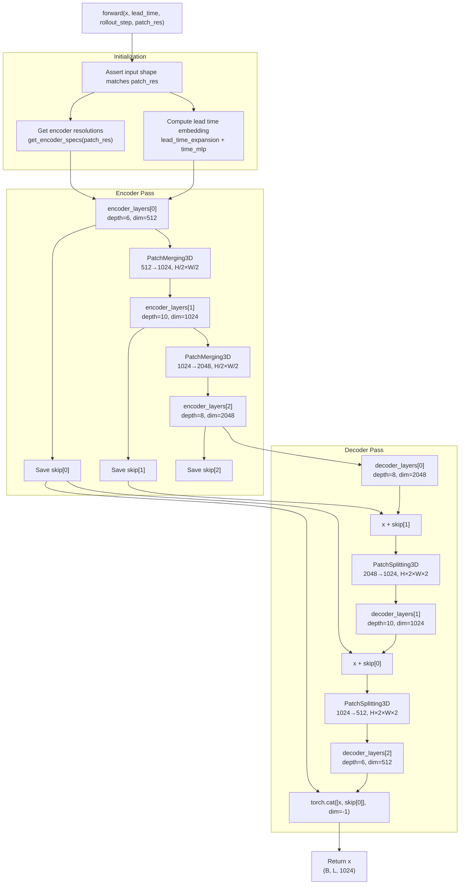

<!-- source: DeepWiki mcp.deepwiki.com · repo microsoft/aurora · page 2.2 Swin3D Transformer Backbone · fetched 2026-10-26 -->

# Swin3D Transformer Backbone

<details>
<summary>Relevant source files</summary>

The following files were used as context for generating this wiki page:

- [aurora/model/aurora.py](aurora/model/aurora.py)
- [aurora/model/swin3d.py](aurora/model/swin3d.py)

</details>


## Purpose and Scope

The Swin3D Transformer Backbone is the core processing component of Aurora's neural network architecture. It implements a hierarchical encoder-decoder structure with 3D shifted-window attention, operating on patch embeddings produced by the Perceiver3D Encoder and outputting features for the Perceiver3D Decoder to reconstruct. This document covers the backbone's internal architecture, attention mechanisms, multi-scale processing, and conditioning strategies.

For information about the encoder that feeds into this backbone, see [Perceiver3D Encoder](#2.1). For details about the decoder that processes the backbone's output, see [Perceiver3D Decoder](#2.3). For the overall model structure, see [Aurora Model Class](#2.1).

## Architecture Overview

The Swin3D Transformer Backbone consists of encoder layers that progressively reduce spatial resolution while increasing feature dimensionality, followed by decoder layers that reverse this process. The backbone operates on tokenized 3D data with dimensions `(B, L, D)` where `B` is batch size, `L` is the number of tokens (levels × height × width), and `D` is the embedding dimension.



**Sources:** [aurora/model/swin3d.py:753-939](), [aurora/model/aurora.py:220-234]()

## Class Hierarchy and Components

The backbone is composed of several key classes that work together to implement the hierarchical transformer architecture.



**Sources:** [aurora/model/swin3d.py:753-939](), [aurora/model/swin3d.py:618-742](), [aurora/model/swin3d.py:365-511]()

## Hierarchical Encoder-Decoder Structure

The backbone uses a 4-stage hierarchical structure (default configuration uses 3 encoder + 3 decoder layers). Each encoder stage reduces spatial resolution by 2× in both horizontal dimensions while doubling the feature dimensionality. Decoder stages reverse this process.

| Stage | Type | Dimensions | Depth | Heads | Resolution |
|-------|------|------------|-------|-------|------------|
| 0 | Encoder | 512 | 6 | 8 | L × H × W |
| 1 | Encoder | 1024 | 10 | 16 | L × H/2 × W/2 |
| 2 | Encoder | 2048 | 8 | 32 | L × H/4 × W/4 |
| 3 | Decoder | 2048 | 8 | 32 | L × H/4 × W/4 |
| 4 | Decoder | 1024 | 10 | 16 | L × H/2 × W/2 |
| 5 | Decoder | 512 | 6 | 8 | L × H × W |

The vertical (level) dimension `L` remains constant throughout the backbone as it is already small (typically 4 latent levels).

**Configuration Parameters:**

```python
# From aurora/model/aurora.py:220-234
backbone = Swin3DTransformerBackbone(
    window_size=(2, 6, 12),           # (Wc, Wh, Ww)
    encoder_depths=(6, 10, 8),        # Blocks per encoder layer
    encoder_num_heads=(8, 16, 32),    # Attention heads per layer
    decoder_depths=(8, 10, 6),        # Blocks per decoder layer
    decoder_num_heads=(32, 16, 8),    # Attention heads per layer
    embed_dim=512,                     # Base embedding dimension
    mlp_ratio=4.0,                     # Hidden/input ratio for MLPs
    drop_path_rate=0.0,                # Stochastic depth rate
    use_lora=True,                     # Enable LoRA adaptation
    lora_steps=40,                     # Number of LoRA rollout steps
    lora_mode="single",                # LoRA mode
)
```

**Sources:** [aurora/model/swin3d.py:756-798](), [aurora/model/aurora.py:220-234]()

## 3D Window Attention Mechanism

The core innovation of Swin3D is the use of 3D shifted-window attention, which divides the input into non-overlapping 3D windows and computes self-attention within each window. Consecutive blocks alternate between regular and shifted windows to enable cross-window connections.

### Window Partitioning and Shifting

The attention mechanism operates on 3D windows defined by `window_size = (Wc, Wh, Ww)`:
- `Wc`: Window size in the vertical (level) dimension
- `Wh`: Window size in the height dimension  
- `Ww`: Window size in the width dimension

For shifted windows, the shift is half the window size: `shift_size = (Wc//2, Wh//2, Ww//2)`.



**Sources:** [aurora/model/swin3d.py:442-511](), [aurora/model/swin3d.py:198-248]()

### Window Attention Implementation

The `WindowAttention` class [aurora/model/swin3d.py:69-176]() implements multi-head self-attention within windows:

```python
# Simplified forward pass from aurora/model/swin3d.py:136-172
def forward(x, mask=None, rollout_step=0):
    # Compute Q, K, V with optional LoRA adaptation
    qkv = self.qkv(x) + self.lora_qkv(x, rollout_step)
    qkv = rearrange(qkv, "B N (qkv H D) -> qkv B H N D", H=num_heads, qkv=3)
    q, k, v = qkv[0], qkv[1], qkv[2]
    
    # Apply attention with mask (for shifted windows)
    if mask is not None:
        x = F.scaled_dot_product_attention(q, k, v, attn_mask=mask, dropout_p=attn_dropout)
    else:
        x = F.scaled_dot_product_attention(q, k, v, dropout_p=attn_dropout)
    
    # Project output with optional LoRA adaptation
    x = rearrange(x, "B H N D -> B N (H D)")
    x = self.proj(x) + self.lora_proj(x, rollout_step)
    return x
```

### Shifted Window Masking

For shifted windows, an attention mask is computed to prevent communication between patches that should not interact [aurora/model/swin3d.py:304-362](). The mask handles:
- **Cyclic boundaries**: Left and right edges are treated as connected (warped mode)
- **Padding**: Padded regions are assigned to a separate communication group
- **Merge groups**: Patches at edges that wrap around are merged into the same communication group

**Sources:** [aurora/model/swin3d.py:69-176](), [aurora/model/swin3d.py:304-362](), [aurora/model/swin3d.py:442-511]()

## Patch Merging and Splitting

The backbone uses patch merging to downsample and patch splitting to upsample spatial dimensions, similar to pooling/unpooling in CNNs but with learned transformations.

### PatchMerging3D

`PatchMerging3D` [aurora/model/swin3d.py:514-557]() reduces spatial resolution by 2× in both height and width dimensions:

1. Reshape input from `(B, C*H*W, D)` to `(B, C, H, W, D)`
2. Pad height and width to multiples of 2
3. Combine neighboring 2×2 patches: `(C, H, W, D)` → `(C, H/2, W/2, 4D)`
4. Apply layer normalization
5. Project with linear layer: `4D` → `2D`

The level dimension `C` is never reduced as it is already small.

### PatchSplitting3D

`PatchSplitting3D` [aurora/model/swin3d.py:560-615]() increases spatial resolution by 2× in both dimensions:

1. Apply linear projection: `D` → `2D`
2. Reshape to split each token: `(B, C*H*W, 2D)` → `(B, C, H, W, 2, 2, D/2)`
3. Rearrange: `(B, C, H, W, 2, 2, D/2)` → `(B, C, 2H, 2W, D/2)`
4. Crop to undo padding from corresponding `PatchMerging`
5. Apply layer normalization
6. Apply linear projection: `D/2` → `D/2`



**Sources:** [aurora/model/swin3d.py:514-557](), [aurora/model/swin3d.py:560-615]()

## Lead Time Conditioning

The backbone is conditioned on the forecast lead time (prediction horizon) using Feature-wise Linear Modulation (FiLM). This allows the model to adapt its processing based on how far into the future it is predicting.

### Lead Time Embedding

Lead time is converted from a `timedelta` to hours and then expanded using Fourier features:

```python
# From aurora/model/swin3d.py:915-917
lead_hours = lead_time / timedelta(hours=1)
lead_times = lead_hours * torch.ones(x.shape[0], dtype=torch.float32, device=x.device)
c = self.time_mlp(lead_time_expansion(lead_times, self.embed_dim).to(dtype=x.dtype))
```

The `time_mlp` [aurora/model/swin3d.py:808-812]() is a small feedforward network:

```python
self.time_mlp = nn.Sequential(
    nn.Linear(embed_dim, embed_dim, bias=True),
    nn.SiLU(),
    nn.Linear(embed_dim, embed_dim, bias=True),
)
```

### Adaptive Layer Normalization

The lead time embedding `c` is passed to `AdaptiveLayerNorm` layers in each `Swin3DTransformerBlock`. These layers modulate the normalization statistics based on the lead time:

```python
# From aurora/model/swin3d.py:509-510
x = shortcut + self.drop_path(self.norm1(x, c))
x = x + self.drop_path(self.norm2(self.mlp(x), c))
```

The `AdaptiveLayerNorm` computes scale and shift parameters from the conditioning context `c` and applies them to the normalized features.

**Sources:** [aurora/model/swin3d.py:808-812](), [aurora/model/swin3d.py:915-917](), [aurora/model/swin3d.py:419](), [aurora/model/swin3d.py:433](), [aurora/model/swin3d.py:509-510]()

## LoRA Adaptation

Low-Rank Adaptation (LoRA) enables efficient fine-tuning by adding trainable low-rank matrices to the attention projection layers while keeping the original weights frozen.

### LoRA Integration in WindowAttention

The `WindowAttention` class includes optional LoRA layers for both the QKV projection and the output projection:

```python
# From aurora/model/swin3d.py:125-134
if use_lora:
    self.lora_proj = LoRARollout(
        dim, dim, lora_r, lora_alpha, lora_dropout, lora_steps, lora_mode
    )
    self.lora_qkv = LoRARollout(
        dim, dim * 3, lora_r, lora_alpha, lora_dropout, lora_steps, lora_mode
    )
else:
    self.lora_proj = lambda *args, **kwargs: 0
    self.lora_qkv = lambda *args, **kwargs: 0
```

During the forward pass, LoRA outputs are added to the main projections:

```python
# From aurora/model/swin3d.py:154, 170
qkv = self.qkv(x) + self.lora_qkv(x, rollout_step)
# ...
x = self.proj(x) + self.lora_proj(x, rollout_step)
```

### LoRA Modes

The backbone supports three LoRA modes controlled by `lora_mode`:

| Mode | Description | Use Case |
|------|-------------|----------|
| `"single"` | Same LoRA weights for all rollout steps | Uniform adaptation across predictions |
| `"from_second"` | One LoRA for first step, another for all subsequent steps | Handle initial condition differently |
| `"all"` | Separate LoRA weights for each rollout step up to `lora_steps` | Maximum flexibility per step |

The `rollout_step` parameter passed through the forward pass determines which LoRA weights to use.

**Sources:** [aurora/model/swin3d.py:125-134](), [aurora/model/swin3d.py:154](), [aurora/model/swin3d.py:170](), [aurora/model/lora.py]()

## Skip Connections

The backbone implements U-Net style skip connections between encoder and decoder layers at matching resolutions. This preserves fine-grained spatial information that might be lost during downsampling.

### Skip Connection Strategy

```python
# From aurora/model/swin3d.py:919-938
skips = []
for i, layer in enumerate(self.encoder_layers):
    x, x_unscaled = layer(x, c, all_enc_res[i], rollout_step=rollout_step)
    skips.append(x_unscaled)  # Save pre-downsampling features

for i, layer in enumerate(self.decoder_layers):
    index = self.num_decoder_layers - i - 1
    x, _ = layer(x, c, all_enc_res[index], padded_outs[index - 1], rollout_step=rollout_step)
    
    if 0 < i < self.num_decoder_layers - 1:
        # Intermediate stages: additive skip connections
        x = x + skips[index - 1]
    elif i == self.num_decoder_layers - 1:
        # Last stage: concatenation
        x = torch.cat([x, skips[0]], dim=-1)
```

### Skip Connection Types

- **Intermediate decoder layers**: Use additive skip connections (`x = x + skip`)
- **Final decoder layer**: Uses concatenation (`x = torch.cat([x, skip], dim=-1)`)

The concatenation at the final layer doubles the dimensionality from `embed_dim` to `2*embed_dim`, which is why the decoder is initialized with `embed_dim * 2` [aurora/model/aurora.py:241]().

**Sources:** [aurora/model/swin3d.py:919-938](), [aurora/model/aurora.py:236-252]()

## Forward Pass Data Flow

The complete forward pass through the backbone follows this sequence:



**Key Parameters:**

- **Input**: `x` of shape `(B, L, D)` where `L = C*H*W` (tokens), `D = embed_dim`
- **lead_time**: `timedelta` representing forecast horizon
- **rollout_step**: Integer indicating autoregressive step (for LoRA)
- **patch_res**: Tuple `(C, H, W)` specifying token layout
- **Output**: `x` of shape `(B, L, 2*D)` (doubled due to concatenation)

**Sources:** [aurora/model/swin3d.py:887-939]()

## Configuration Examples

### Default Aurora Model (1.3B parameters)

```python
# From aurora/model/aurora.py:61-68
backbone = Swin3DTransformerBackbone(
    window_size=(2, 6, 12),
    encoder_depths=(6, 10, 8),
    encoder_num_heads=(8, 16, 32),
    decoder_depths=(8, 10, 6),
    decoder_num_heads=(32, 16, 8),
    embed_dim=512,
    mlp_ratio=4.0,
)
```

### AuroraSmall Model (for debugging)

```python
# From aurora/model/aurora.py:580-598
backbone = Swin3DTransformerBackbone(
    window_size=(2, 6, 12),
    encoder_depths=(2, 6, 2),        # Fewer blocks
    encoder_num_heads=(4, 8, 16),    # Fewer heads
    decoder_depths=(2, 6, 2),
    decoder_num_heads=(16, 8, 4),
    embed_dim=256,                    # Smaller embedding
    mlp_ratio=4.0,
)
```

### AuroraHighRes Model (0.1° resolution)

```python
# From aurora/model/aurora.py:634-642
backbone = Swin3DTransformerBackbone(
    window_size=(2, 6, 12),
    encoder_depths=(6, 8, 8),        # Modified depths
    encoder_num_heads=(8, 16, 32),
    decoder_depths=(8, 8, 6),
    decoder_num_heads=(32, 16, 8),
    embed_dim=512,
    mlp_ratio=4.0,
)
```

**Sources:** [aurora/model/aurora.py:55-95](), [aurora/model/aurora.py:568-598](), [aurora/model/aurora.py:624-643]()

## Performance Considerations

### Memory Optimization

The backbone can be run with automatic mixed precision (AMP) to reduce memory usage:

```python
# From aurora/model/aurora.py:327-336
if self.autocast:
    device_type = "cuda" if torch.cuda.is_available() else "cpu"
    context = torch.autocast(device_type=device_type, dtype=torch.bfloat16)
else:
    context = contextlib.nullcontext()
    
with context:
    x = self.backbone(x, lead_time=self.timestep, patch_res=patch_res, rollout_step=rollout_step)
```

### Activation Checkpointing

For training and fine-tuning, activation checkpointing can be enabled on the backbone to trade computation for memory:

```python
# From aurora/model/aurora.py:506-547
model.configure_activation_checkpointing(
    module_names=(
        "Swin3DTransformerBackbone",
        "Swin3DTransformerBlock",
        # ... other modules
    )
)
```

**Sources:** [aurora/model/aurora.py:327-343](), [aurora/model/aurora.py:506-547]()

---

