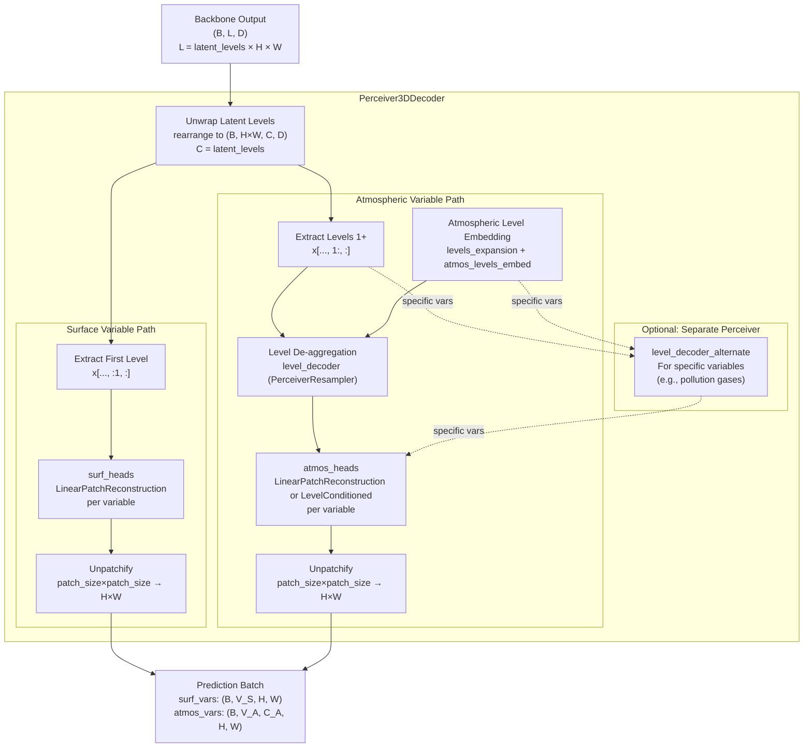
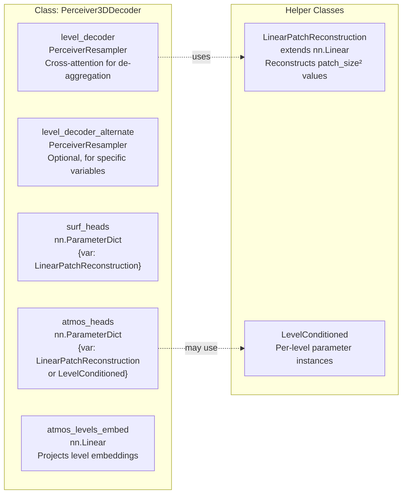
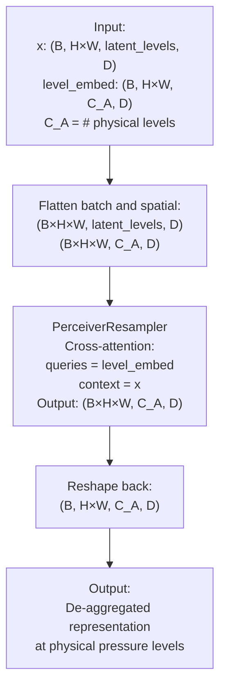
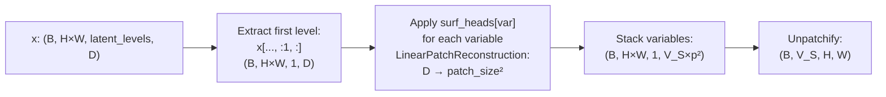
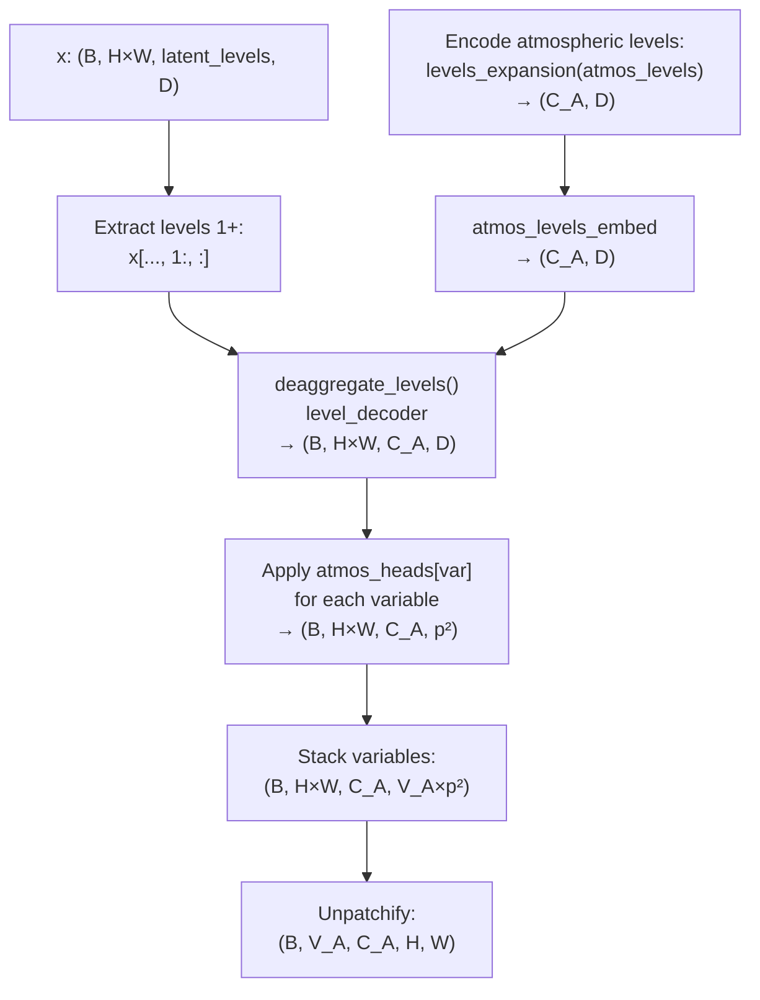
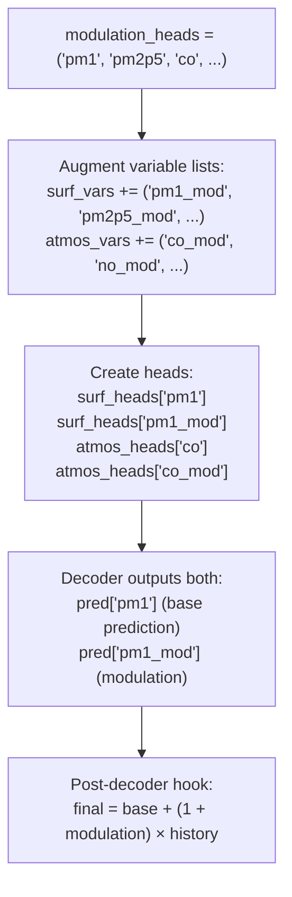
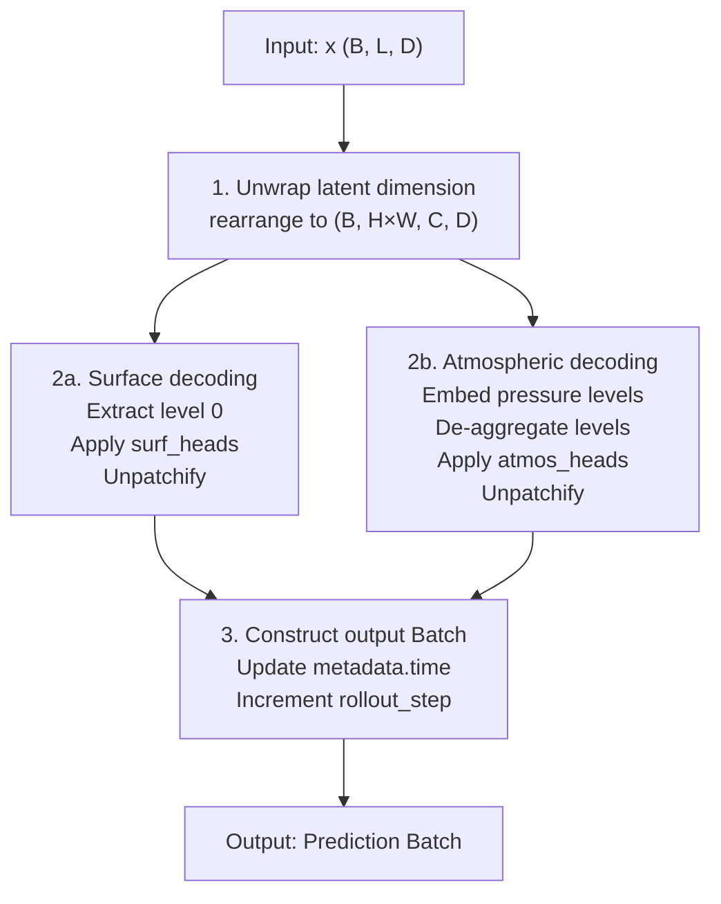
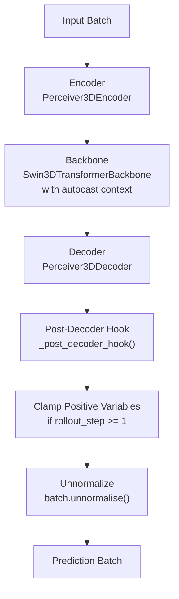

<!-- source: DeepWiki mcp.deepwiki.com · repo microsoft/aurora · page 2.3 Perceiver3D Decoder · fetched 2026-10-26 -->

# Perceiver3D Decoder

<details>
<summary>Relevant source files</summary>

The following files were used as context for generating this wiki page:

- [aurora/model/aurora.py](aurora/model/aurora.py)
- [aurora/model/decoder.py](aurora/model/decoder.py)

</details>


## Purpose and Scope

The Perceiver3D Decoder is the final stage of the Aurora model architecture responsible for reconstructing multi-scale, multi-variable atmospheric predictions from the compressed backbone representation. It transforms the hierarchical latent representation from the Swin3D Transformer backbone back into physical space predictions for surface-level and atmospheric variables at their original spatial resolutions.

For information about the encoder that feeds into the backbone, see [Perceiver3D Encoder](#2.1). For details on the backbone transformer that processes the encoded representation, see [Swin3D Transformer Backbone](#2.2). For the overall model integration, see [Aurora Model Class](#2.1).

**Sources**: [aurora/model/decoder.py:1-277]()

---

## Architecture Overview

The `Perceiver3DDecoder` class implements a multi-scale decoder using Perceiver cross-attention to transform the backbone's compressed latent representation into per-variable predictions.



**Diagram: Perceiver3D Decoder Architecture**

The decoder performs three main operations:
1. **Unwrapping**: Reshapes the flattened backbone output back into spatial and level dimensions
2. **Surface Decoding**: Extracts the first latent level and reconstructs surface variables
3. **Atmospheric Decoding**: De-aggregates latent levels into physical pressure levels and reconstructs atmospheric variables

**Sources**: [aurora/model/decoder.py:27-139](), [aurora/model/decoder.py:168-276]()

---

## Initialization Parameters

The decoder is initialized with configuration parameters that determine its architecture and supported variables.

| Parameter | Type | Purpose | Default |
|-----------|------|---------|---------|
| `surf_vars` | `tuple[str, ...]` | Surface-level variable names | Required |
| `atmos_vars` | `tuple[str, ...]` | Atmospheric variable names | Required |
| `patch_size` | `int` | Patch size for unpatchifying | 4 |
| `embed_dim` | `int` | Embedding dimensionality (doubled from backbone) | 1024 |
| `depth` | `int` | Number of Perceiver blocks | 1 |
| `head_dim` | `int` | Dimension per attention head | 64 |
| `num_heads` | `int` | Number of attention heads | 8 |
| `mlp_ratio` | `float` | MLP hidden dim / embed dim ratio | 4.0 |
| `perceiver_ln_eps` | `float` | Layer norm epsilon | 1e-5 |
| `level_condition` | `Optional[tuple]` | Pressure levels for conditioning | `None` |
| `separate_perceiver` | `tuple[str, ...]` | Variables using alternate Perceiver | `()` |
| `modulation_heads` | `tuple[str, ...]` | Variables with difference prediction heads | `()` |

**Note**: The `embed_dim` passed to the decoder is typically double the encoder's embedding dimension due to U-Net skip connections concatenating encoder and decoder features in the backbone.

**Sources**: [aurora/model/decoder.py:30-75](), [aurora/model/aurora.py:236-252]()

---

## Component Structure

### Core Components Mapping



**Diagram: Decoder Component Classes**

**Sources**: [aurora/model/decoder.py:93-138](), [aurora/model/decoder.py:23-24]()

---

## Level De-aggregation

The decoder must reverse the level aggregation performed by the encoder. The backbone processes a compressed representation with `latent_levels` (typically 4) channels, but predictions must be made at the original atmospheric pressure levels (typically 13 levels).

### De-aggregation Process

The `deaggregate_levels()` method uses Perceiver cross-attention to map from latent levels to physical levels:



**Diagram: Level De-aggregation Flow**

The level embeddings are created using Fourier expansion of the physical pressure level values, providing the decoder with information about which pressure level to reconstruct at each position.

**Sources**: [aurora/model/decoder.py:140-166](), [aurora/model/decoder.py:220-231]()

---

## Surface Variable Reconstruction

Surface variables are simpler to reconstruct as they exist at a single vertical level. The decoder extracts the first latent level and applies variable-specific linear heads.

### Surface Reconstruction Pipeline



**Diagram: Surface Variable Reconstruction**

Each surface variable has its own `LinearPatchReconstruction` layer stored in the `surf_heads` parameter dictionary. This allows the model to learn variable-specific output transformations.

**Sources**: [aurora/model/decoder.py:213-217]()

---

## Atmospheric Variable Reconstruction

Atmospheric variables require more complex processing due to their vertical structure across pressure levels. The decoder supports two modes: standard reconstruction and level-conditioned reconstruction.

### Standard Reconstruction



**Diagram: Atmospheric Variable Reconstruction (Standard Mode)**

### Level-Conditioned Reconstruction

When `level_condition` is provided during initialization, each atmospheric variable head is wrapped in a `LevelConditioned` module that maintains separate parameters for each pressure level.

```python
# Standard mode (level_condition=None)
atmos_heads = {
    name: LinearPatchReconstruction(embed_dim, patch_size**2)
    for name in atmos_vars
}

# Level-conditioned mode
atmos_heads = {
    name: LevelConditioned(
        lambda: LinearPatchReconstruction(embed_dim, patch_size**2),
        levels=level_condition,
        levels_dim=-2,
    )
    for name in atmos_vars
}
```

This allows the model to learn level-specific behavior for each atmospheric variable, which is particularly useful for variables with different characteristics at different altitudes (e.g., pollution concentrations).

**Sources**: [aurora/model/decoder.py:219-264](), [aurora/model/decoder.py:120-134]()

---

## Special Features

### Modulation Heads

Modulation heads enable the decoder to predict variable differences rather than absolute values. This is particularly useful for air pollution modeling where changes are often more predictable than absolute concentrations.

When `modulation_heads` is specified, the decoder creates additional reconstruction heads with the suffix `_mod`:



**Diagram: Modulation Head Workflow**

The actual combination of base and modulation predictions occurs in the model's `_post_decoder_hook()` method, not in the decoder itself.

**Sources**: [aurora/model/decoder.py:78-84](), [aurora/model/decoder.py:190-193](), [aurora/model/aurora.py:760-796]()

### Separate Perceiver for Specific Variables

Some variables exhibit significantly different behavior and benefit from having their own Perceiver de-aggregation path. This is specified via the `separate_perceiver` parameter:

| Model Variant | Separate Perceiver Variables | Rationale |
|---------------|------------------------------|-----------|
| AuroraAirPollution | `('co', 'no', 'no2', 'go3', 'so2')` | Pollution gases have different vertical distribution patterns than standard meteorological variables |

When `separate_perceiver` is non-empty, the decoder maintains two parallel de-aggregation paths:

1. **Main path**: `level_decoder` for standard atmospheric variables
2. **Alternate path**: `level_decoder_alternate` for specified variables

Both Perceivers have identical architecture but independent parameters, allowing them to learn different vertical aggregation patterns.

**Sources**: [aurora/model/decoder.py:104-115](), [aurora/model/decoder.py:232-241](), [aurora/model/decoder.py:244-261](), [aurora/model/aurora.py:690]()

---

## Forward Pass Details

The `forward()` method orchestrates the complete decoding process:

### Input and Output Specifications

**Input:**
- `x`: Backbone output tensor `(B, L, D)` where `L = latent_levels × (H/patch_size) × (W/patch_size)`
- `batch`: Input batch containing variable dictionaries and metadata
- `patch_res`: Tuple `(latent_levels, H/patch_size, W/patch_size)`
- `lead_time`: Forecast lead time (used for metadata)

**Output:**
- `Batch` object with:
  - `surf_vars`: Dictionary `{var: (B, H, W)}`
  - `atmos_vars`: Dictionary `{var: (B, C_A, H, W)}`
  - `static_vars`: Copied from input
  - `metadata`: Updated with new time and incremented rollout step

### Processing Steps



**Diagram: Forward Pass Pipeline**

### Shape Transformations

| Stage | Shape | Description |
|-------|-------|-------------|
| Backbone output | `(B, L, D)` | Flattened spatial-level representation |
| After unwrap | `(B, H×W, C, D)` | Separated spatial and level dimensions |
| Surface extraction | `(B, H×W, 1, D)` | First level only |
| Surface heads | `(B, H×W, 1, V_S×p²)` | Per-variable patch values |
| Surface unpatchify | `(B, V_S, H, W)` | Final surface predictions |
| Atmos extraction | `(B, H×W, C-1, D)` | Levels 1+ (latent levels) |
| Level de-aggregation | `(B, H×W, C_A, D)` | Physical pressure levels |
| Atmos heads | `(B, H×W, C_A, V_A×p²)` | Per-variable patch values |
| Atmos unpatchify | `(B, V_A, C_A, H, W)` | Final atmospheric predictions |

**Sources**: [aurora/model/decoder.py:168-276]()

---

## Integration with Aurora Model

The decoder is the final stage of the Aurora model's forward pass and is tightly integrated with the model's hook system.

### Instantiation in Aurora

```python
# In Aurora.__init__() at aurora/model/aurora.py:236-252
self.decoder = Perceiver3DDecoder(
    surf_vars=surf_vars,
    atmos_vars=atmos_vars,
    patch_size=patch_size,
    embed_dim=embed_dim * 2,  # Doubled due to U-Net concatenation
    head_dim=embed_dim * 2 // num_heads,
    num_heads=num_heads,
    depth=dec_depth,
    mlp_ratio=dec_mlp_ratio,
    perceiver_ln_eps=perceiver_ln_eps,
    level_condition=level_condition,
    separate_perceiver=separate_perceiver,
    modulation_heads=modulation_heads,
)
```

### Usage in Forward Pass



**Diagram: Decoder Integration in Aurora Forward Pass**

The decoder receives the backbone output after autocast processing and returns a prediction batch that is then post-processed through hooks, clamping, and unnormalization.

**Sources**: [aurora/model/aurora.py:236-252](), [aurora/model/aurora.py:345-392]()

### Checkpoint Compatibility

The decoder's state is saved as part of the full Aurora checkpoint. Parameter names follow the pattern:
- `decoder.level_decoder.*` - Main Perceiver de-aggregation
- `decoder.level_decoder_alternate.*` - Alternate Perceiver (if used)
- `decoder.surf_heads.<var>.*` - Surface variable heads
- `decoder.atmos_heads.<var>.*` - Atmospheric variable heads
- `decoder.atmos_levels_embed.*` - Level embedding projection

When loading checkpoints with different variable sets or features, the decoder can be loaded with `strict=False` to allow partial weight loading.

**Sources**: [aurora/model/aurora.py:432-456]()

---

## Model Variant Configurations

Different Aurora model variants use different decoder configurations:

| Variant | Distinct Features |
|---------|------------------|
| **Aurora / AuroraPretrained** | Standard configuration with no special features |
| **AuroraHighRes** | Same decoder architecture, different patch size (10 vs 4) |
| **AuroraAirPollution** | `level_condition` enabled<br/>`separate_perceiver` for pollution gases<br/>`modulation_heads` for all pollution variables |
| **AuroraWave** | Standard configuration, post-processing in hooks |
| **AuroraSmall** | Reduced `embed_dim` (256 vs 512), affects decoder dimensionality |

The decoder's flexibility through its initialization parameters allows it to adapt to different modeling requirements without architectural changes.

**Sources**: [aurora/model/aurora.py:550-933]()

---

