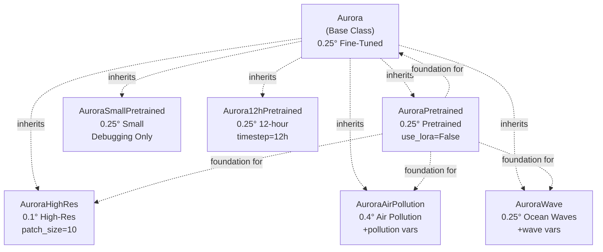
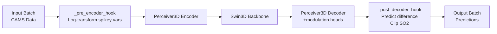
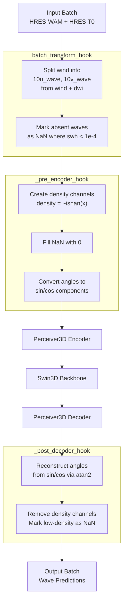
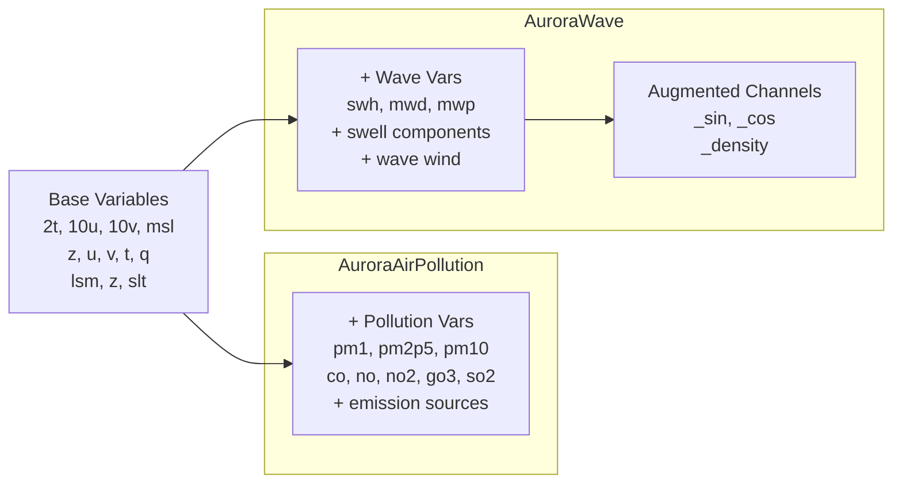
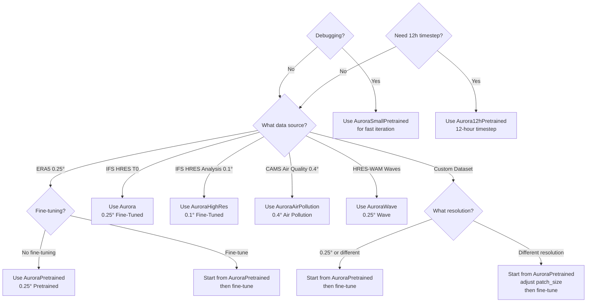

<!-- source: DeepWiki mcp.deepwiki.com · repo microsoft/aurora · page 2.4 Model Variants · fetched 2026-10-26 -->

# Model Variants

<details>
<summary>Relevant source files</summary>

The following files were used as context for generating this wiki page:

- [aurora/__init__.py](aurora/__init__.py)
- [aurora/model/aurora.py](aurora/model/aurora.py)
- [docs/models.md](docs/models.md)
- [docs/tracking.md](docs/tracking.md)

</details>


This page documents all Aurora model variants, their inheritance relationships, configuration differences, and specialized capabilities. Each variant is designed for specific data sources and prediction tasks, extending the base `Aurora` class with domain-specific adaptations.

For information about the base `Aurora` class architecture and initialization parameters, see [Aurora Model Class](#2.1). For detailed technical specifications including exact variable lists and pressure levels, see [Model Variants Specification](#8.1). For checkpoint loading mechanics, see [Checkpoint Management](#2.5).

---

## Overview

Aurora provides seven model variants that share the same core architecture but differ in resolution, timestep, supported variables, and domain-specific processing. All variants inherit from the base `Aurora` class defined in [aurora/model/aurora.py:40-548]().



**Sources:** [aurora/model/aurora.py:28-37](), [aurora/model/aurora.py:550-933]()

---

## Variant Classification

Model variants can be classified along three dimensions: resolution, domain specialization, and training stage.

| Variant | Resolution | Grid Size | Patch Size | Domain | Training Stage | Use LoRA |
|---------|-----------|-----------|------------|---------|----------------|----------|
| `Aurora` | 0.25° | 721×1440 | 4 | General Weather | Fine-tuned on IFS HRES T0 | Yes (default) |
| `AuroraPretrained` | 0.25° | 721×1440 | 4 | General Weather | Pretrained only | No |
| `AuroraSmallPretrained` | 0.25° | 721×1440 | 4 | Debug | Pretrained only | No |
| `Aurora12hPretrained` | 0.25° | 721×1440 | 4 | General Weather | Pretrained only | No |
| `AuroraHighRes` | 0.1° | 1801×3600 | 10 | General Weather | Fine-tuned on IFS HRES Analysis | Yes (default) |
| `AuroraAirPollution` | 0.4° | 451×900 | 3 | Air Quality | Fine-tuned on CAMS | Yes (default) |
| `AuroraWave` | 0.25° | 721×1440 | 4 | Ocean Waves | Fine-tuned on HRES-WAM | Yes |

**Sources:** [aurora/model/aurora.py:40-933](), [docs/models.md:1-322]()

---

## Base Variant: Aurora

The default `Aurora` class represents the 0.25° fine-tuned version trained on IFS HRES T0 data. This is the recommended variant for operational weather forecasting.

### Configuration

```python
class Aurora(torch.nn.Module):
    default_checkpoint_repo = "microsoft/aurora"
    default_checkpoint_name = "aurora-0.25-finetuned.ckpt"
    default_checkpoint_revision = "0be7e57c685dac86b78c4a19a3ab149d13c6a3dd"
```

### Key Parameters

- **surf_vars:** `("2t", "10u", "10v", "msl")` - Standard meteorological surface variables
- **static_vars:** `("lsm", "z", "slt")` - Land-sea mask, geopotential, soil type
- **atmos_vars:** `("z", "u", "v", "t", "q")` - Geopotential, wind components, temperature, specific humidity
- **patch_size:** `4` - Spatial patch size for tokenization
- **timestep:** `timedelta(hours=6)` - Prediction timestep
- **use_lora:** `True` - LoRA adaptation enabled by default

### LoRA Configuration

The base variant supports LoRA (Low-Rank Adaptation) for efficient fine-tuning and improved long-term accuracy. Users can disable LoRA for more realistic (but slightly higher MSE) predictions:

```python
model = Aurora(use_lora=False)
model.load_checkpoint(strict=False)
```

**Sources:** [aurora/model/aurora.py:40-95](), [aurora/model/aurora.py:46-53](), [docs/models.md:64-122]()

---

## AuroraPretrained

Pretrained foundation model trained on diverse datasets (ERA5, CMIP6, GFS, HRES) without fine-tuning on specific operational data.

### Usage

```python
from aurora import AuroraPretrained

model = AuroraPretrained()
model.load_checkpoint()
```

### Configuration Differences

```python
class AuroraPretrained(Aurora):
    default_checkpoint_name = "aurora-0.25-pretrained.ckpt"
    default_checkpoint_revision = "0be7e57c685dac86b78c4a19a3ab149d13c6a3dd"
    
    def __init__(self, *, use_lora: bool = False, **kw_args):
        super().__init__(use_lora=use_lora, **kw_args)
```

**Key difference:** `use_lora=False` by default, as LoRA is only applicable after fine-tuning.

### Recommended Use

- Predictions on ERA5 data at 0.25° resolution
- Starting point for fine-tuning on custom datasets
- Use when no domain-specific fine-tuned variant exists

**Sources:** [aurora/model/aurora.py:550-566](), [docs/models.md:6-43]()

---

## AuroraSmallPretrained

Smaller architecture variant designed exclusively for debugging and testing.

### Configuration Differences

```python
class AuroraSmallPretrained(Aurora):
    default_checkpoint_name = "aurora-0.25-small-pretrained.ckpt"
    
    def __init__(
        self,
        *,
        encoder_depths: tuple[int, ...] = (2, 6, 2),    # vs (6, 10, 8)
        encoder_num_heads: tuple[int, ...] = (4, 8, 16), # vs (8, 16, 32)
        decoder_depths: tuple[int, ...] = (2, 6, 2),    # vs (8, 10, 6)
        decoder_num_heads: tuple[int, ...] = (16, 8, 4), # vs (32, 16, 8)
        embed_dim: int = 256,                           # vs 512
        num_heads: int = 8,                             # vs 16
        use_lora: bool = False,
        **kw_args,
    ):
        super().__init__(...)
```

### Parameter Comparison

| Parameter | AuroraSmall | Aurora (Full) |
|-----------|-------------|---------------|
| `encoder_depths` | (2, 6, 2) | (6, 10, 8) |
| `encoder_num_heads` | (4, 8, 16) | (8, 16, 32) |
| `decoder_depths` | (2, 6, 2) | (8, 10, 6) |
| `decoder_num_heads` | (16, 8, 4) | (32, 16, 8) |
| `embed_dim` | 256 | 512 |
| `num_heads` | 8 | 16 |

**Not recommended for production use.**

**Sources:** [aurora/model/aurora.py:568-601](), [docs/models.md:46-61]()

---

## Aurora12hPretrained

Variant with 12-hour prediction timestep instead of the standard 6-hour timestep.

### Configuration

```python
class Aurora12hPretrained(Aurora):
    default_checkpoint_name = "aurora-0.25-12h-pretrained.ckpt"
    default_checkpoint_revision = "15e76e47b65bf4b28fd2246b7b5b951d6e2443b9"
    
    def __init__(
        self,
        *,
        timestep: timedelta = timedelta(hours=12),  # vs timedelta(hours=6)
        use_lora: bool = False,
        **kw_args,
    ):
        super().__init__(timestep=timestep, use_lora=use_lora, **kw_args)
```

**Key difference:** `timestep=timedelta(hours=12)` changes the temporal resolution of predictions. All other parameters remain identical to `AuroraPretrained`.

**Sources:** [aurora/model/aurora.py:604-622](), [docs/models.md:123-156]()

---

## AuroraHighRes

High-resolution variant operating at 0.1° spatial resolution for IFS HRES analysis data.

### Configuration

```python
class AuroraHighRes(Aurora):
    default_checkpoint_name = "aurora-0.1-finetuned.ckpt"
    
    def __init__(
        self,
        *,
        patch_size: int = 10,                      # vs 4
        encoder_depths: tuple[int, ...] = (6, 8, 8), # vs (6, 10, 8)
        decoder_depths: tuple[int, ...] = (8, 8, 6), # vs (8, 10, 6)
        **kw_args,
    ):
        super().__init__(
            patch_size=patch_size,
            encoder_depths=encoder_depths,
            decoder_depths=decoder_depths,
            **kw_args,
        )
```

### Resolution Requirements

- **Input dimensions:** 1801×3600 (0.1° resolution)
- **Patch size:** 10 (larger to compensate for higher resolution)
- **Encoder/decoder depths:** Modified for high-resolution processing

### Static Variable Handling

Due to regridding sensitivities, `AuroraHighRes` requires specific static variables and may need adjusted normalization:

```python
model = AuroraHighRes(
    surf_stats={"z": (-3.270407e03, 6.540335e04)}  # Adjusted normalization for geopotential
)
```

**Sources:** [aurora/model/aurora.py:624-644](), [docs/models.md:158-234]()

---

## AuroraAirPollution

Specialized variant for air quality forecasting using CAMS data, extended with pollution-specific variables and processing hooks.

### Configuration

```python
class AuroraAirPollution(Aurora):
    default_checkpoint_name = "aurora-0.4-air-pollution.ckpt"
    default_checkpoint_revision = "1764d5630a53d3d7a7d169ca335236fc343e4bfc"
```

### Extended Variables

```python
surf_vars = (
    ("2t", "10u", "10v", "msl")  # Meteorological
    + ("pm1", "pm2p5", "pm10", "tcco", "tc_no", "tcno2", "gtco3", "tcso2")  # Pollution
)

static_vars = (
    ("lsm", "z", "slt")  # Standard
    + ("static_ammonia", "static_ammonia_log", "static_co", "static_co_log")
    + ("static_nox", "static_nox_log", "static_so2", "static_so2_log")  # Emission sources
)

atmos_vars = (
    "z", "u", "v", "t", "q",  # Meteorological
    "co", "no", "no2", "go3", "so2"  # Atmospheric pollutants
)
```

### Specialized Configuration Parameters

```python
def __init__(
    self,
    *,
    patch_size: int = 3,                           # Smaller patch size for 0.4° data
    timestep: timedelta = timedelta(hours=12),     # 12-hour timestep
    level_condition: tuple = (50, 100, 150, ..., 1000),  # Pressure-level conditioning
    dynamic_vars: bool = True,                     # Time-of-day variables
    atmos_static_vars: bool = True,                # Concat static vars to atmos
    separate_perceiver: tuple = ("co", "no", "no2", "go3", "so2"),  # Separate decoding
    modulation_heads: tuple = (...),               # Difference prediction heads
    positive_surf_vars: tuple = ("pm1", "pm2p5", "pm10", ...),  # Enforce positivity
    positive_atmos_vars: tuple = ("co", "no", "no2", "go3", "so2"),
    simulate_indexing_bug: bool = True,            # Backwards compatibility
    **kw_args,
):
```

### Hook System

`AuroraAirPollution` implements custom pre-encoder and post-decoder hooks for pollution-specific transformations:



#### Pre-Encoder Hook: Log-Transform

Applies a specialized log-transform to pollution variables to handle their spikey distributions:

```python
def _pre_encoder_hook(self, batch: Batch) -> Batch:
    eps = 1e-4
    divisor = -np.log(eps)
    
    def _transform(z: torch.Tensor, feature_combiner: nn.Module) -> torch.Tensor:
        return feature_combiner(
            torch.stack([
                z.clamp(min=0, max=2.5),
                (torch.log(z.clamp(min=eps)) - np.log(eps)) / divisor,
            ], dim=-1)
        )[..., 0]
    
    # Apply to positive surface and atmospheric variables
```

#### Post-Decoder Hook: Difference Prediction

Predicts changes relative to previous timesteps instead of absolute values:

```python
def _post_decoder_hook(self, batch: Batch, pred: Batch) -> Batch:
    # For variables in _predict_difference_history_dim_lookup:
    # prediction = model_output + (1 + modulation) * previous_value
    
    # Example: "pm1" uses history dimension 0 (12h ago)
    #          "co" uses history dimension 1 (24h ago)
```

**Sources:** [aurora/model/aurora.py:646-802](), [docs/models.md:237-276]()

---

## AuroraWave

Specialized variant for ocean wave forecasting using HRES-WAM data, with density channel encoding for sparse observations.

### Configuration

```python
class AuroraWave(Aurora):
    default_checkpoint_name = "aurora-0.25-wave.ckpt"
    default_checkpoint_revision = "74598e8c65d53a96077c08bb91acdfa5525340c9"
```

### Extended Variables

```python
surf_vars = (
    ("2t", "10u", "10v", "msl")  # Meteorological from HRES T0
    + ("swh", "mwd", "mwp", "pp1d", "shww", "mdww", "mpww", 
       "shts", "mdts", "mpts")  # Total wave parameters
    + ("swh1", "mwd1", "mwp1", "swh2", "mwd2", "mwp2")  # Swell components
    + ("wind", "10u_wave", "10v_wave")  # Wave-specific wind
)

static_vars = ("lsm", "z", "slt", "wmb", "lat_mask")  # +wave mask, latitude mask
```

### Specialized Configuration

```python
def __init__(
    self,
    *,
    lora_mode: LoRAMode = "from_second",           # LoRA from 2nd rollout step
    stabilise_level_agg: bool = True,              # Extra layer norm
    density_channel_surf_vars: tuple = (...),      # Variables needing density channels
    angle_surf_vars: tuple = ("mwd", "mdww", "mdts", "mwd1", "mwd2"),  # Direction vars
    **kw_args,
):
```

### Variable Augmentation Strategy

Wave variables are augmented with additional channels to handle sparse observations and directional data:

| Original Variable | Augmented Channels | Purpose |
|-------------------|-------------------|---------|
| `swh` | `swh`, `swh_density` | Wave height + observation density |
| `mwd` | `mwd_sin`, `mwd_cos`, `mwd_density` | Direction as sin/cos + density |
| `wind` + `dwi` | `10u_wave`, `10v_wave`, `wind_density` | Wind components + density |

### Hook Processing Pipeline



### Density Channel Mechanism

The density channel approach handles sparse wave observations:

1. **Pre-encoding:** Convert NaN values to explicit density channels
   ```python
   density = (~torch.isnan(x)).float()
   data = x.nan_to_num(0)
   ```

2. **Model processes:** Both data and density channels through encoder-backbone-decoder

3. **Post-decoding:** Reconstruct sparsity from predicted density
   ```python
   density = torch.sigmoid(density_pred) * wmb_mask
   data[density < 0.5] = np.nan  # Below threshold = no observation
   ```

**Sources:** [aurora/model/aurora.py:804-933](), [docs/models.md:278-322]()

---

## Checkpoint Management

All variants define default checkpoint locations in the HuggingFace repository:

| Variant | Checkpoint Name | Commit Revision |
|---------|----------------|----------------|
| `Aurora` | `aurora-0.25-finetuned.ckpt` | `0be7e57c685dac86b78c4a19a3ab149d13c6a3dd` |
| `AuroraPretrained` | `aurora-0.25-pretrained.ckpt` | `0be7e57c685dac86b78c4a19a3ab149d13c6a3dd` |
| `AuroraSmallPretrained` | `aurora-0.25-small-pretrained.ckpt` | `0be7e57c685dac86b78c4a19a3ab149d13c6a3dd` |
| `Aurora12hPretrained` | `aurora-0.25-12h-pretrained.ckpt` | `15e76e47b65bf4b28fd2246b7b5b951d6e2443b9` |
| `AuroraHighRes` | `aurora-0.1-finetuned.ckpt` | `0be7e57c685dac86b78c4a19a3ab149d13c6a3dd` |
| `AuroraAirPollution` | `aurora-0.4-air-pollution.ckpt` | `1764d5630a53d3d7a7d169ca335236fc343e4bfc` |
| `AuroraWave` | `aurora-0.25-wave.ckpt` | `74598e8c65d53a96077c08bb91acdfa5525340c9` |

### Checkpoint Adaptation

Specialized variants override `_adapt_checkpoint()` to transform loaded checkpoints:

```python
# AuroraAirPollution
def _adapt_checkpoint(self, d: dict[str, torch.Tensor]) -> dict[str, torch.Tensor]:
    d = Aurora._adapt_checkpoint(self, d)
    d = _adapt_checkpoint_air_pollution(self.patch_size, d)
    return d

# AuroraWave
def _adapt_checkpoint(self, d: dict[str, torch.Tensor]) -> dict[str, torch.Tensor]:
    d = Aurora._adapt_checkpoint(self, d)
    d = _adapt_checkpoint_wave(self.patch_size, d)
    return d
```

See [Checkpoint Management](#2.5) for details on adaptation functions and strict/non-strict loading.

**Sources:** [aurora/model/aurora.py:46-53](), [aurora/model/aurora.py:409-467](), [aurora/model/aurora.py:798-801](), [aurora/model/aurora.py:849-852]()

---

## Variable Extension Pattern

Specialized variants extend the base variable set using a consistent pattern:



### Extension Mechanisms

1. **Direct extension** (AuroraAirPollution):
   - Add new variables to `surf_vars`, `atmos_vars`, `static_vars` tuples
   - Encoder/decoder automatically adapt to new variable count

2. **Augmented channels** (AuroraWave):
   - Transform single variables into multiple channels via hooks
   - Example: `mwd` → `mwd_sin`, `mwd_cos`, `mwd_density`
   - Hooks reverse transformation during output

**Sources:** [aurora/model/aurora.py:670-698](), [aurora/model/aurora.py:810-848]()

---

## Comparison Matrix

### Architectural Differences

| Feature | Aurora | AuroraHighRes | AuroraAirPollution | AuroraWave |
|---------|--------|---------------|-------------------|------------|
| Patch size | 4 | 10 | 3 | 4 |
| Encoder depths | (6,10,8) | (6,8,8) | (6,10,8) | (6,10,8) |
| Decoder depths | (8,10,6) | (8,8,6) | (8,10,6) | (8,10,6) |
| LoRA mode | single | single | single | from_second |
| Level conditioning | None | None | (50,...,1000) | None |
| Dynamic vars | False | False | True | False |
| Atmos static vars | False | False | True | False |
| Separate perceiver | () | () | (co,no,no2,go3,so2) | () |
| Stabilise level agg | False | False | False | True |

### Hook Implementation

| Variant | `batch_transform_hook` | `_pre_encoder_hook` | `_post_decoder_hook` |
|---------|------------------------|---------------------|---------------------|
| `Aurora` | Pass-through | Pass-through | Pass-through |
| `AuroraPretrained` | Pass-through | Pass-through | Pass-through |
| `AuroraAirPollution` | Pass-through | Log-transform pollution vars | Predict differences, clip SO2 |
| `AuroraWave` | Split wind components, mark NaN | Create density channels, sin/cos angles | Reconstruct angles, undo density |

**Sources:** [aurora/model/aurora.py:40-933]()

---

## Variant Selection Guide



**Sources:** [docs/models.md:1-322]()

---

