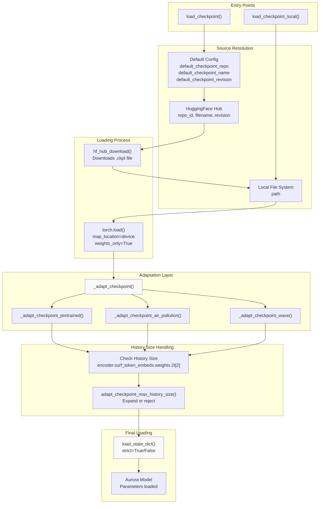
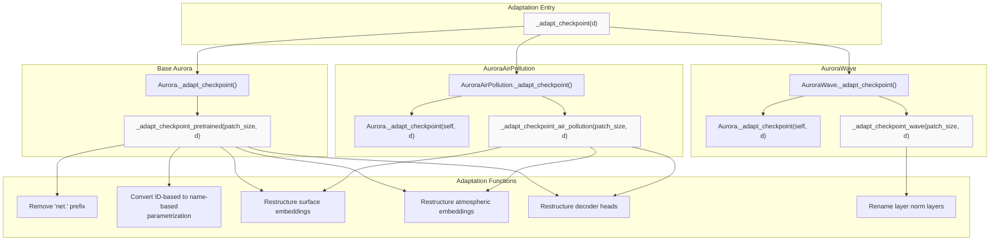
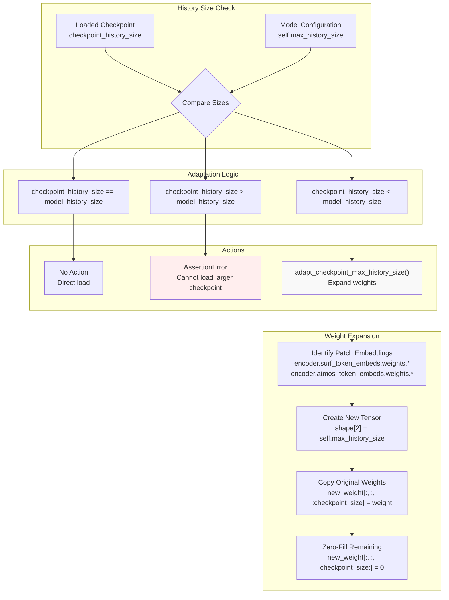

<!-- source: DeepWiki mcp.deepwiki.com · repo microsoft/aurora · page 2.5 Checkpoint Management · fetched 2026-10-26 -->

# Checkpoint Management

<details>
<summary>Relevant source files</summary>

The following files were used as context for generating this wiki page:

- [aurora/model/aurora.py](aurora/model/aurora.py)
- [aurora/model/compat.py](aurora/model/compat.py)
- [aurora/model/levelcond.py](aurora/model/levelcond.py)

</details>


This document describes Aurora's checkpoint management system, which handles loading pre-trained model weights from HuggingFace or local files, adapting checkpoints across model versions, and resolving parameter incompatibilities. Checkpoint management enables loading weights trained with different configurations into the current model architecture.

For information about how to use loaded models for inference, see [Getting Started](#4.1). For details on fine-tuning models from checkpoints, see [Fine-tuning](#5).

---

## Overview

Aurora's checkpoint management system consists of three main components:

1. **Loading**: Retrieving checkpoints from HuggingFace Hub or local filesystem
2. **Adaptation**: Converting checkpoint structure to match current model architecture
3. **Validation**: Ensuring parameter compatibility and handling mismatches

The system supports both strict loading (requiring exact parameter match) and non-strict loading (allowing parameter mismatches), and can adapt checkpoints with different history sizes or variable sets.

---

## Checkpoint Loading Architecture



**Checkpoint Loading Flow**: The system provides two entry points for loading checkpoints, with automatic adaptation and history size handling before final parameter loading.

Sources: [aurora/model/aurora.py:409-456]()

---

## HuggingFace Checkpoint Loading

The primary method for loading checkpoints is from HuggingFace Hub using `load_checkpoint()`.

### Default Checkpoints by Model Variant

Each Aurora model variant has default checkpoint configuration:

| Model Class | Default Checkpoint | Revision Hash | Repository |
|------------|-------------------|--------------|------------|
| `Aurora` (fine-tuned) | `aurora-0.25-finetuned.ckpt` | `0be7e57c685dac86b78c4a19a3ab149d13c6a3dd` | `microsoft/aurora` |
| `AuroraPretrained` | `aurora-0.25-pretrained.ckpt` | `0be7e57c685dac86b78c4a19a3ab149d13c6a3dd` | `microsoft/aurora` |
| `AuroraSmallPretrained` | `aurora-0.25-small-pretrained.ckpt` | `0be7e57c685dac86b78c4a19a3ab149d13c6a3dd` | `microsoft/aurora` |
| `Aurora12hPretrained` | `aurora-0.25-12h-pretrained.ckpt` | `15e76e47b65bf4b28fd2246b7b5b951d6e2443b9` | `microsoft/aurora` |
| `AuroraHighRes` | `aurora-0.1-finetuned.ckpt` | `0be7e57c685dac86b78c4a19a3ab149d13c6a3dd` | `microsoft/aurora` |
| `AuroraAirPollution` | `aurora-0.4-air-pollution.ckpt` | `1764d5630a53d3d7a7d169ca335236fc343e4bfc` | `microsoft/aurora` |
| `AuroraWave` | `aurora-0.25-wave.ckpt` | `74598e8c65d53a96077c08bb91acdfa5525340c9` | `microsoft/aurora` |

### Loading Methods

```python
# Load default checkpoint for model variant
model.load_checkpoint()

# Load specific checkpoint
model.load_checkpoint(
    repo="microsoft/aurora",
    name="aurora-0.25-pretrained.ckpt",
    revision="0be7e57c685dac86b78c4a19a3ab149d13c6a3dd"
)

# Load from local file
model.load_checkpoint_local(path="/path/to/checkpoint.ckpt")
```

The `load_checkpoint()` method [aurora/model/aurora.py:409-430]():
- Uses `hf_hub_download()` to retrieve checkpoint from HuggingFace
- Defaults to class-defined `default_checkpoint_repo`, `default_checkpoint_name`, and `default_checkpoint_revision`
- Delegates to `load_checkpoint_local()` for actual loading

The `load_checkpoint_local()` method [aurora/model/aurora.py:432-456]():
- Uses `torch.load()` with `weights_only=True` for security
- Maps checkpoint to current device (CPU/GPU)
- Applies checkpoint adaptation
- Validates and adapts history size
- Calls `load_state_dict()` with specified strictness

Sources: [aurora/model/aurora.py:40-54](), [aurora/model/aurora.py:409-456](), [aurora/model/aurora.py:550-644](), [aurora/model/aurora.py:646-714](), [aurora/model/aurora.py:804-852]()

---

## Checkpoint Adaptation System

Checkpoint adaptation ensures compatibility between checkpoint structure and current model architecture. Different model variants require different adaptation strategies.



**Checkpoint Adaptation Strategy**: Each model variant overrides `_adapt_checkpoint()` to apply appropriate transformations, with specialized functions handling different parameter restructuring needs.

Sources: [aurora/model/aurora.py:458-467](), [aurora/model/aurora.py:798-801](), [aurora/model/aurora.py:849-852](), [aurora/model/compat.py:1-285]()

---

## Pretrained Checkpoint Adaptation

The `_adapt_checkpoint_pretrained()` function [aurora/model/compat.py:18-75]() transforms older checkpoint formats to the current architecture:

### Transformations Applied

**1. Prefix Removal**
```python
# Remove "net." prefix from all keys
"net.encoder.surf_token_embeds.weight" → "encoder.surf_token_embeds.weight"
```

**2. ID-Based to Name-Based Parametrization**

The older checkpoint format used integer indices for variables; the current format uses variable names.

**Surface Variables:**
```python
# Old format: encoder.surf_token_embeds.weight with shape [*, 4+3]
# New format: encoder.surf_token_embeds.weights.{name} for each variable
encoder.surf_token_embeds.weights.2t     # Temperature at 2m
encoder.surf_token_embeds.weights.10u    # U-component wind at 10m
encoder.surf_token_embeds.weights.10v    # V-component wind at 10m
encoder.surf_token_embeds.weights.msl    # Mean sea level pressure
encoder.surf_token_embeds.weights.lsm    # Land-sea mask (static)
encoder.surf_token_embeds.weights.z      # Geopotential (static)
encoder.surf_token_embeds.weights.slt    # Soil type (static)
```

**Atmospheric Variables:**
```python
# Old format: encoder.atmos_token_embeds.weight with shape [*, 5]
# New format: encoder.atmos_token_embeds.weights.{name}
encoder.atmos_token_embeds.weights.z     # Geopotential
encoder.atmos_token_embeds.weights.u     # U-component wind
encoder.atmos_token_embeds.weights.v     # V-component wind
encoder.atmos_token_embeds.weights.t     # Temperature
encoder.atmos_token_embeds.weights.q     # Specific humidity
```

**Decoder Heads:**
```python
# Old format: decoder.surf_head.weight with shape [4*patch_size^2, *]
# New format: decoder.surf_heads.{name}.weight/bias
decoder.surf_heads.2t.weight
decoder.surf_heads.10u.weight
decoder.surf_heads.10v.weight
decoder.surf_heads.msl.weight

# Old format: decoder.atmos_head.weight with shape [5*patch_size^2, *]
# New format: decoder.atmos_heads.{name}.weight/bias
decoder.atmos_heads.z.weight
decoder.atmos_heads.u.weight
decoder.atmos_heads.v.weight
decoder.atmos_heads.t.weight
decoder.atmos_heads.q.weight
```

Sources: [aurora/model/compat.py:18-75]()

---

## Air Pollution Checkpoint Adaptation

The `_adapt_checkpoint_air_pollution()` function [aurora/model/compat.py:78-270]() handles additional complexity due to extended variable sets and separate Perceivers.

### Key Transformations

**1. Extended Surface Variables**

Adds pollution-specific and static emission variables:

```python
# New surface variables (weight_new)
encoder.surf_token_embeds.weights.pm1
encoder.surf_token_embeds.weights.pm2p5
encoder.surf_token_embeds.weights.pm10
encoder.surf_token_embeds.weights.tcco
encoder.surf_token_embeds.weights.tc_no
encoder.surf_token_embeds.weights.tcno2
encoder.surf_token_embeds.weights.gtco3
encoder.surf_token_embeds.weights.tcso2

# Static emission variables
encoder.surf_token_embeds.weights.static_ammonia
encoder.surf_token_embeds.weights.static_ammonia_log
encoder.surf_token_embeds.weights.static_co
encoder.surf_token_embeds.weights.static_co_log
encoder.surf_token_embeds.weights.static_nox
encoder.surf_token_embeds.weights.static_nox_log
encoder.surf_token_embeds.weights.static_so2
encoder.surf_token_embeds.weights.static_so2_log

# Dynamic time variables
encoder.surf_token_embeds.weights.tod_cos    # Time of day
encoder.surf_token_embeds.weights.tod_sin
encoder.surf_token_embeds.weights.dow_cos    # Day of week
encoder.surf_token_embeds.weights.dow_sin
encoder.surf_token_embeds.weights.doy_cos    # Day of year
encoder.surf_token_embeds.weights.doy_sin
```

**2. Level-Conditioned Atmospheric Embeddings**

Air pollution uses pressure-level-specific embeddings. For each pressure level (50, 100, 150, 200, 250, 300, 400, 500, 600, 700, 850, 925, 1000 hPa):

```python
# Standard meteorological variables
encoder.atmos_token_embeds.layers.{level}.weights.z
encoder.atmos_token_embeds.layers.{level}.weights.u
encoder.atmos_token_embeds.layers.{level}.weights.v
encoder.atmos_token_embeds.layers.{level}.weights.t
encoder.atmos_token_embeds.layers.{level}.weights.q

# Pollution variables
encoder.atmos_token_embeds.layers.{level}.weights.co
encoder.atmos_token_embeds.layers.{level}.weights.no
encoder.atmos_token_embeds.layers.{level}.weights.no2
encoder.atmos_token_embeds.layers.{level}.weights.go3
encoder.atmos_token_embeds.layers.{level}.weights.so2

# Static variables repeated at each level
encoder.atmos_token_embeds.layers.{level}.weights.static_lsm
encoder.atmos_token_embeds.layers.{level}.weights.static_z
encoder.atmos_token_embeds.layers.{level}.weights.static_slt
# ... and all static emission and time variables
```

**3. Indexing Bug Simulation**

The checkpoint includes a workaround for a historical indexing bug [aurora/model/aurora.py:94]():

```python
# Geopotential 'z' incorrectly uses 'static_z' embedding
encoder.atmos_token_embeds.layers.{level}.weights.z = 
    encoder.atmos_token_embeds.layers.{level}.weights.static_z
```

This is controlled by `simulate_indexing_bug=True` parameter.

**4. Separate Perceiver Renaming**

```python
# Old name
decoder.level_decoder_new.*

# New name
decoder.level_decoder_alternate.*
```

**5. Modulation Heads**

The air pollution model predicts differences for certain variables, requiring modulation heads:

```python
decoder.surf_heads.pm1_mod.weight
decoder.surf_heads.pm2p5_mod.weight
# ... for all variables in _predict_difference_history_dim_lookup

decoder.atmos_heads.co_mod.layers.{level}.weight
decoder.atmos_heads.no_mod.layers.{level}.weight
# ... for atmospheric pollution variables
```

Sources: [aurora/model/compat.py:78-270](), [aurora/model/aurora.py:646-801]()

---

## Wave Checkpoint Adaptation

The `_adapt_checkpoint_wave()` function [aurora/model/compat.py:273-284]() performs simpler transformations specific to the wave model.

### Layer Norm Renaming

The wave checkpoint uses different naming for layer normalization in the level aggregation module:

```python
# Old names
.k_ln.    # Key layer norm
.q_ln.    # Query layer norm

# New names
.ln_k.    # Layer norm for keys
.ln_q.    # Layer norm for queries
```

This renaming is applied to all matching keys in the checkpoint dictionary, typically affecting:
- `encoder.level_agg.k_ln.*` → `encoder.level_agg.ln_k.*`
- `encoder.level_agg.q_ln.*` → `encoder.level_agg.ln_q.*`

Sources: [aurora/model/compat.py:273-284](), [aurora/model/aurora.py:804-852]()

---

## History Size Adaptation

Aurora models track multiple historical timesteps. Checkpoints trained with different `max_history_size` can be adapted to models with larger history sizes.



**History Size Adaptation Flow**: The system checks history size compatibility and either loads directly, raises an error, or expands weights with zero-padding.

Sources: [aurora/model/aurora.py:446-454](), [aurora/model/aurora.py:469-504]()

---

## History Size Expansion Process

The `adapt_checkpoint_max_history_size()` method [aurora/model/aurora.py:469-504]() handles weight expansion when loading a checkpoint with smaller history size.

### Weight Shape Transformation

Patch embedding weights have shape:
```
[out_channels, 1, history_size, height, width]
```

When expanding history size from 2 to 4:

```python
# Original checkpoint weight
checkpoint_weight.shape = [512, 1, 2, 4, 4]  # max_history_size=2

# Target model weight
new_weight.shape = [512, 1, 4, 4, 4]  # max_history_size=4

# Expansion strategy
new_weight[:, :, 0:2] = checkpoint_weight  # Copy existing
new_weight[:, :, 2:4] = 0                  # Zero-fill new positions
```

### Affected Parameters

Only patch embeddings are affected:
- `encoder.surf_token_embeds.weights.{var_name}` for all surface variables
- `encoder.atmos_token_embeds.weights.{var_name}` for all atmospheric variables

Decoder heads and other parameters are **not** affected because they operate on the output of the encoder, which has already aggregated history information.

### Restrictions

The system enforces a one-directional adaptation:
- ✅ **Allowed**: Loading checkpoint with `max_history_size=2` into model with `max_history_size=4`
- ❌ **Rejected**: Loading checkpoint with `max_history_size=4` into model with `max_history_size=2`

This prevents loading checkpoints that would require discarding learned history dependencies, which could degrade performance significantly.

Sources: [aurora/model/aurora.py:469-504]()

---

## Strict vs Non-Strict Loading

The `strict` parameter controls parameter matching behavior during checkpoint loading.

### Strict Loading (`strict=True`)

**Default behavior**. Requires exact parameter match:

```python
model.load_checkpoint(strict=True)
```

**Behavior:**
- All parameters in checkpoint must exist in model
- All parameters in model must exist in checkpoint
- Shapes must match exactly
- Raises `RuntimeError` on any mismatch

**Use cases:**
- Loading official checkpoints for standard model configurations
- Ensuring complete parameter initialization
- Validating checkpoint compatibility

### Non-Strict Loading (`strict=False`)

**Flexible loading**. Allows parameter mismatches:

```python
model.load_checkpoint(strict=False)
```

**Behavior:**
- Missing parameters in checkpoint are initialized randomly (or with existing values)
- Extra parameters in checkpoint are ignored
- Shape mismatches still raise errors (handled by PyTorch)
- Returns tuple of `(missing_keys, unexpected_keys)`

**Use cases:**
- Fine-tuning with additional variables (e.g., adding new decoder heads)
- Loading partial checkpoints for transfer learning
- Adapting checkpoints to modified architectures
- Debug and experimentation

### Example Scenarios

**Scenario 1: Adding New Variables**

```python
# Checkpoint has: 2t, 10u, 10v, msl
# Model expects: 2t, 10u, 10v, msl, precipitation

model = Aurora(surf_vars=("2t", "10u", "10v", "msl", "precipitation"))
model.load_checkpoint(strict=False)  # Works - precipitation head randomly initialized
```

**Scenario 2: Removing LoRA Weights**

```python
# Checkpoint has LoRA weights from fine-tuning
# Model has use_lora=False

model = Aurora(use_lora=False)
model.load_checkpoint(strict=False)  # Works - LoRA weights ignored
```

**Scenario 3: Incompatible Configuration**

```python
# Checkpoint: patch_size=4
# Model: patch_size=8

model = Aurora(patch_size=8)
model.load_checkpoint(strict=True)   # Fails - shape mismatch
model.load_checkpoint(strict=False)  # Also fails - shapes incompatible
```

Sources: [aurora/model/aurora.py:414](), [aurora/model/aurora.py:424](), [aurora/model/aurora.py:437-438](), [aurora/model/aurora.py:456]()

---

## Checkpoint Loading Safety

The checkpoint loading system includes several safety measures:

### 1. Weights-Only Loading

```python
torch.load(path, map_location=device, weights_only=True)
```

The `weights_only=True` flag [aurora/model/aurora.py:442]() prevents arbitrary code execution from malicious checkpoints by only loading tensor data.

### 2. Device Mapping

```python
device = next(self.parameters()).device
torch.load(path, map_location=device)
```

Checkpoints are loaded directly to the device where model parameters reside (CPU/GPU/XPU), avoiding unnecessary transfers.

### 3. Version Compatibility Warnings

```python
if self.surf_stats:
    warnings.warn(
        f"The normalisation statics for the following surface-level variables "
        f"are manually adjusted: {', '.join(sorted(self.surf_stats.keys()))}. "
        f"Please ensure that this is right!",
        stacklevel=2,
    )
```

The model warns when non-standard normalization statistics are used [aurora/model/aurora.py:191-197](), which can affect checkpoint compatibility.

### 4. History Size Validation

```python
if self.max_history_size < current_history_size:
    raise AssertionError(
        f"Cannot load checkpoint with `max_history_size` {current_history_size} "
        f"into model with `max_history_size` {self.max_history_size}."
    )
```

Prevents loading incompatible checkpoints [aurora/model/aurora.py:451-454]().

Sources: [aurora/model/aurora.py:442](), [aurora/model/aurora.py:191-197](), [aurora/model/aurora.py:451-454](), [aurora/model/aurora.py:488-492]()

---

## Checkpoint Structure

Understanding checkpoint structure helps debug loading issues.

### Standard Checkpoint Format

```python
checkpoint = {
    # Encoder patch embeddings (name-based)
    "encoder.surf_token_embeds.weights.2t": Tensor[out_channels, 1, history, h, w],
    "encoder.surf_token_embeds.weights.10u": Tensor[...],
    "encoder.atmos_token_embeds.weights.z": Tensor[...],
    
    # Backbone Swin3D transformer
    "backbone.encoder_layers.0.blocks.0.norm1.weight": Tensor[...],
    "backbone.encoder_layers.0.blocks.0.attn.relative_position_bias_table": Tensor[...],
    
    # Optional LoRA weights
    "backbone.encoder_layers.0.blocks.0.attn.lora_A.0": Tensor[...],
    "backbone.encoder_layers.0.blocks.0.attn.lora_B.0": Tensor[...],
    
    # Decoder heads (name-based)
    "decoder.surf_heads.2t.weight": Tensor[patch_size^2, embed_dim],
    "decoder.surf_heads.2t.bias": Tensor[patch_size^2],
    "decoder.atmos_heads.z.weight": Tensor[patch_size^2, embed_dim],
    
    # Optional modulation heads (air pollution)
    "decoder.surf_heads.pm1_mod.weight": Tensor[...],
    "decoder.atmos_heads.co_mod.layers.850.weight": Tensor[...],
}
```

### Level-Conditioned Format (Air Pollution)

```python
checkpoint = {
    # Level-specific embeddings
    "encoder.atmos_token_embeds.layers.50.weights.z": Tensor[...],
    "encoder.atmos_token_embeds.layers.50.weights.co": Tensor[...],
    "encoder.atmos_token_embeds.layers.50.bias": Tensor[...],
    # ... repeated for each pressure level
    
    # Level-specific decoder heads
    "decoder.atmos_heads.z.layers.50.weight": Tensor[...],
    "decoder.atmos_heads.co.layers.50.weight": Tensor[...],
    # ... repeated for each pressure level and variable
}
```

### Supplemented Variables Format (Wave)

```python
checkpoint = {
    # Angle variables split into sin/cos
    "encoder.surf_token_embeds.weights.mwd_sin": Tensor[...],
    "encoder.surf_token_embeds.weights.mwd_cos": Tensor[...],
    
    # Density channels
    "encoder.surf_token_embeds.weights.swh_density": Tensor[...],
    
    # Standard wave variables
    "encoder.surf_token_embeds.weights.swh": Tensor[...],
}
```

Sources: [aurora/model/compat.py:29-73](), [aurora/model/compat.py:82-269](), [aurora/model/compat.py:273-284]()

---

## Summary Table

| Aspect | Details |
|--------|---------|
| **Loading Methods** | `load_checkpoint()` (HuggingFace), `load_checkpoint_local()` (local file) |
| **Default Repository** | `microsoft/aurora` |
| **Adaptation Functions** | `_adapt_checkpoint_pretrained()`, `_adapt_checkpoint_air_pollution()`, `_adapt_checkpoint_wave()` |
| **History Size Support** | Can load smaller history size into larger; cannot load larger into smaller |
| **Strict Loading** | Default `strict=True`; use `strict=False` for partial loading |
| **Safety Features** | `weights_only=True`, device mapping, validation checks |
| **Key Transformations** | Prefix removal, ID→name conversion, level conditioning, modulation heads |
| **Affected Parameters** | Encoder embeddings, decoder heads, backbone LoRA (if present) |

Sources: [aurora/model/aurora.py:409-504](), [aurora/model/compat.py:1-285]()

---

