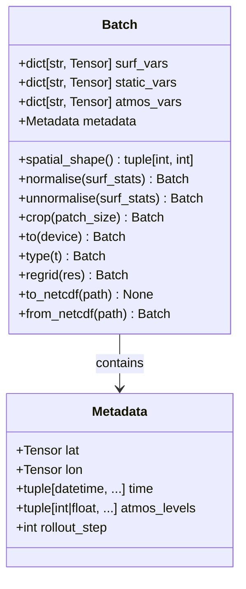
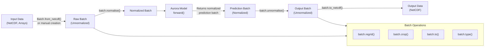
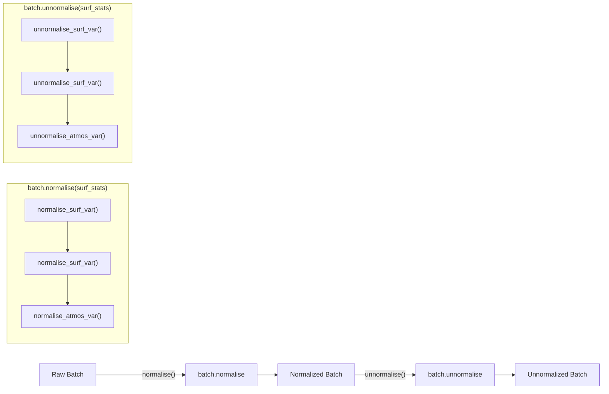
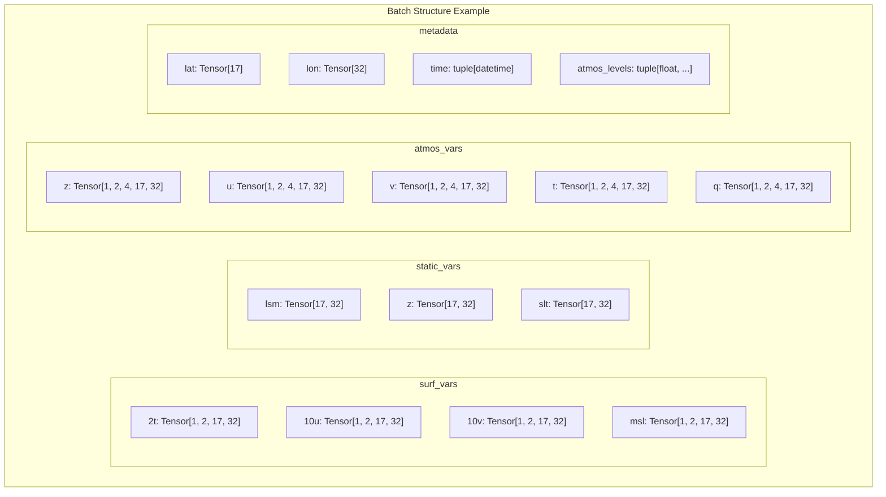

<!-- source: DeepWiki mcp.deepwiki.com · repo microsoft/aurora · page 3 Data Handling · fetched 2026-10-26 -->

# Data Structures

Relevant source files

The following files were used as context for generating this wiki page:

- [README.md](README.md)
- [aurora/model/patchembed.py](aurora/model/patchembed.py)
- [aurora/model/posencoding.py](aurora/model/posencoding.py)
- [docs/example_cams.ipynb](docs/example_cams.ipynb)
- [docs/example_wave.ipynb](docs/example_wave.ipynb)
- [docs/gifs/tc_tracks.gif](docs/gifs/tc_tracks.gif)
- [docs/intro.md](docs/intro.md)
- [docs/usage.md](docs/usage.md)
- [pyproject.toml](pyproject.toml)

This document details the fundamental data structures used in the Aurora system for Earth system forecasting. It focuses primarily on the `Batch` and `Metadata` classes, which are the core data containers that hold and organize meteorological data for processing by the Aurora model. For information about the normalization functions that operate on these data structures, see [Normalization](#3.1).

## Overview

Aurora operates on meteorological data organized in specific formats that facilitate efficient processing. The `Batch` class serves as the primary data container throughout the system, carrying both input data to the model and output predictions from the model.

Sources: [aurora/batch.py:71-292](aurora/batch.py:71-292), [docs/batch.md:1-5](docs/batch.md:1-5)

## Core Data Structures

### Batch and Metadata Structure

The diagram below illustrates the structure of the `Batch` class and its relationship with the `Metadata` class.

Sources: [aurora/batch.py:23-70](aurora/batch.py:23-70), [aurora/batch.py:71-292](aurora/batch.py:71-292)

### Metadata Class

The `Metadata` class contains geographical and temporal information about the data in a batch:

- `lat`: Latitudes in the range [-90, 90], must be strictly decreasing
- `lon`: Longitudes in the range [0, 360), must be strictly increasing
- `time`: Tuple of datetime objects representing the time of each batch element
- `atmos_levels`: Tuple of pressure levels (in hPa) for atmospheric variables
- `rollout_step`: Integer indicating how many roll-out steps were used to produce this data

The `Metadata` class performs validation during initialization to ensure correctness of the spatial coordinates.

Sources: [aurora/batch.py:23-70](aurora/batch.py:23-70), [docs/batch.md:96-119](docs/batch.md:96-119)

### Batch Class

The `Batch` class is the primary data container in Aurora, holding:

1. Surface-level variables (`surf_vars`)
2. Static variables (`static_vars`)
3. Atmospheric variables (`atmos_vars`)
4. Associated metadata (`metadata`)

All variables in a `Batch` are unnormalized; normalization happens internally within the model.

Sources: [aurora/batch.py:71-140](aurora/batch.py:71-140), [docs/batch.md:8-16](docs/batch.md:8-16)

## Data Flow in Aurora

The following diagram illustrates how `Batch` objects flow through the Aurora system:

Sources: [aurora/batch.py:94-140](aurora/batch.py:94-140), [aurora/batch.py:224-292](aurora/batch.py:224-292)

## Batch Components

### Surface Variables (surf_vars)

Surface variables are stored as tensors with shape `(b, t, h, w)` where:
- `b`: batch size
- `t`: history dimension (t=2 for Aurora, representing current and previous timestep)
- `h`: number of latitudes
- `w`: number of longitudes

| Name | Description | Units |
|------|-------------|-------|
| `2t` | Two-meter temperature | K |
| `10u` | Ten-meter eastward wind speed | m/s |
| `10v` | Ten-meter southward wind speed | m/s |
| `msl` | Mean sea-level pressure | Pa |

Sources: [docs/batch.md:41-60](docs/batch.md:41-60)

### Static Variables (static_vars)

Static variables are stored as tensors with shape `(h, w)` where:
- `h`: number of latitudes
- `w`: number of longitudes

| Name | Description |
|------|-------------|
| `lsm` | Land-sea mask |
| `slt` | Soil type |
| `z` | Surface-level geopotential (m²/s²) |

Sources: [docs/batch.md:62-76](docs/batch.md:62-76)

### Atmospheric Variables (atmos_vars)

Atmospheric variables are stored as tensors with shape `(b, t, c, h, w)` where:
- `b`: batch size
- `t`: history dimension
- `c`: number of pressure levels
- `h`: number of latitudes
- `w`: number of longitudes

| Name | Description | Units |
|------|-------------|-------|
| `t` | Temperature | K |
| `u` | Eastward wind speed | m/s |
| `v` | Southward wind speed | m/s |
| `q` | Specific humidity | kg/kg |
| `z` | Geopotential | m²/s² |

Sources: [docs/batch.md:77-95](docs/batch.md:77-95)

## Batch Operations

The `Batch` class provides several methods for manipulating the data:

### Normalization and Unnormalization

The `normalise()` method applies appropriate normalization to each variable type:
- `normalise_surf_var()` for surface variables
- `normalise_surf_var()` for static variables (using the same function as surface variables)
- `normalise_atmos_var()` for atmospheric variables

The `unnormalise()` method reverses this process.

Sources: [aurora/batch.py:94-140](aurora/batch.py:94-140)

### Spatial Operations

- `crop(patch_size)`: Crops the spatial dimensions to be divisible by `patch_size`
- `regrid(res)`: Interpolates the data to a new resolution in degrees
- `to(device)`: Moves the batch to a specified device (CPU/GPU)
- `type(t)`: Converts the batch to a specified data type

Sources: [aurora/batch.py:142-222](aurora/batch.py:142-222)

### IO Operations

- `to_netcdf(path)`: Saves the batch to a NetCDF file
- `from_netcdf(path)`: Static method to load a batch from a NetCDF file

These methods provide convenient serialization and deserialization of `Batch` objects.

Sources: [aurora/batch.py:224-292](aurora/batch.py:224-292), [tests/test_batch.py:42-59](tests/test_batch.py:42-59)

## Example Batch Construction

Below is a diagram showing the structure of a typical `Batch` object with expected tensor shapes:

Sources: [docs/batch.md:19-39](docs/batch.md:19-39)

## Important Considerations

1. **Temporal Dimensions**: 
   - For input batches, `surf_vars[:, 1, :, :]` corresponds to the current timestep.
   - `surf_vars[:, 0, :, :]` corresponds to the previous timestep.
   - The `time` field in metadata corresponds to the current timestep.

2. **Coordinate Requirements**:
   - Latitudes must be strictly decreasing from 90° to -90°.
   - Longitudes must be strictly increasing from 0° to 360° (exclusive).
   - For curvilinear grids, these requirements apply to columns (lat) and rows (lon).

3. **Model Output**:
   - The output from Aurora will also be a `Batch` object.
   - The only difference is that the history dimension will have size one.

Sources: [docs/batch.md:120-125](docs/batch.md:120-125), [docs/batch.md:50-51](docs/batch.md:50-51), [docs/batch.md:100-110](docs/batch.md:100-110)

---

