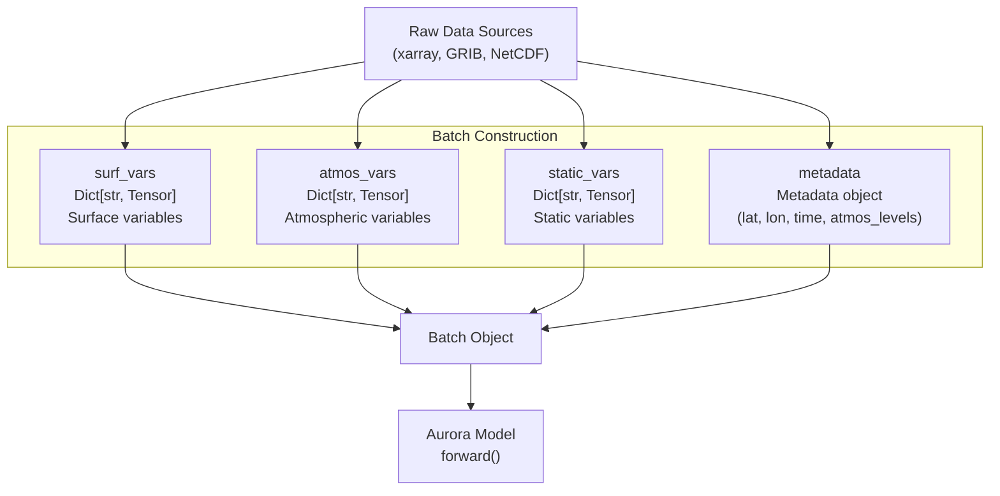
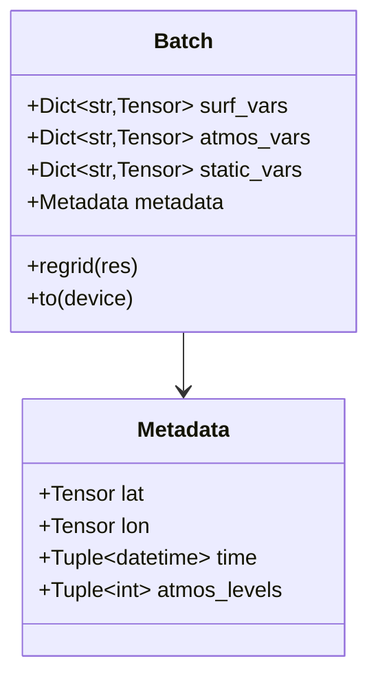
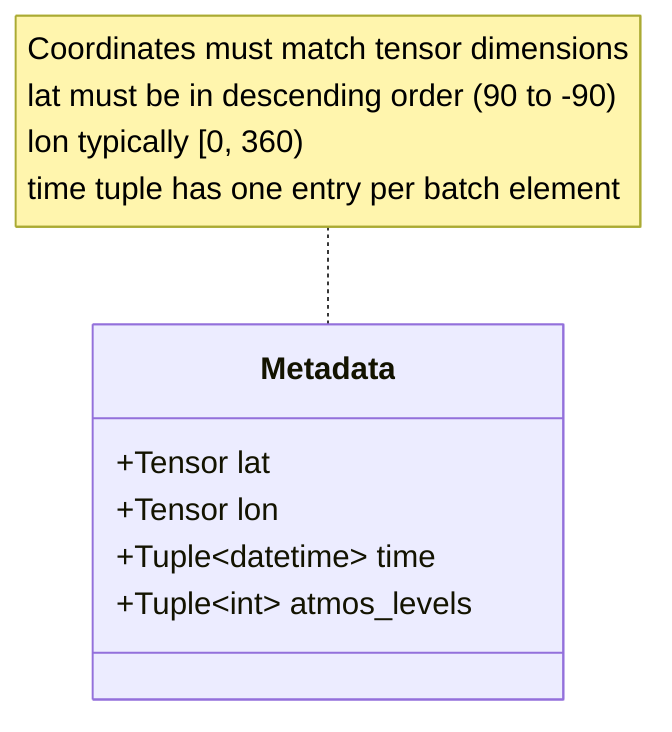
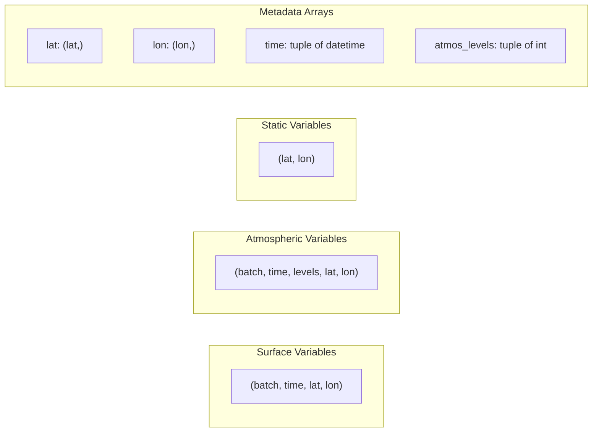
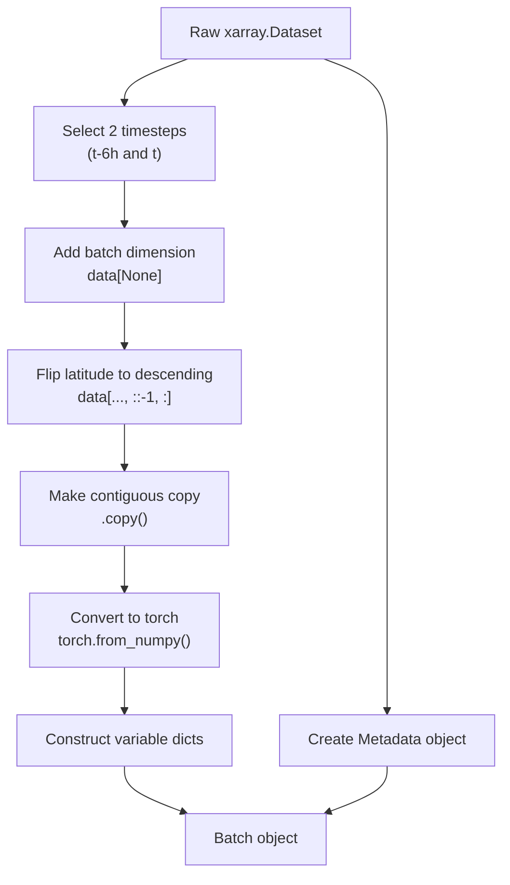

<!-- source: DeepWiki mcp.deepwiki.com · repo microsoft/aurora · page 3.1 Batch Interface · fetched 2026-10-26 -->

# Batch Interface

<details>
<summary>Relevant source files</summary>

The following files were used as context for generating this wiki page:

- [.pre-commit-config.yaml](.pre-commit-config.yaml)
- [README.md](README.md)
- [docs/example_cams.ipynb](docs/example_cams.ipynb)
- [docs/example_hres_0.1.ipynb](docs/example_hres_0.1.ipynb)
- [docs/example_wave.ipynb](docs/example_wave.ipynb)
- [docs/gifs/tc_tracks.gif](docs/gifs/tc_tracks.gif)
- [docs/intro.md](docs/intro.md)
- [docs/usage.md](docs/usage.md)

</details>


## Purpose and Scope

The Batch interface defines the standardized data structure used to pass atmospheric data into Aurora models. This page documents the `Batch` and `Metadata` classes, their required fields, tensor shapes, and construction patterns. For information about normalization of variables within batches, see [Normalization System](#3.2). For details on how batches are transformed into model inputs, see [Input Processing](#3.3).

## Overview

The Batch interface serves as the unified data model throughout Aurora's inference pipeline. Whether loading ERA5 reanalysis data, IFS HRES forecasts, CAMS air quality data, or HRES-WAM wave data, all inputs must be converted into an `aurora.Batch` object before model execution.



**Sources:** [Diagram 1](), [Diagram 4](), [docs/usage.md:40-65]()

## Batch Class Structure

The `Batch` class contains four primary components:

| Component | Type | Description |
|-----------|------|-------------|
| `surf_vars` | `Dict[str, torch.Tensor]` | Surface-level meteorological variables |
| `atmos_vars` | `Dict[str, torch.Tensor]` | Atmospheric variables at pressure levels |
| `static_vars` | `Dict[str, torch.Tensor]` | Time-invariant geographical variables |
| `metadata` | `Metadata` | Spatial coordinates, timestamps, and level information |



**Sources:** [README.md:87-97](), [docs/usage.md:48-66]()

## Surface Variables (surf_vars)

Surface variables are 4-dimensional tensors with shape `(batch, time, lat, lon)`, where:
- `batch`: Batch dimension (typically 1 for inference)
- `time`: Historical timesteps (typically 2: current and previous)
- `lat`: Number of latitude points
- `lon`: Number of longitude points

### Required Surface Variables

The following table shows standard surface variables expected by Aurora models:

| Variable Key | Full Name | Units | Source Example |
|--------------|-----------|-------|----------------|
| `2t` | 2-meter temperature | K | `surf_vars_ds["2m_temperature"]` |
| `10u` | 10-meter U wind component | m/s | `surf_vars_ds["10m_u_component_of_wind"]` |
| `10v` | 10-meter V wind component | m/s | `surf_vars_ds["10m_v_component_of_wind"]` |
| `msl` | Mean sea level pressure | Pa | `surf_vars_ds["mean_sea_level_pressure"]` |

**Sources:** [README.md:88](), [docs/example_wave.ipynb:290-294]()

### Domain-Specific Surface Variables

Different Aurora model variants require additional surface variables:

**AuroraWave** (ocean waves):
- `swh`, `mwd`, `mwp`, `pp1d`: Wave height, direction, and period variables
- `shww`, `mdww`, `mpww`: Wind wave statistics
- `shts`, `mdts`, `mpts`: Total swell statistics
- `swh1`, `mwd1`, `mwp1`, `swh2`, `mwd2`, `mwp2`: Swell partitions
- `wind`, `dwi`: Wind speed and direction

**AuroraAirPollution** (air quality):
- `pm1`, `pm2p5`, `pm10`: Particulate matter concentrations
- `tcco`: Total column carbon monoxide
- `tc_no`, `tcno2`: Nitrogen oxide columns
- `gtco3`: Total column ozone
- `tcso2`: Sulphur dioxide column

**Sources:** [docs/example_wave.ipynb:290-314](), [docs/example_cams.ipynb:195-209]()

## Atmospheric Variables (atmos_vars)

Atmospheric variables are 5-dimensional tensors with shape `(batch, time, levels, lat, lon)`:
- `batch`: Batch dimension
- `time`: Historical timesteps (typically 2)
- `levels`: Number of pressure levels
- `lat`: Number of latitude points
- `lon`: Number of longitude points

### Required Atmospheric Variables

| Variable Key | Full Name | Units | Source Example |
|--------------|-----------|-------|----------------|
| `z` | Geopotential | m²/s² | `atmos_vars_ds["geopotential"]` |
| `u` | U wind component | m/s | `atmos_vars_ds["u_component_of_wind"]` |
| `v` | V wind component | m/s | `atmos_vars_ds["v_component_of_wind"]` |
| `t` | Temperature | K | `atmos_vars_ds["temperature"]` |
| `q` | Specific humidity | kg/kg | `atmos_vars_ds["specific_humidity"]` |

### Pressure Levels

Standard pressure levels (in hPa): `(50, 100, 150, 200, 250, 300, 400, 500, 600, 700, 850, 925, 1000)`

For air pollution models, atmospheric pollutant concentrations are also included:
- `co`: Carbon monoxide
- `no`, `no2`: Nitrogen oxides
- `go3`: Ozone
- `so2`: Sulphur dioxide

**Sources:** [README.md:90](), [docs/example_hres_0.1.ipynb:154](), [docs/example_cams.ipynb:212-219]()

## Static Variables (static_vars)

Static variables are 2-dimensional tensors with shape `(lat, lon)` and do not vary with time:

| Variable Key | Full Name | Description |
|--------------|-----------|-------------|
| `lsm` | Land-sea mask | 0 for ocean, 1 for land |
| `z` | Geopotential at surface | Surface elevation information |
| `slt` | Soil type | Soil classification |

Static variables must be downloaded from HuggingFace for each resolution:
```python
from huggingface_hub import hf_hub_download

static_path = hf_hub_download(
    repo_id="microsoft/aurora",
    filename="aurora-0.25-static.pickle",
)
```

**Sources:** [README.md:89](), [docs/example_wave.ipynb:204-211](), [docs/example_hres_0.1.ipynb:121-128]()

## Metadata Class

The `Metadata` class contains spatial and temporal coordinate information:



### Metadata Fields

| Field | Type | Description | Example |
|-------|------|-------------|---------|
| `lat` | `torch.Tensor` | 1D tensor of latitude values (°N, descending) | `torch.linspace(90, -90, 721)` |
| `lon` | `torch.Tensor` | 1D tensor of longitude values (°E) | `torch.linspace(0, 360, 1440 + 1)[:-1]` |
| `time` | `Tuple[datetime]` | Tuple of datetime objects for each batch element | `(datetime(2022, 6, 1, 12, 0),)` |
| `atmos_levels` | `Tuple[int]` | Tuple of pressure levels in hPa | `(50, 100, 150, ..., 1000)` |

**Important Conventions:**
- Latitudes must be in **descending order** (North to South: 90° to -90°)
- Longitude range typically `[0, 360)` degrees East
- Time tuple contains one datetime per batch element
- Pressure levels in hectoPascals (hPa or mb)

**Sources:** [README.md:92-96](), [docs/example_wave.ipynb:323-333]()

## Tensor Shapes and Data Types

### Dimension Ordering Summary



### Data Type Requirements

All tensor variables must be:
- **Type:** `torch.Tensor` (typically `torch.float32`)
- **Device:** Can be CPU or CUDA (use `.to(device)` method on batch)
- **Contiguous:** Memory must be contiguous (use `.copy()` when converting from NumPy with non-standard strides)

**Sources:** [docs/example_wave.ipynb:267-277](), [README.md:87-97]()

## Constructing a Batch

### Basic Construction Pattern

```python
from datetime import datetime
import torch
from aurora import Batch, Metadata

batch = Batch(
    surf_vars={
        "2t": torch.randn(1, 2, 721, 1440),
        "10u": torch.randn(1, 2, 721, 1440),
        "10v": torch.randn(1, 2, 721, 1440),
        "msl": torch.randn(1, 2, 721, 1440),
    },
    static_vars={
        "lsm": torch.randn(721, 1440),
        "z": torch.randn(721, 1440),
        "slt": torch.randn(721, 1440),
    },
    atmos_vars={
        "z": torch.randn(1, 2, 13, 721, 1440),
        "u": torch.randn(1, 2, 13, 721, 1440),
        "v": torch.randn(1, 2, 13, 721, 1440),
        "t": torch.randn(1, 2, 13, 721, 1440),
        "q": torch.randn(1, 2, 13, 721, 1440),
    },
    metadata=Metadata(
        lat=torch.linspace(90, -90, 721),
        lon=torch.linspace(0, 360, 1440 + 1)[:-1],
        time=(datetime(2022, 6, 1, 12, 0),),
        atmos_levels=(50, 100, 150, 200, 250, 300, 400, 500, 600, 700, 850, 925, 1000),
    ),
)
```

**Sources:** [README.md:87-97]()

### Loading from Real Data

When loading from actual data sources (e.g., GRIB, NetCDF), several preprocessing steps are required:



#### Example: Preprocessing Helper Functions

From the high-resolution HRES example:

```python
def load_surf(v: str, v_in_file: str) -> torch.Tensor:
    """Load surface-level variable for hours 00 and 06."""
    ds = xr.open_dataset(path, engine="cfgrib")
    data = ds[v_in_file].values[:2]  # Select 2 timesteps
    data = data[None]  # Insert batch dimension
    return torch.from_numpy(data)

def load_atmos(v: str) -> torch.Tensor:
    """Load atmospheric variable for hours 00 and 06."""
    ds_00 = xr.open_dataset(path_00, engine="cfgrib")
    ds_06 = xr.open_dataset(path_06, engine="cfgrib")
    ds_00 = ds_00[v].sel(isobaricInhPa=list(levels))
    ds_06 = ds_06[v].sel(isobaricInhPa=list(levels))
    data = np.stack((ds_00.values, ds_06.values), axis=0)
    data = data[None]  # Insert batch dimension
    return torch.from_numpy(data)
```

**Sources:** [docs/example_hres_0.1.ipynb:157-178]()

#### Example: HRES-WAM Wave Data with Latitude Flipping

From the ocean wave example:

```python
def _prepare_hres(x: np.ndarray) -> torch.Tensor:
    """Prepare HRES variable from WeatherBench2.
    
    - Select first two time steps: 00:00 and 06:00
    - Insert batch dimension with [None]
    - Flip latitude axis to ensure descending order
    - Copy data to ensure contiguity
    - Convert to PyTorch
    """
    return torch.from_numpy(x[:2][None][..., ::-1, :].copy())

def _prepare_wave(x: np.ndarray) -> torch.Tensor:
    """Prepare wave variable (already in correct lat order)."""
    return torch.from_numpy(x[:2][None])

batch = Batch(
    surf_vars={
        "2t": _prepare_hres(surf_vars_ds["2m_temperature"].values),
        "10u": _prepare_hres(surf_vars_ds["10m_u_component_of_wind"].values),
        "swh": _prepare_wave(wave_vars_ds["swh"].values),
        # ... more variables
    },
    metadata=Metadata(
        # Flip latitudes from WeatherBench2
        lat=torch.from_numpy(surf_vars_ds.latitude.values[::-1].copy()),
        lon=torch.from_numpy(surf_vars_ds.longitude.values),
        time=(surf_vars_ds.time.values.astype("datetime64[s]").tolist()[1],),
        atmos_levels=tuple(int(level) for level in atmos_vars_ds.level.values),
    ),
)
```

**Sources:** [docs/example_wave.ipynb:267-335]()

#### Example: CAMS Air Quality Data

From the air pollution example:

```python
# Load pickled static variables from HuggingFace
with open(static_path, "rb") as f:
    static_vars = pickle.load(f)

# Open NetCDF datasets
surf_vars_ds = xr.open_dataset(surf_path, engine="netcdf4", decode_timedelta=True)
atmos_vars_ds = xr.open_dataset(atmos_path, engine="netcdf4", decode_timedelta=True)

# Select zero-hour forecast to get analysis product
surf_vars_ds = surf_vars_ds.isel(forecast_period=0)
atmos_vars_ds = atmos_vars_ds.isel(forecast_period=0)

batch = Batch(
    surf_vars={
        # [None] inserts a batch dimension of size one
        "2t": torch.from_numpy(surf_vars_ds["t2m"].values[None]),
        "pm1": torch.from_numpy(surf_vars_ds["pm1"].values[None]),
        # ... more variables
    },
    static_vars={k: torch.from_numpy(v) for k, v in static_vars.items()},
    atmos_vars={
        "t": torch.from_numpy(atmos_vars_ds["t"].values[None]),
        "co": torch.from_numpy(atmos_vars_ds["co"].values[None]),
        # ... more variables
    },
    metadata=Metadata(
        lat=torch.from_numpy(atmos_vars_ds.latitude.values),
        lon=torch.from_numpy(atmos_vars_ds.longitude.values),
        time=(atmos_vars_ds.valid_time.values.astype("datetime64[s]").tolist()[-1],),
        atmos_levels=tuple(int(level) for level in atmos_vars_ds.pressure_level.values),
    ),
)
```

**Sources:** [docs/example_cams.ipynb:172-232]()

## Common Preprocessing Steps

### 1. Time Selection
Always select **two consecutive timesteps** (typically 6 hours apart) to provide the model with historical context:
```python
data = ds.values[:2]  # Select timesteps 0 and 1
```

### 2. Batch Dimension
Insert a batch dimension at position 0:
```python
data = data[None]  # Equivalent to data[np.newaxis]
```

### 3. Latitude Ordering
Aurora requires latitudes in **descending order** (90° to -90°, North to South). WeatherBench2 data often needs flipping:
```python
data = data[..., ::-1, :]  # Flip latitude dimension
lat = lat[::-1]
```

### 4. Memory Contiguity
When using non-standard indexing or slicing, ensure memory is contiguous:
```python
data = data.copy()  # NumPy
# or
data = data.contiguous()  # PyTorch
```

### 5. Type Conversion
Convert from NumPy to PyTorch:
```python
tensor = torch.from_numpy(data)
```

### 6. Datetime Formatting
Convert timestamps to Python datetime objects:
```python
time = ds.time.values.astype("datetime64[s]").tolist()
```

**Sources:** [docs/example_wave.ipynb:267-288](), [docs/example_hres_0.1.ipynb:157-178]()

## Batch Operations

### Device Transfer
Move an entire batch to GPU or CPU:
```python
batch = batch.to("cuda")  # Move to GPU
batch = batch.to("cpu")   # Move back to CPU
```

### Regridding
The `Batch` class provides a convenience method for regridding to different resolutions:
```python
# Regrid to 0.1 degree resolution
batch = batch.regrid(res=0.1)
```

**Note:** This is a convenience function not optimized for speed or accuracy. Use at your own risk for production workloads.

**Sources:** [docs/example_hres_0.1.ipynb:217-221](), [docs/usage.md:114]()

## Model Input and Output

Once constructed, batches are passed directly to Aurora models:


```python
# Single-step prediction
model.eval()
model = model.to("cuda")
with torch.inference_mode():
    prediction = model.forward(batch)

# Multi-step rollout
from aurora import rollout
with torch.inference_mode():
    predictions = [pred.to("cpu") for pred in rollout(model, batch, steps=10)]
```

The model returns predictions as `Batch` objects with the same structure as the input. For a 6-hour timestep model, each prediction advances time by 6 hours.

**Sources:** [docs/usage.md:110-142](), [docs/example_wave.ipynb:369-382]()

## Summary

The Batch interface provides a standardized, type-safe container for atmospheric data in Aurora. Key requirements:
- **Surface variables:** Shape `(batch, time, lat, lon)`, 4 standard meteorological variables minimum
- **Atmospheric variables:** Shape `(batch, time, levels, lat, lon)`, 5 standard variables on 13 pressure levels
- **Static variables:** Shape `(lat, lon)`, 3 geographical variables
- **Metadata:** Spatial coordinates (descending latitude!), timestamps, and pressure levels
- **Preprocessing:** Select 2 timesteps, add batch dimension, flip latitude, ensure contiguity

All data preprocessing pipelines must produce `Batch` objects conforming to these specifications before model inference.

**Sources:** [README.md:87-102](), [docs/usage.md:40-66](), [Diagram 1](), [Diagram 4]()

---

