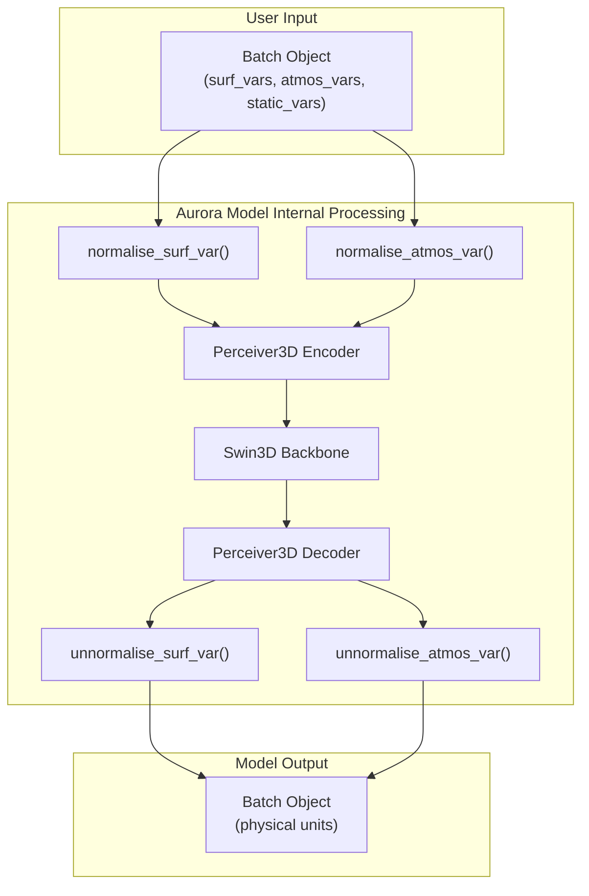
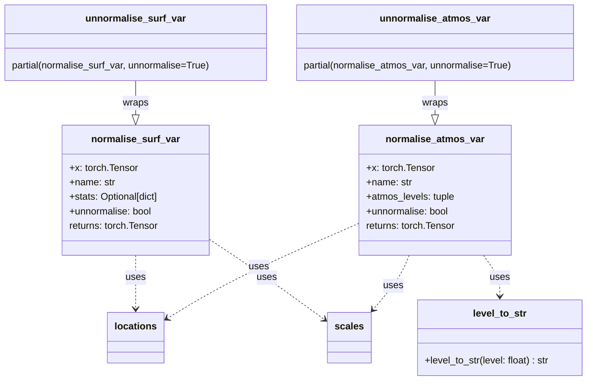
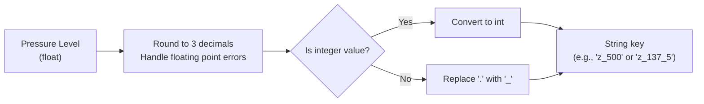
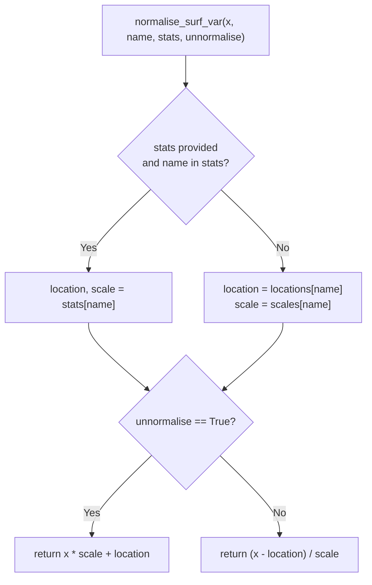
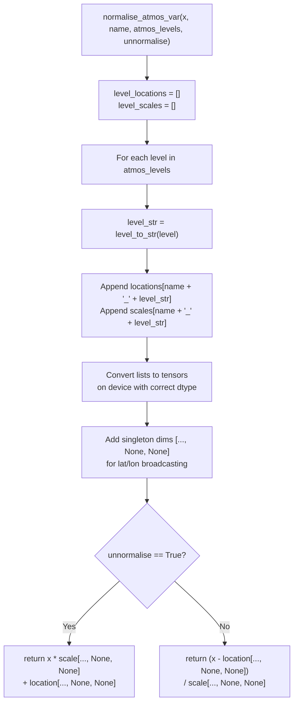
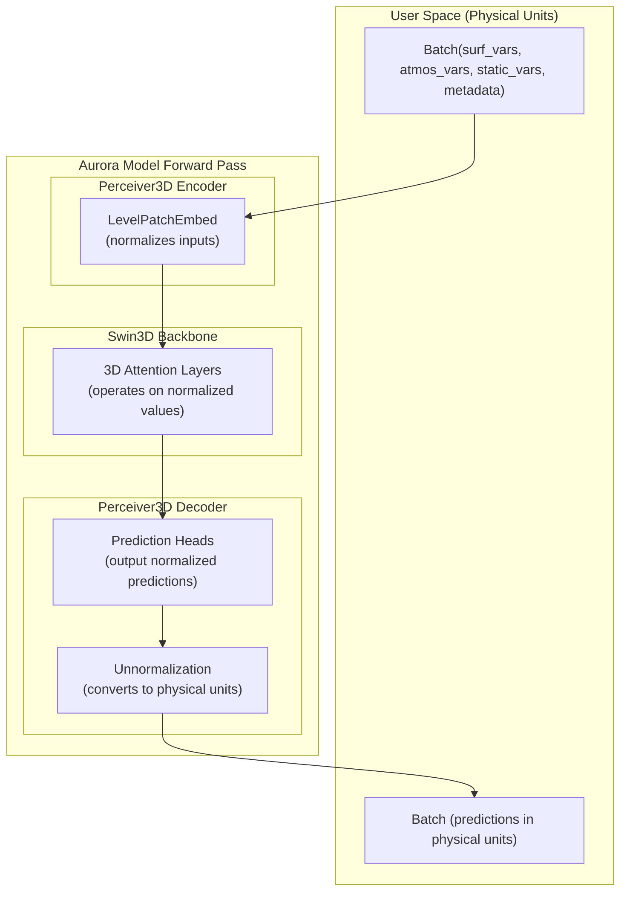

<!-- source: DeepWiki mcp.deepwiki.com · repo microsoft/aurora · page 3.2 Normalization System · fetched 2026-10-26 -->

# Normalization

<details>
<summary>Relevant source files</summary>

The following files were used as context for generating this wiki page:

- [aurora/foundry/common/model.py](aurora/foundry/common/model.py)
- [aurora/normalisation.py](aurora/normalisation.py)
- [docs/example_cams.ipynb](docs/example_cams.ipynb)
- [docs/example_wave.ipynb](docs/example_wave.ipynb)

</details>


This document describes the normalization system used in Aurora, a foundation model for Earth system forecasting. Normalization is a critical preprocessing step that standardizes input data and re-scales output predictions, ensuring the model can effectively learn from and generate weather variables across different scales and units.

## Purpose and Scope

The normalization system in Aurora handles the standardization of various meteorological variables, including:
- Surface-level variables (temperature, wind, pressure)
- Atmospheric variables at different pressure levels
- Static geographical variables

This page focuses specifically on the normalization functionality. For information about the core Aurora model architecture, see [Core Aurora Model](#2).

## Overview

Aurora's normalization system standardizes input data using a mean-subtraction and scaling approach. This is crucial because weather variables operate at vastly different scales (e.g., temperature in Kelvin vs. humidity in kg/kg). Normalized values typically range around zero with a standard deviation of approximately one, which helps the neural network learn efficiently.

**Important**: Normalization is handled internally by the Aurora model. Users typically do not need to call normalization functions directly when using the standard inference workflow. The functions described here are primarily used within the model's forward pass and are exposed for advanced use cases.

Normalization Data Flow



Sources: [aurora/normalisation.py:1-74]()

## Normalization Functions

Core Normalization API



Aurora provides the following normalization functions:

| Function | Purpose | Formula | Location |
|----------|---------|---------|----------|
| `level_to_str()` | Converts pressure level to consistent string format | Handles decimal formatting | [aurora/normalisation.py:17-31]() |
| `normalise_surf_var()` | Normalizes surface-level variables | `(x - location) / scale` | [aurora/normalisation.py:34-50]() |
| `normalise_atmos_var()` | Normalizes atmospheric variables across pressure levels | `(x - location[level]) / scale[level]` | [aurora/normalisation.py:53-71]() |
| `unnormalise_surf_var()` | Reverses normalization for surface variables | `x * scale + location` | [aurora/normalisation.py:73]() |
| `unnormalise_atmos_var()` | Reverses normalization for atmospheric variables | `x * scale[level] + location[level]` | [aurora/normalisation.py:74]() |

Sources: [aurora/normalisation.py:17-74]()

## Normalization Parameters

The normalization system uses two dictionaries of predefined parameters defined in [aurora/normalisation.py:77-457]():

- **`locations`**: Mean values for each variable (the "center" from which data is offset)
- **`scales`**: Scale factors for each variable (determines normalization magnitude)

Parameter Dictionary Structure

```mermaid
graph TB
    subgraph locations["locations dict"]
        direction TB
        surf_loc["Surface Variables<br/>2t, 10u, 10v, msl"]
        static_loc["Static Variables<br/>z, lsm, slt"]
        atmos_loc["Atmospheric Variables<br/>z_50...z_1000<br/>u_50...u_1000<br/>v_50...v_1000<br/>t_50...t_1000<br/>q_50...q_1000<br/>w_50...w_1000"]
        wave_loc["Wave Variables<br/>swh, pp1d, mwd, mwp<br/>shww, mdww, mpww<br/>shts, mdts, mpts<br/>swh1, mwd1, mwp1<br/>swh2, mwd2, mwp2<br/>wind, dwi, 10u_wave, 10v_wave"]
        poll_loc["Pollution Variables<br/>co_*, no2_*, no_*, go3_*, so2_*<br/>pm10, pm1, pm2p5<br/>tcco, tcno2, tc_no, gtco3, tcso2<br/>static_co, static_so2, etc."]
    end
    
    subgraph scales["scales dict"]
        direction TB
        surf_sc["Surface Variables<br/>2t, 10u, 10v, msl"]
        static_sc["Static Variables<br/>z, lsm, slt"]
        atmos_sc["Atmospheric Variables<br/>z_50...z_1000<br/>u_50...u_1000<br/>v_50...v_1000<br/>t_50...t_1000<br/>q_50...q_1000<br/>w_50...w_1000"]
        wave_sc["Wave Variables<br/>swh, pp1d, mwd, mwp<br/>shww, mdww, mpww<br/>shts, mdts, mpts<br/>swh1, mwd1, mwp1<br/>swh2, mwd2, mwp2<br/>wind, dwi, 10u_wave, 10v_wave"]
        poll_sc["Pollution Variables<br/>co_*, no2_*, no_*, go3_*, so2_*<br/>pm10, pm1, pm2p5<br/>tcco, tcno2, tc_no, gtco3, tcso2<br/>static_co, static_so2, etc."]
    end
```



### Variable Categories

The normalization parameters support multiple domains and model variants:

**Standard Meteorological Variables**
- Surface: `z`, `lsm`, `slt`, `2t`, `10u`, `10v`, `msl`
- Atmospheric (13 pressure levels): `z`, `u`, `v`, `t`, `q`, `w`
  - Levels: 50, 100, 150, 200, 250, 300, 400, 500, 600, 700, 850, 925, 1000 hPa

**Wave Variables** (for AuroraWave model)
- Significant wave height: `swh`, `swh1`, `swh2`
- Wave direction: `mwd`, `mdww`, `mdts`, `mwd1`, `mwd2`
- Wave period: `pp1d`, `mwp`, `mpww`, `mpts`, `mwp1`, `mwp2`
- Wind-wave components: `shww`, `shts`
- Wind variables: `wind`, `dwi`, `10u_wave`, `10v_wave`

**Air Pollution Variables** (for AuroraAirPollution model)
- Atmospheric composition at 13 levels: `co`, `no2`, `no`, `go3`, `so2`
- Surface particulates: `pm10`, `pm1`, `pm2p5`
- Total column values: `tcco`, `tcno2`, `tc_no`, `gtco3`, `tcso2`
- Static emission maps: `static_co`, `static_so2`, `static_ammonia`, `static_nox` (and log variants)

**Other Variables**
- `wmb`: Water mask binary
- `lat_mask`: Latitude mask

### Example Parameters

For surface temperature (`2t`):
- Location: `2.785140e02` (≈278.5 K)
- Scale: `2.122036e01` (≈21.2 K)

For geopotential at 500 hPa (`z_500`):
- Location: `5.411537e04` (≈54115 m²/s²)
- Scale: `3.353187e03` (≈3353 m²/s²)

Sources: [aurora/normalisation.py:77-457]()

## Implementation Details

### Helper Function: `level_to_str()`

The `level_to_str()` function provides consistent string formatting for pressure levels, which is essential for looking up normalization parameters in the dictionaries.

Processing Flow



Sources: [aurora/normalisation.py:17-31]()

### Surface Variable Normalization

The `normalise_surf_var()` function normalizes single surface-level variables:

Surface Variable Normalization Logic



**Key Features:**
- Supports custom statistics via `stats` parameter
- Falls back to global `locations` and `scales` dictionaries
- Single bidirectional function controlled by `unnormalise` flag

Sources: [aurora/normalisation.py:34-50]()

### Atmospheric Variable Normalization

The `normalise_atmos_var()` function handles normalization across multiple pressure levels simultaneously:

Atmospheric Variable Normalization Logic



**Key Features:**
- Constructs level-specific parameter tensors from pressure level tuple
- Uses `level_to_str()` to generate dictionary keys
- Applies broadcasting for efficient batch operations across lat/lon dimensions
- Preserves device and dtype of input tensor

Sources: [aurora/normalisation.py:53-71]()

## Handling Surface vs. Atmospheric Variables

The normalization system distinguishes between surface and atmospheric variables due to their different characteristics:

Comparison of Normalization Approaches

| Aspect | Surface Variables | Atmospheric Variables |
|--------|------------------|----------------------|
| Function | `normalise_surf_var()` | `normalise_atmos_var()` |
| Parameters | Single location, scale pair | Level-specific location, scale pairs |
| Tensor shape | `[batch, time, lat, lon]` | `[batch, time, level, lat, lon]` |
| Broadcasting | Applied directly | Broadcasts over level dimension |
| Example key | `"2t"` → `locations["2t"]` | `"t"` + level → `locations["t_500"]` |

**Why the distinction?**
- Atmospheric variables vary significantly with pressure level (e.g., temperature at 50 hPa vs. 1000 hPa)
- Each level requires independent normalization parameters
- The level-specific approach preserves vertical structure information

Sources: [aurora/normalisation.py:34-71]()

## Custom Normalization Parameters

While normalization is typically handled internally, Aurora supports custom normalization parameters through the `stats` parameter in `normalise_surf_var()`. This is useful when:
- Using different datasets with different statistics
- Fine-tuning models on domain-specific data
- Working with manually prepared static variables

Example use case from high-resolution model configuration:

```python
# Custom normalization for static orography when using
# manually downloaded static variables
model = AuroraHighRes(
    surf_stats={"z": (-3.270407e03, 6.540335e04)},
)
```

The custom statistics take precedence over the default global parameters.

Sources: [aurora/normalisation.py:34-50]()

## Integration with Aurora Models

Normalization is deeply integrated into Aurora's model architecture and happens automatically during the forward pass. Users typically interact with physical units when constructing `Batch` objects and receive predictions in physical units.

Model-Level Normalization Flow



**Normalization happens at two key stages:**

1. **Encoding** (via `LevelPatchEmbed` or similar components): Raw physical values are normalized before being processed by the neural network
2. **Decoding** (in prediction heads): Normalized predictions are unnormalized back to physical units before returning to the user

Sources: [aurora/normalisation.py:1-74](), [aurora/foundry/common/model.py:50-72]()

## Required Variables and Their Normalization

For optimal performance, Aurora models require specific variables to be normalized. The tables below list these variables and indicate that they all undergo normalization:

### Surface Variables

| Variable | Description | Normalized |
|----------|-------------|------------|
| `2t` | 2-meter temperature | Yes |
| `10u` | 10-meter U-component of wind | Yes |
| `10v` | 10-meter V-component of wind | Yes |
| `msl` | Mean sea level pressure | Yes |

### Static Variables

| Variable | Description | Normalized |
|----------|-------------|------------|
| `lsm` | Land-sea mask | Yes |
| `slt` | Soil type | Yes |
| `z` | Surface orography | Yes |

### Atmospheric Variables

| Variable | Description | Normalized |
|----------|-------------|------------|
| `t` | Temperature | Yes |
| `u` | U-component of wind | Yes |
| `v` | V-component of wind | Yes |
| `q` | Specific humidity | Yes |
| `z` | Geopotential | Yes |

All atmospheric variables are normalized at 13 standard pressure levels: 50, 100, 150, 200, 250, 300, 400, 500, 600, 700, 850, 925, and 1000 hPa.

Sources: [docs/models.md:30-35](), [docs/models.md:89-94](), [docs/models.md:149-155]()

## Model-Specific Normalization Considerations

Different Aurora model variants may require specific normalization approaches:

### Aurora 0.25° Variants

Both pretrained and fine-tuned 0.25° models use the default normalization parameters for data at 0.25° resolution (dimensions 721×1440).

### Aurora 0.1° Fine-Tuned

The high-resolution model (dimensions 1801×3600) may require adjusted normalization statistics for static variables, particularly when using manually downloaded data instead of the provided static variables.

The recommendation is to:
1. Use the provided static variables from the HuggingFace repository when possible
2. When using manually downloaded static variables, adjust the normalization parameters as shown in the customization example above

Sources: [docs/models.md:160-188]()

## Utility Functions

For convenience, the normalization module provides aliases for unnormalization functions:

- `unnormalise_surf_var`: A partial function of `normalise_surf_var` with `unnormalise=True`
- `unnormalise_atmos_var`: A partial function of `normalise_atmos_var` with `unnormalise=True`

These simplify the code when reverting normalized data back to its original scale.

Sources: [aurora/normalisation.py:55-56]()

---

