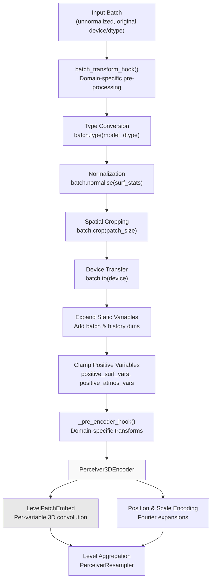
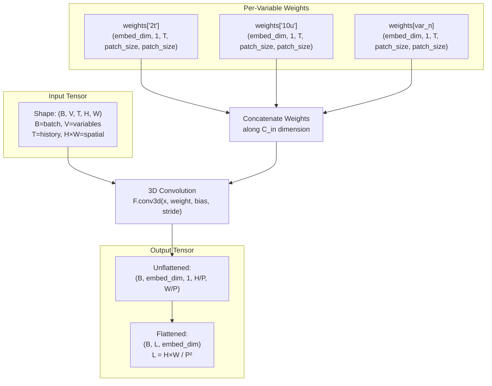
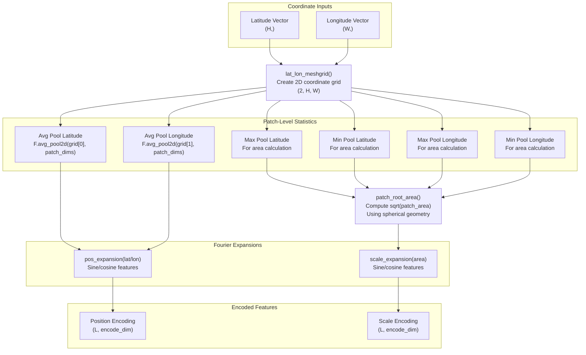
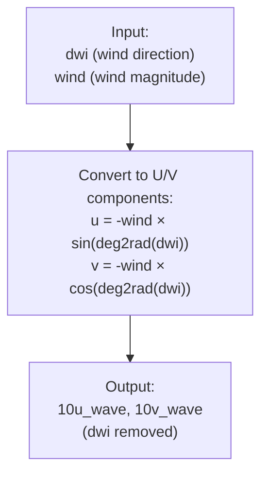

<!-- source: DeepWiki mcp.deepwiki.com · repo microsoft/aurora · page 3.3 Input Processing · fetched 2026-10-26 -->

# Input Processing

<details>
<summary>Relevant source files</summary>

The following files were used as context for generating this wiki page:

- [aurora/model/aurora.py](aurora/model/aurora.py)
- [aurora/model/patchembed.py](aurora/model/patchembed.py)
- [aurora/model/posencoding.py](aurora/model/posencoding.py)
- [pyproject.toml](pyproject.toml)

</details>


Input processing transforms raw atmospheric data from the `Batch` interface into embeddings suitable for the Swin3D Transformer backbone. This includes patch embedding, positional encoding, scale encoding, and domain-specific transformations. For information about the `Batch` data structure itself, see [Batch Interface](#3.1). For information about how data is normalized, see [Normalization System](#3.2).

---

## Input Processing Pipeline

The input processing pipeline transforms a `Batch` object through multiple stages before feeding it to the encoder. The main sequence occurs in the `Aurora.forward` method.



**Sources:** [aurora/model/aurora.py:265-325]()

### Transformation Stages

| Stage | Purpose | Location |
|-------|---------|----------|
| `batch_transform_hook()` | Domain-specific preprocessing (e.g., wind component splitting for waves) | [aurora/model/aurora.py:394-399]() |
| Type conversion | Convert to model dtype | [aurora/model/aurora.py:278]() |
| Normalization | Apply variable-specific normalization | [aurora/model/aurora.py:279]() |
| Cropping | Ensure spatial dimensions are divisible by patch size | [aurora/model/aurora.py:280]() |
| Device transfer | Move data to GPU/CPU | [aurora/model/aurora.py:281]() |
| Static variable expansion | Add batch and history dimensions to static variables | [aurora/model/aurora.py:290-295]() |
| Positive clamping | Clamp variables that must be non-negative | [aurora/model/aurora.py:302-317]() |
| `_pre_encoder_hook()` | Additional domain-specific transforms (e.g., log transforms, density channels) | [aurora/model/aurora.py:401-403]() |

**Sources:** [aurora/model/aurora.py:265-325]()

---

## Patch Embedding

The `LevelPatchEmbed` module converts raw spatial-temporal data into patch embeddings through per-variable 3D convolutions. Each variable is embedded separately before being combined.



**Sources:** [aurora/model/patchembed.py:14-119]()

### LevelPatchEmbed Implementation

The `LevelPatchEmbed` class implements variable-specific patch embedding:

**Key parameters:**
- `var_names`: Tuple of variable names to embed (e.g., `("2t", "10u", "10v", "msl")`)
- `patch_size`: Spatial patch size (typically 4 for 0.25° resolution, 10 for 0.1° resolution)
- `embed_dim`: Embedding dimensionality (default 512)
- `history_size`: Maximum number of history timesteps (default 2)
- `flatten`: Whether to flatten spatial dimensions into a sequence

**Forward pass:**
1. Select weights for variables present in the batch: [aurora/model/patchembed.py:100-107]()
2. Perform 3D convolution with stride `(T, patch_size, patch_size)`: [aurora/model/patchembed.py:112]()
3. Optionally flatten spatial dimensions: [aurora/model/patchembed.py:113-115]()

**Weight initialization:**
- Weights use Kaiming uniform initialization: [aurora/model/patchembed.py:68]()
- Bias follows PyTorch Conv3d default: [aurora/model/patchembed.py:74-77]()

**Sources:** [aurora/model/patchembed.py:14-119]()

### History Dimension Handling

The patch embedding adapts to variable history sizes:

```python
# From aurora/model/patchembed.py:100-109
weight = torch.cat(
    [
        self.weights[name][:, :, :T, ...]  # Select only T history steps
        for name in var_names
    ],
    dim=1,
)
stride = (T,) + self.kernel_size[1:]  # Adjust stride to match history size
```

This allows the model to handle batches with fewer history steps than `max_history_size` without retraining.

**Sources:** [aurora/model/patchembed.py:99-110]()

---

## Positional and Scale Encoding

Aurora uses Fourier expansions to encode spatial position and patch scale, providing the model with information about where each patch is located and how large it is.



**Sources:** [aurora/model/posencoding.py:1-193]()

### Position Encoding

Position encoding captures the latitude and longitude of each patch:

1. **Meshgrid construction:** Convert 1D lat/lon vectors to 2D grid: [aurora/model/posencoding.py:116-143]()
2. **Average pooling:** Compute patch centers using 2D average pooling: [aurora/model/posencoding.py:92-93]()
3. **Fourier expansion:** Apply sine/cosine transformations to lat/lon values: [aurora/model/posencoding.py:106-108]()

**Output shape:** `(L, encode_dim)` where `L = (H/patch_size) × (W/patch_size)`

**Sources:** [aurora/model/posencoding.py:61-114]()

### Scale Encoding

Scale encoding captures the physical size of each patch, accounting for spherical geometry:

1. **Patch boundary extraction:** Use max/min pooling to find patch edges: [aurora/model/posencoding.py:97-100]()
2. **Area calculation:** Compute patch area using spherical geometry formula: [aurora/model/posencoding.py:17-58]()

   ```
   area = R² × π × (sin(φ_max) - sin(φ_min)) × (θ_max - θ_min)
   ```
   where R = 6371 km (Earth's radius)

3. **Square root:** Take square root to keep units in km: [aurora/model/posencoding.py:58]()
4. **Fourier expansion:** Apply sine/cosine transformations: [aurora/model/posencoding.py:111]()

**Purpose:** Patches near the poles are smaller in absolute area than equatorial patches. Scale encoding allows the model to understand this variation.

**Sources:** [aurora/model/posencoding.py:17-58](), [aurora/model/posencoding.py:61-114]()

### Fourier Expansion

Both position and scale encodings use `FourierExpansion` objects to convert scalar values into high-dimensional features through sine and cosine transformations. This is a standard technique in transformer models to provide smooth, periodic representations.

**Sources:** [aurora/model/posencoding.py:106-111]()

---

## Domain-Specific Transformations

Aurora models can apply specialized transformations before and after encoding through hook methods. These hooks enable domain-specific data handling without modifying the core architecture.

### Hook System Architecture


**Sources:** [aurora/model/aurora.py:265-407]()

### batch_transform_hook

Called immediately after receiving input, before normalization. Used for preprocessing that should be idempotent.

**Example: AuroraWave wind component splitting**



**Sources:** [aurora/model/aurora.py:854-890]()

### _pre_encoder_hook

Called after normalization, before the encoder. Used for transformations that depend on normalized values.

**Example: AuroraAirPollution log transforms**

Air pollution variables are transformed using a learned combination of linear and logarithmic features:

```python
# From aurora/model/aurora.py:733-742
eps = 1e-4
divisor = -np.log(eps)

def _transform(z, feature_combiner):
    return feature_combiner(
        torch.stack([
            z.clamp(min=0, max=2.5),                           # Linear component
            (torch.log(z.clamp(min=eps)) - np.log(eps)) / divisor  # Log component
        ], dim=-1)
    )[..., 0]
```

This handles the highly skewed distribution of pollution variables.

**Sources:** [aurora/model/aurora.py:726-758]()

**Example: AuroraWave density channels**

For sparse wave data, density channels indicate where data is present:

```python
# From aurora/model/aurora.py:896-899
if name in density_channel_surf_vars:
    batch.surf_vars[f"{name}_density"] = (~torch.isnan(x)).float()
    batch.surf_vars[name] = x.nan_to_num(0)
```

**Sources:** [aurora/model/aurora.py:892-908]()

### _post_decoder_hook

Called after the decoder, before unnormalization. Used for output transformations.

**Example: AuroraAirPollution difference prediction**

The air pollution model predicts differences rather than absolute values:

```python
# From aurora/model/aurora.py:772-773
if name in dim_lookup:
    return model[name] + (1 + model[f"{name}_mod"]) * prev[name][:, dim_lookup[name]]
```

**Sources:** [aurora/model/aurora.py:760-796]()

---

## Encoder Input Format

After all transformations, the encoder receives data in this format:

**Batch structure:**
- `surf_vars`: Dict of surface variables, each with shape `(B, T, H, W)`
- `atmos_vars`: Dict of atmospheric variables, each with shape `(B, T, L, H, W)`
- `static_vars`: Dict of static variables, each with shape `(B, T, H, W)`

**Processing by encoder:**
1. Each variable passes through `LevelPatchEmbed` separately
2. Patch embeddings are combined with position and scale encodings
3. Level aggregation collapses atmospheric levels into latent levels
4. Output: `(B, latent_levels, H/P, W/P, embed_dim)` ready for the backbone

**Sources:** [aurora/model/aurora.py:199-218](), [aurora/model/aurora.py:322-325]()

---

