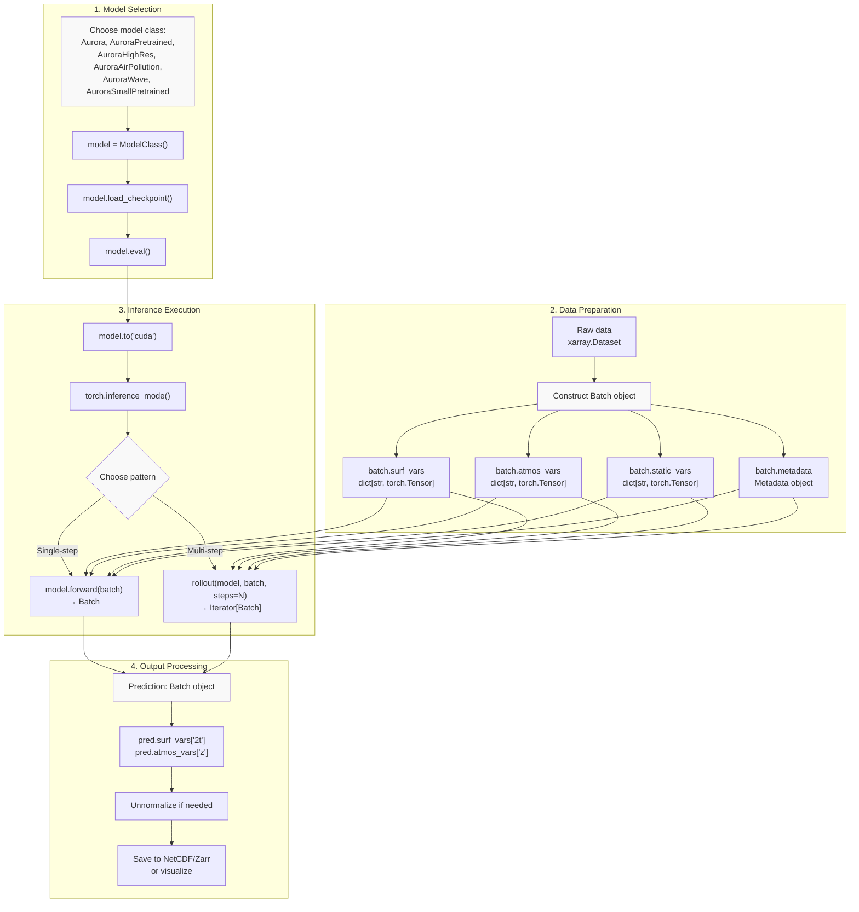
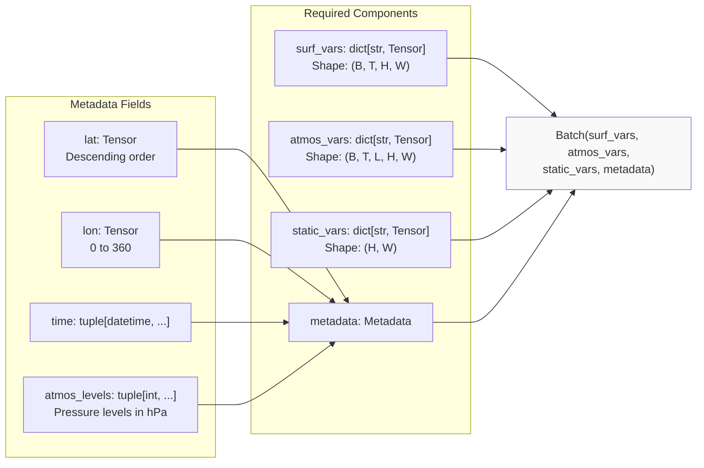
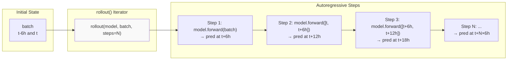
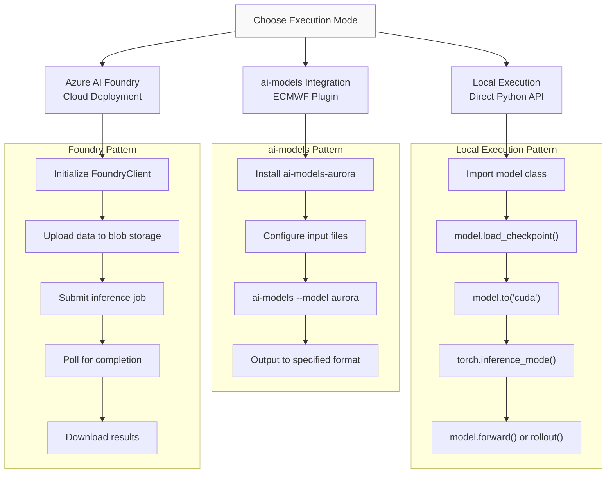

<!-- source: DeepWiki mcp.deepwiki.com · repo microsoft/aurora · page 4 Usage Guide · fetched 2026-10-26 -->

# Usage Guide

<details>
<summary>Relevant source files</summary>

The following files were used as context for generating this wiki page:

- [README.md](README.md)
- [docs/gifs/tc_tracks.gif](docs/gifs/tc_tracks.gif)
- [docs/intro.md](docs/intro.md)
- [docs/models.md](docs/models.md)
- [docs/usage.md](docs/usage.md)

</details>


## Purpose and Scope

This page provides a comprehensive overview of how to use Aurora models for atmospheric and environmental predictions. It covers the core workflow patterns, model selection, data preparation concepts, inference execution, and output handling.

For installation instructions and basic setup, see [Getting Started](#4.1). For detailed examples with specific datasets, see the example pages for [ERA5 data](#4.2), [HRES T0 data](#4.3), [high-resolution data](#4.4), [air pollution](#4.5), and [ocean waves](#4.6). For specialized tracking capabilities, see [Tropical Cyclone Tracking](#4.7). For information about the data structures and preprocessing, see [Data Handling](#3). For fine-tuning Aurora models, see [Fine-tuning](#5).

---

## Core Usage Workflow

The following diagram shows the essential code constructs and their relationships in a typical Aurora usage workflow:

**Diagram: Aurora Usage Workflow with Code Constructs**



**Sources:** [README.md:77-102](), [docs/usage.md:32-143]()

---

## Model Selection

Aurora provides multiple model variants optimized for different resolutions, datasets, and prediction tasks. The following table summarizes the available models and their typical use cases:

| Model Class | Resolution | Primary Dataset | Use Case | Checkpoint Method |
|-------------|-----------|----------------|----------|-------------------|
| `AuroraPretrained` | 0.25° | ERA5, CMIP6, GFS, HRES | General-purpose forecasting, fine-tuning base | `model.load_checkpoint()` |
| `Aurora` | 0.25° | IFS HRES T0 | Operational weather forecasting | `model.load_checkpoint()` |
| `AuroraHighRes` | 0.1° | IFS HRES Analysis | High-resolution weather forecasting | `model.load_checkpoint()` |
| `AuroraAirPollution` | 0.4° | CAMS Analysis | Air quality forecasting | `model.load_checkpoint()` |
| `AuroraWave` | 0.25° | HRES-WAM + HRES T0 | Ocean wave forecasting | `model.load_checkpoint()` |
| `Aurora12hPretrained` | 0.25° | ERA5, CMIP6, GFS, HRES | 12-hour timestep predictions | `model.load_checkpoint()` |
| `AuroraSmallPretrained` | 0.25° | ERA5, CMIP6, GFS, HRES | Debugging and testing | `model.load_checkpoint()` |

### Basic Model Loading Pattern

All model variants follow the same instantiation and checkpoint loading pattern:

```python
from aurora import Aurora  # Or any other model class

# Initialize model
model = Aurora()

# Load checkpoint from HuggingFace
model.load_checkpoint()

# Set to evaluation mode
model.eval()

# Move to GPU (optional but recommended)
model = model.to("cuda")
```

### Model-Specific Configuration

Some models support additional configuration options during initialization:

| Option | Applicable Models | Description | Example |
|--------|------------------|-------------|---------|
| `use_lora` | `Aurora`, `AuroraHighRes` | Enable/disable LoRA adaptation | `Aurora(use_lora=False)` |
| `surf_stats` | `AuroraHighRes` | Override normalization statistics | `AuroraHighRes(surf_stats={"z": (...)})` |
| `strict` | All | Strict checkpoint loading | `model.load_checkpoint(strict=False)` |

**Sources:** [docs/models.md:6-322](), [README.md:77-102](), [docs/usage.md:70-109]()

---

## Data Preparation Overview

Aurora requires input data structured as `Batch` objects, which encapsulate surface variables, atmospheric variables, static variables, and metadata.

**Diagram: Batch Construction Components**



### Tensor Shape Requirements

The following table describes the shape conventions for input tensors:

| Variable Type | Shape | Dimensions | Description |
|--------------|-------|------------|-------------|
| Surface variables | `(B, T, H, W)` | Batch, Time, Height, Width | 2D spatial fields over time |
| Atmospheric variables | `(B, T, L, H, W)` | Batch, Time, Levels, Height, Width | 3D spatial fields over pressure levels |
| Static variables | `(H, W)` | Height, Width | Time-invariant 2D spatial fields |

where:
- `B`: Batch size (typically 1 for inference)
- `T`: History length (typically 2, representing current and previous timestep)
- `L`: Number of atmospheric pressure levels
- `H`, `W`: Spatial dimensions (latitude and longitude)

### Critical Data Conventions

Aurora expects data to follow specific conventions:

1. **Latitude ordering**: Descending from North to South (90° to -90°)
2. **Longitude range**: 0° to 360° (not -180° to 180°)
3. **History requirement**: Two consecutive timesteps (current and previous)
4. **Normalization**: Variables should be normalized using the model's location and scale statistics

For detailed information on constructing batches, see [Batch Interface](#3.1). For normalization details, see [Normalization System](#3.2).

**Sources:** [docs/usage.md:42-66](), [README.md:87-97]()

---

## Inference Patterns

Aurora supports two primary inference patterns: single-step predictions and autoregressive rollouts.

### Single-Step Prediction

Single-step prediction generates one forecast step (typically 6 hours ahead):

```python
with torch.inference_mode():
    prediction = model.forward(batch)
```

The `forward` method:
- Input: `Batch` object with 2-timestep history
- Output: `Batch` object representing the next timestep
- Lead time: Determined by model training (typically 6 hours, 12 hours for `Aurora12hPretrained`)

### Autoregressive Rollout

For multi-step forecasts, use the `rollout` function, which applies the model autoregressively:

```python
from aurora import rollout

with torch.inference_mode():
    predictions = [pred.to("cpu") for pred in rollout(model, batch, steps=10)]
```

The `rollout` function:
- Takes a model, initial batch, and number of steps
- Returns an iterator yielding `Batch` objects for each forecast step
- Each prediction becomes the input for the next step
- Recommendation: Move predictions to CPU immediately to prevent GPU memory buildup

**Diagram: Autoregressive Rollout Process**



### Memory Management During Rollout

For long rollouts, memory management is critical:

```python
# Good: Move to CPU after each step
predictions = [pred.to("cpu") for pred in rollout(model, batch, steps=100)]

# Bad: Keep all predictions on GPU
predictions = list(rollout(model, batch, steps=100))  # May cause OOM
```

**Sources:** [docs/usage.md:112-143](), [README.md:99-102]()

---

## Execution Modes

Aurora supports three execution modes depending on deployment requirements:

**Diagram: Execution Mode Selection**



### Mode Comparison

| Mode | Use Case | Setup Complexity | Scalability | Control |
|------|----------|------------------|-------------|---------|
| Local | Research, development, custom workflows | Low | Limited by local hardware | Full |
| ai-models | ECMWF operational integration | Medium | ECMWF infrastructure | Standardized |
| Foundry | Enterprise cloud deployment | High | High (cloud-based) | API-based |

### Local Execution

Best for research and development. Requires:
- Python environment with PyTorch and CUDA
- Sufficient GPU memory (typically 40 GB for full resolution)
- Direct access to input data

### ai-models Integration

Enables Aurora to work within ECMWF's operational forecasting framework. See [ECMWF ai-models Plugin](#6.2) for details.

### Azure AI Foundry

Provides cloud-based inference with job submission and asynchronous execution. See [Azure AI Foundry](#6.1) for details.

**Sources:** [README.md:61-107](), [docs/usage.md:32-143]()

---

## Output Processing

Predictions from Aurora are returned as `Batch` objects with the same structure as input batches.

### Accessing Predictions

```python
# Single-step prediction
prediction = model.forward(batch)

# Access surface variables
temperature = prediction.surf_vars["2t"]  # Shape: (B, 1, H, W)
wind_u = prediction.surf_vars["10u"]

# Access atmospheric variables
geopotential = prediction.atmos_vars["z"]  # Shape: (B, 1, L, H, W)
temperature_profile = prediction.atmos_vars["t"]

# Access metadata
forecast_time = prediction.metadata.time[0]
```

### Common Post-Processing Operations

| Operation | Purpose | Implementation |
|-----------|---------|----------------|
| Unnormalization | Convert to physical units | Apply reverse of normalization statistics |
| Subsetting | Extract specific region | Index spatial dimensions |
| Variable extraction | Get specific variables | Access dictionary keys |
| Format conversion | Export to NetCDF/Zarr | Use xarray integration |
| Tropical cyclone tracking | Extract cyclone paths | Use `Tracker` component |

### Handling Multiple Rollout Steps

```python
predictions = [pred.to("cpu") for pred in rollout(model, batch, steps=10)]

# Access temperature at each timestep
temperatures = [pred.surf_vars["2t"] for pred in predictions]

# Stack into single tensor
temperature_sequence = torch.stack(temperatures, dim=1)  # (B, Steps, H, W)
```

### Tropical Cyclone Tracking

Aurora includes specialized tracking capabilities for tropical cyclones. See [Tropical Cyclone Tracking](#4.7) for detailed usage.

**Sources:** [docs/usage.md:112-143](), [README.md:99-102]()

---

## GPU Memory Requirements

The following table provides approximate GPU memory requirements for different models and resolutions:

| Model | Resolution | Grid Size | Approximate GPU Memory |
|-------|-----------|-----------|----------------------|
| `AuroraSmallPretrained` | 0.25° | 721 × 1440 | ~8 GB |
| `AuroraPretrained` / `Aurora` | 0.25° | 721 × 1440 | ~40 GB |
| `AuroraHighRes` | 0.1° | 1801 × 3600 | ~60 GB |
| `AuroraAirPollution` | 0.4° | 451 × 900 | ~35 GB |
| `AuroraWave` | 0.25° | 721 × 1440 | ~40 GB |

**Note**: Memory requirements may vary based on batch size and rollout length. For long rollouts, move predictions to CPU after each step to prevent memory buildup.

**Sources:** [docs/usage.md:112-124]()

---

## Error Handling and Common Issues

### Checkpoint Loading Issues

```python
# Issue: LoRA weights not found when loading with use_lora=False
model = Aurora(use_lora=False)
model.load_checkpoint(strict=False)  # Use non-strict loading
```

### Data Shape Mismatches

Common causes:
- Incorrect latitude ordering (should be descending)
- Wrong longitude range (should be 0-360°)
- Missing history dimension (need 2 timesteps)
- Incorrect number of atmospheric levels

### Memory Issues

Mitigation strategies:
- Use `torch.inference_mode()` instead of `torch.no_grad()`
- Move predictions to CPU during rollout
- Reduce batch size
- Use gradient checkpointing for fine-tuning

**Sources:** [docs/usage.md:88-101](), [docs/models.md:104-122]()

---

## Next Steps

For practical, end-to-end examples with specific datasets:

- **[Getting Started](#4.1)**: Installation, environment setup, and first predictions
- **[Example: ERA5 Data](#4.2)**: Working with ERA5 reanalysis data
- **[Example: HRES T0 Data](#4.3)**: Operational forecasting with IFS HRES T0
- **[Example: High-Resolution Data](#4.4)**: 0.1° resolution predictions
- **[Example: Air Pollution](#4.5)**: CAMS air quality forecasting
- **[Example: Ocean Waves](#4.6)**: HRES-WAM wave predictions
- **[Tropical Cyclone Tracking](#4.7)**: Specialized tracking workflows

For deeper understanding of the system:

- **[Data Handling](#3)**: Detailed information on data structures and preprocessing
- **[Model Architecture](#2)**: Understanding Aurora's neural network design
- **[Fine-tuning](#5)**: Adapting Aurora for custom applications
- **[Integration Systems](#6)**: Deployment options and external integrations

**Sources:** [README.md:1-200](), [docs/intro.md:1-38](), [docs/usage.md:1-143]()

---

