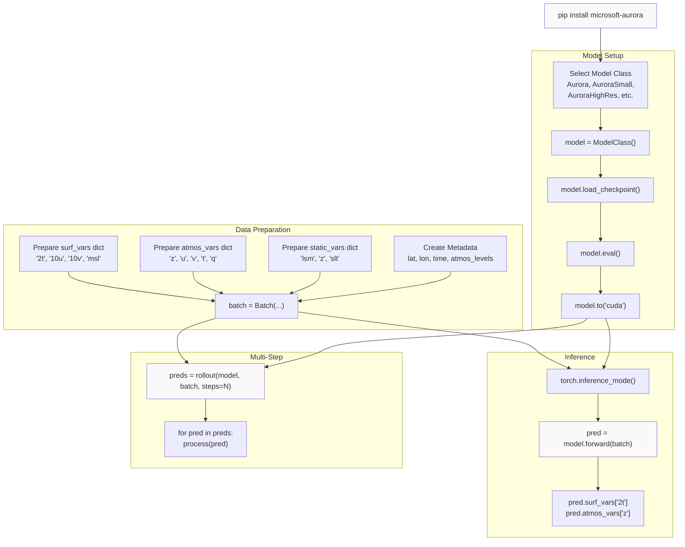
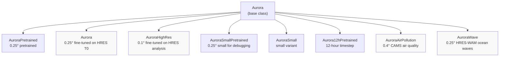
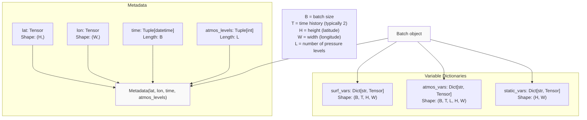

<!-- source: DeepWiki mcp.deepwiki.com · repo microsoft/aurora · page 4.1 Getting Started · fetched 2026-10-26 -->

# Getting Started

<details>
<summary>Relevant source files</summary>

The following files were used as context for generating this wiki page:

- [README.md](README.md)
- [aurora/__init__.py](aurora/__init__.py)
- [docs/gifs/tc_tracks.gif](docs/gifs/tc_tracks.gif)
- [docs/intro.md](docs/intro.md)
- [docs/models.md](docs/models.md)
- [docs/tracking.md](docs/tracking.md)
- [docs/usage.md](docs/usage.md)

</details>


This page provides a practical introduction to using Aurora for atmospheric prediction. It covers installation, basic model loading, checkpoint management, making single-step predictions, and running multi-step autoregressive forecasts.

For fine-tuning Aurora models, see [Fine-tuning](#5). For specific data source examples (ERA5, HRES T0, CAMS, etc.), see pages [4.2](#4.2) through [4.6](#4.6). For tropical cyclone tracking, see [Tropical Cyclone Tracking](#4.7).

## Installation

Aurora can be installed via pip or conda/mamba.

### PyPI Installation

```bash
pip install microsoft-aurora
```

This installs the latest stable release from PyPI. The package includes all core dependencies for running inference with pretrained models.

**Sources:** [README.md:63-67](), [docs/usage.md:5-9]()

### Conda Installation

```bash
mamba install microsoft-aurora -c conda-forge
```

Or using conda:

```bash
conda install microsoft-aurora -c conda-forge
```

**Sources:** [README.md:69-73](), [docs/usage.md:11-15]()

### Development Installation

For development or if you want the latest code from GitHub:

```bash
git clone https://github.com/microsoft/aurora.git
cd aurora
virtualenv venv -p python3.10
source venv/bin/activate
make install
```

The `make install` command sets up the package in editable mode and installs pre-commit hooks for code quality.

**Sources:** [docs/usage.md:17-30](), [README.md:179-183]()

## Quick Start Example

Here is a minimal example that loads a small pretrained Aurora model and runs a prediction on random data:

```python
from datetime import datetime
import torch
from aurora import AuroraSmallPretrained, Batch, Metadata

# Load model and checkpoint
model = AuroraSmallPretrained()
model.load_checkpoint()

# Construct a batch with random data
batch = Batch(
    surf_vars={k: torch.randn(1, 2, 17, 32) for k in ("2t", "10u", "10v", "msl")},
    static_vars={k: torch.randn(17, 32) for k in ("lsm", "z", "slt")},
    atmos_vars={k: torch.randn(1, 2, 4, 17, 32) for k in ("z", "u", "v", "t", "q")},
    metadata=Metadata(
        lat=torch.linspace(90, -90, 17),
        lon=torch.linspace(0, 360, 32 + 1)[:-1],
        time=(datetime(2020, 6, 1, 12, 0),),
        atmos_levels=(100, 250, 500, 850),
    ),
)

# Run prediction
prediction = model.forward(batch)
print(prediction.surf_vars["2t"])
```

This example downloads approximately 500 MB for the checkpoint and static variables on first run.

**Sources:** [README.md:77-102](), [docs/usage.md:48-66]()

## Basic Workflow

The following diagram illustrates the complete workflow for making predictions with Aurora:

**Figure 1: Aurora Prediction Workflow**



**Sources:** [docs/usage.md:32-43](), [README.md:77-102]()

## Model Classes and Selection

Aurora provides multiple model variants optimized for different resolutions, data sources, and use cases. All model classes are imported from the `aurora` package.

**Figure 2: Aurora Model Class Hierarchy**



### Model Selection Guide

| Model Class | Resolution | Use Case | Checkpoint Size |
|------------|-----------|----------|----------------|
| `Aurora` | 0.25° (721×1440) | IFS HRES T0 operational forecasts | ~1.2 GB |
| `AuroraPretrained` | 0.25° (721×1440) | ERA5 or general weather prediction | ~1.2 GB |
| `AuroraHighRes` | 0.1° (1801×3600) | High-resolution IFS HRES analysis | ~1.2 GB |
| `AuroraSmallPretrained` | 0.25° (varies) | Debugging and testing | ~500 MB |
| `Aurora12hPretrained` | 0.25° (721×1440) | 12-hour timestep predictions | ~1.2 GB |
| `AuroraAirPollution` | 0.4° (451×900) | CAMS air quality forecasts | ~1.3 GB |
| `AuroraWave` | 0.25° (721×1440) | Ocean wave forecasts with HRES-WAM | ~1.3 GB |

### Importing Model Classes

All model classes are available from the main `aurora` package:

```python
from aurora import (
    Aurora,
    AuroraPretrained,
    AuroraHighRes,
    AuroraSmallPretrained,
    Aurora12hPretrained,
    AuroraAirPollution,
    AuroraWave,
)
```

**Sources:** [aurora/__init__.py:3-13](), [docs/models.md:1-322](), [docs/usage.md:70-86]()

## Loading Models and Checkpoints

### Basic Model Construction

Constructing a model instance is straightforward:

```python
from aurora import Aurora

model = Aurora()
```

At this stage, the model has random weights and is not yet ready for inference.

### Loading Checkpoints

Checkpoints are stored on HuggingFace and automatically downloaded on first use:

```python
model.load_checkpoint()
```

This loads the default checkpoint for the model class from the `microsoft/aurora` repository. The checkpoint file and static variables are cached locally (typically in `~/.cache/huggingface/hub/`).

**Sources:** [docs/usage.md:88-92](), [README.md:85-86]()

### Loading Specific Checkpoints

You can specify a different checkpoint explicitly:

```python
model.load_checkpoint("microsoft/aurora", "aurora-0.25-pretrained.ckpt")
```

The first argument is the HuggingFace repository, and the second is the checkpoint filename.

**Sources:** [docs/usage.md:94-101]()

### Strict vs Non-Strict Loading

By default, checkpoint loading is strict, meaning all weights must match exactly. When using LoRA configurations, you may need non-strict loading:

```python
from aurora import Aurora

model = Aurora(use_lora=False)
model.load_checkpoint(strict=False)
```

The `strict=False` argument allows loading checkpoints even when some parameters don't match (e.g., when disabling LoRA).

**Sources:** [docs/models.md:114-122]()

### Evaluation Mode

Always set the model to evaluation mode before inference to disable dropout and other training-specific behavior:

```python
model.eval()
```

**Sources:** [docs/usage.md:103-107]()

## Batch Construction

Aurora requires input data in the form of `Batch` objects. A batch contains:
- **surf_vars**: Surface-level variables (dict of tensors)
- **atmos_vars**: Atmospheric variables at pressure levels (dict of tensors)
- **static_vars**: Time-invariant geographical variables (dict of tensors)
- **metadata**: Coordinate and time information (`Metadata` object)

**Figure 3: Batch Structure and Tensor Shapes**



### Minimal Example

```python
from datetime import datetime
import torch
from aurora import Batch, Metadata

batch = Batch(
    # Surface variables: (batch, time, height, width)
    surf_vars={
        "2t": torch.randn(1, 2, 721, 1440),    # 2-meter temperature
        "10u": torch.randn(1, 2, 721, 1440),   # 10-meter u-wind
        "10v": torch.randn(1, 2, 721, 1440),   # 10-meter v-wind
        "msl": torch.randn(1, 2, 721, 1440),   # Mean sea level pressure
    },
    # Static variables: (height, width)
    static_vars={
        "lsm": torch.randn(721, 1440),  # Land-sea mask
        "z": torch.randn(721, 1440),    # Surface geopotential
        "slt": torch.randn(721, 1440),  # Soil type
    },
    # Atmospheric variables: (batch, time, levels, height, width)
    atmos_vars={
        "z": torch.randn(1, 2, 13, 721, 1440),   # Geopotential
        "u": torch.randn(1, 2, 13, 721, 1440),   # u-wind component
        "v": torch.randn(1, 2, 13, 721, 1440),   # v-wind component
        "t": torch.randn(1, 2, 13, 721, 1440),   # Temperature
        "q": torch.randn(1, 2, 13, 721, 1440),   # Specific humidity
    },
    # Metadata
    metadata=Metadata(
        lat=torch.linspace(90, -90, 721),  # Descending order
        lon=torch.linspace(0, 360, 1440 + 1)[:-1],  # Exclude 360
        time=(datetime(2020, 6, 1, 12, 0),),  # Single timestamp
        atmos_levels=(50, 100, 150, 200, 250, 300, 400, 500, 600, 700, 850, 925, 1000),  # hPa
    ),
)
```

### Key Requirements

| Aspect | Requirement |
|--------|------------|
| **Latitude ordering** | Descending (90 to -90) |
| **Longitude range** | 0 to 360 (exclusive of 360) |
| **Time history** | Typically 2 timesteps (current and previous) |
| **Batch dimension** | Usually 1 for inference |
| **Resolution matching** | Must match model's expected resolution |

For detailed information on batch construction and normalization, see [Batch Interface](#3.1) and [Normalization System](#3.2).

**Sources:** [README.md:87-97](), [docs/usage.md:42-66]()

## Single-Step Predictions

Once you have a model and batch, making a single prediction is straightforward.

### Basic Inference Pattern

```python
import torch

# Move model to GPU
model = model.to("cuda")

# Move batch to GPU (if not already)
batch = batch.to("cuda")

# Run inference
with torch.inference_mode():
    prediction = model.forward(batch)
```

The `torch.inference_mode()` context manager disables gradient computation and reduces memory usage.

**Sources:** [docs/usage.md:111-122]()

### GPU Memory Requirements

| Model | Resolution | Approximate GPU Memory |
|-------|-----------|----------------------|
| Aurora / AuroraPretrained | 0.25° | ~40 GB |
| AuroraHighRes | 0.1° | ~80+ GB |
| AuroraSmallPretrained | 0.25° (reduced) | ~10 GB |

For the full-size models at 0.25°, you need approximately 40 GB of GPU memory. The small model can run on GPUs with ~10 GB.

**Sources:** [docs/usage.md:123-124]()

### Accessing Predictions

The output `prediction` is also a `Batch` object with the same structure as the input:

```python
# Access surface predictions
temp_2m = prediction.surf_vars["2t"]  # Shape: (1, 1, 721, 1440)
u_10m = prediction.surf_vars["10u"]
v_10m = prediction.surf_vars["10v"]
msl = prediction.surf_vars["msl"]

# Access atmospheric predictions
geopotential = prediction.atmos_vars["z"]  # Shape: (1, 1, 13, 721, 1440)
u_wind = prediction.atmos_vars["u"]
v_wind = prediction.atmos_vars["v"]
temperature = prediction.atmos_vars["t"]
humidity = prediction.atmos_vars["q"]
```

Note that predictions have a time dimension of 1 (single timestep ahead), while input typically has time dimension of 2 (history).

**Sources:** [docs/usage.md:120-122]()

## Autoregressive Rollout

For multi-step forecasts, Aurora uses autoregressive rollout where each prediction becomes the input for the next step.

**Figure 4: Autoregressive Rollout Execution**

```mermaid
graph LR
    subgraph "Initial State"
        Batch0["Initial Batch<br/>time: t-6h, t"]
    end
    
    subgraph "Step 1"
        Model1["model.forward()"]
        Pred1["Prediction<br/>time: t+6h"]
        Update1["Update history:<br/>t, t+6h"]
    end
    
    subgraph "Step 2"
        Model2["model.forward()"]
        Pred2["Prediction<br/>time: t+12h"]
        Update2["Update history:<br/>t+6h, t+12h"]
    end
    
    subgraph "Step N"
        ModelN["model.forward()"]
        PredN["Prediction<br/>time: t+N*6h"]
    end
    
    Batch0 --> Model1
    Model1 --> Pred1
    Pred1 --> Update1
    Update1 --> Model2
    Model2 --> Pred2
    Pred2 --> Update2
    Update2 --> ModelN
    ModelN --> PredN
    
    style Model1 fill:#f9f9f9
    style Model2 fill:#f9f9f9
    style ModelN fill:#f9f9f9
```



### Using the rollout Function

The `rollout` function handles autoregressive iteration automatically:

```python
from aurora import rollout
import torch

model = model.to("cuda")

with torch.inference_mode():
    preds = [pred.to("cpu") for pred in rollout(model, batch, steps=10)]
```

This generates 10 six-hour forecasts (60 hours total for a 6-hour timestep model).

**Key points:**
- Each prediction is moved to CPU immediately to avoid GPU memory buildup
- The `rollout` function is a generator yielding `Batch` objects
- The initial `batch` must have 2 timesteps of history

**Sources:** [docs/usage.md:126-143](), [aurora/__init__.py:14]()

### Processing Rollout Results

```python
from aurora import rollout

preds = []
with torch.inference_mode():
    for i, pred in enumerate(rollout(model, batch, steps=20)):
        # Move to CPU to save GPU memory
        pred = pred.to("cpu")
        
        # Extract and process predictions
        temp_forecast = pred.surf_vars["2t"]
        
        # Store or analyze
        preds.append(pred)
        
        print(f"Step {i+1}: forecasted for {pred.metadata.time[0]}")
```

Each `pred` in the rollout is a `Batch` with:
- Time dimension of 1 (single prediction timestep)
- Same spatial dimensions as input
- Updated `metadata.time` reflecting the forecast time

**Sources:** [docs/usage.md:136-143]()

## Device Management

### Moving Models Between Devices

```python
# Move to GPU
model = model.to("cuda")

# Move back to CPU
model = model.to("cpu")

# Specify GPU device
model = model.to("cuda:0")
```

### Moving Batches Between Devices

```python
# Original batch on CPU
batch_cpu = Batch(...)

# Move to GPU
batch_gpu = batch_cpu.to("cuda")

# Move predictions back to CPU
with torch.inference_mode():
    pred = model.forward(batch_gpu)
    pred_cpu = pred.to("cpu")
```

The `Batch.to()` method handles moving all tensors (surf_vars, atmos_vars, static_vars, and metadata tensors) to the specified device.

**Sources:** [docs/usage.md:114](), [docs/tracking.md:34]()

## Complete Example

Here is a complete example putting all pieces together:

```python
from datetime import datetime
import torch
from aurora import Aurora, Batch, Metadata, rollout

# 1. Load model and checkpoint
model = Aurora()
model.load_checkpoint()
model.eval()
model = model.to("cuda")

# 2. Construct batch (with real data or placeholders)
batch = Batch(
    surf_vars={
        "2t": torch.randn(1, 2, 721, 1440),
        "10u": torch.randn(1, 2, 721, 1440),
        "10v": torch.randn(1, 2, 721, 1440),
        "msl": torch.randn(1, 2, 721, 1440),
    },
    static_vars={
        "lsm": torch.randn(721, 1440),
        "z": torch.randn(721, 1440),
        "slt": torch.randn(721, 1440),
    },
    atmos_vars={
        "z": torch.randn(1, 2, 13, 721, 1440),
        "u": torch.randn(1, 2, 13, 721, 1440),
        "v": torch.randn(1, 2, 13, 721, 1440),
        "t": torch.randn(1, 2, 13, 721, 1440),
        "q": torch.randn(1, 2, 13, 721, 1440),
    },
    metadata=Metadata(
        lat=torch.linspace(90, -90, 721),
        lon=torch.linspace(0, 360, 1441)[:-1],
        time=(datetime(2020, 6, 1, 12, 0),),
        atmos_levels=(50, 100, 150, 200, 250, 300, 400, 500, 600, 700, 850, 925, 1000),
    ),
)

# 3. Single-step prediction
with torch.inference_mode():
    prediction = model.forward(batch)
    print(f"Single prediction shape: {prediction.surf_vars['2t'].shape}")

# 4. Multi-step rollout
with torch.inference_mode():
    preds = [pred.to("cpu") for pred in rollout(model, batch, steps=8)]
    print(f"Generated {len(preds)} predictions (48 hours)")

# 5. Clean up
model = model.to("cpu")
```

**Sources:** [README.md:77-102](), [docs/usage.md:32-143]()

## Next Steps

After getting started with basic predictions:

- **[Example: ERA5 Data](#4.2)** - Learn how to load and predict with ERA5 reanalysis data
- **[Example: HRES T0 Data](#4.3)** - Work with operational IFS HRES forecast data
- **[Example: High-Resolution Data](#4.4)** - Use AuroraHighRes for 0.1° predictions
- **[Example: Air Pollution](#4.5)** - Forecast air quality with CAMS data
- **[Example: Ocean Waves](#4.6)** - Predict ocean wave conditions
- **[Tropical Cyclone Tracking](#4.7)** - Track tropical cyclones through predictions
- **[Batch Interface](#3.1)** - Detailed documentation on batch construction
- **[Normalization System](#3.2)** - Understanding data normalization
- **[Model Variants](#2.4)** - Comprehensive guide to all Aurora variants

**Sources:** [docs/usage.md:1-143](), [docs/intro.md:1-38]()

---

