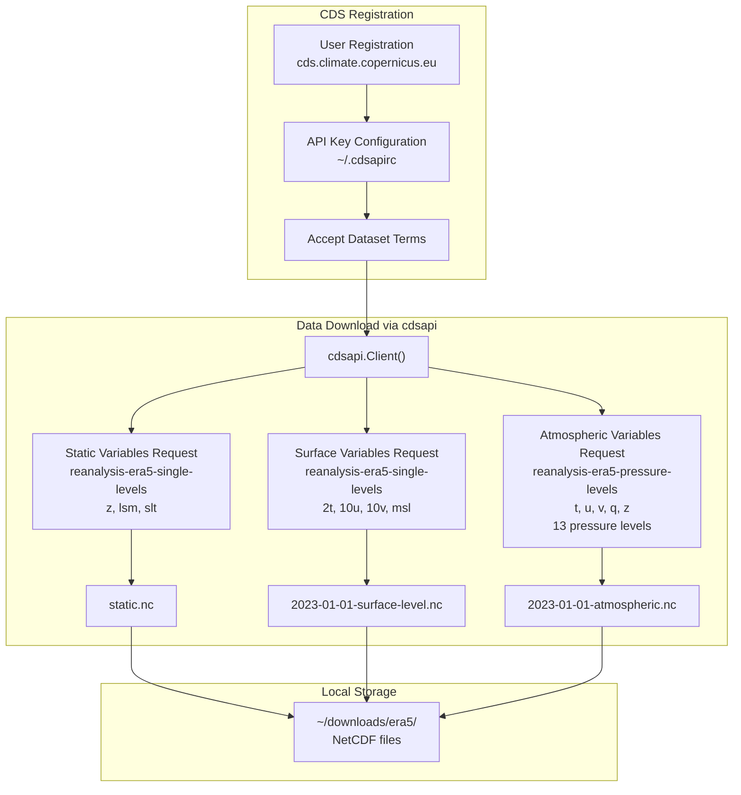
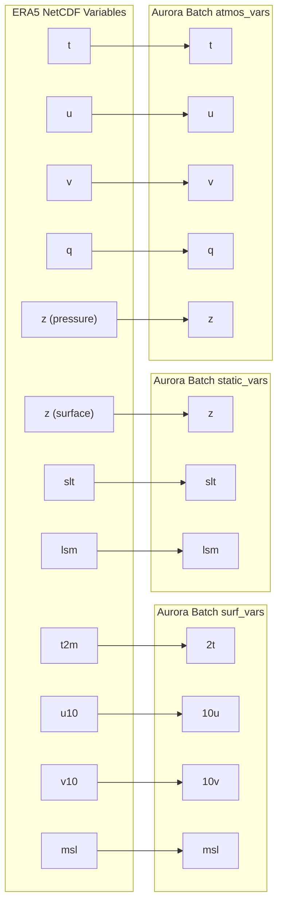
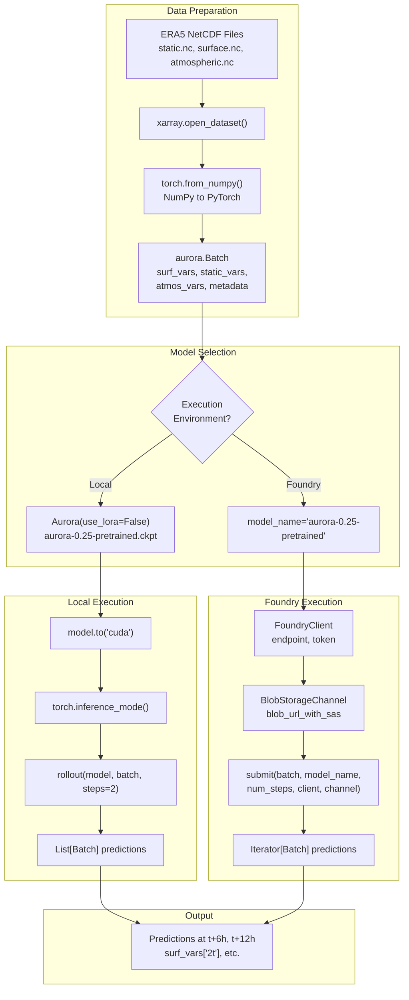

<!-- source: DeepWiki mcp.deepwiki.com · repo microsoft/aurora · page 4.2 Example: ERA5 Data · fetched 2026-10-26 -->

# Example: ERA5 Data

<details>
<summary>Relevant source files</summary>

The following files were used as context for generating this wiki page:

- [README.md](README.md)
- [docs/example_era5.ipynb](docs/example_era5.ipynb)
- [docs/gifs/tc_tracks.gif](docs/gifs/tc_tracks.gif)
- [docs/intro.md](docs/intro.md)
- [docs/usage.md](docs/usage.md)

</details>


## Purpose

This page demonstrates how to use Aurora with ERA5 reanalysis data, covering the complete workflow from data acquisition through prediction generation. ERA5 provides global atmospheric reanalysis at 0.25° resolution, making it suitable for the pretrained Aurora base model. For working with operational IFS HRES T0 data, see [Example: HRES T0 Data](#4.3). For high-resolution predictions at 0.1°, see [Example: High-Resolution Data](#4.4).

## Overview

The ERA5 workflow consists of three main phases: registering with the Copernicus Climate Data Store (CDS), downloading the required atmospheric variables, and constructing an Aurora batch for prediction. Unlike the fine-tuned Aurora model which works with IFS HRES T0 data, the pretrained version is used for ERA5 data.

**Sources:** [docs/example_era5.ipynb:8-10]()

## Prerequisites

### CDS Account Registration

To download ERA5 data, you must register an account with the [Climate Data Store](https://cds.climate.copernicus.eu/) and configure API access:

1. Create an account on the CDS website
2. Accept the terms of use on the [ERA5 dataset page](https://cds.climate.copernicus.eu/datasets/reanalysis-era5-single-levels?tab=download)
3. Create `$HOME/.cdsapirc` with your API credentials:

```
url: https://cds.climate.copernicus.eu/api
key: <API key>
```

The API key is available on your CDS account page.

**Required Python packages:**
- `cdsapi` for data download
- `matplotlib` for visualization (optional)

Install with: `pip install cdsapi matplotlib`

**Sources:** [docs/example_era5.ipynb:18-29]()

## Data Requirements

### Variable Categories

Aurora requires three categories of variables from ERA5:

| Category | Variables | Source Dataset | Temporal Resolution |
|----------|-----------|----------------|---------------------|
| **Static** | `z` (geopotential), `lsm` (land-sea mask), `slt` (soil type) | reanalysis-era5-single-levels | Single time point |
| **Surface-level** | `2t` (2m temperature), `10u` (10m u-wind), `10v` (10m v-wind), `msl` (mean sea level pressure) | reanalysis-era5-single-levels | 6-hourly |
| **Atmospheric** | `t` (temperature), `u` (u-wind), `v` (v-wind), `q` (specific humidity), `z` (geopotential) | reanalysis-era5-pressure-levels | 6-hourly |

### Pressure Levels

Atmospheric variables must be retrieved at the following 13 pressure levels (hPa):

```
50, 100, 150, 200, 250, 300, 400, 500, 600, 700, 850, 925, 1000
```

**Sources:** [docs/example_era5.ipynb:71-150]()

## Data Download Workflow



**Sources:** [docs/example_era5.ipynb:58-150]()

### Download Implementation

The download process uses the `cdsapi` client to retrieve data from the CDS:

```python
from pathlib import Path
import cdsapi

download_path = Path("~/downloads/era5").expanduser()
download_path.mkdir(parents=True, exist_ok=True)

c = cdsapi.Client()

# Static variables (time-invariant)
c.retrieve(
    "reanalysis-era5-single-levels",
    {
        "product_type": "reanalysis",
        "variable": ["geopotential", "land_sea_mask", "soil_type"],
        "year": "2023",
        "month": "01",
        "day": "01",
        "time": "00:00",
        "format": "netcdf",
    },
    str(download_path / "static.nc"),
)
```

Surface and atmospheric variables require 6-hourly time points. For two timesteps of history (required by Aurora), download times `["00:00", "06:00"]` plus additional times for validation. The notebook downloads four times `["00:00", "06:00", "12:00", "18:00"]` to demonstrate predictions for 12:00 and 18:00.

**Sources:** [docs/example_era5.ipynb:66-150]()

## Batch Construction

### ERA5 to Aurora Variable Mapping

Aurora uses specific variable names that differ from ERA5 conventions:



**Sources:** [docs/example_era5.ipynb:164-212]()

### Construction Process

The batch construction involves loading NetCDF files as xarray datasets and converting them to PyTorch tensors:

```python
import torch
import xarray as xr
from aurora import Batch, Metadata

# Load NetCDF files
static_vars_ds = xr.open_dataset(download_path / "static.nc", engine="netcdf4")
surf_vars_ds = xr.open_dataset(download_path / "2023-01-01-surface-level.nc", engine="netcdf4")
atmos_vars_ds = xr.open_dataset(download_path / "2023-01-01-atmospheric.nc", engine="netcdf4")

batch = Batch(
    surf_vars={
        # Select first two time points (00:00 and 06:00), add batch dimension [None]
        "2t": torch.from_numpy(surf_vars_ds["t2m"].values[:2][None]),
        "10u": torch.from_numpy(surf_vars_ds["u10"].values[:2][None]),
        "10v": torch.from_numpy(surf_vars_ds["v10"].values[:2][None]),
        "msl": torch.from_numpy(surf_vars_ds["msl"].values[:2][None]),
    },
    static_vars={
        # Static variables: select first time point only
        "z": torch.from_numpy(static_vars_ds["z"].values[0]),
        "slt": torch.from_numpy(static_vars_ds["slt"].values[0]),
        "lsm": torch.from_numpy(static_vars_ds["lsm"].values[0]),
    },
    atmos_vars={
        # Atmospheric variables: first two time points, all pressure levels
        "t": torch.from_numpy(atmos_vars_ds["t"].values[:2][None]),
        "u": torch.from_numpy(atmos_vars_ds["u"].values[:2][None]),
        "v": torch.from_numpy(atmos_vars_ds["v"].values[:2][None]),
        "q": torch.from_numpy(atmos_vars_ds["q"].values[:2][None]),
        "z": torch.from_numpy(atmos_vars_ds["z"].values[:2][None]),
    },
    metadata=Metadata(
        lat=torch.from_numpy(surf_vars_ds.latitude.values),
        lon=torch.from_numpy(surf_vars_ds.longitude.values),
        # Convert to datetime.datetime, select timestep 1 (06:00)
        time=(surf_vars_ds.valid_time.values.astype("datetime64[s]").tolist()[1],),
        atmos_levels=tuple(int(level) for level in atmos_vars_ds.pressure_level.values),
    ),
)
```

**Key points:**
- Surface and atmospheric variables require shape `(batch, time, [levels,] lat, lon)`
- Static variables have shape `(lat, lon)` without time or batch dimensions
- `[None]` indexing adds the batch dimension
- `[:2]` selects the first two time points (required history)
- `metadata.time` represents the **current time** (the second timestep), stored as a tuple for batching

**Sources:** [docs/example_era5.ipynb:164-212]()

## Running Predictions

### Local Execution

For local GPU execution, use the pretrained Aurora model (without LoRA fine-tuning for HRES T0):

```python
from aurora import Aurora, rollout

model = Aurora(use_lora=False)  # Pretrained version does not use LoRA
model.load_checkpoint("microsoft/aurora", "aurora-0.25-pretrained.ckpt")

model.eval()
model = model.to("cuda")

with torch.inference_mode():
    preds = [pred.to("cpu") for pred in rollout(model, batch, steps=2)]

model = model.to("cpu")  # Free GPU memory
```

This performs a 2-step rollout, generating predictions for 12:00 and 18:00 given initial conditions at 00:00 and 06:00.

**Memory requirements:** Approximately 40 GB GPU memory for 0.25° global data.

**Sources:** [docs/example_era5.ipynb:240-257]()

### Azure AI Foundry Execution

For cloud-based execution, Aurora can run on Azure AI Foundry. This requires environment variables:
- `FOUNDRY_ENDPOINT`: Foundry service endpoint URL
- `FOUNDRY_TOKEN`: Authentication token
- `BLOB_URL_WITH_SAS`: Azure Blob Storage URL with SAS token

```python
import os
from aurora.foundry import BlobStorageChannel, FoundryClient, submit

foundry_client = FoundryClient(
    endpoint=os.environ["FOUNDRY_ENDPOINT"],
    token=os.environ["FOUNDRY_TOKEN"],
)
channel = BlobStorageChannel(os.environ["BLOB_URL_WITH_SAS"])

predictions = list(
    submit(
        batch,
        model_name="aurora-0.25-pretrained",
        num_steps=2,
        foundry_client=foundry_client,
        channel=channel,
    )
)
```

The `submit` function handles uploading data to blob storage, submitting the inference job, polling for completion, and downloading results. For details on Foundry deployment, see [Azure AI Foundry](#6.1).

**Sources:** [docs/example_era5.ipynb:267-296]()

## Prediction Workflow



**Sources:** [docs/example_era5.ipynb:158-296]()

## Data Dimensions

Understanding the tensor shapes at each stage:

| Variable Type | xarray Shape | PyTorch Shape After Conversion | Notes |
|---------------|--------------|-------------------------------|-------|
| Surface (single) | `(time, lat, lon)` | `(1, 2, 721, 1440)` | Added batch dim with `[None]`, selected 2 times with `[:2]` |
| Static | `(lat, lon)` | `(721, 1440)` | No time or batch dimension |
| Atmospheric | `(time, level, lat, lon)` | `(1, 2, 13, 721, 1440)` | 13 pressure levels |

For 0.25° global data:
- Latitude points: 721 (90° to -90° inclusive)
- Longitude points: 1440 (0° to 359.75°)
- Batch size: 1 (single forecast)
- History length: 2 timesteps (required by Aurora)

**Sources:** [docs/example_era5.ipynb:180-201]()

## Key Considerations

### Time Alignment

Aurora requires two consecutive timesteps as input history. The `metadata.time` field specifies the **current time** (the second timestep), not the initial time:

```python
# If downloading 00:00 and 06:00:
#   - Input history: 00:00 (t-6h), 06:00 (t)
#   - metadata.time = 06:00
#   - First prediction: 12:00 (t+6h)
```

**Sources:** [docs/example_era5.ipynb:206-209]()

### Pressure Level Ordering

ERA5 NetCDF files store pressure levels in ascending order (50, 100, ..., 1000 hPa). Aurora expects this same ordering. No reordering is necessary when constructing the batch.

**Sources:** [docs/example_era5.ipynb:127-141]()

### Coordinate System

ERA5 uses:
- Latitude: 90° to -90° (North to South)
- Longitude: 0° to 360° (East)

Aurora expects latitudes in descending order (90° to -90°), which matches ERA5's default ordering.

**Sources:** [docs/example_era5.ipynb:203-204]()

## Output Format

Predictions are returned as `aurora.Batch` objects with the same structure as inputs:

```python
# Access predicted surface temperature at t+6h
pred_temp = preds[0].surf_vars["2t"]  # Shape: (1, 1, 721, 1440)

# Access predicted atmospheric temperature at 500 hPa
pred_atmos_temp = preds[0].atmos_vars["t"]  # Shape: (1, 1, 13, 721, 1440)
# Index to 500 hPa (level index 7): pred_atmos_temp[0, 0, 7, :, :]
```

Each prediction contains:
- `surf_vars`: Dictionary of surface variables
- `atmos_vars`: Dictionary of atmospheric variables
- `metadata`: Updated with new prediction time

For visualization and further analysis, convert tensors back to NumPy arrays or xarray datasets.

**Sources:** [README.md:101](), [docs/usage.md:121]()

---

