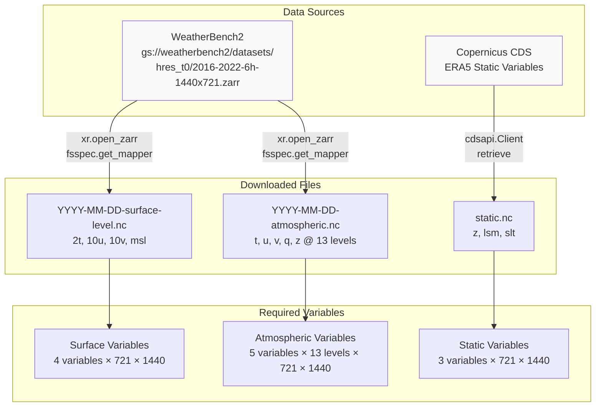
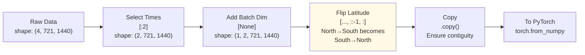
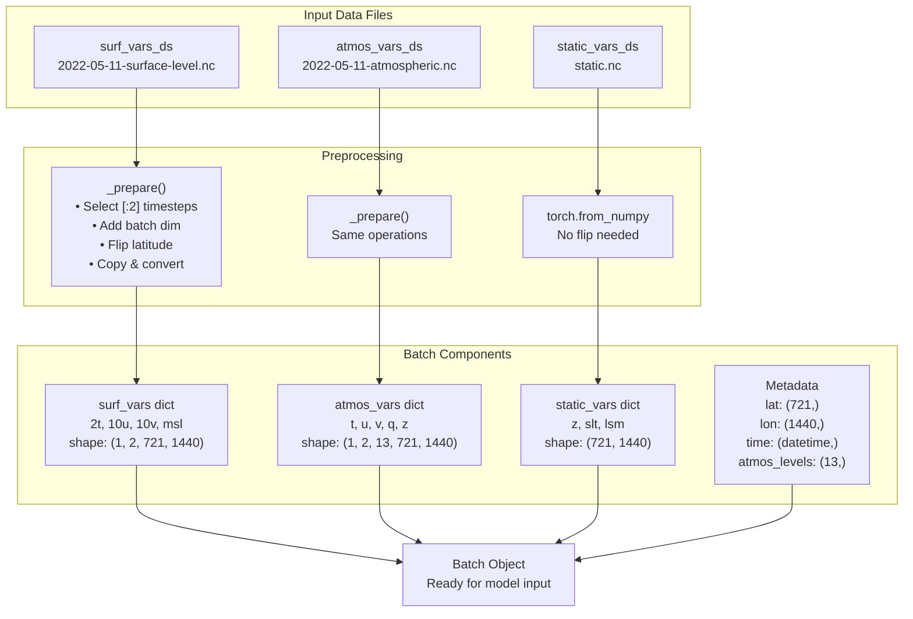
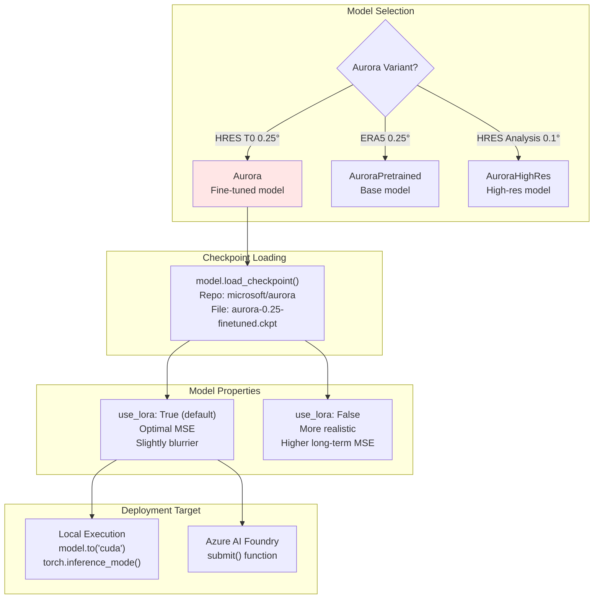
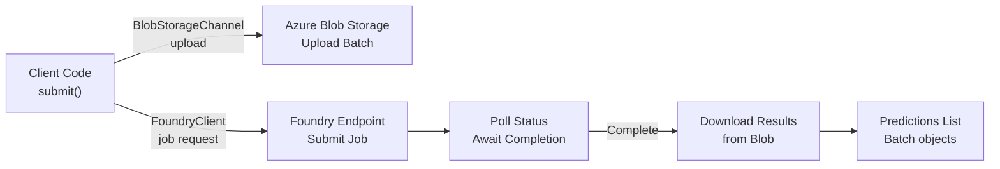
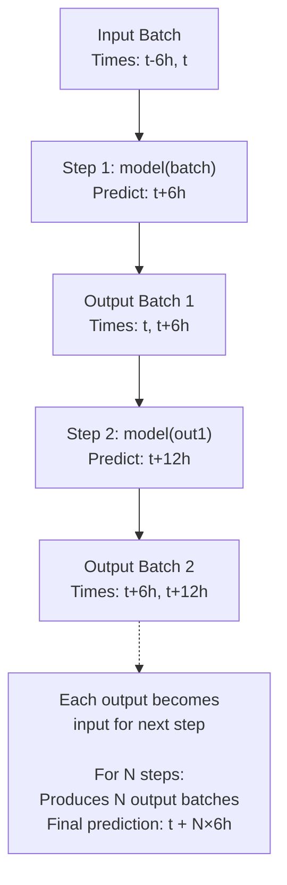
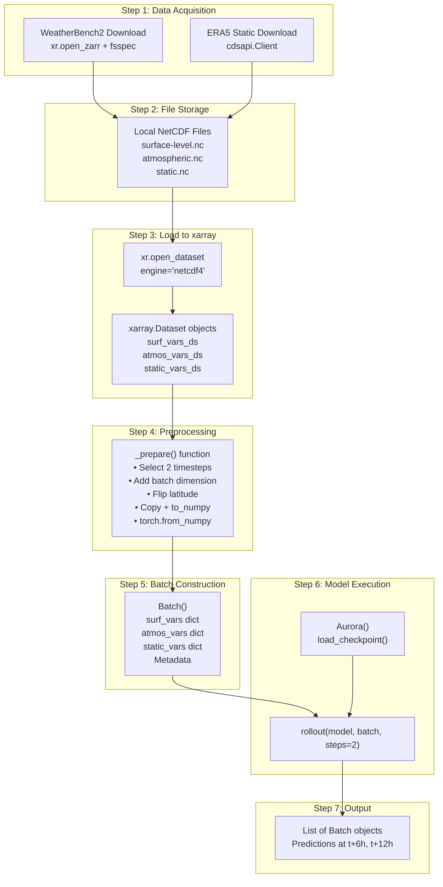

<!-- source: DeepWiki mcp.deepwiki.com · repo microsoft/aurora · page 4.3 Example: HRES T0 Data · fetched 2026-10-26 -->

# Example: HRES T0 Data

<details>
<summary>Relevant source files</summary>

The following files were used as context for generating this wiki page:

- [docs/example_cams.ipynb](docs/example_cams.ipynb)
- [docs/example_hres_t0.ipynb](docs/example_hres_t0.ipynb)
- [docs/example_wave.ipynb](docs/example_wave.ipynb)
- [docs/models.md](docs/models.md)

</details>


This page demonstrates using Aurora 0.25° Fine-Tuned with IFS HRES T0 operational forecast data from WeatherBench2. For ERA5 data usage, see [Example: ERA5 Data](#4.2). For high-resolution 0.1° analysis data, see [Example: High-Resolution Data](#4.4).

**Key Point:** Aurora 0.25° Fine-Tuned (`Aurora` class) is specifically fine-tuned on IFS HRES T0 data and delivers optimal performance only with this dataset. HRES T0 (operational forecast) differs from HRES analysis data.

---

## Overview

This example covers the complete workflow:

1. Downloading HRES T0 data from WeatherBench2 at 0.25° resolution
2. Obtaining ERA5 static variables
3. Constructing a `Batch` object with proper preprocessing
4. Loading and executing the fine-tuned Aurora model
5. Running predictions locally or on Azure AI Foundry

Sources: [docs/example_hres_t0.ipynb:1-38](), [docs/models.md:63-103]()

---

## HRES T0 Dataset Characteristics

**Data Source:** WeatherBench2 hosts IFS HRES T0 forecasts in Zarr format on Google Cloud Storage.

**Resolution:** 0.25° spatial resolution (1440×721 grid)

**Variables Required:**
- Surface: `2t`, `10u`, `10v`, `msl`
- Atmospheric: `t`, `u`, `v`, `q`, `z` at 13 pressure levels (50, 100, 150, 200, 250, 300, 400, 500, 600, 700, 850, 925, 1000 hPa)
- Static: `lsm`, `slt`, `z` (from ERA5)



Sources: [docs/example_hres_t0.ipynb:38-81](), [docs/models.md:87-95]()

---

## Data Acquisition

### WeatherBench2 HRES T0 Data

```python
import fsspec
import xarray as xr

url = "gs://weatherbench2/datasets/hres_t0/2016-2022-6h-1440x721.zarr"
ds = xr.open_zarr(fsspec.get_mapper(url), chunks=None)

day = "2022-05-11"

# Surface variables
surface_vars = ["10m_u_component_of_wind", "10m_v_component_of_wind", 
                "2m_temperature", "mean_sea_level_pressure"]
ds_surf = ds[surface_vars].sel(time=day).compute()

# Atmospheric variables
atmos_vars = ["temperature", "u_component_of_wind", "v_component_of_wind",
              "specific_humidity", "geopotential"]
ds_atmos = ds[atmos_vars].sel(time=day).compute()
```

**Key Details:**
- Uses `fsspec` to access Google Cloud Storage
- Data dimensions: `(time: 4, latitude: 721, longitude: 1440, level: 13)`
- Latitude ordering: **North to South** (90° to -90°)
- Time steps: 6-hourly (00:00, 06:00, 12:00, 18:00)

Sources: [docs/example_hres_t0.ipynb:38-81]()

### ERA5 Static Variables

Static variables must be obtained from ERA5 using the Copernicus Climate Data Store API:

```python
import cdsapi

c = cdsapi.Client()
c.retrieve(
    "reanalysis-era5-single-levels",
    {
        "product_type": "reanalysis",
        "variable": ["geopotential", "land_sea_mask", "soil_type"],
        "year": "2023",
        "month": "01",
        "day": "01",
        "time": "00:00",
        "format": "netcdf",
    },
    "static.nc",
)
```

**Important:** Pre-downloaded static variables are available on HuggingFace: `aurora-0.25-static.pickle`

Sources: [docs/example_hres_t0.ipynb:84-151](), [docs/models.md:97-102]()

---

## Batch Preparation Pipeline

### Data Preprocessing Function

The preprocessing function `_prepare()` performs critical transformations:



**Critical:** WeatherBench2 data has descending latitudes (90° to -90°), but Aurora expects ascending order (-90° to 90°). The flip operation `[..., ::-1, :]` corrects this.

Sources: [docs/example_hres_t0.ipynb:169-192]()

### Batch Construction



**Key Implementation:**

```python
from aurora import Batch, Metadata

batch = Batch(
    surf_vars={
        "2t": _prepare(surf_vars_ds["2m_temperature"].values),
        "10u": _prepare(surf_vars_ds["10m_u_component_of_wind"].values),
        "10v": _prepare(surf_vars_ds["10m_v_component_of_wind"].values),
        "msl": _prepare(surf_vars_ds["mean_sea_level_pressure"].values),
    },
    static_vars={
        "z": torch.from_numpy(static_vars_ds["z"].values[0]),
        "slt": torch.from_numpy(static_vars_ds["slt"].values[0]),
        "lsm": torch.from_numpy(static_vars_ds["lsm"].values[0]),
    },
    atmos_vars={
        "t": _prepare(atmos_vars_ds["temperature"].values),
        "u": _prepare(atmos_vars_ds["u_component_of_wind"].values),
        "v": _prepare(atmos_vars_ds["v_component_of_wind"].values),
        "q": _prepare(atmos_vars_ds["specific_humidity"].values),
        "z": _prepare(atmos_vars_ds["geopotential"].values),
    },
    metadata=Metadata(
        lat=torch.from_numpy(surf_vars_ds.latitude.values[::-1].copy()),
        lon=torch.from_numpy(surf_vars_ds.longitude.values),
        time=(surf_vars_ds.time.values.astype("datetime64[s]").tolist()[1],),
        atmos_levels=tuple(int(level) for level in atmos_vars_ds.level.values),
    ),
)
```

**Metadata Requirements:**
- `lat`: Must be flipped to ascending order
- `time`: Tuple containing datetime for second timestep (06:00)
- `atmos_levels`: Tuple of pressure levels as integers

Sources: [docs/example_hres_t0.ipynb:158-229]()

---

## Model Loading and Execution

### Model Configuration



Sources: [docs/example_hres_t0.ipynb:236-274](), [docs/models.md:63-122]()

### Local Execution

```python
from aurora import Aurora, rollout

# Load model
model = Aurora()
model.load_checkpoint("microsoft/aurora", "aurora-0.25-finetuned.ckpt")

# Prepare for inference
model.eval()
model = model.to("cuda")

# Run rollout
with torch.inference_mode():
    predictions = [pred.to("cpu") for pred in rollout(model, batch, steps=2)]

model = model.to("cpu")
```

**Execution Flow:**
1. `Aurora()` instantiates the fine-tuned model class
2. `load_checkpoint()` loads weights from HuggingFace
3. `model.eval()` sets model to evaluation mode
4. `model.to("cuda")` moves model to GPU
5. `rollout(model, batch, steps=2)` performs 2-step autoregressive prediction
6. Results moved back to CPU for processing

Sources: [docs/example_hres_t0.ipynb:255-274]()

### Azure AI Foundry Execution

```python
from aurora.foundry import BlobStorageChannel, FoundryClient, submit
import os

# Configure clients
foundry_client = FoundryClient(
    endpoint=os.environ["FOUNDRY_ENDPOINT"],
    token=os.environ["FOUNDRY_TOKEN"],
)
channel = BlobStorageChannel(os.environ["BLOB_URL_WITH_SAS"])

# Submit job
predictions = list(
    submit(
        batch,
        model_name="aurora-0.25-finetuned",
        num_steps=2,
        foundry_client=foundry_client,
        channel=channel,
    )
)
```

**Architecture:**



**Environment Variables:**
- `FOUNDRY_ENDPOINT`: Azure Foundry endpoint URL
- `FOUNDRY_TOKEN`: Authentication token
- `BLOB_URL_WITH_SAS`: Azure Blob Storage URL with SAS token

Sources: [docs/example_hres_t0.ipynb:277-312]()

---

## Rollout Mechanics

The `rollout()` function performs autoregressive predictions:



**Input:** 
- Initial batch with 2 timesteps (t-6h, t)

**Output:** 
- Generator yielding `steps` batches
- Each batch contains predictions for the next 6-hour window
- For `steps=2`: produces predictions at t+6h and t+12h

Sources: [docs/example_hres_t0.ipynb:255-274]()

---

## Variable Naming Mappings

Aurora uses short variable names internally. The mapping from WeatherBench2 names:

| WeatherBench2 Name | Aurora Name | Description |
|---|---|---|
| `2m_temperature` | `2t` | 2-meter temperature |
| `10m_u_component_of_wind` | `10u` | 10-meter U wind component |
| `10m_v_component_of_wind` | `10v` | 10-meter V wind component |
| `mean_sea_level_pressure` | `msl` | Mean sea level pressure |
| `temperature` | `t` | Temperature (atmospheric) |
| `u_component_of_wind` | `u` | U wind component (atmospheric) |
| `v_component_of_wind` | `v` | V wind component (atmospheric) |
| `specific_humidity` | `q` | Specific humidity |
| `geopotential` | `z` | Geopotential (atmospheric) |
| `geopotential` (static) | `z` | Geopotential (static) |
| `land_sea_mask` | `lsm` | Land-sea mask |
| `soil_type` | `slt` | Soil type |

Sources: [docs/example_hres_t0.ipynb:194-228]()

---

## Complete Workflow Diagram



Sources: [docs/example_hres_t0.ipynb:1-312]()

---

## Common Issues and Solutions

### Latitude Order Mismatch

**Problem:** WeatherBench2 uses descending latitude order (90° to -90°), but Aurora expects ascending (-90° to 90°).

**Solution:** Apply `[::-1]` flip during preprocessing and metadata construction:
```python
torch.from_numpy(x[:2][None][..., ::-1, :].copy())  # Data
torch.from_numpy(surf_vars_ds.latitude.values[::-1].copy())  # Metadata
```

### Non-Contiguous Arrays

**Problem:** NumPy arrays must be contiguous for PyTorch conversion.

**Solution:** Call `.copy()` after flipping operations to ensure contiguity.

### Time Metadata Format

**Problem:** Metadata requires specific datetime format.

**Solution:** Convert to `datetime64[s]` and extract as Python datetime:
```python
time=(surf_vars_ds.time.values.astype("datetime64[s]").tolist()[1],)
```

### Wrong Model Variant

**Problem:** Using `AuroraPretrained` instead of `Aurora` for HRES T0 data.

**Solution:** Use `Aurora()` class specifically for HRES T0 fine-tuned model.

Sources: [docs/example_hres_t0.ipynb:169-229](), [docs/models.md:77-85]()

---

## Performance Considerations

### LoRA Configuration

Aurora 0.25° Fine-Tuned supports two modes via the `use_lora` parameter:

| Configuration | MSE Performance | Visual Quality | Use Case |
|---|---|---|---|
| `use_lora=True` (default) | Optimal long-term MSE | Slightly blurrier | Minimizing forecast error |
| `use_lora=False` | Higher long-term MSE | More realistic | Qualitative analysis |

To disable LoRA:
```python
model = Aurora(use_lora=False)
model.load_checkpoint(strict=False)
```

Sources: [docs/models.md:104-122]()

### Dataset Specificity

Aurora 0.25° Fine-Tuned is optimized exclusively for IFS HRES T0 data. Using it with other datasets (ERA5, HRES analysis) will produce suboptimal results. For other datasets:
- ERA5: Use `AuroraPretrained` ([Section 4.2](#4.2))
- HRES Analysis 0.1°: Use `AuroraHighRes` ([Section 4.4](#4.4))

Sources: [docs/models.md:77-85]()

---

## Code Entity Reference

**Key Classes:**
- `Aurora`: Fine-tuned model class for HRES T0 [aurora/model.py]()
- `Batch`: Data container class [aurora/batch.py]()
- `Metadata`: Metadata container [aurora/batch.py]()

**Key Functions:**
- `rollout(model, batch, steps)`: Autoregressive prediction [aurora/rollout.py]()
- `load_checkpoint(repo_id, filename)`: Checkpoint loading [aurora/model.py]()
- `submit(batch, model_name, num_steps, ...)`: Foundry submission [aurora/foundry/submit.py]()

**Model Checkpoint:**
- HuggingFace repo: `microsoft/aurora`
- Checkpoint file: `aurora-0.25-finetuned.ckpt`
- Static variables: `aurora-0.25-static.pickle`

Sources: [docs/example_hres_t0.ipynb:1-312](), [docs/models.md:63-103]()

---

