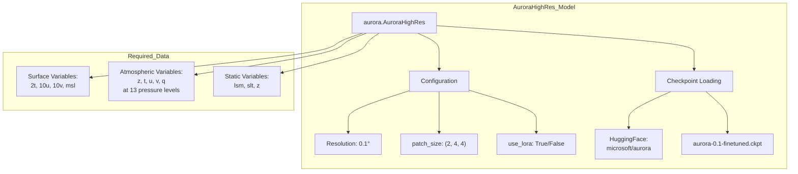
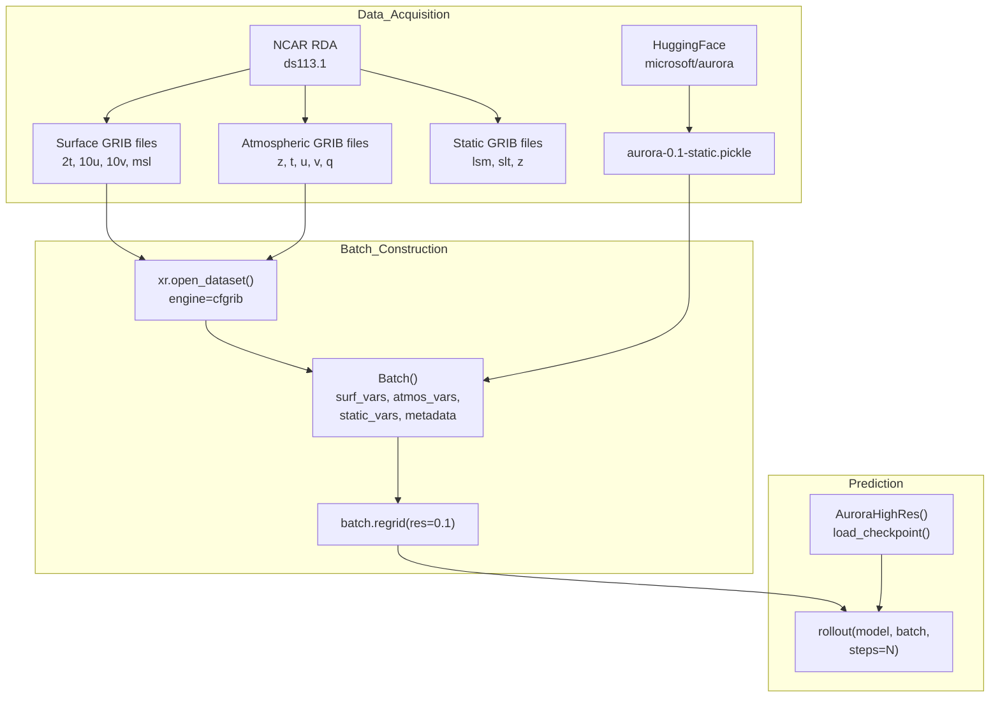

<!-- source: DeepWiki mcp.deepwiki.com · repo microsoft/aurora · page 4.4 Example: High-Resolution Data · fetched 2026-10-26 -->

# Example: High-Resolution Data

<details>
<summary>Relevant source files</summary>

The following files were used as context for generating this wiki page:

- [.pre-commit-config.yaml](.pre-commit-config.yaml)
- [docs/example_hres_0.1.ipynb](docs/example_hres_0.1.ipynb)
- [docs/models.md](docs/models.md)

</details>


This document demonstrates using `AuroraHighRes` for high-resolution (0.1°) weather predictions with IFS HRES analysis data. The 0.1° resolution provides approximately 6.25× more spatial detail than the standard 0.25° resolution, with grid dimensions of `(1801, 3600)` versus `(721, 1440)`.

**Important:** `AuroraHighRes` is fine-tuned specifically for IFS HRES analysis data at 0.1° resolution. This is different from IFS HRES T0 data (which is used by the standard `Aurora` model). Using this model with other data sources may impact performance.

## Model: AuroraHighRes

The `AuroraHighRes` class provides high-resolution forecasting capabilities through fine-tuning of the base Aurora architecture on IFS HRES analysis data.

Diagram: AuroraHighRes Model Configuration



Sources: [docs/models.md:158-234](), [docs/example_hres_0.1.ipynb:262-277]()

### Key Configuration Options

| Parameter | Purpose | Options |
|-----------|---------|---------|
| `use_lora` | LoRA adaptation mode | `True` (optimal long-term MSE), `False` (more realistic predictions) |
| `surf_stats` | Surface variable normalization | Default or custom `{"z": (location, scale)}` for manually regridded static variables |
| `patch_size` | Encoder patch dimensions | `(2, 4, 4)` for high-resolution |

Sources: [docs/models.md:224-234](), [docs/models.md:206-223]()

## Data Requirements

### IFS HRES Analysis Data (0.1°)

The model requires IFS HRES analysis data at 0.1° resolution from the [NCAR Research Data Archive (RDA) dataset ds113.1](https://rda.ucar.edu/datasets/d113001/).

Required variables at 0.1° resolution (1801×3600 grid):

| Category | Variables | Pressure Levels (hPa) |
|----------|-----------|----------------------|
| Surface | `2t`, `10u`, `10v`, `msl` | N/A |
| Atmospheric | `z`, `t`, `u`, `v`, `q` | 50, 100, 150, 200, 250, 300, 400, 500, 600, 700, 850, 925, 1000 |
| Static | `lsm`, `slt`, `z` | N/A |

Sources: [docs/models.md:183-191](), [docs/example_hres_0.1.ipynb:53-82]()

### Static Variables

Use the pre-processed static variables from HuggingFace to ensure correct normalization:

```python
from huggingface_hub import hf_hub_download

static_path = hf_hub_download(
    repo_id="microsoft/aurora",
    filename="aurora-0.1-static.pickle",
)
```

**Important:** Due to differences in regridding implementations, using the exact static variables from HuggingFace is recommended. If you manually regrid static variables from RDA, adjust the normalization statistics using the `surf_stats` parameter when initializing `AuroraHighRes`.

Sources: [docs/models.md:194-223](), [docs/example_hres_0.1.ipynb:120-129]()

## Workflow: Loading Data and Making Predictions

The complete workflow involves downloading data, constructing a `Batch`, loading the model, and running predictions.

Diagram: High-Resolution Data Processing Workflow



Sources: [docs/example_hres_0.1.ipynb:38-227]()

### Step 1: Download Data from RDA

Download surface and atmospheric variables from the Research Data Archive for your target date:

```python
from datetime import datetime
from pathlib import Path
import requests

download_path = Path("~/downloads/hres_0.1").expanduser()
date = datetime(2022, 5, 11)

# Variable numbers for RDA API
var_nums = {
    "2t": "167", "10u": "165", "10v": "166", "msl": "151",
    "t": "130", "u": "131", "v": "132", "q": "133", "z": "129",
    "slt": "043", "lsm": "172",
}

# Download surface variables
for v in ["2t", "10u", "10v", "msl", "z", "slt", "lsm"]:
    url = (
        f"https://data.rda.ucar.edu/d113001/"
        f"ec.oper.an.sfc/{date.year}{date.month:02d}/"
        f"ec.oper.an.sfc.128_{var_nums[v]}_{v}."
        f"regn1280sc.{date.year}{date.month:02d}{date.day:02d}.grb"
    )
    # Download logic...

# Download atmospheric variables at each analysis time
for v in ["z", "t", "u", "v", "q"]:
    for hour in [0, 6, 12, 18]:
        url = (
            f"https://data.rda.ucar.edu/d113001/"
            f"ec.oper.an.pl/{date.year}{date.month:02d}/"
            f"ec.oper.an.pl.128_{var_nums[v]}_{v}."
            f"regn1280{prefix}.{date.year}{date.month:02d}{date.day:02d}{hour:02d}.grb"
        )
        # Download logic...
```

Sources: [docs/example_hres_0.1.ipynb:38-94]()

### Step 2: Download Static Variables

Download the pre-processed static variables from HuggingFace:

```python
from huggingface_hub import hf_hub_download

static_path = hf_hub_download(
    repo_id="microsoft/aurora",
    filename="aurora-0.1-static.pickle",
)
```

Sources: [docs/example_hres_0.1.ipynb:120-129]()

### Step 3: Construct the Batch

Load the GRIB files and construct a `Batch` object with the required two-timestep history:

```python
import numpy as np
import torch
import xarray as xr
from aurora import Batch, Metadata

# Define pressure levels
levels = (1000, 925, 850, 700, 600, 500, 400, 300, 250, 200, 150, 100, 50)

def load_surf(v: str, v_in_file: str) -> torch.Tensor:
    """Load surface variable for hours 00 and 06."""
    ds = xr.open_dataset(
        download_path / date.strftime(f"surf_{v}_%Y-%m-%d.grib"),
        engine="cfgrib"
    )
    data = ds[v_in_file].values[:2]  # First two timesteps
    data = data[None]  # Add batch dimension
    return torch.from_numpy(data)

def load_atmos(v: str) -> torch.Tensor:
    """Load atmospheric variable for hours 00 and 06."""
    ds_00 = xr.open_dataset(
        download_path / date.strftime(f"atmos_{v}_%Y-%m-%d_00.grib"),
        engine="cfgrib"
    )
    ds_06 = xr.open_dataset(
        download_path / date.strftime(f"atmos_{v}_%Y-%m-%d_06.grib"),
        engine="cfgrib"
    )
    # Select pressure levels
    ds_00 = ds_00[v].sel(isobaricInhPa=list(levels))
    ds_06 = ds_06[v].sel(isobaricInhPa=list(levels))
    data = np.stack((ds_00.values, ds_06.values), axis=0)
    data = data[None]  # Add batch dimension
    return torch.from_numpy(data)

# Extract latitude/longitude from downloaded data
ds = xr.open_dataset(next(iter(downloads.keys())), engine="cfgrib")

batch = Batch(
    surf_vars={
        "2t": load_surf("2t", "t2m"),
        "10u": load_surf("10u", "u10"),
        "10v": load_surf("10v", "v10"),
        "msl": load_surf("msl", "msl"),
    },
    static_vars={},  # Will be set after regridding
    atmos_vars={
        "t": load_atmos("t"),
        "u": load_atmos("u"),
        "v": load_atmos("v"),
        "q": load_atmos("q"),
        "z": load_atmos("z"),
    },
    metadata=Metadata(
        lat=torch.from_numpy(ds.latitude.values),
        lon=torch.from_numpy(ds.longitude.values),
        time=(date.replace(hour=6),),
        atmos_levels=levels,
    ),
)
```

Sources: [docs/example_hres_0.1.ipynb:142-208]()

### Step 4: Regrid and Add Static Variables

Regrid the batch to exactly 0.1° resolution and load the static variables:

```python
import pickle

# Regrid to 0.1 degrees
batch = batch.regrid(res=0.1)

# Load and add static variables
with open(static_path, "rb") as f:
    static_vars = pickle.load(f)
batch.static_vars = {k: torch.from_numpy(v) for k, v in static_vars.items()}
```

**Note:** The `batch.regrid()` function is a convenience method that may not be optimized for speed or accuracy. It is provided for demonstration purposes.

Sources: [docs/example_hres_0.1.ipynb:216-227]()

### Step 5: Load Model and Run Predictions

Load the `AuroraHighRes` model and generate predictions:

```python
from aurora import AuroraHighRes, rollout

# Initialize model
model = AuroraHighRes()
model.load_checkpoint("microsoft/aurora", "aurora-0.1-finetuned.ckpt")

# Set to evaluation mode and move to GPU
model.eval()
model = model.to("cuda")

# Generate predictions
with torch.inference_mode():
    preds = [pred.to("cpu") for pred in rollout(model, batch, steps=2)]

# Move model back to CPU
model = model.to("cpu")
```

This generates predictions at 12:00 and 18:00 (two 6-hour steps forward).

Sources: [docs/example_hres_0.1.ipynb:254-277]()

### Optional: Disable LoRA for More Realistic Predictions

For more realistic predictions at the expense of slightly higher long-term MSE:

```python
model = AuroraHighRes(use_lora=False)
model.load_checkpoint("microsoft/aurora", "aurora-0.1-finetuned.ckpt", strict=False)
```

Sources: [docs/models.md:224-234]()

## Technical Considerations

### Memory Requirements

High-resolution data processing requires significant computational resources:

| Consideration | Standard Resolution (0.25°) | High Resolution (0.1°) | Impact |
|---------------|----------------------------|------------------------|--------|
| Grid points | ~1 million (721×1440) | ~6.5 million (1801×3600) | ~6.25× memory requirement |
| Model parameters | Base configuration | Optimized for high-res | Potentially larger model |
| Processing time | Baseline | 3-5× longer | Increased computation time |
| Storage requirements | Baseline | ~6.25× larger files | More storage needed |

### Optimization Strategies

When working with high-resolution data, consider these optimization approaches:

1. **Memory Management**:
   - Process smaller geographic regions if global processing exceeds resources
   - Reduce the number of time steps processed simultaneously

2. **Computational Efficiency**:
   - Use GPU acceleration (16GB+ VRAM recommended)
   - Consider mixed precision to reduce memory usage

3. **I/O Optimization**:
   - Use chunked reading for efficient data loading
   - Implement parallel processing where appropriate

## Complete Example Workflow

Below is a complete example workflow for using Aurora with high-resolution HRES data:

```python
import torch
import xarray as xr
from aurora.model import aurora
from aurora.batch import Batch

# 1. Initialize the high-resolution model
model = aurora.AuroraHighRes()
model.eval()  # Set to evaluation mode

# 2. Load high-resolution HRES data
ds_highres = xr.open_dataset("path/to/hres_01deg_data.nc")

# 3. Create batch with appropriate variable structure
batch = Batch.from_xarray(
    ds_highres,
    surface=["2t", "10u", "10v", "msl"],
    pressure_level=["z", "t", "u", "v", "q"],
    static=["lsm", "z", "slt"],
    metadata=["lat", "lon"]
)

# 4. Normalize the batch
batch.normalize()

# 5. Process through model (with appropriate memory handling)
with torch.no_grad():  # Disable gradient calculation for inference
    output_batch = model(batch)

# 6. Unnormalize the results
output_batch.unnormalize()

# 7. Convert to xarray for analysis and visualization
result_ds = output_batch.to_xarray()

# 8. Save or visualize results
result_ds.to_netcdf("highres_forecast_output.nc")
```

## Conclusion

Working with high-resolution (0.1°) HRES data in Aurora provides more detailed weather forecasts but requires additional computational resources and the specialized `AuroraHighRes` model variant. By following the workflow described in this document, you can effectively process high-resolution HRES data to produce detailed weather forecasts.

For information about using Aurora with standard resolution HRES data, see [Example: HRES T0 Data](#4.2). For information about using Aurora with ERA5 reanalysis data, see [Example: ERA5 Data](#4.1).

---

