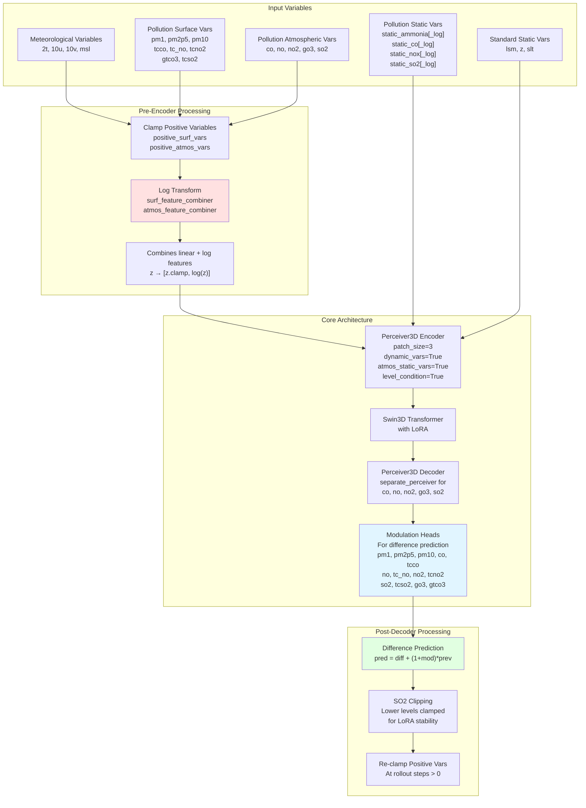
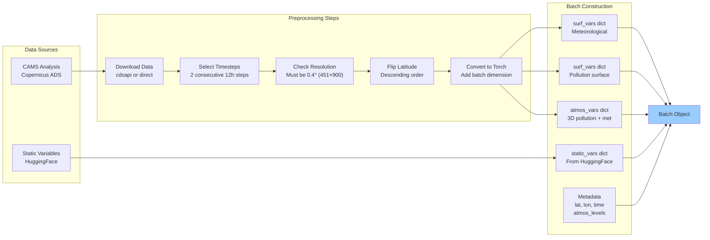
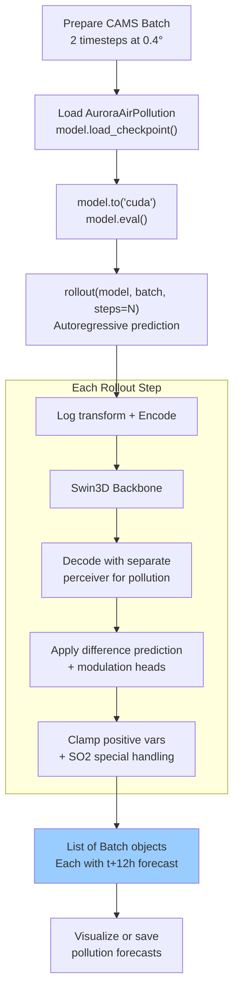

<!-- source: DeepWiki mcp.deepwiki.com · repo microsoft/aurora · page 4.5 Example: Air Pollution · fetched 2026-10-26 -->

# Example: Air Pollution

<details>
<summary>Relevant source files</summary>

The following files were used as context for generating this wiki page:

- [aurora/model/aurora.py](aurora/model/aurora.py)
- [docs/example_cams.ipynb](docs/example_cams.ipynb)
- [docs/example_wave.ipynb](docs/example_wave.ipynb)
- [docs/models.md](docs/models.md)

</details>


## Purpose and Scope

This page demonstrates how to use `AuroraAirPollution` to produce air quality forecasts using CAMS (Copernicus Atmosphere Monitoring Service) analysis data. This model extends the base Aurora architecture with pollution-specific variables, transformations, and prediction mechanisms. For general information about Aurora model variants, see [Model Variants](#2.4). For fine-tuning Aurora models, see [Fine-tuning](#5).

---

## Overview of CAMS and Aurora Air Pollution

The Copernicus Atmosphere Monitoring Service (CAMS) provides global atmospheric composition forecasts, including concentrations of various pollutants. Aurora 0.4° Air Pollution is Aurora 0.25° Pretrained fine-tuned specifically on CAMS analysis data at 0.4° resolution (dimensions: 451 × 900).

**Key characteristics:**
- **Resolution:** 0.4° (coarser than standard Aurora models)
- **Timestep:** 12 hours (unlike the standard 6-hour timestep)
- **Domain:** Air quality prediction with atmospheric chemistry variables
- **Base architecture:** Extends Aurora with pollution-specific processing

**Sources:** [aurora/model/aurora.py:646-714](), [docs/models.md:236-276]()

---

## Model Architecture and Special Features



**Aurora Air Pollution Architecture**

The model introduces several specialized components:

| Component | Purpose | Location |
|-----------|---------|----------|
| `surf_feature_combiner` | Combines linear and log-transformed pollution variables | [aurora/model/aurora.py:716-718]() |
| `atmos_feature_combiner` | Combines linear and log-transformed atmospheric pollution | [aurora/model/aurora.py:719-721]() |
| `_pre_encoder_hook` | Applies log transformation before encoding | [aurora/model/aurora.py:726-758]() |
| `_post_decoder_hook` | Applies difference prediction and SO2 clipping | [aurora/model/aurora.py:760-796]() |
| `modulation_heads` | Enables prediction of differences rather than absolute values | [aurora/model/aurora.py:691]() |
| `separate_perceiver` | Dedicated decoder path for pollution variables | [aurora/model/aurora.py:690]() |

**Sources:** [aurora/model/aurora.py:646-802](), [docs/models.md:262-276]()

---

## Data Requirements

Aurora 0.4° Air Pollution requires a specific set of variables and static fields:

### Required Variables Table

| Category | Variables | Details |
|----------|-----------|---------|
| **Surface (Meteorological)** | `2t`, `10u`, `10v`, `msl` | Standard meteorological variables |
| **Surface (Pollution)** | `pm1`, `pm2p5`, `pm10` | Particulate matter concentrations |
| | `tcco`, `tc_no`, `tcno2` | Total column concentrations |
| | `tcso2`, `gtco3` | Sulfur dioxide and ozone total columns |
| **Atmospheric (Meteorological)** | `z`, `u`, `v`, `t`, `q` | Standard atmospheric variables |
| **Atmospheric (Pollution)** | `co`, `no`, `no2`, `so2`, `go3` | 3D pollution concentrations |
| **Static (Standard)** | `lsm`, `z`, `slt` | Land-sea mask, orography, soil type |
| **Static (Pollution)** | `static_ammonia`, `static_ammonia_log` | Ammonia emission statistics |
| | `static_co`, `static_co_log` | Carbon monoxide emission statistics |
| | `static_nox`, `static_nox_log` | Nitrogen oxides emission statistics |
| | `static_so2`, `static_so2_log` | Sulfur dioxide emission statistics |

### Pressure Levels

The model requires data at 13 pressure levels (hPa):
```
50, 100, 150, 200, 250, 300, 400, 500, 600, 700, 850, 925, 1000
```

### Resolution

- **Spatial:** 0.4° (451 latitude × 900 longitude)
- **Temporal:** 12-hour timestep
- **History:** 2 timesteps (current and previous)

**Sources:** [aurora/model/aurora.py:670-682](), [docs/models.md:262-276]()

---

## Data Preparation Workflow



**Data Preparation Pipeline**

### Step 1: Download CAMS Data

CAMS data can be obtained from the [Copernicus Atmosphere Data Store](https://ads.atmosphere.copernicus.eu/datasets/cams-global-atmospheric-composition-forecasts). You'll need to register and set up API credentials.

### Step 2: Prepare Variables

The data must be preprocessed to match Aurora's expectations:

1. **Select two consecutive 12-hour timesteps** (e.g., 00:00 and 12:00)
2. **Ensure 0.4° resolution** (451 × 900 grid)
3. **Flip latitude to descending order** (North to South)
4. **Convert to PyTorch tensors** with batch dimension

Example structure:
```python
# Shape: [batch=1, time=2, lat=451, lon=900]
surf_var = torch.from_numpy(data[:2][None][..., ::-1, :].copy())

# Shape: [batch=1, time=2, levels=13, lat=451, lon=900]
atmos_var = torch.from_numpy(data[:2][None][..., ::-1, :].copy())
```

### Step 3: Load Static Variables

Static variables must be downloaded from HuggingFace:

```python
from huggingface_hub import hf_hub_download
import pickle

static_path = hf_hub_download(
    repo_id="microsoft/aurora",
    filename="aurora-0.4-air-pollution-static.pickle",
)

with open(static_path, "rb") as f:
    static_vars = pickle.load(f)
```

### Step 4: Construct Batch

```python
from aurora import Batch, Metadata

batch = Batch(
    surf_vars={
        # Meteorological
        "2t": surf_2t,
        "10u": surf_10u,
        "10v": surf_10v,
        "msl": surf_msl,
        # Pollution
        "pm1": surf_pm1,
        "pm2p5": surf_pm2p5,
        "pm10": surf_pm10,
        "tcco": surf_tcco,
        "tc_no": surf_tc_no,
        "tcno2": surf_tcno2,
        "tcso2": surf_tcso2,
        "gtco3": surf_gtco3,
    },
    atmos_vars={
        # Meteorological
        "z": atmos_z,
        "u": atmos_u,
        "v": atmos_v,
        "t": atmos_t,
        "q": atmos_q,
        # Pollution
        "co": atmos_co,
        "no": atmos_no,
        "no2": atmos_no2,
        "so2": atmos_so2,
        "go3": atmos_go3,
    },
    static_vars={k: torch.from_numpy(v) for k, v in static_vars.items()},
    metadata=Metadata(
        lat=torch.from_numpy(lat_array[::-1].copy()),
        lon=torch.from_numpy(lon_array),
        time=(time_at_index_1,),  # Second timestep
        atmos_levels=(50, 100, 150, 200, 250, 300, 400, 500, 600, 700, 850, 925, 1000),
    ),
)
```

**Sources:** [aurora/batch.py](), [docs/models.md:272-276]()

---

## Log Transformation Details

A critical preprocessing step for pollution variables involves a specialized log transformation. This addresses the "spiky" nature of pollution concentrations that can span several orders of magnitude.

### Transformation Function

The transformation combines a clamped linear component with a log component:

```
For each pollution variable z:
1. Linear component: z.clamp(min=0, max=2.5)
2. Log component: (log(z.clamp(min=ε)) - log(ε)) / (-log(ε))
   where ε = 1e-4
3. Combine: feature_combiner([linear, log])
```

The `feature_combiner` is a learned linear layer (initialized with weights=0.5) that blends these two representations. This allows the model to handle both typical and extreme pollution values effectively.

### Applied Variables

| Surface Variables | Atmospheric Variables |
|-------------------|----------------------|
| `pm1`, `pm2p5`, `pm10` | `co`, `no`, `no2` |
| `tcco`, `tc_no`, `tcno2` | `so2`, `go3` |
| `tcso2`, `gtco3` | |

**Sources:** [aurora/model/aurora.py:726-758]()

---

## Difference Prediction Mechanism

Unlike standard Aurora models that predict absolute values, Aurora Air Pollution uses **difference prediction** for pollution variables. This improves stability and captures the temporal evolution of pollutant concentrations.

### How It Works

For each pollution variable with a modulation head:

```
prediction = difference + (1 + modulation) * previous_value
```

Where:
- `difference`: The base prediction from the decoder
- `modulation`: Additional learned adjustment from the modulation head
- `previous_value`: Value from the appropriate history timestep

### History Dimension Lookup

Different variables reference different history timesteps:

| Variable | History Index | Time Reference |
|----------|---------------|----------------|
| `pm1`, `pm2p5`, `pm10` | 0 | 12 hours ago |
| `no`, `tc_no`, `no2`, `tcno2` | 0 | 12 hours ago |
| `co`, `tcco` | 1 | 24 hours ago |
| `so2`, `tcso2` | 1 | 24 hours ago |
| `go3`, `gtco3` | 1 | 24 hours ago |

This asymmetry reflects the different persistence timescales of various pollutants.

**Sources:** [aurora/model/aurora.py:652-668](), [aurora/model/aurora.py:760-783]()

---

## Running Predictions

### Local Execution

```python
from aurora import AuroraAirPollution, rollout
import torch

# Load model
model = AuroraAirPollution()
model.load_checkpoint()

# Move to GPU
model.eval()
model = model.to("cuda")

# Run prediction
with torch.inference_mode():
    predictions = [pred.to("cpu") for pred in rollout(model, batch, steps=4)]

# Move model back to CPU
model = model.to("cpu")
```

### Azure AI Foundry Execution

```python
import os
from aurora.foundry import BlobStorageChannel, FoundryClient, submit

foundry_client = FoundryClient(
    endpoint=os.environ["FOUNDRY_ENDPOINT"],
    token=os.environ["FOUNDRY_TOKEN"],
)
channel = BlobStorageChannel(os.environ["BLOB_URL_WITH_SAS"])

predictions = list(
    submit(
        batch,
        model_name="aurora-0.4-air-pollution",
        num_steps=4,
        foundry_client=foundry_client,
        channel=channel,
    )
)
```

**Sources:** [aurora/model/aurora.py:646-714](), [docs/example_wave.ipynb:370-421]()

---

## Understanding Predictions and Special Behaviors

### Output Structure

Each prediction in the rollout sequence is a `Batch` object containing:

```python
# Access surface pollution variables
pm1_forecast = predictions[0].surf_vars["pm1"]  # Shape: [1, 1, 451, 900]
pm2p5_forecast = predictions[0].surf_vars["pm2p5"]

# Access atmospheric pollution variables (3D)
co_forecast = predictions[0].atmos_vars["co"]  # Shape: [1, 1, 13, 451, 900]
no2_forecast = predictions[0].atmos_vars["no2"]
```

### Positive Variable Clamping

All pollution variables are constrained to be non-negative. After the first rollout step, the model automatically clamps:

- **Surface:** `pm1`, `pm2p5`, `pm10`, `tcco`, `tc_no`, `tcno2`, `gtco3`, `tcso2`
- **Atmospheric:** `co`, `no`, `no2`, `go3`, `so2`

This is handled automatically by the forward pass at rollout steps ≥ 1.

**Sources:** [aurora/model/aurora.py:692-695](), [aurora/model/aurora.py:367-388]()

### SO2 Special Handling

When using LoRA, lower atmospheric levels of SO2 can become unstable. The model applies aggressive clipping:

```python
# For atmospheric SO2 at levels >= 850 hPa
if level >= 850:
    so2_value = so2_value.clamp(max=1)
```

This prevents blow-up in the boundary layer where SO2 concentrations are typically higher and more variable.

**Sources:** [aurora/model/aurora.py:786-794]()

---

## Complete Example



**End-to-End Workflow**

This example demonstrates the complete workflow from data preparation through prediction:

```python
import torch
from aurora import AuroraAirPollution, rollout, Batch, Metadata
from huggingface_hub import hf_hub_download
import pickle

# 1. Load static variables
static_path = hf_hub_download(
    repo_id="microsoft/aurora",
    filename="aurora-0.4-air-pollution-static.pickle",
)
with open(static_path, "rb") as f:
    static_vars = pickle.load(f)

# 2. Prepare batch from CAMS data
# (Assuming you have loaded and preprocessed CAMS data)
batch = Batch(
    surf_vars={...},  # All meteorological + pollution surface vars
    atmos_vars={...},  # All meteorological + pollution 3D vars
    static_vars={k: torch.from_numpy(v) for k, v in static_vars.items()},
    metadata=Metadata(
        lat=lat_tensor,
        lon=lon_tensor,
        time=(current_time,),
        atmos_levels=(50, 100, 150, 200, 250, 300, 400, 500, 600, 700, 850, 925, 1000),
    ),
)

# 3. Load and run model
model = AuroraAirPollution()
model.load_checkpoint()
model.eval()
model = model.to("cuda")

with torch.inference_mode():
    # Produces predictions at t+12h, t+24h, t+36h, t+48h
    predictions = [pred.to("cpu") for pred in rollout(model, batch, steps=4)]

# 4. Extract results
pm2p5_12h = predictions[0].surf_vars["pm2p5"][0, 0]  # Shape: [451, 900]
pm2p5_24h = predictions[1].surf_vars["pm2p5"][0, 0]
```

**Sources:** [aurora/model/aurora.py:646-802](), [aurora/rollout.py](), [docs/models.md:236-276]()

---

## Key Considerations

### Performance Optimization

1. **Use only CAMS analysis data** - The model is specifically tuned for CAMS. Using other data sources will degrade performance.
2. **Respect the 0.4° resolution** - Do not interpolate to other resolutions.
3. **Maintain 12-hour timestep** - The model expects 12-hour intervals between history steps and predictions.

### Model Limitations

1. **Domain specificity** - Predictions outside CAMS analysis conditions may be unreliable.
2. **SO2 instability** - Lower atmospheric SO2 requires special clamping when using LoRA.
3. **Difference prediction** - The model predicts changes rather than absolute values for pollution variables.

### Debugging Tips

If predictions seem incorrect:
- Verify input data is at exactly 0.4° resolution (451 × 900)
- Check that latitude is in descending order (North to South)
- Ensure static variables match those from HuggingFace
- Confirm all required pollution variables are present
- Verify timestep is 12 hours, not 6

**Sources:** [aurora/model/aurora.py:646-802](), [docs/models.md:257-261]()

---

