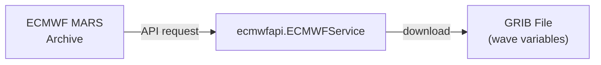
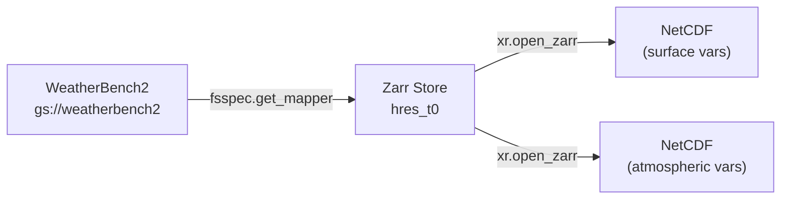
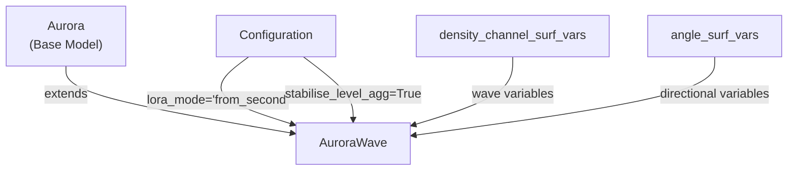
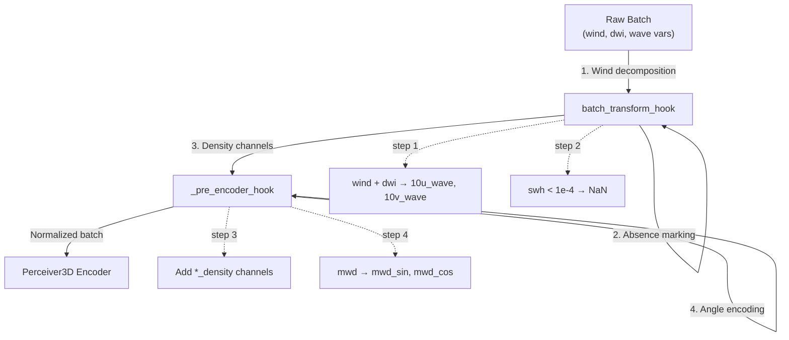
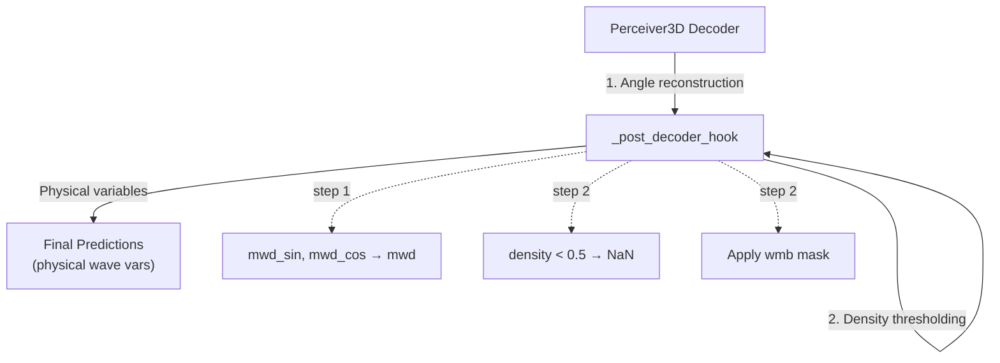
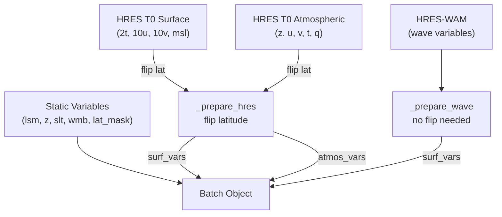
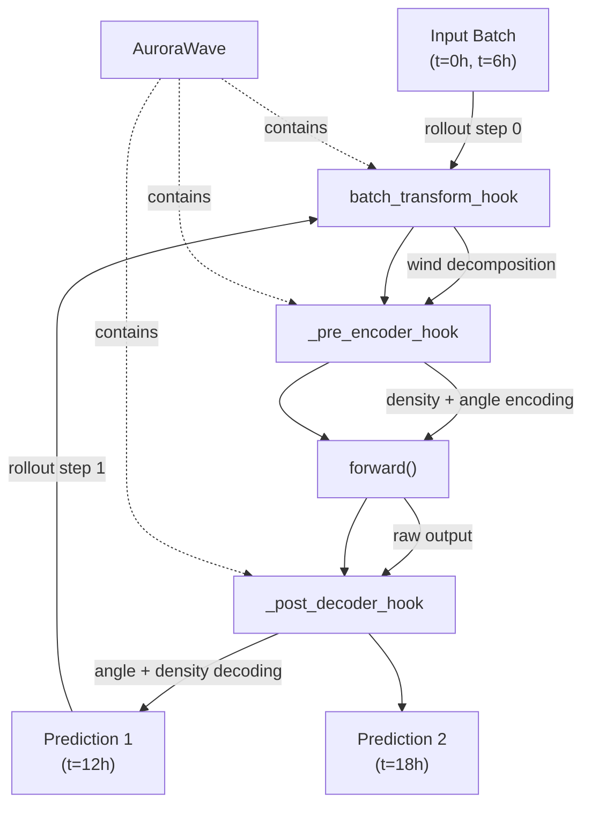
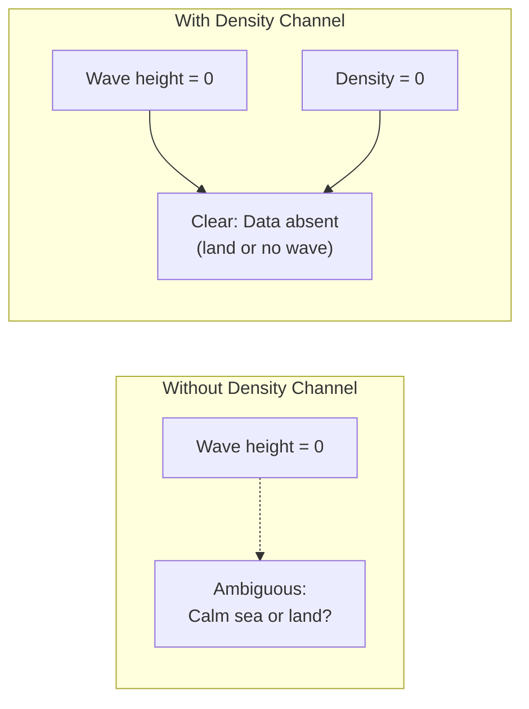
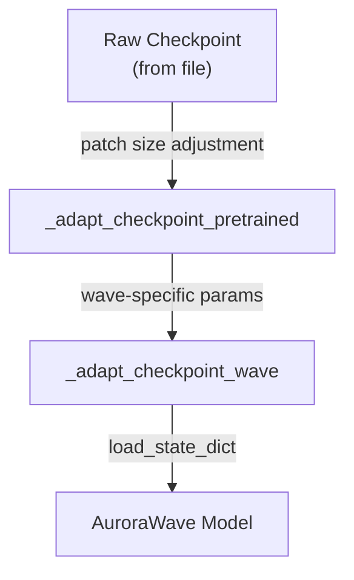

<!-- source: DeepWiki mcp.deepwiki.com · repo microsoft/aurora · page 4.6 Example: Ocean Waves · fetched 2026-10-26 -->

# Example: Ocean Waves

<details>
<summary>Relevant source files</summary>

The following files were used as context for generating this wiki page:

- [aurora/model/aurora.py](aurora/model/aurora.py)
- [docs/example_cams.ipynb](docs/example_cams.ipynb)
- [docs/example_wave.ipynb](docs/example_wave.ipynb)
- [docs/models.md](docs/models.md)

</details>


## Purpose and Scope

This guide demonstrates how to use **AuroraWave** (Aurora 0.25° Wave) for ocean wave forecasting with HRES-WAM data. AuroraWave is a specialized variant of Aurora fine-tuned on ECMWF's HRES-WAM ocean wave model data, supplemented with meteorological variables from IFS HRES T0.

This page covers:
- Data acquisition from HRES-WAM and HRES T0
- Wave-specific data preprocessing (density channels and angle encoding)
- Model configuration and execution
- Understanding wave-specific transformations

For general Aurora usage patterns, see [Getting Started](#4.1). For other model variants, see [Model Variants](#2.4).

**Sources:** [aurora/model/aurora.py:804-933](), [docs/example_wave.ipynb:1-435](), [docs/models.md:277-322]()

---

## Data Requirements

AuroraWave requires a combination of ocean wave variables from HRES-WAM and meteorological variables from IFS HRES T0.

### Required Variables

| Variable Type | Variables |
|--------------|-----------|
| **Surface (HRES T0)** | `2t`, `10u`, `10v`, `msl` |
| **Surface (HRES-WAM)** | `swh`, `mwd`, `mwp`, `pp1d`, `shww`, `mdww`, `mpww`, `shts`, `mdts`, `mpts`, `swh1`, `mwd1`, `mwp1`, `swh2`, `mwd2`, `mwp2`, `wind`, `dwi` |
| **Atmospheric (HRES T0)** | `z`, `u`, `v`, `t`, `q` at 13 pressure levels |
| **Static** | `lsm`, `z`, `slt`, `wmb`, `lat_mask` |

### Pressure Levels

```
50, 100, 150, 200, 250, 300, 400, 500, 600, 700, 850, 925, 1000 hPa
```

### Wave Variable Definitions

| Variable | Description | Type |
|----------|-------------|------|
| `swh` | Significant wave height | Height |
| `mwd` | Mean wave direction | Angle (degrees) |
| `mwp` | Mean wave period | Period |
| `pp1d` | Peak wave period | Period |
| `shww` | Significant height of wind waves | Height |
| `mdww` | Mean direction of wind waves | Angle (degrees) |
| `mpww` | Mean period of wind waves | Period |
| `shts` | Significant height of total swell | Height |
| `mdts` | Mean direction of total swell | Angle (degrees) |
| `mpts` | Mean period of total swell | Period |
| `swh1`, `swh2` | Significant height of first/second swell | Height |
| `mwd1`, `mwd2` | Mean direction of first/second swell | Angle (degrees) |
| `mwp1`, `mwp2` | Mean period of first/second swell | Period |
| `wind` | 10m neutral wind speed | Speed |
| `dwi` | 10m neutral wind direction | Angle (degrees) |

**Sources:** [aurora/model/aurora.py:813-824](), [docs/example_wave.ipynb:74-93](), [docs/models.md:310-315]()

---

## Data Acquisition

### HRES-WAM from MARS

HRES-WAM data must be downloaded from ECMWF's MARS archive using the `ecmwfapi` package:



**Diagram: HRES-WAM Data Acquisition**

The download process retrieves wave variables using MARS parameter codes (e.g., `140229` for `swh`). See [docs/example_wave.ipynb:59-118]() for the complete download script.

### HRES T0 from WeatherBench2

Meteorological variables are obtained from the WeatherBench2 dataset on Google Cloud Storage:



**Diagram: HRES T0 Data Acquisition**

### Static Variables

Wave-specific static variables must be downloaded from HuggingFace:

```python
from huggingface_hub import hf_hub_download

static_path = hf_hub_download(
    repo_id="microsoft/aurora",
    filename="aurora-0.25-wave-static.pickle",
)
```

The static variables include:
- Standard variables: `lsm`, `z`, `slt`
- Wave-specific: `wmb` (wave model bathymetry), `lat_mask` (latitude mask)

**Sources:** [docs/example_wave.ipynb:119-212](), [docs/models.md:318-321]()

---

## Model Initialization and Configuration

### AuroraWave Class

The `AuroraWave` class extends the base `Aurora` model with wave-specific functionality:



**Diagram: AuroraWave Model Configuration**

### Key Configuration Parameters

The `AuroraWave` initialization sets several wave-specific parameters:

| Parameter | Value | Purpose |
|-----------|-------|---------|
| `lora_mode` | `"from_second"` | Different LoRA from second rollout step onward |
| `stabilise_level_agg` | `True` | Additional layer normalization for stability |
| `density_channel_surf_vars` | 18 wave variables | Variables requiring density channels for sparse data |
| `angle_surf_vars` | 5 direction variables | Variables encoded as sin/cos components |

**Sources:** [aurora/model/aurora.py:804-848]()

---

## Wave-Specific Preprocessing

AuroraWave applies specialized transformations to handle the unique characteristics of ocean wave data.

### Preprocessing Pipeline



**Diagram: Wave Data Preprocessing Flow**

### Step 1: Wind Decomposition

The `batch_transform_hook` method converts wind speed and direction into u/v components:

```python
# dwi: wind direction (degrees from)
# wind: wind speed
u_wave = -wind * sin(dwi)  # u-component
v_wave = -wind * cos(dwi)  # v-component
```

This conversion happens in [aurora/model/aurora.py:860-868]() and is applied **before normalization**.

### Step 2: Absence Marking

Ocean waves are spatially sparse (absent over land and in calm seas). When wave height is below threshold, all related variables are marked as NaN:

```python
# For each wave system (primary, wind waves, swell, etc.)
if swh < 1e-4:
    swh, mwd, mwp, pp1d = NaN, NaN, NaN, NaN
```

This occurs only when `rollout_step == 0` (input data, not predictions) at [aurora/model/aurora.py:872-889]().

### Step 3: Density Channels

The `_pre_encoder_hook` creates a density channel for each wave variable to indicate data presence:

```python
for each wave variable x:
    x_density = (~isnan(x)).float()  # 1 if present, 0 if absent
    x = nan_to_num(x, 0)             # Replace NaN with 0
```

This doubles the number of wave-related surface variables. Implemented at [aurora/model/aurora.py:892-900]().

### Step 4: Angle Encoding

Wave directions (angles) are encoded as sine/cosine pairs to handle the 0°/360° boundary:

```python
for each directional variable (mwd, mdww, mdts, mwd1, mwd2):
    angle_sin = sin(angle_degrees)
    angle_cos = cos(angle_degrees)
    # Original angle variable is removed
```

This transformation occurs at [aurora/model/aurora.py:901-906]().

**Sources:** [aurora/model/aurora.py:854-909]()

---

## Wave-Specific Postprocessing

After the decoder produces predictions, AuroraWave applies reverse transformations to obtain physical wave variables.

### Postprocessing Pipeline



**Diagram: Wave Data Postprocessing Flow**

### Step 1: Angle Reconstruction

Sine/cosine pairs are converted back to directional angles:

```python
for each angle variable:
    angle_degrees = rad2deg(atan2(sin, cos)) % 360
```

This occurs at [aurora/model/aurora.py:914-920]().

### Step 2: Density Thresholding

The density channel predictions are converted to presence/absence masks:

```python
density = sigmoid(density_raw) * wmb_mask
data = data * wmb_mask
data[density < 0.5] = NaN
```

The `wmb` (wave model bathymetry) mask ensures predictions are only over ocean regions. The sigmoid activation converts raw predictions to probabilities. Implemented at [aurora/model/aurora.py:922-930]().

**Sources:** [aurora/model/aurora.py:910-932]()

---

## Batch Preparation

The `Batch` object combines HRES-WAM and HRES T0 data with appropriate preprocessing:



**Diagram: Batch Construction Process**

### Preparation Functions

Two helper functions prepare the data:

**`_prepare_hres`** (lines 267-277):
- Selects first two timesteps (history)
- Adds batch dimension
- **Flips latitude axis** (HRES uses ascending latitudes, Aurora requires descending)
- Converts to PyTorch tensor

**`_prepare_wave`** (lines 280-287):
- Selects first two timesteps
- Adds batch dimension
- No latitude flip (HRES-WAM already in correct order)
- Converts to PyTorch tensor

### Complete Batch Example

```python
batch = Batch(
    surf_vars={
        # HRES T0 meteorological (4 variables)
        "2t": _prepare_hres(surf_vars_ds["2m_temperature"].values),
        "10u": _prepare_hres(surf_vars_ds["10m_u_component_of_wind"].values),
        "10v": _prepare_hres(surf_vars_ds["10m_v_component_of_wind"].values),
        "msl": _prepare_hres(surf_vars_ds["mean_sea_level_pressure"].values),
        
        # HRES-WAM waves (18 variables including wind/dwi)
        "swh": _prepare_wave(wave_vars_ds["swh"].values),
        "mwd": _prepare_wave(wave_vars_ds["mwd"].values),
        # ... (16 more wave variables)
    },
    atmos_vars={
        # HRES T0 atmospheric (5 variables × 13 levels)
        "z": _prepare_hres(atmos_vars_ds["geopotential"].values),
        "u": _prepare_hres(atmos_vars_ds["u_component_of_wind"].values),
        "v": _prepare_hres(atmos_vars_ds["v_component_of_wind"].values),
        "t": _prepare_hres(atmos_vars_ds["temperature"].values),
        "q": _prepare_hres(atmos_vars_ds["specific_humidity"].values),
    },
    static_vars={
        # Static variables from pickle file
        k: torch.from_numpy(v) for k, v in static_vars.items()
    },
    metadata=Metadata(
        lat=torch.from_numpy(surf_vars_ds.latitude.values[::-1].copy()),
        lon=torch.from_numpy(surf_vars_ds.longitude.values),
        time=(surf_vars_ds.time.values.astype("datetime64[s]").tolist()[1],),
        atmos_levels=tuple(int(level) for level in atmos_vars_ds.level.values),
    ),
)
```

**Sources:** [docs/example_wave.ipynb:219-336]()

---

## Running Predictions

### Local Execution

```python
from aurora import AuroraWave, rollout

# Load model
model = AuroraWave()
model.load_checkpoint()

# Move to GPU and set evaluation mode
model.eval()
model = model.to("cuda")

# Run autoregressive rollout
with torch.inference_mode():
    predictions = [pred.to("cpu") for pred in rollout(model, batch, steps=2)]
```

### Execution Flow



**Diagram: Autoregressive Rollout Execution**

Each prediction step:
1. Applies `batch_transform_hook` (wind decomposition, absence marking)
2. Normalizes and applies `_pre_encoder_hook` (density channels, angle encoding)
3. Runs through encoder → backbone → decoder
4. Applies `_post_decoder_hook` (angle reconstruction, density thresholding)
5. Uses output as input for next step

**Sources:** [docs/example_wave.ipynb:358-382](), [aurora/model/aurora.py:265-392]()

---

## Understanding the Transformations

### Why Density Channels?

Ocean wave data is fundamentally sparse—waves do not exist over land or in completely calm conditions. Standard neural networks struggle with this sparsity. Density channels provide an explicit signal:



**Diagram: Density Channel Motivation**

The model learns to:
- Predict both the wave variable **and** its density
- Use density to gate the wave prediction
- Distinguish between "zero" (calm) and "absent" (land/missing)

### Why Sine/Cosine Encoding?

Wave directions are circular: 359° and 1° are nearly identical, but numerically distant. Standard encoding fails:

| Scenario | Without Encoding | With Sin/Cos Encoding |
|----------|------------------|----------------------|
| 359° and 1° | Distance = 358 | Distance = √[(sin(359°)-sin(1°))² + (cos(359°)-cos(1°))²] ≈ 0.035 |
| Averaging 10° and 350° | (10+350)/2 = 180° ❌ | atan2(sin average, cos average) ≈ 0° ✓ |

The sine/cosine representation ensures the model respects circular topology.

### Why Different Wind Variables?

HRES-WAM provides `wind` (speed) and `dwi` (direction) for the 10m neutral wind at wave points. These differ from HRES T0's `10u` and `10v` because:
- HRES-WAM uses **neutral** stability (not actual atmospheric stability)
- Wave points have different spatial coverage than meteorological grid points

The `batch_transform_hook` converts `(wind, dwi)` → `(10u_wave, 10v_wave)` to create consistent u/v components for the model.

**Sources:** [aurora/model/aurora.py:821-837](), [docs/models.md:298-300]()

---

## Output Format

### Prediction Structure

Each prediction in the rollout is a `Batch` object with:

```python
prediction = Batch(
    surf_vars={
        # Meteorological (4)
        "2t": Tensor[B, T, H, W],
        "10u": Tensor[B, T, H, W],
        "10v": Tensor[B, T, H, W],
        "msl": Tensor[B, T, H, W],
        
        # Wave heights/periods (13)
        "swh": Tensor[B, T, H, W],  # May contain NaN where absent
        "mwp": Tensor[B, T, H, W],
        # ... other wave variables
        
        # Wave directions (5)
        "mwd": Tensor[B, T, H, W],  # Degrees, 0-360
        "mdww": Tensor[B, T, H, W],
        # ... other directions
        
        # Wind components (3)
        "10u_wave": Tensor[B, T, H, W],
        "10v_wave": Tensor[B, T, H, W],
        "wind": Tensor[B, T, H, W],
    },
    atmos_vars={
        # Atmospheric variables (5 × 13 levels)
        "z": Tensor[B, T, L, H, W],
        # ...
    },
    static_vars={
        # Static fields (no batch/time dimensions)
        "lsm": Tensor[H, W],
        "wmb": Tensor[H, W],
        # ...
    },
    metadata=Metadata(
        lat=Tensor[H],
        lon=Tensor[W],
        time=tuple[datetime],
        atmos_levels=tuple[int],
        rollout_step=int,
    ),
)
```

Where:
- `B` = batch size (typically 1)
- `T` = time dimension (typically 1 for predictions)
- `H` = 721 (latitude dimension)
- `W` = 1440 (longitude dimension)
- `L` = 13 (pressure levels)

### NaN Handling

Wave variables contain NaN values where data is absent (over land or in regions without waves). This is **intentional** and reflects physical reality. When analyzing predictions:

```python
# Count valid wave predictions
valid_mask = ~torch.isnan(prediction.surf_vars["swh"])
num_valid = valid_mask.sum()

# Compute statistics only over valid regions
mean_wave_height = prediction.surf_vars["swh"][valid_mask].mean()
```

**Sources:** [aurora/model/aurora.py:359-392](), [docs/example_wave.ipynb:290-335]()

---

## Model Checkpoints and Versioning

### Default Checkpoint

```python
AuroraWave.default_checkpoint_name = "aurora-0.25-wave.ckpt"
AuroraWave.default_checkpoint_revision = "74598e8c65d53a96077c08bb91acdfa5525340c9"
```

This checkpoint is automatically downloaded from HuggingFace repository `microsoft/aurora` when calling:

```python
model.load_checkpoint()
```

### Checkpoint Adaptation

The `_adapt_checkpoint` method applies wave-specific transformations when loading weights:



**Diagram: Checkpoint Loading Pipeline**

The adaptation process (at [aurora/model/aurora.py:849-852]()):
1. Calls base Aurora checkpoint adaptation
2. Applies wave-specific parameter transformations via `_adapt_checkpoint_wave`

**Sources:** [aurora/model/aurora.py:804-852](), [aurora/model/compat.py]()

---

## Complete Example Summary

### Minimal Working Example

```python
import torch
from aurora import AuroraWave, Batch, Metadata, rollout

# 1. Load model
model = AuroraWave()
model.load_checkpoint()
model.eval()
model = model.to("cuda")

# 2. Prepare batch (assuming data is already loaded)
batch = Batch(
    surf_vars=surf_vars_dict,  # 22 variables (4 met + 18 wave)
    atmos_vars=atmos_vars_dict,  # 5 variables × 13 levels
    static_vars=static_vars_dict,  # 5 static fields
    metadata=metadata,
)

# 3. Run predictions
with torch.inference_mode():
    predictions = [pred.to("cpu") for pred in rollout(model, batch, steps=4)]

# 4. Extract results
for i, pred in enumerate(predictions):
    # Wave heights at step i (may contain NaN)
    swh = pred.surf_vars["swh"]
    
    # Wave direction (0-360 degrees)
    mwd = pred.surf_vars["mwd"]
    
    # Valid data mask
    valid = ~torch.isnan(swh)
```

### Key Considerations

1. **Data Consistency**: Always combine HRES-WAM wave data with HRES T0 meteorological data
2. **NaN Values**: Wave predictions contain NaN over land/absent regions—this is correct behavior
3. **Angle Variables**: Directions are in degrees (0-360), properly handled by sin/cos encoding internally
4. **Wind Components**: Model outputs both `10u_wave`/`10v_wave` and reconstructed `wind` speed
5. **Static Variables**: Must include wave-specific `wmb` and `lat_mask` from HuggingFace

**Sources:** [docs/example_wave.ipynb:358-435](), [aurora/model/aurora.py:804-933]()

---

