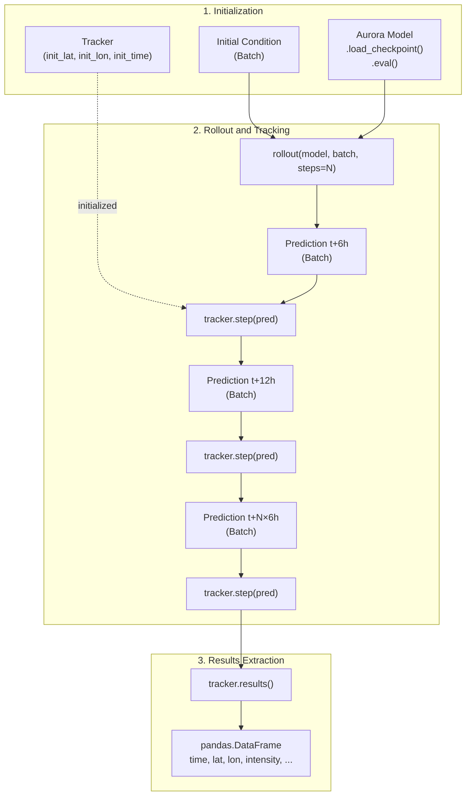
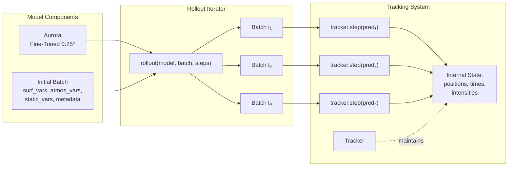
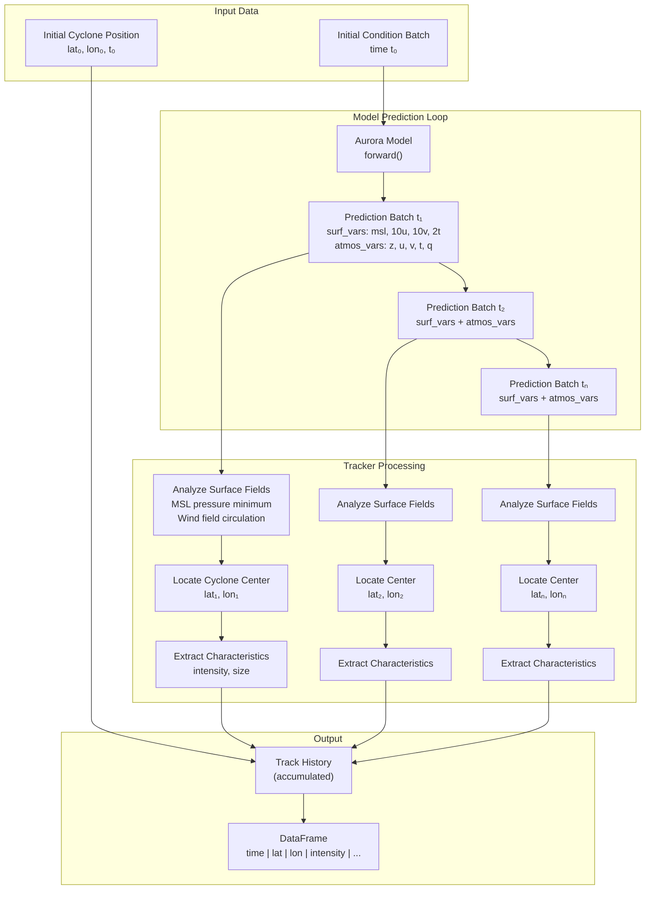

<!-- source: DeepWiki mcp.deepwiki.com · repo microsoft/aurora · page 4.7 Tropical Cyclone Tracking · fetched 2026-10-26 -->

# Tropical Cyclone Tracking

<details>
<summary>Relevant source files</summary>

The following files were used as context for generating this wiki page:

- [README.md](README.md)
- [aurora/__init__.py](aurora/__init__.py)
- [docs/gifs/tc_tracks.gif](docs/gifs/tc_tracks.gif)
- [docs/intro.md](docs/intro.md)
- [docs/tracking.md](docs/tracking.md)
- [docs/usage.md](docs/usage.md)

</details>


## Purpose and Scope

This page documents Aurora's tropical cyclone (TC) tracking capability, which enables automated tracking of cyclone positions, intensities, and characteristics across multi-step predictions. The tracking system integrates with Aurora's autoregressive rollout mechanism to follow tropical cyclones through time as the model generates forecasts.

For general model usage and single-step predictions, see [Getting Started](#4.1). For information about autoregressive multi-step forecasting, see [Getting Started](#4.1) section on rollouts. For specific examples using different model variants, see [Example: ERA5 Data](#4.2), [Example: HRES T0 Data](#4.3), and [Example: High-Resolution Data](#4.4).

## Overview

Aurora can track tropical cyclones through its predictions by monitoring surface-level meteorological variables to identify and follow cyclone centers. The tracking functionality is implemented in the `Tracker` class, which processes prediction batches at each timestep to update cyclone position, intensity estimates, and other characteristics.

The tracker is designed to work with the `rollout` function for autoregressive forecasting and produces structured results as a pandas DataFrame for analysis and visualization. Aurora 0.25° Fine-Tuned is the recommended model variant for tropical cyclone tracking.

**Key Components:**
- `aurora.Tracker` - Main tracking class
- `aurora.rollout` - Autoregressive prediction generator
- `aurora.Batch` - Input/output data structure containing meteorological fields

Sources: [docs/tracking.md:1-44](), [aurora/__init__.py:15](), [README.md:1]()

## The Tracker Class

### Initialization Parameters

The `Tracker` class must be initialized with the current position and time of the tropical cyclone being tracked:

| Parameter | Type | Description |
|-----------|------|-------------|
| `init_lat` | float | Initial latitude of the cyclone center (degrees) |
| `init_lon` | float | Initial longitude of the cyclone center (degrees) |
| `init_time` | datetime | Initial timestamp matching the model's initial condition |

The initialization timestamp must correspond to the time of the initial condition `Batch` that will be passed to the model.

```python
from datetime import datetime
from aurora import Tracker

tracker = Tracker(
    init_lat=25.0,      # e.g., 25°N
    init_lon=140.0,     # e.g., 140°E
    init_time=datetime(2022, 9, 17, 0, 0)
)
```

Sources: [docs/tracking.md:22-24]()

### Core Methods

#### `step(pred: Batch) -> None`

The `step` method processes a single prediction batch to update the tracked cyclone's position and characteristics. This method should be called for each prediction generated during rollout.

**Parameters:**
- `pred` - A `Batch` object containing model predictions for the next timestep

**Behavior:**
- Analyzes surface variables (particularly mean sea level pressure and wind fields) to locate cyclone center
- Updates internal state with new position, time, and intensity estimates
- Accumulates tracking history for the entire forecast period

#### `results() -> pandas.DataFrame`

Extracts the complete tracking history as a structured DataFrame containing the cyclone's trajectory and characteristics at each timestep.

**Returns:** A pandas DataFrame with columns typically including:
- Time information
- Latitude/longitude positions
- Intensity metrics
- Other cyclone characteristics

Sources: [docs/tracking.md:31-41]()

## Usage Workflow

The following diagram illustrates the complete workflow for tropical cyclone tracking with Aurora:



**Workflow: Tropical Cyclone Tracking with Aurora**

Sources: [docs/tracking.md:8-44]()

## Integration with Rollout

The tracker integrates seamlessly with Aurora's autoregressive prediction mechanism. The `rollout` function generates predictions step-by-step, and the tracker processes each prediction to update the cyclone track.



**Integration: Tracker with Rollout Iterator**

The typical pattern uses a loop over the rollout generator:

```python
with torch.inference_mode():
    for pred in rollout(model, initial_condition, steps=8):
        tracker.step(pred)
```

Each prediction `Batch` is passed to `tracker.step()`, allowing the tracker to build a complete trajectory over the forecast period.

Sources: [docs/tracking.md:6-33]()

## Recommended Configuration

### Model Selection

**Aurora 0.25° Fine-Tuned** is the recommended model variant for tropical cyclone tracking. This model provides:
- Fine-tuned performance on IFS HRES T0 operational forecast data
- 0.25° spatial resolution suitable for capturing cyclone-scale features
- Optimal balance between resolution and computational requirements

```python
from aurora import Aurora

model = Aurora(use_lora=True)  # Fine-tuned variant
model.load_checkpoint("microsoft/aurora", "aurora-0.25-finetuned.ckpt")
```

### Forecast Duration

Tropical cyclone tracking typically uses forecast periods of 1-5 days:
- **Short-range (1-2 days):** 4-8 steps of 6-hour predictions
- **Medium-range (3-5 days):** 12-20 steps of 6-hour predictions

Sources: [docs/tracking.md:3-4]()

## Complete Example

The following example demonstrates the complete workflow for tracking a tropical cyclone:

```python
from datetime import datetime
import torch
from aurora import Aurora, Batch, Tracker, rollout

# 1. Initialize model
model = Aurora()
model.load_checkpoint()
model.eval()
model = model.to("cuda")

# 2. Prepare initial condition (load actual data for the cyclone time)
initial_condition = Batch(
    surf_vars={...},     # Surface variables at cyclone time
    atmos_vars={...},    # Atmospheric variables
    static_vars={...},   # Static geographical data
    metadata=Metadata(
        lat=...,
        lon=...,
        time=(datetime(2022, 9, 17, 0, 0),),
        atmos_levels=(...)
    )
)

# 3. Initialize tracker with cyclone's current position
tracker = Tracker(
    init_lat=25.0,              # Current latitude
    init_lon=140.0,             # Current longitude  
    init_time=datetime(2022, 9, 17, 0, 0)  # Current time
)

# 4. Run tracking through rollout (2 days = 8 six-hour steps)
with torch.inference_mode():
    for pred in rollout(model, initial_condition, steps=8):
        tracker.step(pred)

model = model.to("cpu")

# 5. Extract and analyze results
track_df = tracker.results()
print(track_df)
# DataFrame with columns: time, lat, lon, intensity, ...
```

This pattern is demonstrated in full detail in a complete example that tracks Typhoon Nanmadol (2022).

Sources: [docs/tracking.md:10-44]()

## Data Flow Architecture

The following diagram shows how data flows through the tracking system:



**Data Flow: Tropical Cyclone Tracking System**

The tracker analyzes surface-level meteorological fields in each prediction batch to identify the cyclone center. Key variables used for tracking include:
- Mean sea level pressure (`msl`) - identifies pressure minimum
- 10-meter u-wind component (`10u`) - circulation pattern
- 10-meter v-wind component (`10v`) - circulation pattern
- 2-meter temperature (`2t`) - warm core structure

Sources: [docs/tracking.md:1-44](), [aurora/__init__.py:1-30]()

## Output Format

The `tracker.results()` method returns a pandas DataFrame where each row represents the cyclone's state at one timestep. This structured format facilitates:
- Trajectory visualization and plotting
- Comparison with observation data or other forecasts
- Statistical analysis of track and intensity errors
- Export to standard formats for meteorological analysis tools

The DataFrame provides a time-indexed record of the complete cyclone evolution through the forecast period.

Sources: [docs/tracking.md:37-41]()

---

