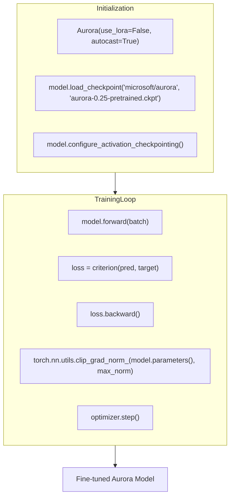
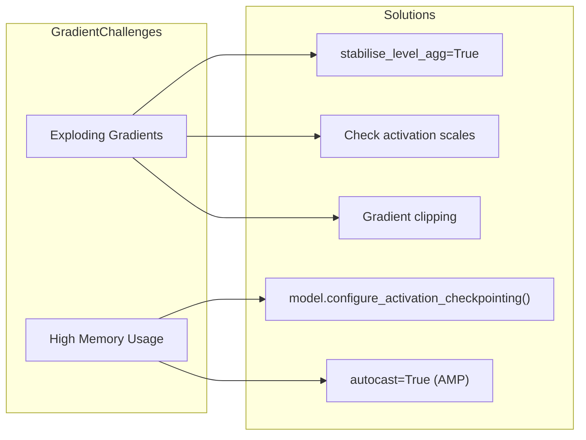
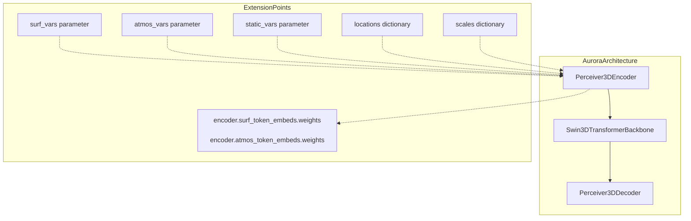

<!-- source: DeepWiki mcp.deepwiki.com · repo microsoft/aurora · page 5 Fine-tuning · fetched 2026-10-26 -->

# Fine-tuning

<details>
<summary>Relevant source files</summary>

The following files were used as context for generating this wiki page:

- [aurora/model/aurora.py](aurora/model/aurora.py)
- [docs/finetuning.md](docs/finetuning.md)
- [finetuning/Dockerfile](finetuning/Dockerfile)
- [finetuning/finetune.py](finetuning/finetune.py)

</details>


This document explains how to fine-tune the Aurora model for specialized Earth system forecasting tasks. Fine-tuning allows you to adapt the pretrained model for specific applications, datasets, or domains. This page covers the complete fine-tuning process from initialization through training, memory optimization techniques, handling training challenges, and extending the model with new variables.

## Getting Started with Fine-tuning

The basic approach for fine-tuning Aurora is to start with the pretrained model as your foundation. A typical fine-tuning setup begins with loading the pretrained checkpoint:

```python
from aurora import Aurora

model = Aurora(use_lora=False)  # Model is not fine-tuned
model.load_checkpoint("microsoft/aurora", "aurora-0.25-pretrained.ckpt")
```

Sources: [docs/finetuning.md:3-11]()

## Fine-tuning Process Overview

The diagram below illustrates the complete fine-tuning workflow including initialization, memory optimization, and the training loop:



Sources: [docs/finetuning.md:3-38]()

## Computing Gradients and Memory Management

Fine-tuning Aurora has significant hardware requirements and memory optimization needs:

### Hardware Requirements
- A100 GPU with 80GB of memory is recommended

### Memory Optimization Techniques
- PyTorch Automatic Mixed Precision (AMP) via `autocast=True`
- Gradient checkpointing via `model.configure_activation_checkpointing()`

Here's a code example configuring Aurora for efficient gradient computation:

```python
from aurora import Aurora

model = Aurora(
    use_lora=False,  # Model was not fine-tuned
    autocast=True,   # Use AMP
)
model.load_checkpoint("microsoft/aurora", "aurora-0.25-pretrained.ckpt")

batch = ...  # Load some data

model = model.cuda()
model.train()
model.configure_activation_checkpointing()

pred = model.forward(batch)
loss = ...
loss.backward()
```

Sources: [docs/finetuning.md:14-38]()

## Handling Training Challenges

### Exploding Gradients

Exploding gradients are a common challenge when fine-tuning large models like Aurora. Here are strategies for managing this issue:



Exploding gradients may not immediately lead to abnormal model outputs due to Aurora's gradient clipping and internal layer normalization, but they will eventually cause training to fail. Monitor gradient values carefully during training.

#### Stabilizing Level Aggregation

The level aggregation component in Aurora has been identified as a potential weak point susceptible to exploding gradients. You can stabilize this part of the model using the `stabilise_level_agg=True` parameter:

```python
from aurora import Aurora

model = Aurora(
    use_lora=False,
    stabilise_level_agg=True,  # Insert extra layer norm to mitigate exploding gradients
)
model.load_checkpoint("microsoft/aurora", "aurora-0.25-pretrained.ckpt", strict=False)
```

**Important note**: Setting `stabilise_level_agg=True` significantly alters the model's behavior, requiring additional fine-tuning to achieve desired performance.

Sources: [docs/finetuning.md:40-69]()

## Extending Aurora with New Variables

Aurora's variable set can be extended beyond the default variables. The diagram below illustrates the extension points and configuration requirements:



### Adding New Variables

To add new variables to Aurora, adjust the `surf_vars`, `static_vars`, and `atmos_vars` parameters and set appropriate normalization statistics:

```python
from aurora import Aurora
from aurora.normalisation import locations, scales

model = Aurora(
    use_lora=False,
    surf_vars=("2t", "10u", "10v", "msl", "new_surf_var"),
    static_vars=("lsm", "z", "slt", "new_static_var"),
    atmos_vars=("z", "u", "v", "t", "q", "new_atmos_var"),
)
model.load_checkpoint("microsoft/aurora", "aurora-0.25-pretrained.ckpt", strict=False)

# Normalization means:
locations["new_surf_var"] = 0.0
locations["new_static_var"] = 0.0
locations["new_atmos_var"] = 0.0

# Normalization standard deviations:
scales["new_surf_var"] = 1.0
scales["new_static_var"] = 1.0
scales["new_atmos_var"] = 1.0
```

### Learning Rate Configuration

When adding new variables, it's recommended to use different learning rates for different parts of the model:

| Component | Recommended Learning Rate |
|-----------|---------------------------|
| New variable patch embeddings | 1e-3 |
| Existing model parameters | 3e-4 |

### Patch Embedding Initialization

By default, patch embeddings for new variables are initialized randomly, which can affect predictions for existing variables. To prevent this, you can initialize new patch embeddings to zero in the relevant parameter dictionaries:
- `model.encoder.surf_token_embeds.weights`
- `model.encoder.atmos_token_embeds.weights`

Sources: [docs/finetuning.md:71-111]()

## Other Model Extensions

Beyond adding variables, you can extend the Aurora model in various ways. When adding or removing parameters, use `strict=False` when loading checkpoints to ignore parameter mismatches:

```python
from aurora import Aurora

model = Aurora(...)

... # Modify model

model.load_checkpoint("microsoft/aurora", "aurora-0.25-pretrained.ckpt", strict=False)
```

Sources: [docs/finetuning.md:112-128]()

## Data Preparation Best Practices

Proper data preparation is crucial for successful fine-tuning. Here are key considerations:

| Consideration | Description | 
|---------------|-------------|
| Normalization statistics | Verify that existing/new normalization statistics are appropriate for your data |
| Missing data | Check for and handle any missing data points |
| Zeros/NaNs | Identify and address zeros or NaNs that might affect training |
| Outliers | Detect and handle outliers that could interfere with training |

Sources: [docs/finetuning.md:129-142]()

---

