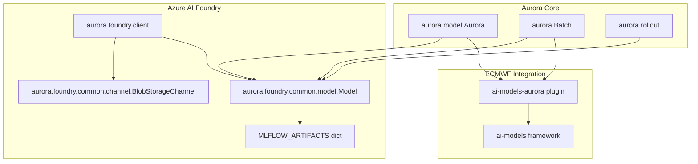
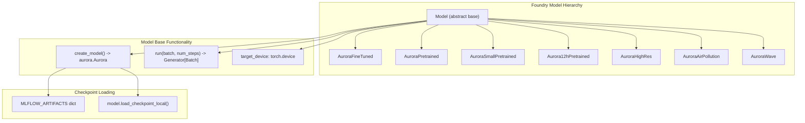
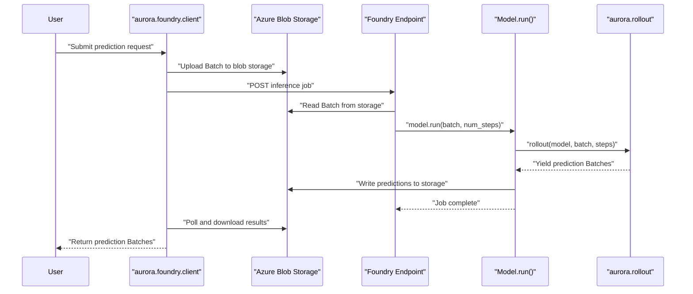
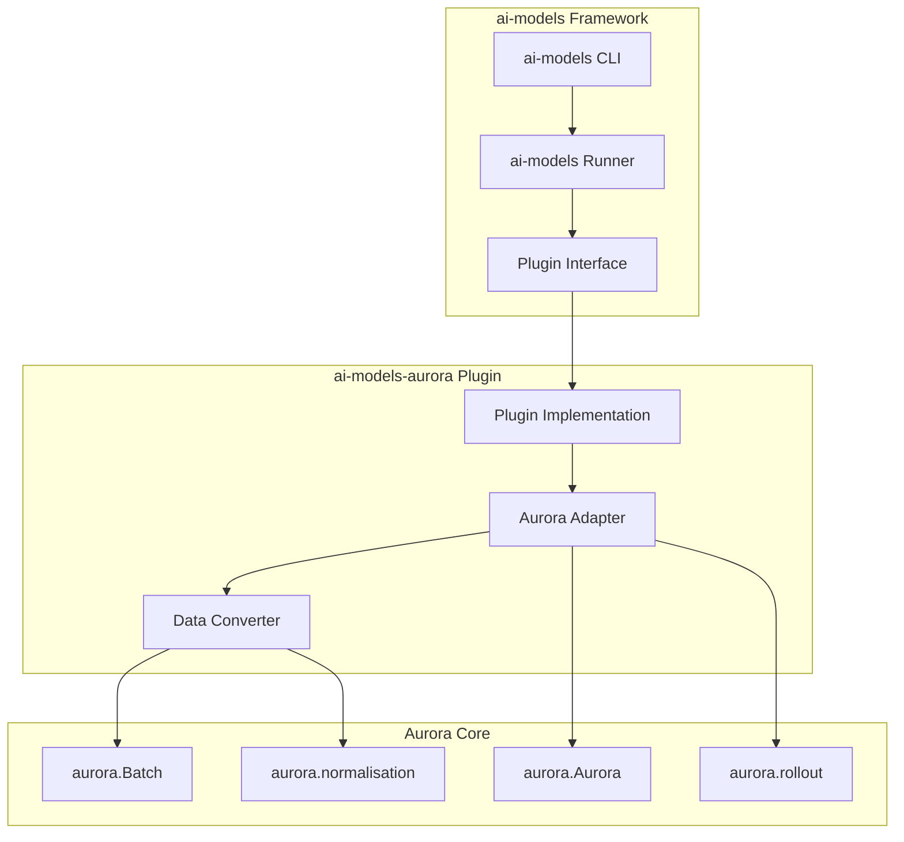

<!-- source: DeepWiki mcp.deepwiki.com · repo microsoft/aurora · page 6 Integration Systems · fetched 2026-10-26 -->

# Integration Systems

<details>
<summary>Relevant source files</summary>

The following files were used as context for generating this wiki page:

- [aurora/foundry/common/model.py](aurora/foundry/common/model.py)
- [aurora/normalisation.py](aurora/normalisation.py)
- [docs/_toc.yml](docs/_toc.yml)
- [docs/ai_models_plugin.md](docs/ai_models_plugin.md)
- [docs/foundry/intro.md](docs/foundry/intro.md)

</details>


Aurora provides two primary integration paths for operational deployment: Azure AI Foundry for cloud-based inference and the ECMWF `ai-models` framework for meteorological workflows. This page provides an overview of both integration systems.

For detailed implementation instructions, see [Azure AI Foundry](#6.1) and [ECMWF ai-models Plugin](#6.2).

## Integration Options Overview

Aurora supports two external integration systems beyond direct Python usage:

| Integration Path | Purpose | Key Components | Distribution |
|-----------------|---------|----------------|--------------|
| Azure AI Foundry | Cloud-based scalable inference | `aurora.foundry.client`, `aurora.foundry.common.model`, `aurora.foundry.common.channel` | Azure AI platform |
| ECMWF ai-models | Operational meteorological workflows | `ai-models-aurora` plugin package | PyPI (`pip install ai-models-aurora`) |

**Integration Architecture Overview**



Sources: [docs/ai_models_plugin.md](), [docs/_toc.yml](), [aurora/foundry/common/model.py:1-151]()

## Azure AI Foundry Integration

Aurora is available as a model on the Azure AI Foundry platform for cloud-based inference. The integration consists of server-side model hosting and client-side submission tools.

### Foundry Model Classes

The Foundry integration provides model wrapper classes in [aurora/foundry/common/model.py:21-151]() that handle model initialization and inference on Azure infrastructure:



The `Model` base class in [aurora/foundry/common/model.py:21-72]() implements:
- `__init__()`: Creates model via `create_model()`, sets to eval mode, detects target device (CUDA/XPU/CPU)
- `run(batch, num_steps)`: Performs autoregressive inference using `aurora.rollout`, moving data to/from target device
- `create_model()`: Abstract method implemented by subclasses to instantiate specific Aurora variants

Each model subclass (e.g., `AuroraFineTuned` at [aurora/foundry/common/model.py:74-81]()) specifies:
- `name`: Model identifier string (e.g., `"aurora-0.25-finetuned"`)
- `create_model()`: Instantiates the corresponding Aurora variant and loads checkpoint from `MLFLOW_ARTIFACTS[self.name]`

The `models` dictionary at [aurora/foundry/common/model.py:144-150]() auto-registers all `Model` subclasses by name for runtime lookup.

### Client-Side Integration

The client-side Foundry integration requires three environment variables for authentication and data transfer:

| Environment Variable | Purpose |
|---------------------|---------|
| `FOUNDRY_ENDPOINT` | Azure AI Foundry endpoint URL |
| `FOUNDRY_TOKEN` | Endpoint access token |
| `BLOB_URL_WITH_SAS` | Azure Blob Storage URL with SAS token for read/write access |

These credentials enable the Foundry client (in `aurora.foundry.client`) to submit inference jobs and retrieve results via Azure Blob Storage. See [docs/foundry/intro.md:6-39]() for credential management details.

**Foundry Execution Flow**



Sources: [aurora/foundry/common/model.py:1-151](), [docs/foundry/intro.md:1-40](), [docs/_toc.yml:23-28]()

### Device Selection and Memory Management

The `Model.__init__()` method at [aurora/foundry/common/model.py:24-40]() automatically detects and selects the optimal compute device:

1. **CUDA GPU**: Preferred if `torch.cuda.is_available()` returns `True`
2. **Intel XPU**: Selected if `torch.xpu.is_available()` returns `True` 
3. **CPU**: Fallback if no accelerators are available

The `Model.run()` method at [aurora/foundry/common/model.py:50-71]() implements efficient memory management:
- Moves model and batch to target device before inference (lines 62-63)
- Uses `torch.inference_mode` context manager to disable gradient computation (line 50)
- Yields predictions immediately moved to CPU to free device memory (line 67)
- Moves model and batch back to CPU after inference to release device resources (lines 70-71)

This pattern ensures minimal memory footprint on compute devices while maximizing throughput.

Sources: [aurora/foundry/common/model.py:21-72]()

## ECMWF ai-models Plugin

Aurora integrates with the ECMWF `ai-models` framework through the external plugin package `ai-models-aurora`. This integration enables Aurora to participate in operational meteorological workflows alongside other AI weather models.

### Installation

The plugin is distributed separately via PyPI:

```bash
pip install ai-models-aurora
```

The plugin package is maintained at https://github.com/ecmwf-lab/ai-models-aurora and provides a bridge between the `ai-models` framework interface and Aurora's `Batch` data structure and model API.

### Integration Architecture

The `ai-models-aurora` plugin implements the plugin interface required by the `ai-models` framework, handling:
- Data conversion from `ai-models` standard formats to Aurora's `Batch` structure
- Model instantiation and checkpoint loading
- Autoregressive inference via `aurora.rollout`
- Output conversion back to `ai-models` format conventions

**ECMWF ai-models Integration Structure**



The plugin architecture ensures that Aurora can be invoked using standard `ai-models` workflows and data conventions, making it compatible with existing ECMWF operational pipelines and tooling.

For detailed usage instructions, see the `ai-models` framework documentation at https://github.com/ecmwf-lab/ai-models and the plugin documentation at https://github.com/ecmwf-lab/ai-models-aurora.

Sources: [docs/ai_models_plugin.md:1-18]()

## Common Integration Patterns

### Cloud-based Deployment with Azure AI Foundry

For large-scale, production-level deployments, integrating Aurora with Azure AI Foundry provides scalability and reliability:

1. Create a Foundry service instance
2. Use the `FoundryClient` to connect to your service
3. Upload your data through the `BlobStorageChannel`
4. Execute predictions and retrieve results

### Meteorological Workflows with ECMWF ai-models

For users already working within the ECMWF ecosystem, the `ai-models-aurora` plugin provides a seamless integration:

1. Install the `ai-models-aurora` plugin
2. Configure your data sources through the `ai-models` interface
3. Execute Aurora predictions using the standard `ai-models` workflows
4. Process and analyze results using ECMWF tools

### Hybrid Approach

For complex workflows, you can combine multiple integration approaches:

1. Use the ECMWF plugin for data preparation and meteorological-specific preprocessing
2. Deploy the model using Azure AI Foundry for scalable inference
3. Post-process and analyze results using your preferred tools

This hybrid approach leverages the strengths of each integration path while accommodating specialized workflow requirements.

Sources: [docs/ai_models_plugin.md](), [docs/_toc.yml]()

---

