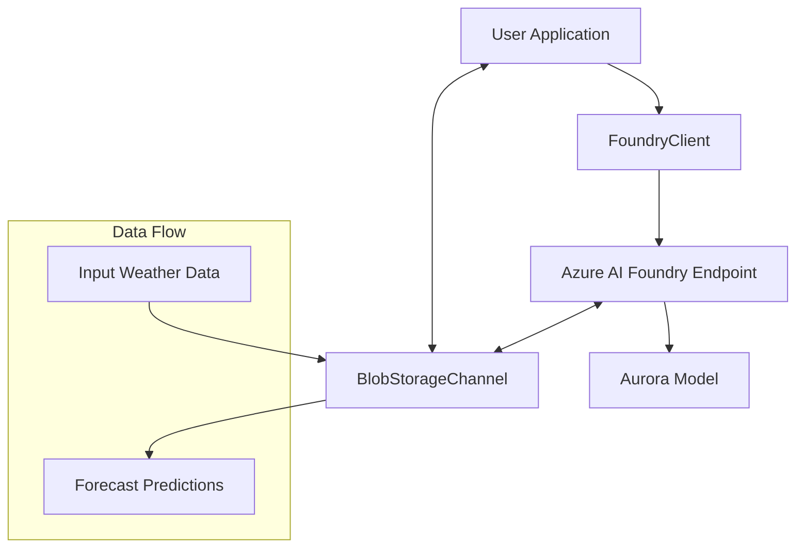
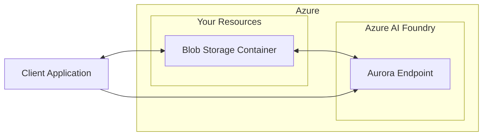
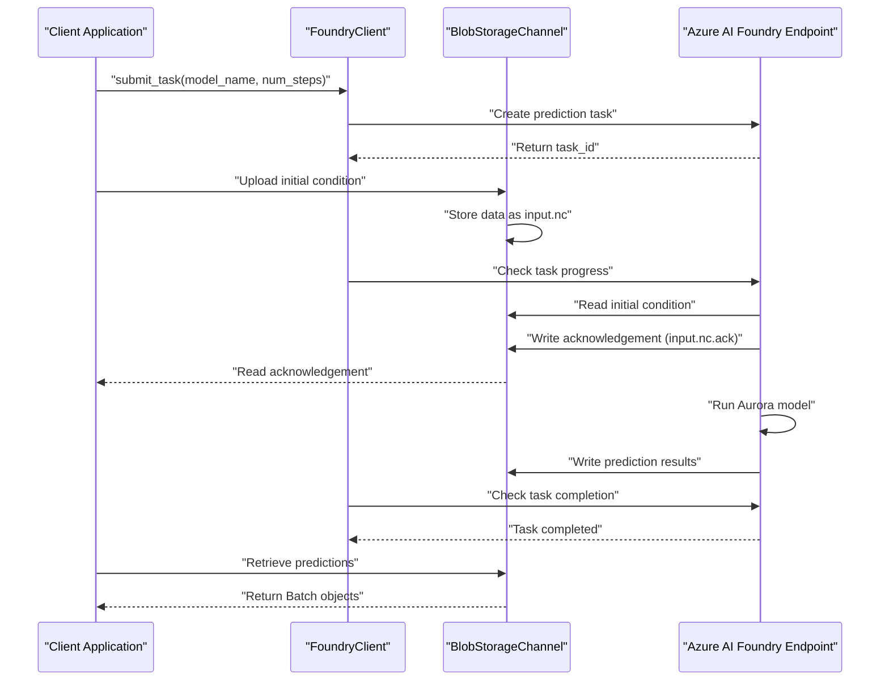
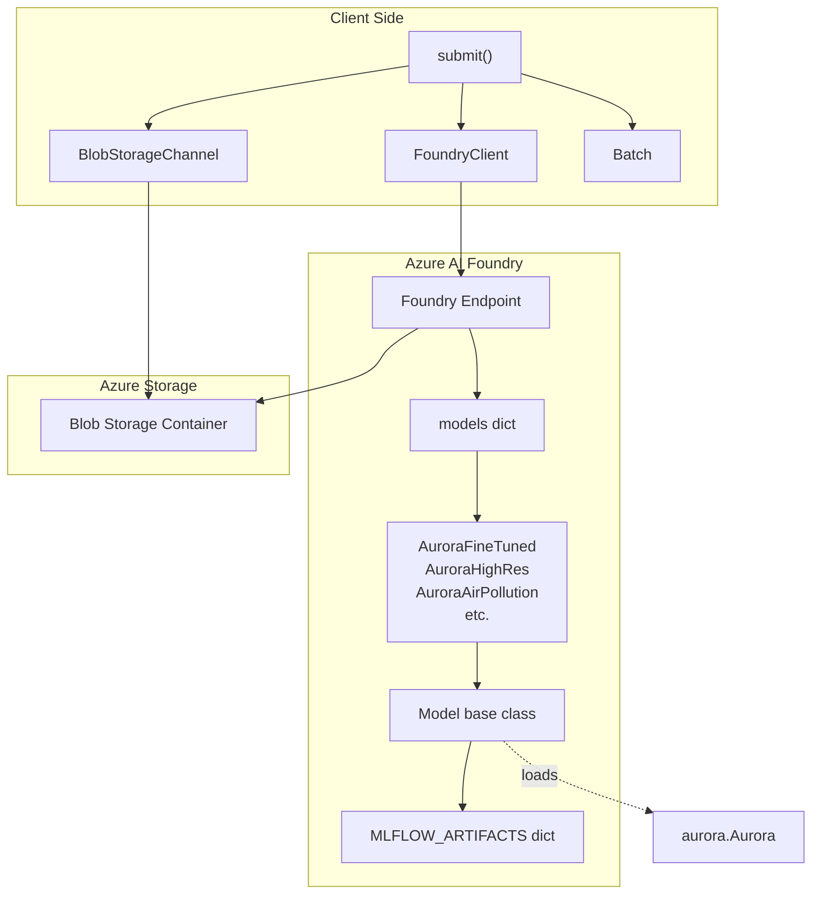
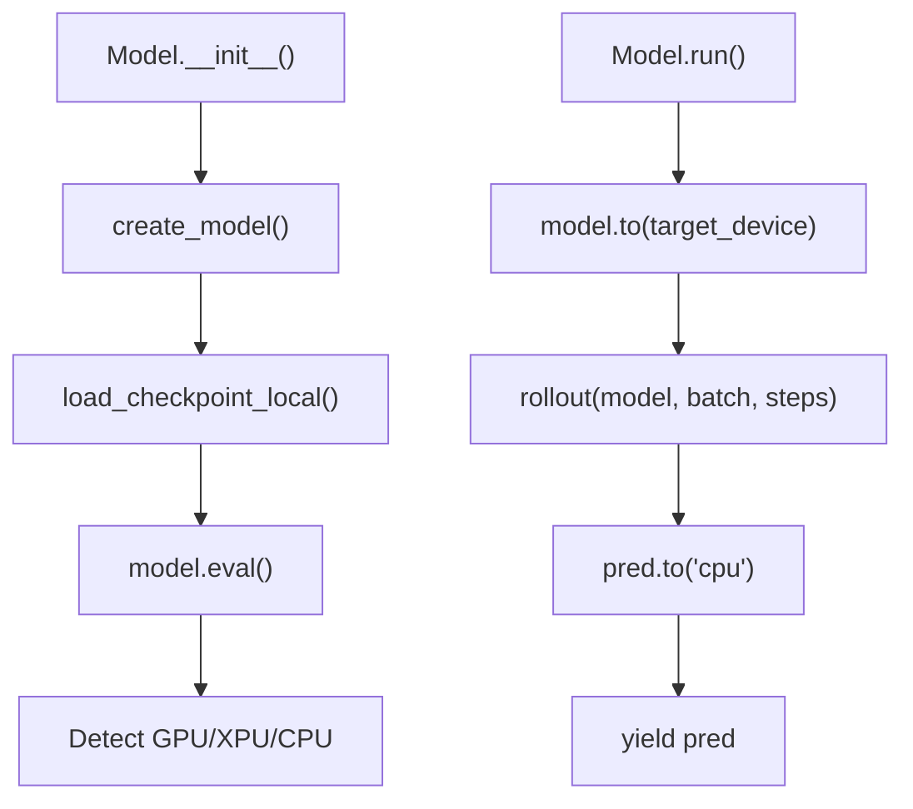
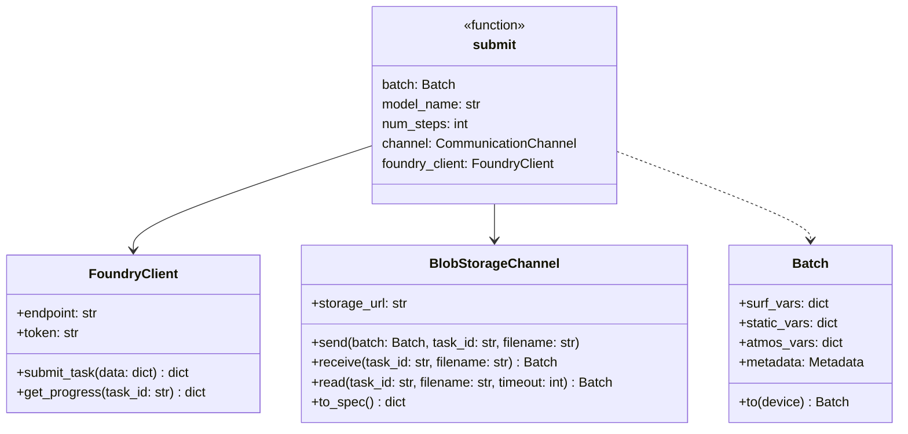

<!-- source: DeepWiki mcp.deepwiki.com · repo microsoft/aurora · page 6.1 Azure AI Foundry · fetched 2026-10-26 -->

# Azure AI Foundry

<details>
<summary>Relevant source files</summary>

The following files were used as context for generating this wiki page:

- [aurora/foundry/common/model.py](aurora/foundry/common/model.py)
- [aurora/normalisation.py](aurora/normalisation.py)
- [docs/foundry/intro.md](docs/foundry/intro.md)

</details>


## Purpose and Scope

This document explains deploying and using Aurora models on Azure AI Foundry, Microsoft's AI model deployment platform. The integration provides endpoint configuration, blob storage-based data transfer, and job submission for cloud-based weather forecasting. For general Aurora usage, see [Usage Guide](#4), and for ECMWF integration, see [ECMWF ai-models Plugin](#6.2).

## Overview

Azure AI Foundry is Microsoft's AI model deployment platform that allows access to various AI models through standardized APIs. Aurora is available in the Azure AI Foundry model catalog, enabling users to create endpoints that serve Aurora predictions.



Sources: [docs/foundry/intro.md:1-5]()

The integration consists of three main client-side components:

1. **FoundryClient** ([aurora/foundry/client/foundry.py:14-70]()): HTTP client for endpoint communication
2. **BlobStorageChannel** ([aurora/foundry/client/storage.py]()): Data transfer via Azure Blob Storage
3. **submit()** ([aurora/foundry/client/api.py:38-126]()): Orchestrates the prediction process

And server-side model infrastructure:

1. **Model** base class ([aurora/foundry/common/model.py:21-72]()): Abstract model interface
2. **models** registry ([aurora/foundry/common/model.py:144-150]()): Available model implementations
3. **MLFLOW_ARTIFACTS** ([aurora/foundry/common/model.py:18]()): Checkpoint path mapping

## Setup Process

### 1. Deploy an Aurora Endpoint

Aurora is available in the Azure AI Foundry model catalog and can be deployed as follows:

1. Navigate to the [Azure AI Foundry model catalog](https://ai.azure.com/explore/models)
2. Locate the Aurora model
3. Click "Deploy" and follow the instructions to create an endpoint
4. Once deployed, note the endpoint URL and access token

Sources: [docs/foundry/submission.md:1-9]()

### 2. Create a Blob Storage Container

Communication between your client and the Aurora endpoint happens through Azure Blob Storage:

1. Create an Azure Blob Storage container in your subscription
2. Generate a SAS token for the container with **both read and write permissions**
3. Note the container URL with the SAS token appended



Sources: [docs/foundry/submission.md:20-41]()

### 3. Configure the Client Libraries

Initialize the client components to interact with the Aurora endpoint:

```python
from aurora.foundry import FoundryClient, BlobStorageChannel

# Create client to communicate with the endpoint
foundry_client = FoundryClient(
    endpoint="https://your-endpoint-url/",
    token="YOUR_ACCESS_TOKEN"
)

# Create channel for data transfer via blob storage
channel = BlobStorageChannel(
    "https://your-storage-account.blob.core.windows.net/container/folder?SAS_TOKEN"
)
```

The `FoundryClient` ([aurora/foundry/client/foundry.py:14-70]()) uses `endpoint` and `token` to authenticate HTTP requests. The `BlobStorageChannel` uses the `storage_url` with SAS token to upload/download `Batch` objects as NetCDF files.

For secure credential management, store these values in environment variables `FOUNDRY_ENDPOINT`, `FOUNDRY_TOKEN`, and `BLOB_URL_WITH_SAS` as described in [docs/foundry/intro.md:6-39]().

Sources: [docs/foundry/submission.md:10-31](), [aurora/foundry/client/foundry.py:14-24](), [docs/foundry/intro.md:6-39]()

## Submission Process

The Aurora Foundry integration uses the `submit()` function to manage the entire prediction process, from sending the initial condition to retrieving the forecast results.



Sources: [aurora/foundry/client/api.py:38-126]()

### Using the Submit Function

The `submit()` function handles the entire process of sending initial conditions, monitoring progress, and retrieving predictions:

```python
from aurora import Batch, Metadata
from aurora.foundry import submit
import torch
from datetime import datetime

# Create initial condition
initial_condition = Batch(
    surf_vars={k: torch.randn(1, 2, 17, 32) for k in ("2t", "10u", "10v", "msl")},
    static_vars={k: torch.randn(17, 32) for k in ("lsm", "z", "slt")},
    atmos_vars={k: torch.randn(1, 2, 4, 17, 32) for k in ("z", "u", "v", "t", "q")},
    metadata=Metadata(
        lat=torch.linspace(90, -90, 17),
        lon=torch.linspace(0, 360, 32 + 1)[:-1],
        time=(datetime(2020, 6, 1, 12, 0),),
        atmos_levels=(100, 250, 500, 850),
    ),
)

# Submit prediction request
for prediction in submit(
    batch=initial_condition,
    model_name="aurora-0.25-finetuned",  # Use the fine-tuned model
    num_steps=4,  # Generate 4 prediction steps
    foundry_client=foundry_client,
    channel=channel,
):
    # Process each prediction step
    print(f"Received prediction for time: {prediction.metadata.time[0]}")
```

Sources: [docs/foundry/submission.md:42-79]()

## Available Models

Aurora models available on Azure AI Foundry are defined in [aurora/foundry/common/model.py:74-142](). Each model extends the `Model` base class and implements `create_model()`:

| Model Name | Class | Resolution | Description |
|------------|-------|------------|-------------|
| `aurora-0.25-pretrained` | `AuroraPretrained` | 0.25° | Base pretrained model |
| `aurora-0.25-finetuned` | `AuroraFineTuned` | 0.25° | Fine-tuned on IFS HRES T0 |
| `aurora-0.25-small-pretrained` | `AuroraSmallPretrained` | 0.25° | Small variant for testing |
| `aurora-0.25-12h-pretrained` | `Aurora12hPretrained` | 0.25° | 12-hour timestep model |
| `aurora-0.1-finetuned` | `AuroraHighRes` | 0.1° | High-resolution fine-tuned |
| `aurora-0.4-air-pollution` | `AuroraAirPollution` | 0.4° | CAMS air quality predictions |
| `aurora-0.25-wave` | `AuroraWave` | 0.25° | HRES-WAM ocean wave predictions |

The `models` dictionary at [aurora/foundry/common/model.py:144-150]() maintains the registry of available models. Each model loads its checkpoint from `MLFLOW_ARTIFACTS[self.name]`.

Production use should employ the fine-tuned model (`aurora-0.25-finetuned`) with proper initial conditions from HRES T0 data.

Sources: [aurora/foundry/common/model.py:74-150]()

## Code Architecture

### Component Architecture

The Azure AI Foundry integration consists of client-side and server-side components:



**Diagram: Azure AI Foundry Component Architecture**

Sources: [aurora/foundry/__init__.py:1-12](), [aurora/foundry/client/foundry.py:1-70](), [aurora/foundry/client/api.py:1-126](), [aurora/foundry/common/model.py:1-151]()

### Server-Side Model Loading

The server-side `Model` base class ([aurora/foundry/common/model.py:21-72]()) implements the model lifecycle:



**Diagram: Server-Side Model Initialization and Execution**

The `Model.run()` method ([aurora/foundry/common/model.py:50-71]()) performs the following:
1. Moves model and batch to target device (GPU/XPU/CPU)
2. Executes `rollout()` for autoregressive predictions
3. Yields predictions to CPU for transfer back to client
4. Moves model back to CPU after completion

Sources: [aurora/foundry/common/model.py:21-72]()

### Client-Side Classes



**Diagram: Client-Side Class Structure**

Sources: [aurora/foundry/__init__.py:1-12](), [aurora/foundry/client/foundry.py:1-70](), [aurora/foundry/client/api.py:1-126]()

## Workflow Details

The `submit()` function ([aurora/foundry/client/api.py:38-126]()) orchestrates the full prediction workflow:

### Step-by-Step Process

1. **Task Creation**: `foundry_client.submit_task()` creates a task on the endpoint with `model_name` and `num_steps`
2. **Upload Initial Condition**: `channel.send()` uploads the `Batch` object to blob storage as `input.nc`
3. **Acknowledgement**: Endpoint reads initial condition and writes `input.nc.ack` to signal readiness
4. **Model Execution**: Server-side `Model.run()` method executes `rollout()` for autoregressive predictions
5. **Result Upload**: Each prediction step is written to blob storage (e.g., `output-0.nc`, `output-1.nc`)
6. **Download Results**: Client polls blob storage and yields `Batch` objects as they become available

### Timeout and Polling

The `submit()` function uses timeouts to handle various stages:
- **Acknowledgement timeout**: Default 10 minutes to read `input.nc.ack`
- **Prediction timeout**: Default 10 minutes per prediction step
- **Polling interval**: Configurable interval for checking task progress

These parameters ensure robust operation even with network latency or computational delays.

Sources: [aurora/foundry/client/api.py:38-126]()

## Troubleshooting

Common issues when using the Azure AI Foundry integration:

| Issue | Possible Cause | Solution |
|-------|----------------|----------|
| `SubmissionError: Failed to create task` | Invalid endpoint URL or token | Verify endpoint URL and token |
| `SubmissionError: Could not read acknowledgement` | Blob storage SAS token without read/write permissions | Regenerate SAS token with both read and write permissions |
| `KeyError: Model is not a valid model` | Specified model name doesn't exist | Use one of the available model names (e.g., `aurora-0.25-finetuned`) |
| Task fails to complete | Issues with input data format | Ensure initial condition conforms to expected format |

Sources: [aurora/foundry/client/api.py:60-105]()

## Summary

The Azure AI Foundry integration provides a scalable, managed solution for generating Aurora weather forecasts without the need for local high-performance computing resources. By deploying an Aurora endpoint and configuring the client libraries, you can submit prediction requests and receive forecasts through a streamlined API.

For production use, it's recommended to use the fine-tuned model with proper initial conditions from real weather data, as shown in the [Example: HRES T0 Data](#4.2) guide.

---

