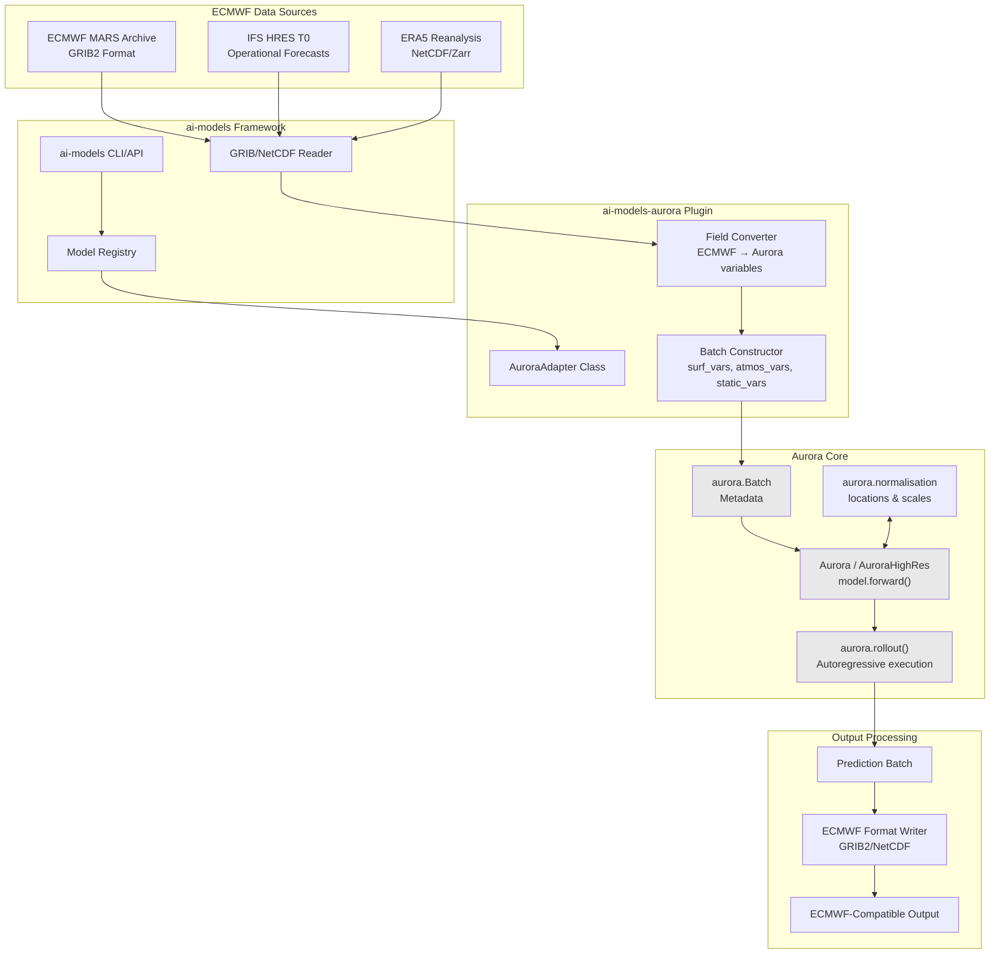
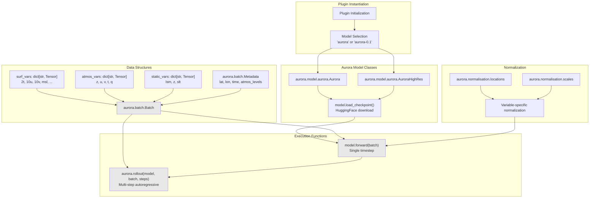

<!-- source: DeepWiki mcp.deepwiki.com · repo microsoft/aurora · page 6.2 ECMWF ai-models Plugin · fetched 2026-10-26 -->

# ECMWF ai-models Plugin

<details>
<summary>Relevant source files</summary>

The following files were used as context for generating this wiki page:

- [README.md](README.md)
- [docs/_toc.yml](docs/_toc.yml)
- [docs/ai_models_plugin.md](docs/ai_models_plugin.md)
- [docs/gifs/tc_tracks.gif](docs/gifs/tc_tracks.gif)
- [docs/intro.md](docs/intro.md)
- [docs/usage.md](docs/usage.md)

</details>


The `ai-models-aurora` plugin integrates Aurora into ECMWF's operational forecasting infrastructure through the `ai-models` framework. This plugin enables users to run Aurora models using ECMWF's standardized data formats and interfaces, primarily targeting operational weather forecasting workflows.

For cloud-based deployment, see [Azure AI Foundry Integration](#6.1).

## Overview

The `ai-models` framework ([github.com/ecmwf-lab/ai-models](https://github.com/ecmwf-lab/ai-models)) is ECMWF's standardized interface for AI-based weather models. The `ai-models-aurora` plugin ([github.com/ecmwf-lab/ai-models-aurora](https://github.com/ecmwf-lab/ai-models-aurora)) provides Aurora-specific adapters that handle:

- Data format conversion between ECMWF GRIB/NetCDF formats and Aurora's `Batch` structure
- Model instantiation and checkpoint loading for supported Aurora variants
- Autoregressive rollout execution using `aurora.rollout`
- Output conversion back to ECMWF-compatible formats

This allows Aurora to participate in ECMWF workflows alongside other AI models (Pangu-Weather, FourCastNet, GraphCast, etc.).

Sources: [docs/ai_models_plugin.md:1-17](), [README.md:50-60]()

## Installation

Install the plugin via pip:

```bash
pip install ai-models-aurora
```

This automatically installs the base `microsoft-aurora` package as a dependency. The plugin package is separate from the main Aurora codebase and maintained in the ECMWF Lab organization.

Sources: [docs/ai_models_plugin.md:8-10](), [README.md:63-67]()

## Plugin Architecture

### Data Flow Pipeline

The following diagram shows the complete data transformation pipeline from ECMWF formats to Aurora predictions:



Sources: [docs/ai_models_plugin.md:1-17](), [README.md:50-60]()

The plugin acts as a bridge layer, performing:

1. **Variable Mapping**: Maps ECMWF variable names (e.g., `t2m`, `u10`, `v10`) to Aurora's naming convention (`2t`, `10u`, `10v`)
2. **Level Selection**: Extracts required atmospheric pressure levels for `atmos_vars` (13 levels for base model, 4 levels for small)
3. **Spatial Resampling**: Handles resolution differences between input data and model requirements (0.25° for base, 0.1° for high-res)
4. **Batch Construction**: Builds `aurora.Batch` objects with proper `Metadata` (lat, lon, time, atmos_levels)
5. **Static Variable Loading**: Downloads and caches static variables (lsm, z, slt) from HuggingFace
6. **Normalization Application**: Applies variable-specific normalization using Aurora's `locations` and `scales` dictionaries

Sources: [docs/ai_models_plugin.md:1-17]()

## Supported Model Variants

The plugin supports multiple Aurora model variants through the `ai-models` model selection interface:

| Model Identifier | Aurora Class | Resolution | Checkpoint | Use Case |
|-----------------|--------------|------------|------------|----------|
| `aurora` | `Aurora` | 0.25° | `aurora-0.25-finetuned.ckpt` | Standard weather forecasting with IFS HRES T0 |
| `aurora-0.1` | `AuroraHighRes` | 0.1° | `aurora-0.1-finetuned.ckpt` | High-resolution weather forecasting |

The plugin automatically:
- Instantiates the appropriate model class based on user selection
- Downloads the corresponding checkpoint from HuggingFace (`microsoft/aurora` repository)
- Loads resolution-specific static variables
- Configures appropriate pressure levels and variable sets

Sources: [docs/ai_models_plugin.md:1-17](), [README.md:50-60]()

## Code-Level Integration

### Aurora Core Components Used by Plugin



Sources: [docs/ai_models_plugin.md:1-17](), [docs/usage.md:1-143](), [README.md:77-102]()

The plugin interacts with Aurora through:

- **Model Instantiation**: Calls constructors for `Aurora` or `AuroraHighRes` classes
- **Checkpoint Loading**: Uses `model.load_checkpoint()` to download from HuggingFace
- **Batch Construction**: Creates `Batch` objects with proper dict structures for `surf_vars`, `atmos_vars`, `static_vars`
- **Metadata Population**: Constructs `Metadata` with latitude/longitude arrays, timestamps, and pressure levels
- **Inference Execution**: Calls `model.forward()` for single-step or `rollout()` for multi-step predictions
- **Normalization Access**: Uses `aurora.normalisation.locations` and `aurora.normalisation.scales` for variable transforms

Sources: [docs/usage.md:33-143](), [README.md:77-102]()

## Benefits of Using the Plugin

Using Aurora through the ECMWF ai-models framework offers several advantages:

1. **Standardized Interface**: Access Aurora using the same interface as other ECMWF AI models
2. **Simplified Data Handling**: Automatic conversion between ECMWF data formats and Aurora's requirements
3. **Ecosystem Integration**: Seamless integration with other ECMWF tools and workflows
4. **Operational Readiness**: Deployment path for operational weather forecasting contexts

## Documentation Resources

For detailed information about how to use Aurora through the ai-models framework, including code examples and API documentation, refer to:

- [ECMWF ai-models documentation](https://github.com/ecmwf-lab/ai-models)
- [ai-models-aurora plugin documentation](https://github.com/ecmwf-lab/ai-models-aurora)

Sources: [docs/ai_models_plugin.md:12-17]()

---

