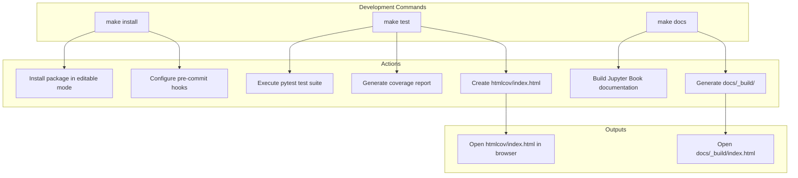
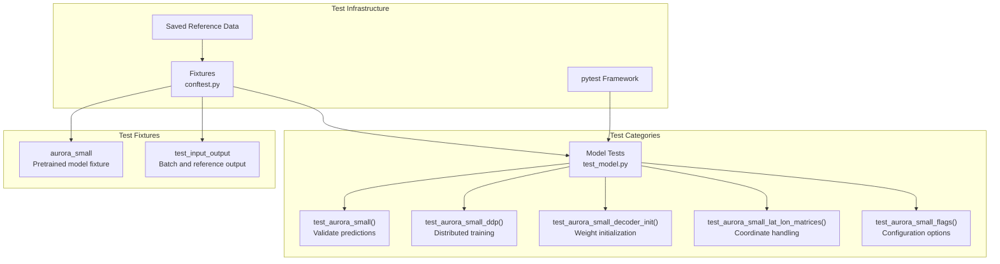
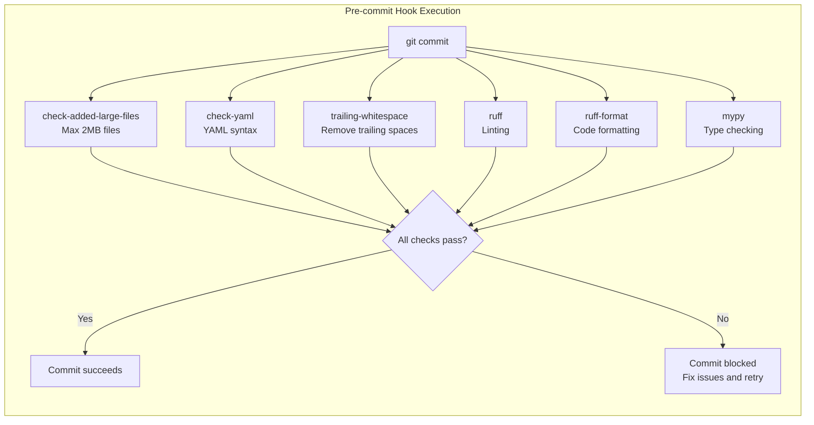
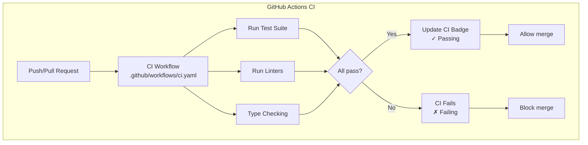

<!-- source: DeepWiki mcp.deepwiki.com · repo microsoft/aurora · page 7 Development · fetched 2026-10-26 -->

# Development

<details>
<summary>Relevant source files</summary>

The following files were used as context for generating this wiki page:

- [.pre-commit-config.yaml](.pre-commit-config.yaml)
- [README.md](README.md)
- [docs/example_hres_0.1.ipynb](docs/example_hres_0.1.ipynb)
- [docs/gifs/tc_tracks.gif](docs/gifs/tc_tracks.gif)
- [docs/intro.md](docs/intro.md)
- [docs/usage.md](docs/usage.md)
- [tests/test_model.py](tests/test_model.py)

</details>


This guide provides information for developers who want to contribute to or modify the Aurora codebase. It covers development environment setup, testing procedures, code quality standards, and contribution workflows.

For detailed information about testing procedures, see [Testing](#7.1). For code quality standards and pre-commit hooks, see [Code Quality](#7.2).

## Overview

Aurora is developed as a Python package with a focus on code quality, reproducibility, and maintainability. The development infrastructure includes automated testing, linting, type checking, and documentation generation. The codebase follows modern Python development practices with continuous integration through GitHub Actions.

**Sources:** [README.md:108-200]()

## Development Environment Setup

### Prerequisites

Aurora requires Python 3.10 or later. The development environment uses standard Python tooling including `virtualenv`, `pip`, and `make` for common tasks.

### Initial Setup

Clone the repository and set up the development environment:

```bash
git clone https://github.com/microsoft/aurora.git
cd aurora
```

Create and activate a virtual environment:

```bash
virtualenv venv -p python3.10
source venv/bin/activate  # On Windows: venv\Scripts\activate
```

Install the package in editable mode with development dependencies and set up pre-commit hooks:

```bash
make install
```

This command installs Aurora in editable mode, allowing you to modify the code and see changes immediately without reinstalling. It also configures pre-commit hooks that automatically check code quality before each commit.

**Sources:** [README.md:177-183]()

## Development Commands

The repository provides a `Makefile` with common development commands:



| Command | Purpose | Output |
|---------|---------|--------|
| `make install` | Install package and setup development tools | Package installed in editable mode, pre-commit hooks configured |
| `make test` | Run test suite with coverage | Test results and coverage report in `htmlcov/` |
| `make docs` | Build documentation | Documentation in `docs/_build/` |

**Sources:** [README.md:177-199]()

## Project Structure

The Aurora repository follows a standard Python package structure:

```mermaid
graph TB
    subgraph "Repository Root"
        Aurora["aurora/"]
        Tests["tests/"]
        Docs["docs/"]
        Config["Configuration Files"]
    end
    
    subgraph "aurora/ Package"
        Models["model.py<br/>Model definitions"]
        Batch["batch.py<br/>Batch interface"]
        Rollout["rollout.py<br/>Autoregressive execution"]
        Init["__init__.py<br/>Package exports"]
    end
    
    subgraph "tests/ Directory"
        TestModel["test_model.py<br/>Model correctness tests"]
        Conftest["conftest.py<br/>Test fixtures"]
        TestData["Test data artifacts"]
    end
    
    subgraph "docs/ Directory"
        Examples["*.ipynb<br/>Usage examples"]
        DocsConfig["_config.yml<br/>Jupyter Book config"]
        DocsMD["*.md<br/>Documentation pages"]
    end
    
    subgraph "Configuration Files"
        PreCommit[".pre-commit-config.yaml<br/>Code quality hooks"]
        PyProject["pyproject.toml<br/>Package metadata"]
        Makefile["Makefile<br/>Common commands"]
    end
    
    Aurora --> Models
    Aurora --> Batch
    Aurora --> Rollout
    Aurora --> Init
    
    Tests --> TestModel
    Tests --> Conftest
    Tests --> TestData
    
    Docs --> Examples
    Docs --> DocsConfig
    Docs --> DocsMD
    
    Config --> PreCommit
    Config --> PyProject
    Config --> Makefile
```



**Sources:** Repository structure inferred from file paths

## Testing

Aurora includes a comprehensive test suite to ensure model correctness and reproducibility. Tests are written using `pytest` and include validation of model outputs against reference data.

### Running Tests

Execute the full test suite:

```bash
make test
```

This runs all tests with coverage reporting. The coverage report is generated in `htmlcov/index.html` and can be opened in a browser to view detailed coverage statistics.

### Test Structure

The test suite includes:

- **Model correctness tests**: Validate model predictions against saved reference outputs
- **Distributed training tests**: Test DDP (DistributedDataParallel) functionality
- **Numerical stability tests**: Ensure predictions remain consistent across different configurations
- **Initialization tests**: Verify proper weight and bias initialization

For detailed information about the test suite, fixtures, and validation procedures, see [Testing](#7.1).

**Sources:** [README.md:185-191](), [tests/test_model.py:1-206]()

### Key Test Components



**Sources:** [tests/test_model.py:18-206]()

## Code Quality

Aurora enforces code quality through automated tools configured via pre-commit hooks. The project uses:

- **Ruff**: Fast Python linter and formatter
- **mypy**: Static type checker
- **Pre-commit hooks**: Various file and formatting checks

### Pre-commit Hooks

When you run `make install`, pre-commit hooks are automatically configured. These hooks run before each commit to ensure code meets quality standards:



### Configured Hooks

| Hook | Purpose | Auto-fix |
|------|---------|----------|
| `check-added-large-files` | Prevent files >2MB from being committed | No |
| `check-case-conflict` | Detect case-insensitive filename conflicts | No |
| `check-merge-conflict` | Detect merge conflict markers | No |
| `check-yaml` | Validate YAML syntax | No |
| `debug-statements` | Detect leftover debug statements | No |
| `end-of-file-fixer` | Ensure files end with newline | Yes |
| `mixed-line-ending` | Standardize line endings | Yes |
| `trailing-whitespace` | Remove trailing whitespace | Yes |
| `ruff` | Lint Python code | Yes (some issues) |
| `ruff-format` | Format Python code | Yes |
| `mypy` | Type check Python code | No |

For detailed information about code quality standards and tools, see [Code Quality](#7.2).

**Sources:** [.pre-commit-config.yaml:1-45]()

## Documentation

Aurora uses Jupyter Book to generate documentation from Markdown files and Jupyter notebooks. The documentation includes:

- API reference
- Usage examples with executable notebooks
- Model descriptions
- Integration guides

### Building Documentation

Build the documentation locally:

```bash
make docs
```

View the generated documentation by opening `docs/_build/index.html` in your browser.

The documentation automatically includes:
- Markdown pages from `docs/*.md`
- Jupyter notebooks from `docs/*.ipynb`
- Configuration from `docs/_config.yml`

**Sources:** [README.md:193-199]()

## Continuous Integration

Aurora uses GitHub Actions for continuous integration. The CI pipeline runs on every push and pull request.



The CI badge is displayed in the README and indicates the current build status.

**Sources:** [README.md:5]()

## Contribution Workflow

### Standard Workflow

1. **Fork and clone** the repository
2. **Create a branch** for your changes
3. **Make changes** following code quality standards
4. **Run tests** locally: `make test`
5. **Build docs** if documentation changed: `make docs`
6. **Commit changes**: Pre-commit hooks run automatically
7. **Push** to your fork
8. **Open a pull request** to the main repository

### Code Standards

- All code must pass pre-commit hooks (ruff, mypy)
- New features should include tests
- Maintain or improve test coverage
- Update documentation for user-facing changes
- Follow existing code style and patterns

### Test Requirements

Before submitting a pull request:

- All existing tests must pass
- Add tests for new functionality
- Ensure numerical stability tests pass
- Verify DDP tests pass (unless on Windows where they may be skipped)

**Sources:** [README.md:108-110](), [tests/test_model.py:89-95]()

## Development Best Practices

### Model Development

When modifying or extending models:

1. **Preserve numerical consistency**: Model changes should maintain backward compatibility with checkpoints where possible
2. **Test initialization**: Verify weight and bias initialization is correct
3. **Validate against reference data**: Compare outputs with saved reference predictions
4. **Consider memory requirements**: Test on appropriate hardware configurations

### Testing Strategy

- Use fixtures from `conftest.py` for consistent test data
- Test edge cases and different batch sizes
- Validate coordinate handling (latitude/longitude matrices vs. vectors)
- Test configuration flags independently

**Sources:** [tests/test_model.py:113-206]()

## Common Development Tasks

### Adding a New Model Variant

1. Define model class inheriting from `Aurora`
2. Implement checkpoint loading logic
3. Add model-specific preprocessing hooks
4. Create tests with reference data
5. Update documentation with usage examples

### Modifying Model Architecture

1. Make changes to model components
2. Run tests to check for breaking changes
3. Update or regenerate reference test data if needed
4. Verify memory requirements haven't increased significantly
5. Document architectural changes

### Extending Test Coverage

1. Add test cases to `tests/test_model.py`
2. Create fixtures in `conftest.py` if needed
3. Generate reference data with known-good model version
4. Ensure tests run in CI pipeline

**Sources:** [tests/test_model.py:1-206]()

---

This development guide provides the foundation for contributing to Aurora. For specific details on testing procedures and code quality enforcement, refer to the child pages [Testing](#7.1) and [Code Quality](#7.2).

---

