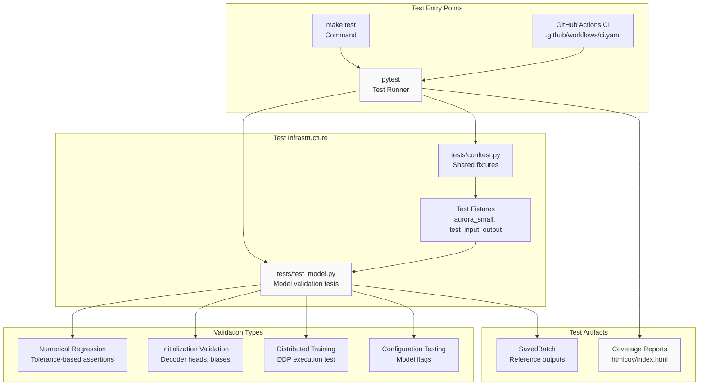
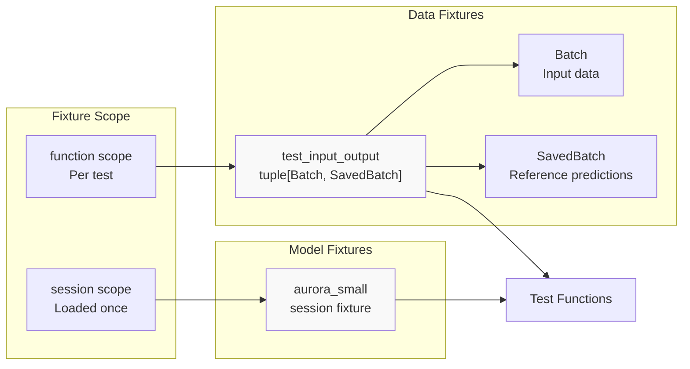
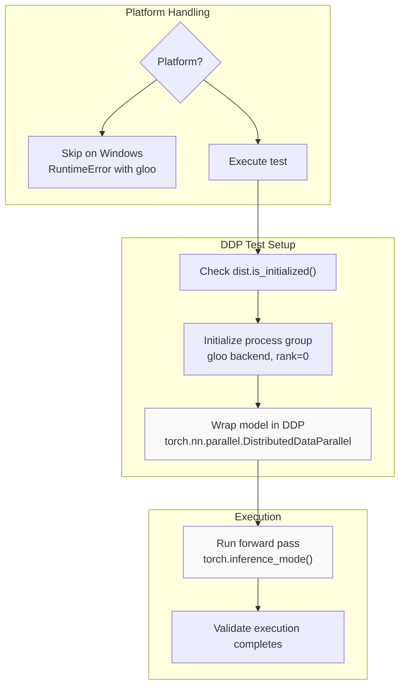
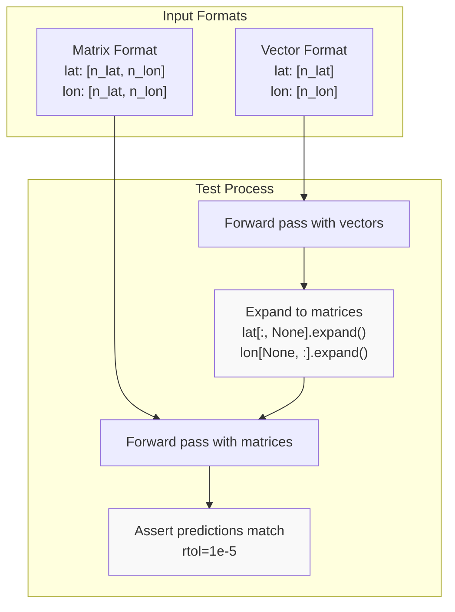
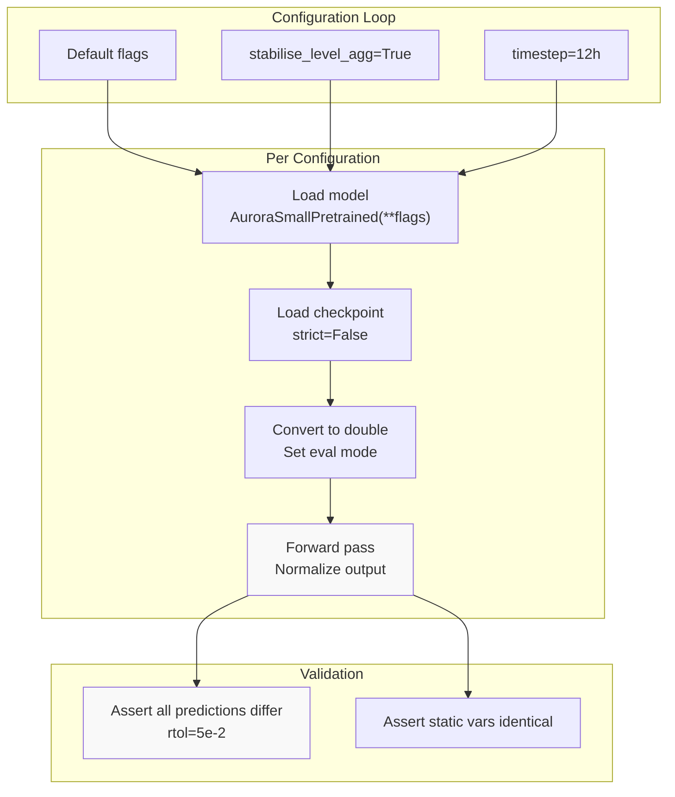
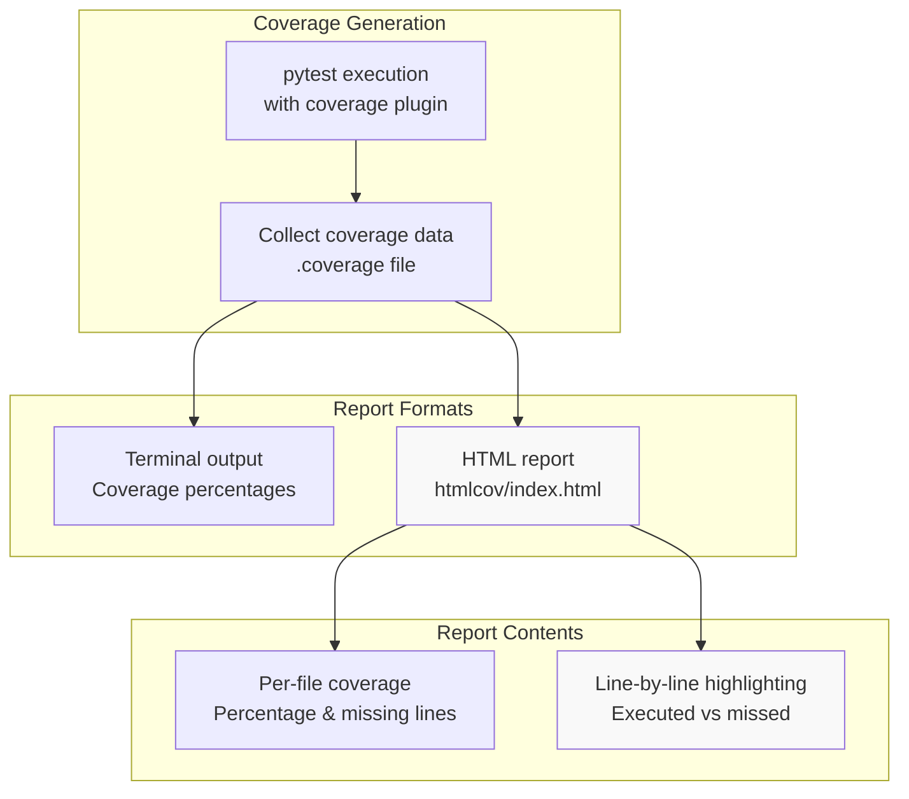

<!-- source: DeepWiki mcp.deepwiki.com · repo microsoft/aurora · page 7.1 Testing · fetched 2026-10-26 -->

# Testing

<details>
<summary>Relevant source files</summary>

The following files were used as context for generating this wiki page:

- [README.md](README.md)
- [docs/gifs/tc_tracks.gif](docs/gifs/tc_tracks.gif)
- [docs/intro.md](docs/intro.md)
- [docs/usage.md](docs/usage.md)
- [tests/test_model.py](tests/test_model.py)

</details>


This page documents Aurora's test suite, including how to run tests, the test framework structure, validation procedures for model correctness, and specialized testing for distributed training. For information about code quality tools (linting, type checking, formatting), see [Code Quality](#7.2).

## Overview

Aurora uses `pytest` as its testing framework with a focus on validating model correctness through numerical regression tests. The test suite ensures that model predictions match reference outputs within specified tolerances, validates proper initialization of components, and verifies compatibility with distributed training systems. Tests are executed through both local development workflows and continuous integration via GitHub Actions.

**Sources:** [README.md:5](), [README.md:185-189]()

---

## Test Framework Architecture



**Test Framework Structure:** Aurora's testing infrastructure centers on `pytest` as the test runner, orchestrated through a `Makefile` for local development and GitHub Actions for continuous integration. The `tests/conftest.py` file provides shared fixtures that are consumed by test modules. The primary test module `tests/test_model.py` validates model behavior through multiple test categories: numerical regression against reference outputs, initialization correctness, distributed training compatibility, and configuration flag handling.

**Sources:** [README.md:185-189](), [tests/test_model.py:1-206]()

---

## Running Tests

### Local Test Execution

To run the complete test suite with coverage reporting:

```bash
make test
```

This command executes all tests and generates an HTML coverage report in `htmlcov/index.html` that can be viewed in a browser.

**Sources:** [README.md:185-191]()

### Continuous Integration

The repository includes a GitHub Actions CI workflow that automatically runs tests on pull requests and commits. The CI status is tracked via a badge in the README:

[](https://github.com/microsoft/Aurora/actions/workflows/ci.yaml)

**Sources:** [README.md:5]()

---

## Test Fixtures



**Fixture System:** Aurora uses pytest's fixture system for efficient test setup. The `aurora_small` fixture is scoped to the session level, meaning the model is loaded once and reused across all tests, reducing overhead. The `test_input_output` fixture provides paired input batches and reference outputs for validation tests.

**Sources:** [tests/test_model.py:18-24]()

### aurora_small Fixture

The `aurora_small` fixture provides a pretrained small model instance for testing:

[tests/test_model.py:18-24]()

Key characteristics:
- **Session scope**: Loaded once per test session for efficiency
- **LoRA enabled**: Configured with `use_lora=True`
- **Non-strict loading**: Uses `strict=False` as LoRA parameters aren't available in checkpoints
- **Double precision**: Converted to `torch.double` for numerical accuracy in tests
- **Evaluation mode**: Set to `eval()` to disable dropout and training behavior

**Sources:** [tests/test_model.py:18-24]()

### test_input_output Fixture

Provides paired input and reference output data for regression testing. The fixture returns a tuple containing:
- `Batch`: Input batch with surface, atmospheric, and static variables
- `SavedBatch`: Dictionary containing reference predictions

This fixture is defined in `tests/conftest.py` (not shown in provided files).

**Sources:** [tests/test_model.py:13](), [tests/test_model.py:27-28]()

---

## Model Validation Tests

### Numerical Regression Test

The `test_aurora_small` function validates model predictions against reference outputs:

[tests/test_model.py:27-87]()

#### Test Procedure

| Step | Action | Purpose |
|------|--------|---------|
| 1 | Duplicate batch to size 2 | Validate batch processing |
| 2 | Run forward pass | Generate predictions |
| 3 | Compare against reference | Numerical accuracy validation |
| 4 | Validate metadata | Check coordinate preservation |

**Variable-Specific Tolerances:** The test uses different tolerance thresholds for different variables due to varying numerical stability:

| Variable | Tolerance | Reason |
|----------|-----------|---------|
| `2t` (2m temperature) | 0.01% | Stable variable |
| `msl` (mean sea level pressure) | 0.01% | Stable variable |
| `t` (temperature) | 0.01% | Stable variable |
| `10u`, `10v` (wind components) | 0.5% | More numerically unstable |
| `u`, `v` (atmospheric wind) | 0.5% | More numerically unstable |
| `q` (specific humidity) | 0.5% | More numerically unstable |

**Assertion Logic:** The test uses relative error checking:

```
error = |prediction - reference|.mean()
magnitude = |reference|.mean()
assert error / magnitude <= tolerance
```

This approach ensures that errors are evaluated relative to the variable's typical magnitude.

**Sources:** [tests/test_model.py:27-87](), [tests/test_model.py:45-61]()

---

## Distributed Training Validation



**DDP Test Strategy:** The `test_aurora_small_ddp` function validates that Aurora is compatible with PyTorch's Distributed Data Parallel (DDP) wrapper for multi-GPU training.

**Sources:** [tests/test_model.py:89-110]()

### Test Implementation

[tests/test_model.py:96-110]()

**Key Aspects:**
- **Process group initialization**: Sets up a single-process DDP group with the `gloo` backend
- **Environment variables**: Configures `MASTER_ADDR=localhost` and `MASTER_PORT=12355`
- **Smoke test**: Only validates that the forward pass executes without errors
- **Windows skip**: Test is skipped on Windows due to a `RuntimeError: makeDeviceForHostname(): unsupported gloo device` issue

**Sources:** [tests/test_model.py:89-110]()

---

## Initialization Validation

The `test_aurora_small_decoder_init` function validates proper initialization of decoder output heads:

[tests/test_model.py:113-123]()

### Validation Criteria

| Component | Expected State |
|-----------|----------------|
| Surface head weights | Non-zero (randomly initialized) |
| Surface head biases | Zero |
| Atmospheric head weights | Non-zero (randomly initialized) |
| Atmospheric head biases | Zero |

**Purpose:** Zero-bias initialization is a common neural network practice that prevents initial predictions from being biased. The test ensures this convention is followed while confirming that weights are properly initialized to non-zero values.

**Decoder Heads Tested:**
- `aurora_small.decoder.surf_heads`: Dictionary of surface variable prediction heads
- `aurora_small.decoder.atmos_heads`: Dictionary of atmospheric variable prediction heads

**Sources:** [tests/test_model.py:113-123]()

---

## Input Format Tests

### Latitude-Longitude Matrix Handling



**Matrix Format Test:** The `test_aurora_small_lat_lon_matrices` function validates that Aurora produces identical predictions regardless of whether latitude/longitude are provided as 1D vectors or 2D matrices.

**Sources:** [tests/test_model.py:126-161]()

### Implementation

[tests/test_model.py:126-161]()

**Test Logic:**
1. Run model with standard vector format: `lat` shape `[n_lat]`, `lon` shape `[n_lon]`
2. Transform vectors to matrices by broadcasting
3. Run model with matrix format: both `lat` and `lon` have shape `[n_lat, n_lon]`
4. Assert predictions are numerically identical (relative tolerance 1e-5)

**Tested Variables:**
- All surface variables in `pred.surf_vars`
- All static variables in `pred.static_vars`
- All atmospheric variables in `pred.atmos_vars`

**Sources:** [tests/test_model.py:126-161]()

---

## Configuration Flag Testing

The `test_aurora_small_flags` function validates that different model configurations produce distinct predictions:

[tests/test_model.py:163-206]()

### Tested Configurations

| Configuration | Flag | Purpose |
|---------------|------|---------|
| Default | `{}` | Baseline configuration |
| Gradient stabilization | `{"stabilise_level_agg": True}` | Numerical stability for level aggregation |
| 12-hour timestep | `{"timestep": timedelta(hours=12)}` | Alternative temporal resolution |

### Test Procedure



**Validation Strategy:** The test ensures that:
1. Different configurations produce different predictions (5% relative tolerance check ensures they're not accidentally similar)
2. Static variables remain identical across configurations (they shouldn't change)
3. Surface and atmospheric predictions differ for each configuration

**Output Normalization:** Predictions are normalized using `model.surf_stats` before comparison to ensure fair evaluation.

**Sources:** [tests/test_model.py:163-206]()

---

## Coverage Reporting



**Coverage Workflow:** Running `make test` automatically generates both terminal and HTML coverage reports. The HTML report provides detailed line-by-line coverage information for all source files.

**Viewing Coverage:**
1. Execute `make test` to run tests and generate coverage
2. Open `htmlcov/index.html` in a web browser
3. Browse per-file coverage with highlighted source code

**Sources:** [README.md:185-191]()

---

## Development Workflow

### Setting Up for Testing

For local development, first install the repository in editable mode with pre-commit hooks:

```bash
make install
```

Then run the test suite:

```bash
make test
```

**Sources:** [README.md:177-189]()

### Test Organization

The test suite follows pytest conventions:

| Directory/File | Contents |
|----------------|----------|
| `tests/` | Test module root directory |
| `tests/conftest.py` | Shared fixtures and test configuration |
| `tests/test_model.py` | Model validation tests |

**Test Discovery:** Pytest automatically discovers test files matching the pattern `test_*.py` and test functions matching `test_*`.

**Sources:** [tests/test_model.py:1]()

---

## Test Data Management

### SavedBatch Structure

Reference outputs are stored in the `SavedBatch` type, which is a dictionary containing:

| Key | Type | Contents |
|-----|------|----------|
| `"surf_vars"` | `dict[str, np.ndarray]` | Surface variable predictions |
| `"atmos_vars"` | `dict[str, np.ndarray]` | Atmospheric variable predictions |
| `"metadata"` | `dict` | Coordinate and time information |

The `SavedBatch` structure mirrors the `Batch` object but uses NumPy arrays instead of PyTorch tensors.

**Sources:** [tests/test_model.py:13](), [tests/test_model.py:36-40]()

### Test Batch Manipulation

For tests requiring multiple batch sizes, the test suite uses `dataclasses.replace` to duplicate batch dimensions:

[tests/test_model.py:31-40]()

This pattern allows testing batch processing without creating entirely new data structures.

**Sources:** [tests/test_model.py:31-40]()

---

**Sources for entire page:** [README.md:1-200](), [tests/test_model.py:1-206](), [tests/conftest.py (referenced but not provided)]()

---

