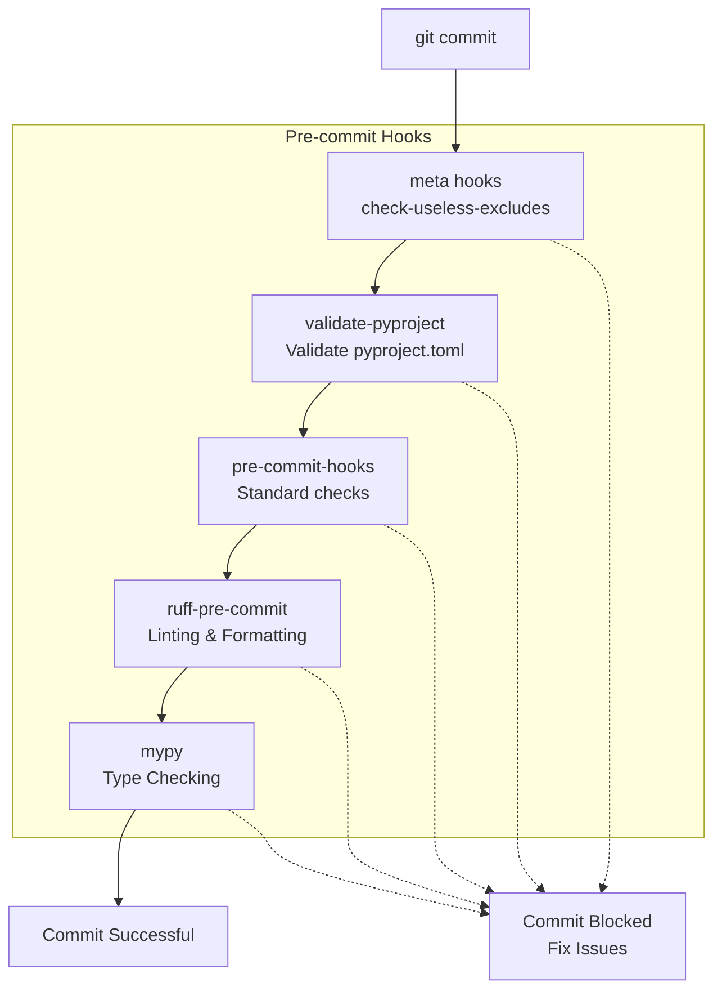
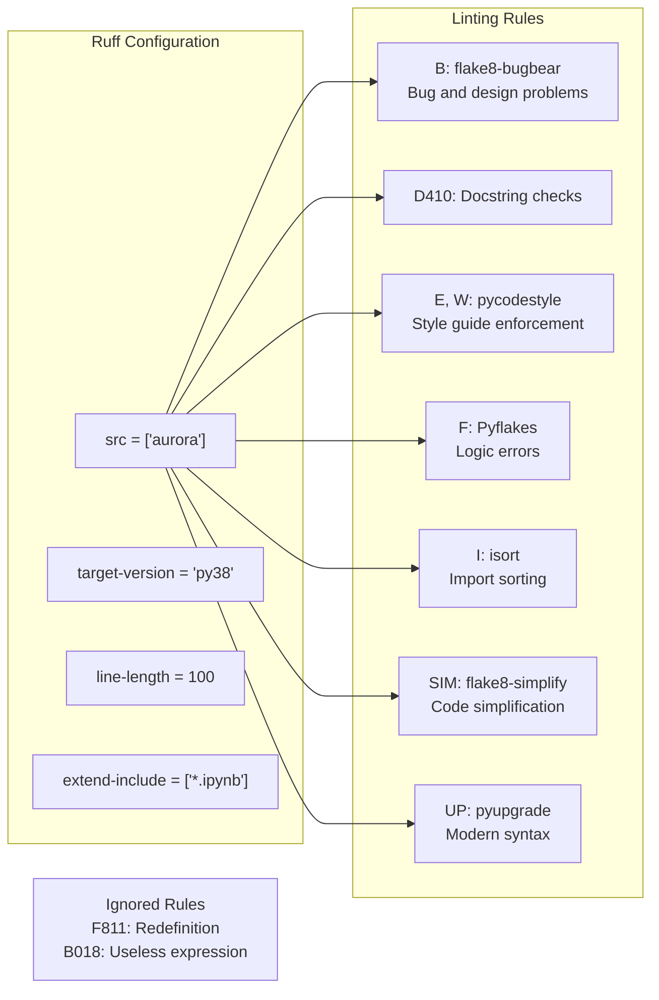
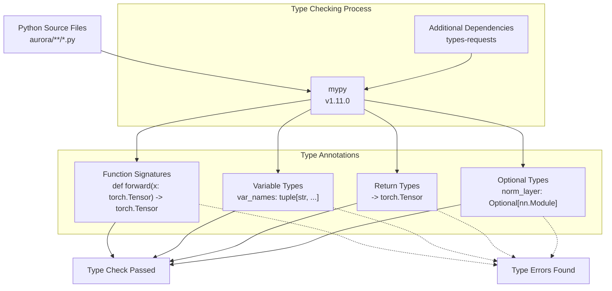
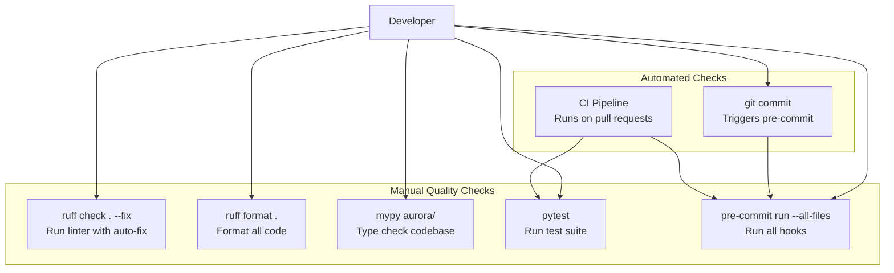
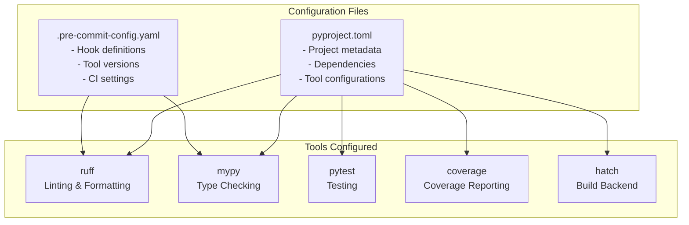

<!-- source: DeepWiki mcp.deepwiki.com · repo microsoft/aurora · page 7.2 Code Quality · fetched 2026-10-26 -->

# Code Quality

<details>
<summary>Relevant source files</summary>

The following files were used as context for generating this wiki page:

- [.pre-commit-config.yaml](.pre-commit-config.yaml)
- [aurora/model/patchembed.py](aurora/model/patchembed.py)
- [aurora/model/posencoding.py](aurora/model/posencoding.py)
- [docs/example_hres_0.1.ipynb](docs/example_hres_0.1.ipynb)
- [pyproject.toml](pyproject.toml)

</details>


This page documents the code quality standards, tooling, and automation used in the Aurora codebase. It covers linting, type checking, code formatting, and pre-commit hooks that enforce these standards.

For information about running tests and test infrastructure, see [Testing](#7.1). For information about setting up the development environment for fine-tuning, see [Fine-tuning](#5).

## Overview

Aurora maintains code quality through a combination of automated tooling and pre-commit hooks. The primary tools are:

- **ruff**: Fast Python linter and formatter
- **mypy**: Static type checker
- **pre-commit**: Framework for managing pre-commit hooks
- **pytest**: Testing framework with coverage reporting

All tools are configured in [pyproject.toml]() and [.pre-commit-config.yaml](), and are automatically installed when using the `dev` optional dependencies.

## Pre-commit Hooks

### Hook Configuration

The pre-commit hooks are defined in [.pre-commit-config.yaml:1-45]() and run automatically before each commit to enforce code quality standards.



**Pre-commit Hook Stages**

Sources: [.pre-commit-config.yaml:1-45]()

### Standard Checks

The standard pre-commit hooks from `pre-commit-hooks` repository [.pre-commit-config.yaml:15-26]() perform the following validations:

| Hook | Purpose | Configuration |
|------|---------|---------------|
| `check-added-large-files` | Prevents commits of files larger than 2MB | `--maxkb=2000` |
| `check-case-conflict` | Detects files with case-only naming conflicts | None |
| `check-merge-conflict` | Ensures no merge conflict markers remain | None |
| `check-yaml` | Validates YAML syntax | None |
| `debug-statements` | Detects leftover debug statements | None |
| `end-of-file-fixer` | Ensures files end with newline | None |
| `mixed-line-ending` | Detects mixed line endings | None |
| `trailing-whitespace` | Removes trailing whitespace | None |

Sources: [.pre-commit-config.yaml:15-26]()

### Installation and Usage

Install pre-commit hooks:

```bash
pip install -e ".[dev]"
pre-commit install
```

The hooks run automatically on `git commit`. To run manually:

```bash
# Run on all files
pre-commit run --all-files

# Run on staged files only
pre-commit run

# Update hook versions
pre-commit autoupdate
```

Sources: [pyproject.toml:50-62](), [.pre-commit-config.yaml:1-45]()

## Linting with Ruff

### Ruff Configuration

Ruff is a fast Python linter and formatter written in Rust. The configuration is specified in [pyproject.toml:90-113]().



**Ruff Linting Architecture**

Sources: [pyproject.toml:90-113]()

### Selected Rules

The following rule categories are enabled [pyproject.toml:97-105]():

- **B** (`flake8-bugbear`): Catches common bugs and design problems
- **D410**: Specific docstring formatting checks
- **E, W** (`pycodestyle`): PEP 8 style guide enforcement
- **F** (`Pyflakes`): Detects various Python errors
- **I** (`isort`): Ensures imports are properly sorted
- **SIM** (`flake8-simplify`): Suggests simpler code alternatives
- **UP** (`pyupgrade`): Upgrades syntax for newer Python versions

Ignored rules [pyproject.toml:106]():
- **F811**: Redefinition of unused name (common in test fixtures)
- **B018**: Useless expression (sometimes needed for type hints)

### Code Formatting

Ruff also handles code formatting [pyproject.toml:111-112]():

- **Line length**: Maximum 100 characters
- **Docstring code formatting**: Enabled for code blocks in docstrings
- **Target**: Python 3.8+ syntax
- **Jupyter notebooks**: Formatting extends to `.ipynb` files

Sources: [pyproject.toml:90-113](), [.pre-commit-config.yaml:28-37]()

### Usage

```bash
# Run linter with auto-fix
ruff check . --fix

# Run formatter
ruff format .

# Check specific file
ruff check aurora/model/patchembed.py
```

In pre-commit, ruff runs with the `--fix` and `--show-fixes` flags [.pre-commit-config.yaml:34]() to automatically fix issues where possible.

Sources: [.pre-commit-config.yaml:28-37](), [pyproject.toml:90-113]()

## Type Checking with Mypy

### Mypy Configuration

Mypy performs static type checking to catch type-related errors before runtime. It is configured in the pre-commit hooks [.pre-commit-config.yaml:39-44]().



**Mypy Type Checking Flow**

Sources: [.pre-commit-config.yaml:39-44]()

### Type Annotation Examples

The codebase uses comprehensive type annotations. Example from [aurora/model/patchembed.py:18-38]():

```python
def __init__(
    self,
    var_names: tuple[str, ...],
    patch_size: int,
    embed_dim: int,
    history_size: int = 1,
    norm_layer: Optional[nn.Module] = None,
    flatten: bool = True,
) -> None:
```

Return type annotations from [aurora/model/patchembed.py:79-90]():

```python
def forward(self, x: torch.Tensor, var_names: tuple[str, ...]) -> torch.Tensor:
    """Run the embedding.
    
    Args:
        x (:class:`torch.Tensor`): Tensor to embed of a shape of `(B, V, T, H, W)`.
        var_names (tuple[str, ...]): Names of the variables in `x`.
    
    Returns:
        :class:`torch.Tensor`: Embedded tensor a shape of `(B, L, D])`.
    """
```

Complex type annotations from [aurora/model/posencoding.py:61-67]():

```python
def pos_scale_enc_grid(
    encode_dim: int,
    grid: torch.Tensor,
    patch_dims: tuple,
    pos_expansion: FourierExpansion,
    scale_expansion: FourierExpansion,
) -> tuple[torch.Tensor, torch.Tensor]:
```

Sources: [aurora/model/patchembed.py:18-90](), [aurora/model/posencoding.py:61-67]()

### Running Mypy

```bash
# Run mypy manually
mypy aurora/

# Run through pre-commit
pre-commit run mypy --all-files
```

Mypy requires the `types-requests` package for type stubs [.pre-commit-config.yaml:44](), which is automatically included in the pre-commit configuration.

Sources: [.pre-commit-config.yaml:39-44]()

## Code Style Standards

### Import Organization

Imports are organized using `isort` through ruff [pyproject.toml:108-109]():

```python
# Standard library
import math
from typing import Optional

# Third-party packages
import torch
import torch.nn as nn
import torch.nn.functional as F
from timm.layers import to_2tuple

# Local imports (aurora package)
from aurora.model.fourier import FourierExpansion
```

The `known-local-folder` setting [pyproject.toml:109]() ensures `aurora` imports are properly categorized.

Sources: [aurora/model/patchembed.py:1-12](), [aurora/model/posencoding.py:1-12](), [pyproject.toml:108-109]()

### Docstring Conventions

All public APIs use comprehensive docstrings with Args, Returns, and optionally Raises sections:

```python
def forward(self, x: torch.Tensor, var_names: tuple[str, ...]) -> torch.Tensor:
    """Run the embedding.

    Args:
        x (:class:`torch.Tensor`): Tensor to embed of a shape of `(B, V, T, H, W)`.
        var_names (tuple[str, ...]): Names of the variables in `x`. The length should be equal
            to `V`.

    Returns:
        :class:`torch.Tensor`: Embedded tensor a shape of `(B, L, D]) if flattened,
            where `L = H * W / P^2`. Otherwise, the shape is `(B, D, H', W')`.
    """
```

Docstrings include:
- Clear description of functionality
- Type hints in docstring format (`:class:`torch.Tensor``)
- Detailed shape information for tensors
- Default values and optional behaviors

Sources: [aurora/model/patchembed.py:79-90](), [aurora/model/posencoding.py:22-35]()

### Module-Level Documentation

Each module includes copyright and attribution information [aurora/model/patchembed.py:1]():

```python
"""Copyright (c) Microsoft Corporation. Licensed under the MIT license."""
```

When code is inspired by external sources, attribution is provided [aurora/model/posencoding.py:1-6]():

```python
"""Copyright (c) Microsoft Corporation. Licensed under the MIT license.

Parts of this code are inspired by

    https://github.com/microsoft/ClimaX/blob/6d5d354ffb4b91bb684f430b98e8f6f8af7c7f7c/src/climax/utils/pos_embed.py
"""
```

Sources: [aurora/model/patchembed.py:1](), [aurora/model/posencoding.py:1-6]()

## Development Workflow

### Setting Up Development Environment

```bash
# Clone repository
git clone https://github.com/microsoft/aurora
cd aurora

# Install with development dependencies
pip install -e ".[dev]"

# Install pre-commit hooks
pre-commit install
```

The `dev` optional dependencies [pyproject.toml:50-62]() include all necessary tooling:

| Package | Purpose |
|---------|---------|
| `pytest` | Testing framework |
| `pytest-cov` | Coverage reporting |
| `mypy` | Type checking |
| `ruff==0.4.1` | Linting and formatting |
| `pre-commit` | Pre-commit hook management |
| `requests_mock` | HTTP request mocking for tests |
| `jupyter-book` | Documentation generation |
| `mlflow` | Experiment tracking |

Sources: [pyproject.toml:50-62]()

### Quality Check Commands



**Code Quality Check Workflow**

Sources: [pyproject.toml:50-62](), [.pre-commit-config.yaml:1-45]()

### Continuous Integration

The pre-commit configuration [.pre-commit-config.yaml:1-3]() includes CI-specific settings:

```yaml
ci:
  autoupdate_commit_msg: "chore: Update pre-commit hooks"
  autofix_commit_msg: "style: Pre-commit fixes"
```

This enables automatic updates and fixes when using pre-commit CI services.

Sources: [.pre-commit-config.yaml:1-3]()

## Python Version and Dependencies

### Version Requirements

The project requires Python 3.10+ [pyproject.toml:35]():

```toml
requires-python = ">=3.10"
```

However, ruff is configured to target Python 3.8+ syntax [pyproject.toml:92]() for broader compatibility:

```toml
target-version = "py38"
```

### Core Dependencies

Runtime dependencies [pyproject.toml:36-47]() include:

- `numpy`: Numerical computations
- `scipy`: Scientific computing
- `torch`: Deep learning framework
- `einops`: Tensor operations
- `timm`: PyTorch image models
- `huggingface-hub`: Model checkpoint management
- `pydantic`: Data validation
- `xarray`: Labeled multi-dimensional arrays
- `netcdf4`: NetCDF file handling
- `azure-storage-blob`: Azure Blob Storage integration

Sources: [pyproject.toml:35-47]()

## Jupyter Notebook Quality

### Notebook Linting

Ruff extends to Jupyter notebooks through the `extend-include` configuration [pyproject.toml:94]():

```toml
extend-include = ["*.ipynb"]
```

This ensures that code in example notebooks (e.g., [docs/example_hres_0.1.ipynb]()) follows the same quality standards as the main codebase.

The pre-commit ruff hooks explicitly handle notebooks [.pre-commit-config.yaml:33-37]():

```yaml
- id: ruff
  types_or: [python, pyi, jupyter]
  args: ["--fix", "--show-fixes"]
- id: ruff-format
  types_or: [python, pyi, jupyter]
```

Sources: [pyproject.toml:94](), [.pre-commit-config.yaml:28-37]()

### Notebook Best Practices

Example notebooks demonstrate:
- Clear markdown documentation
- Executable code cells with outputs
- Proper error handling
- Integration with Aurora's API

Sources: [docs/example_hres_0.1.ipynb]()

## Configuration Files Summary



**Configuration File Structure**

Sources: [pyproject.toml:1-113](), [.pre-commit-config.yaml:1-45]()

### pyproject.toml Sections

| Section | Purpose | Lines |
|---------|---------|-------|
| `[build-system]` | Build backend configuration (hatchling) | [1-3]() |
| `[project]` | Package metadata, dependencies | [5-65]() |
| `[tool.hatch.*]` | Build and version configuration | [67-74]() |
| `[tool.coverage.run]` | Test coverage settings | [76-79]() |
| `[tool.pytest.ini_options]` | Pytest configuration | [81-88]() |
| `[tool.ruff]` | Ruff linter configuration | [90-94]() |
| `[tool.ruff.lint]` | Linting rules selection | [96-106]() |
| `[tool.ruff.lint.isort]` | Import sorting configuration | [108-109]() |
| `[tool.ruff.format]` | Code formatting settings | [111-112]() |

Sources: [pyproject.toml:1-113]()

---

