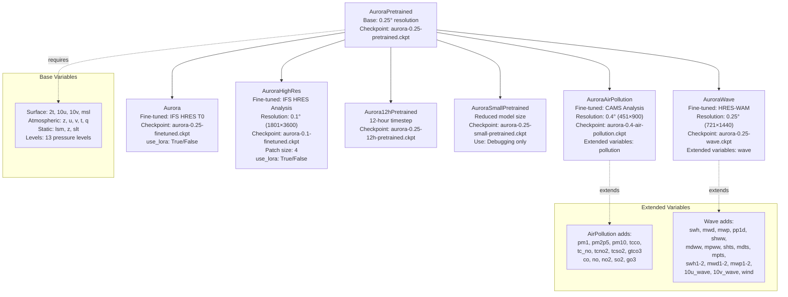
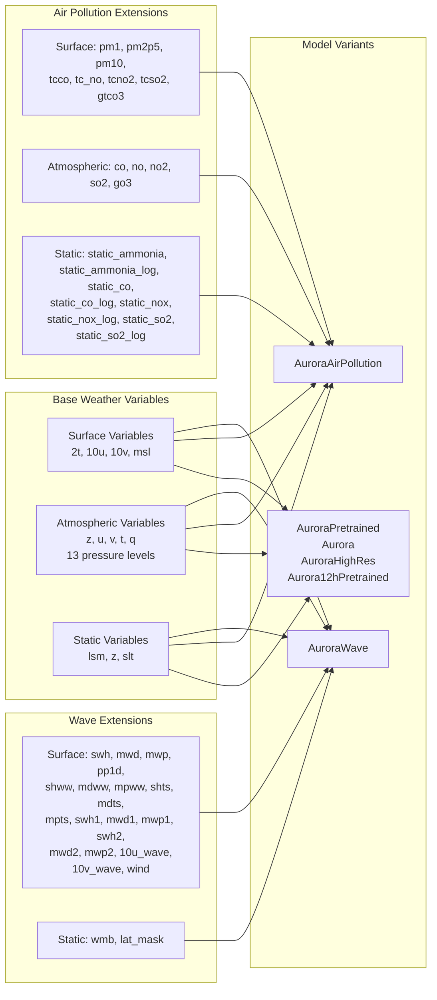

<!-- source: DeepWiki mcp.deepwiki.com · repo microsoft/aurora · page 8 Reference · fetched 2026-10-26 -->

# Reference

<details>
<summary>Relevant source files</summary>

The following files were used as context for generating this wiki page:

- [README.md](README.md)
- [docs/gifs/tc_tracks.gif](docs/gifs/tc_tracks.gif)
- [docs/intro.md](docs/intro.md)
- [docs/models.md](docs/models.md)
- [docs/usage.md](docs/usage.md)

</details>


This section provides technical reference documentation for Aurora, including detailed specifications of model variants, their data requirements, and known limitations. This material is intended for users who need precise technical details for implementation, troubleshooting, or understanding model behavior.

For step-by-step usage instructions, see [Getting Started](#4.1). For architectural details, see [Model Architecture](#2). For specific implementation examples, see the Usage Guide pages under section [4](#4).

## Overview

The Reference section contains:

- **[Model Variants Specification](#8.1)**: Complete technical specifications for each model variant, including required variables, pressure levels, resolutions, checkpoint files, and static variable requirements
- **[Caveats and Limitations](#8.2)**: Known limitations, edge cases, dataset-specific performance characteristics, and responsible AI considerations

## Model Family Structure

Aurora consists of a base pretrained model and several specialized variants. The following diagram shows the relationship between model classes, their training progression, and key configuration parameters.

**Diagram: Aurora Model Variants and Specialization Hierarchy**



**Sources:** [docs/models.md:1-322](), [README.md:50-60]()

## Model Variant Quick Reference

The following table provides a quick comparison of all available Aurora model variants:

| Model Class | Resolution | Grid Size | Target Dataset | LoRA Support | Checkpoint File | Static Variables File |
|------------|------------|-----------|----------------|--------------|-----------------|----------------------|
| `AuroraPretrained` | 0.25° | 721×1440 | ERA5, various | N/A | `aurora-0.25-pretrained.ckpt` | `aurora-0.25-static.pickle` |
| `Aurora` | 0.25° | 721×1440 | IFS HRES T0 | Yes | `aurora-0.25-finetuned.ckpt` | `aurora-0.25-static.pickle` |
| `AuroraHighRes` | 0.1° | 1801×3600 | IFS HRES Analysis | Yes | `aurora-0.1-finetuned.ckpt` | `aurora-0.1-static.pickle` |
| `AuroraAirPollution` | 0.4° | 451×900 | CAMS Analysis | No | `aurora-0.4-air-pollution.ckpt` | `aurora-0.4-air-pollution-static.pickle` |
| `AuroraWave` | 0.25° | 721×1440 | HRES-WAM + HRES T0 | No | `aurora-0.25-wave.ckpt` | `aurora-0.25-wave-static.pickle` |
| `Aurora12hPretrained` | 0.25° | 721×1440 | ERA5, various | N/A | `aurora-0.25-12h-pretrained.ckpt` | `aurora-0.25-static.pickle` |
| `AuroraSmallPretrained` | 0.25° | 721×1440 | ERA5, various | N/A | `aurora-0.25-small-pretrained.ckpt` | `aurora-0.25-static.pickle` |

**Sources:** [docs/models.md:1-322]()

## Data Requirements Across Variants

The following diagram shows the data requirements for each model variant, distinguishing between base requirements and extended requirements for specialized models.

**Diagram: Variable Requirements by Model Variant**



**Sources:** [docs/models.md:28-316]()

## Pressure Levels

All Aurora model variants use the same 13 standard pressure levels for atmospheric variables:

| Level | Pressure (hPa) |
|-------|---------------|
| 1 | 50 |
| 2 | 100 |
| 3 | 150 |
| 4 | 200 |
| 5 | 250 |
| 6 | 300 |
| 7 | 400 |
| 8 | 500 |
| 9 | 600 |
| 10 | 700 |
| 11 | 850 |
| 12 | 925 |
| 13 | 1000 |

**Sources:** [docs/models.md:35-35](), [docs/models.md:94-94](), [docs/models.md:147-147](), [docs/models.md:190-190](), [docs/models.md:269-269](), [docs/models.md:315-315]()

## Checkpoint and Static Variable Locations

All model checkpoints and static variables are distributed via the HuggingFace repository `microsoft/aurora`. The following diagram shows the mapping between model classes and their required files.

**Diagram: Model Files and HuggingFace Repository Structure**

```mermaid
graph TB
    HF["HuggingFace Repository<br/>microsoft/aurora"]
    
    HF --> CP1["aurora-0.25-pretrained.ckpt"]
    HF --> CP2["aurora-0.25-finetuned.ckpt"]
    HF --> CP3["aurora-0.1-finetuned.ckpt"]
    HF --> CP4["aurora-0.4-air-pollution.ckpt"]
    HF --> CP5["aurora-0.25-wave.ckpt"]
    HF --> CP6["aurora-0.25-12h-pretrained.ckpt"]
    HF --> CP7["aurora-0.25-small-pretrained.ckpt"]
    
    HF --> SV1["aurora-0.25-static.pickle"]
    HF --> SV2["aurora-0.1-static.pickle"]
    HF --> SV3["aurora-0.4-air-pollution-static.pickle"]
    HF --> SV4["aurora-0.25-wave-static.pickle"]
    
    CP1 -.loaded by.-> M1["AuroraPretrained"]
    CP2 -.loaded by.-> M2["Aurora"]
    CP3 -.loaded by.-> M3["AuroraHighRes"]
    CP4 -.loaded by.-> M4["AuroraAirPollution"]
    CP5 -.loaded by.-> M5["AuroraWave"]
    CP6 -.loaded by.-> M6["Aurora12hPretrained"]
    CP7 -.loaded by.-> M7["AuroraSmallPretrained"]
    
    SV1 -.required by.-> M1
    SV1 -.required by.-> M2
    SV1 -.required by.-> M6
    SV1 -.required by.-> M7
    SV2 -.required by.-> M3
    SV3 -.required by.-> M4
    SV4 -.required by.-> M5
```



**Sources:** [docs/models.md:43-43](), [docs/models.md:102-102](), [docs/models.md:155-155](), [docs/models.md:197-197](), [docs/models.md:275-275](), [docs/models.md:321-321]()

## Model Loading Patterns

Aurora models follow a consistent loading pattern:

```python
from aurora import ModelClass

# Initialize model
model = ModelClass()

# Load checkpoint (downloads automatically from HuggingFace)
model.load_checkpoint()

# Set to evaluation mode
model.eval()

# Optional: Move to GPU
model = model.to("cuda")
```

For models with LoRA support (`Aurora`, `AuroraHighRes`), LoRA can be disabled:

```python
from aurora import Aurora

# Disable LoRA for more realistic samples at the expense of slightly higher MSE
model = Aurora(use_lora=False)
model.load_checkpoint(strict=False)  # Use strict=False when disabling LoRA
```

**Sources:** [docs/models.md:12-17](), [docs/models.md:70-74](), [docs/models.md:114-122](), [docs/models.md:228-234]()

## Input and Output Shape Conventions

Aurora expects inputs in the `Batch` format with specific tensor shapes:

| Variable Type | Shape | Description |
|--------------|-------|-------------|
| Surface variables | `(B, H, lat, lon)` | B=batch size, H=2 (history length) |
| Atmospheric variables | `(B, H, L, lat, lon)` | L=number of pressure levels (13) |
| Static variables | `(lat, lon)` | No batch or history dimension |
| Metadata latitude | `(lat,)` | Descending order (90° to -90°) |
| Metadata longitude | `(lon,)` | Ascending order (0° to 360°) |
| Metadata time | `(B,)` | Tuple of `datetime` objects |
| Metadata atmos_levels | `(L,)` | Tuple of pressure levels in hPa |

The model outputs predictions for the next timestep in the same `Batch` format.

**Sources:** [docs/usage.md:46-66]()

## Hardware Requirements

Running Aurora models requires significant computational resources:

| Model Variant | Minimum GPU Memory | Recommended Use Case |
|--------------|-------------------|---------------------|
| `AuroraSmallPretrained` | ~5 GB | Debugging, testing |
| `AuroraPretrained` | ~40 GB | Global 0.25° predictions |
| `Aurora` | ~40 GB | Global 0.25° predictions |
| `AuroraHighRes` | ~100+ GB | Global 0.1° predictions |
| `AuroraAirPollution` | ~25 GB | Global 0.4° predictions |
| `AuroraWave` | ~40 GB | Global 0.25° predictions |

These estimates are for inference with `torch.inference_mode()`. Training and fine-tuning require significantly more memory and benefit from activation checkpointing and automatic mixed precision.

**Sources:** [docs/usage.md:123-124]()

## Related Documentation

For detailed information on specific topics:

- **Complete model specifications**: See [Model Variants Specification](#8.1) for exhaustive lists of required variables and configurations
- **Known issues and limitations**: See [Caveats and Limitations](#8.2) for responsible AI considerations and dataset-specific behaviors
- **Usage examples**: See [Getting Started](#4.1) and related usage guides
- **Architecture details**: See [Model Architecture](#2) and its subsections

**Sources:** [README.md:1-200](), [docs/intro.md:1-38](), [docs/models.md:1-322]()

---

